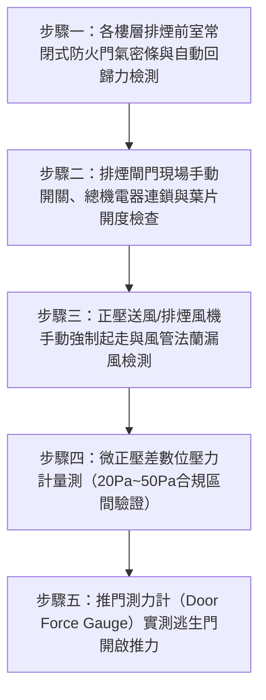

# 全案購屋實戰第二百六十四部：中古大樓社區各樓層消防排煙室正壓送風防煙閘門熔絲連鎖風壓風量衰減與前室微正壓壓差計體檢工序全書

## 壹、前言與防護戰略意義

在現代集合住宅高層建築的消防生命防護體系中，火災發生時致死率最高的核心元兇並非明火灼燒，而是沿著安全逃生梯間、管道間與走道迅速蔓延的「高溫劇毒濃煙」。依據我國建築技術規則建築設計施工編及各類場所消防安全設備設置標準，超過一定規模與高層之集合住宅，通往避難安全梯之過渡空間必須規劃為「排煙室」或「緊急昇降機間之前室（Smoke Lobby / Ante-Room）」。

排煙室之防煙設計通常採取兩大關鍵工程手段之一（或兩者聯鎖配置）：
1. **機械排煙系統**：透過各樓層排煙閘門（Smoke Damper）開啟，由排煙風機強制抽吸前室之濃煙排出戶外。
2. **特別安全梯與緊急昇降機間正壓送風系統（Pressurization Smoke Control System）**：由地下室或頂樓之大型正壓送風風機將戶外新鮮空氣強行灌入梯間與前室，使梯間及前室維持高於火災火場區域 $20 \sim 50\,\text{Pa}$ 之「微正壓（Positive Differential Pressure）」，形成無形之氣壓屏障，徹底阻絕毒煙滲入逃生核心動線。

然而，在台中南區與南屯區屋齡 25 至 30 年以上的中古集合住宅（例如：大安紫金城、長億南園、歌德堡、靜園 A 區等社區），排煙室與特別安全梯正壓防煙系統普遍存在極度嚴重的「系統性假性合格」隱患：
1. **正壓送風風道或排煙風管法蘭嚴重漏風，末端動壓歸零**：高樓層或低樓層排煙室實測正壓差甚至不到 $5\,\text{Pa}$，火災時門一推開毒煙瞬間倒灌滅頂。
2. **排煙閘門易熔片（Fusible Link）金屬疲勞脆斷、傳動鋼索卡死**：平日因管壁震動或灰塵積結造成閘門誤關閉或無法由消防總機電器連鎖自動彈開。
3. **前室常閉式防火門自動回歸鉸鏈扭力衰退，無法抵抗風壓緊密閉合**：正壓送風啟動時產生之風壓使防火門產生數公分之門縫洩壓，或反之因氣壓過高導致長輩與孩童「推不開逃生門」。

本專書為「小寶置產全案防護體系」第二百六十四部，旨在建立一套針對中古集合住宅排煙前室正壓送風壓差測定、排煙閘門熔絲與電器連動、防火門開門推力測量及排煙室氣密性的全維度工程體檢工序，捍衛家庭成員火災逃生時的絕對呼吸通道，並轉化為對賣方與管委會強力議價的實體技術鐵證。

---

## 貳、排煙室與正壓送風防煙系統核心失效機理

### 一、正壓壓差失調與門扇推力超標機理
1. **正壓差過低（$< 20\,\text{Pa}$）導致毒煙滲透**：
   - 梯間與前室的正壓值若低於 $20\,\text{Pa}$，在火災產生熱浮力（Stack Effect）與高溫氣體熱膨脹壓力下，微正壓屏障形同虛設，濃煙會迅速穿透防火門邊縫與鎖孔，將逃生梯充斥致死毒氣。
2. **正壓差過高（$> 50\,\text{Pa}$）導致逃生門卡死**：
   - 若系統未安裝自動洩壓閘門（Barometric Relief Damper）或風機變頻壓差控制器，當所有防火門閉合時，前室氣壓急遽飆升至 $80 \sim 100\,\text{Pa}$。
   - 依據人體工學與建築法規，逃生防火門之手動開啟推力不得超過 $110\,\text{N}$（約 $11.2\,\text{kgf}$）。若壓差過大，門扇受氣壓緊緊吸附，婦幼老弱在極度恐慌中根本無法推開逃生門，慘遭反鎖於火場燒死。

### 二、排煙風道漏風與風量衰減機理
1. **鍍鋅鐵皮風管咬口開裂與角鐵法蘭墊片粉化**：
   - 25 年老舊風管長期承受送風震動與冷熱交替，風管插條咬口產生鬆動隙縫，法蘭密封墊片老化碎裂。送風機送出之風量在垂直豎井中沿途大量洩漏，到達最不利樓層時風量衰減超過 $60\%$。
2. **豎井（Shaft）混凝土內壁未粉刷開裂**：
   - 早期部分中古大樓以 RC 砌磚管道間直接作為正壓風道（無內襯鐵皮風管）。磚石砂漿長期風化脫落，大量空氣直接經由管道間牆體裂縫滲入電梯機房或私人戶內，前室根本無法蓄積正壓。

### 三、排煙閘門（SD）機械機構與電器控制卡阻
1. **微動開關接點氧化與電磁螺線管（Solenoid）燒燬**：
   - 消防受訊總機發出火警啟動信號時，排煙閘門之 DC 24V 釋放電磁閥因長年潮濕氧化卡死無法脫扣，彈簧無法釋放帶動葉片旋轉開啟。
2. **葉片轉軸積碳與連桿變形**：
   - 閘門百葉轉軸缺乏高溫潤滑矽油，葉片邊緣與外框摩擦咬死；開關位置信號微動開關未導通，造成中央消防總機無法連鎖啟動排煙送風機。

---

## 參、實地現場勘驗五步檢測工序

### 步驟一：排煙室防火門氣密與閉合機構體檢
1. **遮煙條（Smoke Seal）與防火膨脹密封條檢驗**：
   - 檢視排煙室防火門框四周是否安裝耐候阻燃矽膠氣密條。
   - 以名片或紙張夾於門縫處，門扇閉合後嘗試抽取紙張，各處均應有明顯阻力，證明氣密條壓實無缺損。
2. **地彈簧/閉門器（Door Closer）回歸力校準**：
   - 將門扇推開至 $90^\circ$ 釋放，門扇應能在 5 至 8 秒內平穩均勻閉合，並在鎖舌撞擊受口時順利卡入「上鎖狀態」，絕不可有半開虛掩之現象。

### 步驟二：排煙閘門手動與電器動作檢測
1. **現場手動手柄釋放測試**：
   - 扳動排煙閘門面板上之「手動測試拉鈕」或連桿。
   - 觀察閘門內部百葉片是否在 1 秒內迅速平順旋轉至 $90^\circ$ 全開位置；開啟過程中不可有尖銳摩擦金屬聲或卡頓。
2. **手動復位（Reset）與信號回授**：
   - 使用專用復位扳手將閘門葉片旋轉推回鎖定。
   - 與一樓管理室以無線電確認：閘門開啟時消防總機對應分區之「排煙口開啟」指示紅燈應即刻點亮，復位後紅燈熄滅。

### 步驟三：正壓送風風機連鎖起走與風道檢測
1. **消防聯鎖強制起走測試**：
   - 由消防總機或地下室/頂樓正壓送風機控制箱手動啟動風機。
   - 檢測風機運轉聲音平順度，三相電流是否在銘牌額定值以內；風道出風口柔性帆布接頭是否充飽且無撕裂破損。
2. **垂直風道豎井漏風檢查**：
   - 於各樓層管道間檢修門處，感受有無強烈涼風噴出。若檢修門縫有明顯風切氣流，代表豎井內部管線未做密封封堵。

### 步驟四：數位微壓差計（Micromanometer）精密量測
1. **前室與火災走道微正壓量測**：
   - 將排煙室通往走道之防火門全數緊密關閉，正壓送風機處於全速運轉狀態。
   - 將高精度數位微壓差計之高壓端（$+$）軟管置於排煙前室內，低壓端（$-$）軟管穿過門底縫伸至走道外側。
   - 讀取壓差數值：
     $$20\,\text{Pa} \le \Delta P \le 50\,\text{Pa}$$
   - 若 $\Delta P < 20\,\text{Pa}$，顯示送風量嚴重不足或漏風過甚；若 $\Delta P > 50\,\text{Pa}$，顯示自動洩壓裝置卡死。

### 步驟五：逃生門扇手動開啟推力實測
1. **推拉力計（Force Gauge）測試**：
   - 在正壓送風全開、門扇內外維持最高正壓差之狀態下，將推拉力計勾住或頂住門把手邊緣（距門軸最遠端）。
   - 緩慢施力垂直推開門扇，記錄門扇脫離門框瞬間的最大峰值推力（$F_{\text{push}}$）。
2. **法規合規判定**：
   $$F_{\text{push}} \le 110\,\text{N} \quad (\approx 11.2\,\text{kgf})$$
   - 若測得推力大於 $130\,\text{N}$，代表火災時孩童與年長者將無法推開逃生門，管委會必須立即調降送風壓或校正自動洩壓百葉。

---

## 肆、全案四棟核心考慮物件排煙前室體檢實戰

| 考慮社區 | 逃生梯間與排煙室型態 | 現場勘驗要點與潛在風險 | 談判籌碼與合約特約防線 |
| :--- | :--- | :--- | :--- |
| **大安紫金城 13 樓 (`PROP_10`)** | 13 樓位居高樓層，極度依賴排煙前室與特別安全梯逃生 | 1. 13 樓前室常閉式防火門是否因前屋主改 4 間套房進出頻繁而遭人為常開卡死，或閉門器拆除。 2. 13 樓排煙閘門開啟信號回授是否正常。 | 以「高樓層排煙前室防火門破損與風道漏風，逃生安全存重大瑕疵，需耗資修復」為籌碼，併同 50 萬拆除復原款，重砍 898 萬開價，堅定鎖定 768~788 萬。 |
| **長億南園 8 樓 (`PROP_106`)** | 社區樓高約 12~14 層，8 樓梯間排煙窗多採自然排煙 | 1. 8 樓梯間自然排煙窗開關手柄是否鏽蝕卡死無法由地面拉動開啟。 2. 逃生梯間防火門氣密條是否完全粉化脫落。 | 直指老舊大樓逃生梯防排煙功能退化、火災煙囪效應極其致命之結構性缺點，狠砍 200 萬，出價 745~760 萬。 |
| **歌德堡 8 樓** | 特別安全梯動線清晰，排煙前室配置完善 | 1. 檢視排煙室防火門開關平順度與遮煙條完整性。 2. 壓差計量測前室微正壓是否穩定合規。 | 精裝優質標的，確認排煙防煙設備完全合規，作為家人安全無可挑剔之核心資產對照組。 |
| **靜園 A 區 11 樓** | 11 樓高樓層雙拼格局，梯間採光良好 | 1. 梯間對外排煙窗連桿機構靈敏度。 2. 排煙室防火門閉合推力是否合乎人體工學。 | 作為比價牽制籌碼，藉由標準之防排煙動線壓制其他老舊缺失社區。 |

---

## 伍、買方防護作戰特約條款與自保機制

在正式進入買賣斡旋與簽訂要約書時，應在不動產買賣契約補充協議中明確載明：

> **【公共逃生避難梯間與排煙室消防安全合規特約條款】**  
> 「賣方保證本契約標的物所在樓層及社區公共之特別安全梯、排煙室、排煙閘門及常閉式防火門系統運作正常，且完全符合現行消防與建築安全法規標準，無防火門無法自動回歸、排煙閘門故障卡阻或排煙風道嚴重漏風失效之情事。若簽約至交屋期間經專業消防安檢發現本標的所在樓層逃生防煙系統存在重大不合格項目，賣方應促使管委會或自行負責於交屋日前修繕復原至合格驗收狀態；若逾期未改善，買方得主張自買賣尾款中暫扣新台幣伍萬元整作為修繕準備金。」

---

## 陸、結論與行動指引

特別安全梯與排煙室是火災肆虐時保護全家生命的「最後安全氣囊」。正壓微壓差過低將招致毒煙滅頂，壓差過高則造成門扇卡死無路可逃。透過本工序之精確儀器檢測，買方不僅能為全家築起堅不可摧的火災逃生屏障，更能精準洞察大樓公共消防與物業維護的真實功力，將隱藏的消防瑕疵轉化為談判桌上的定錨重鎚！
