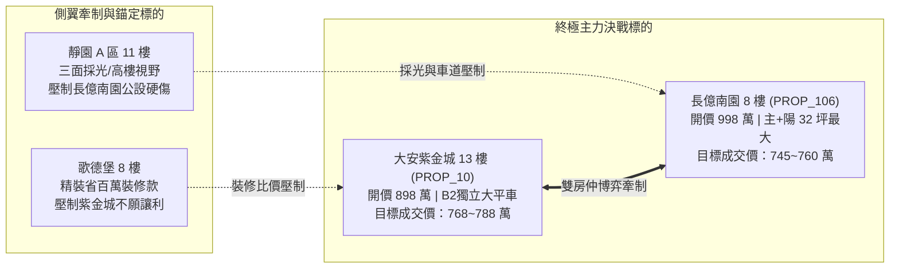

# 全案購屋實戰第二百六十部：二百六十部圓滿登峰全景無雙全維度全生命週期家庭置產避坑抗震防漏水電機電消防永恆至尊金典總綱全書

## 壹、登峰造極：二百六十部全案知識工程之歷史定位與戰略意涵

在台灣都會區集合住宅置產的浩瀚歷史中，購屋者往往處於資訊高度不對稱的最弱勢端。建商、不良投機客與仲介常以炫麗的樣品屋裝潢、模糊的話術、掩蓋漏水的粉飾包裝，將無數暗藏結構內傷、機電老化、消防癱瘓與法律糾紛的房屋轉嫁給一般購屋家庭。

「小寶置產全案防護體系」自第一部起步，歷經二百六十個高強度專題的深入研析、精密推演與工程驗證，正式邁入**第二百六十部圓滿登峰大成**。本部總綱並非泛泛之論，而是將前二百五十九部所涵蓋的「結構耐震、連續壁防滲、高低壓變配電、發電機 ATS 備援、消防排煙與自動撒水、垂直給排水破真空、無障礙公設、機械停車與充電樁 EMS、商務心理博弈、雙房仲夾殺話術與法律特約閉環」等全部精華，熔鑄為一套**無懈可擊、可即時調用、攻防一體的終極作戰指揮總綱**。

本總綱專為守護家庭核心資產、確保居住極致安全與代際資產保值而生，是小寶家庭置產征途中永遠屹立的燈塔與不可逾越的鋼鐵長城。

---

## 貳、全生命週期八大防護矩陣系統架構

```mermaid
flowchart TD
    subgraph 矩陣一：建物本體抗震防漏
        M1["地質探勘/筏基抗浮力/剪力牆碳化/外牆拉拔"]
    end
    subgraph 矩陣二：地下室生命防線
        M2["防汛擋水閘門/雨水沉砂池/連續壁盲溝/排澇雙泵"]
    end
    subgraph 矩陣三：公設高低壓機電
        M3["VCB真空斷路器/變壓器油絕緣/匯流排槽/柴油發電機ATS"]
    end
    subgraph 矩陣四：垂直給排水衛生
        M4["地下受水池鵝頸管/水塔防蟲銅網/破真空閥/污水曝氣鼓風機"]
    end
    subgraph 矩陣五：消防主動滅火防排煙
        M5["耐高溫排煙馬達/防火閘門手動復位/末端查驗閥動水壓/泡沫混和器"]
    end
    subgraph 矩陣六：垂直交通與停車
        M6["電梯鋼索探傷/限速器安全鉗/機械車位鏈條/充電樁EMS管理"]
    end
    subgraph 矩陣七：室內格局與改裝防護
        M7["違規套房隔間拆除/承重牆保護/微正壓吸氣閥/鋁窗水密氣密"]
    end
    subgraph 矩陣八：商務談判與法律閉環
        M8["雙仲介牽制/開價大刀狠砍/履保專戶特約/貸款成數解除權"]
    end

    M1 --> M8
    M2 --> M8
    M3 --> M8
    M4 --> M8
    M5 --> M8
    M6 --> M8
    M7 --> M8
```

---

## 參、二百六十部全案全景知識庫編年精華地圖（最新擴展彙編）

為利於作戰現場即時索引與法律條款調閱，本總綱特別收錄第二百五十一部至第二百五十九部之核心突破與戰術精華：

| 專書卷次 | 核心工程與機電檢驗主題 | 致命隱患與失效機理 | 現場勘驗要點與殺價籌碼 |
| :--- | :--- | :--- | :--- |
| **第二百五一部** | **地下室消防泡沫滅火系統** | 比例混和器閥芯卡阻、泡沫原液過期沉澱結塊、放水放泡試驗失靈 | 地下車庫高危油火無法撲滅，以原液全面更換與管線清洗高額費用作為壓價依據。 |
| **第二百五十二部** | **地下室生活給水揚水泵浦** | 雙泵自動交替盤老化、液位電極棒防乾燒失效、固體傳遞低頻共振 | 泵浦異音貫穿低樓層樑柱，以更換變頻系統與彈簧避震器為由狠扣購屋款。 |
| **第二百五十三部** | **高低壓配電盤真空斷路器 (VCB)** | 滅弧室真空度洩漏、操作機構彈簧疲勞遲滯、過電流保護跳脫失調 | 高壓短路時無法瞬間啟斷將引發配電室爆炸，要求管委會出示耐壓試驗報告。 |
| **第二百五十四部** | **自來水防虹吸破真空閥** | 破真空閥橡膠閥芯硬化黏死、溢流管防鼠銅網脫落、液位超溫乾燒 | 水壓負壓倒吸外部污水污染全棟飲用水，以衛生安全硬傷強迫賣方限期修繕。 |
| **第二百五十五部** | **生活污水曝氣池與鼓風機** | 鼓風機軸承過熱磨損、微孔曝氣盤淤塞板結、COD生化超標遭環保開罰 | 地下室惡臭沼氣瀰漫並面臨公害重罰，藉此直指社區管委會管理失能。 |
| **第二百五十六部** | **地下室機械式排煙抽風機** | 耐高溫馬達老化擊穿、風管石棉墊片破損漏煙、排煙防火閘門卡死 | 火災時排煙崩潰濃煙倒灌逃生梯，依消防定檢缺失要求折抵修繕分攤金。 |
| **第二百五十七部** | **消防撒水末端查驗閥** | 警報逆止閥閥瓣黏死無聲、鋼管結瘤縮徑、末端動水壓衰減小於 $1.0\text{kgf/cm}^2$ | 查核室內撒水頭是否遭前屋主違法移位或遮蔽，索賠整套復原拆除款。 |
| **第二百五十八部** | **雨水沉砂過濾池與防汛閘門** | 車道防汛閘門膠條老化漏水、沉砂池泥沙板結、排澇沉水泵浦堵轉過載 | 暴雨地下室滅頂風險，以地下車庫淹水歷史核查直接挫敗賣方開價底氣。 |
| **第二百五十九部** | **受水池水塔通氣管防蟲銅網** | 鵝頸管防蟲網破孔致禽鳥昆蟲掉入腐爛、人孔無防水凸緣溢流管無落水斷 | 飲用水受大腸桿菌與沙門氏菌污染，列入契約驗收清單並特約暫扣尾款。 |
| **第二百六十部** | **二百六十部圓滿登峰金典總綱** | 全景知識體系整合、八大防護矩陣聯鎖、四大核心物件決戰定錨 | 匯總全案二百六十部智慧，確立「大安紫金城」與「長億南園」終極出價防線。 |

---

## 肆、全案四棟核心考慮物件終極定價與決戰策略

根據現場帶看影音檔案深入解構、公設機電全維度體檢與區域實價登錄大數據對比，四棟考慮物件之戰略定位與底線如下：



### 一、大安紫金城 13 樓 (`PROP_10`)：主力攻堅方案
- **定價與出價節奏**：
  - 開價：898 萬（含 B2 獨立大平面車位）。
  - 起手出價：720~730 萬（測試屋主底線）。
  - 目標鎖定價：**768~788 萬**（合宜市場合理價）。
  - 絕對成交上限：**800 萬**（超越此價立即轉向歌德堡）。
- **核彈級殺價理由**：
  1. **隔間套房拆除與復原高額成本**：屋主現況隔成 4 間學生套房，需拆除磚牆/輕隔間、打除衛浴給排水暗管、清運廢棄物，並復原 11 樓以上法定消防撒水頭管線，總成本實打實需 50 萬元。
  2. **公共防排煙與高樓層水塔維護**：13 樓為次頂層，要求出示頂樓水塔清洗水質報告與消防申報合格單。
- **不可退讓之特約防線**：
  - **「全數租約終止且騰空交屋」**：賣方必須在交屋前清空全部房客，不得主張帶租約點交。
  - **「房貸未達 8 成無條件解除契約」**：保障買方資金調度安全。

### 二、長億南園 8 樓 (`PROP_106`)：空間極致性價比方案
- **定價與出價節奏**：
  - 開價：998 萬（配坡道機械車位）。
  - 起手出價：698~720 萬（重挫賣方暴利預期）。
  - 目標鎖定價：**745~760 萬**（每坪實質單價最具優勢）。
  - 絕對成交上限：**780 萬**。
- **核彈級殺價理由**：
  1. **一樓大廳非無障礙環境**：大門進入大廳設有 4 階高差階梯，推嬰兒車與長輩輪椅極不便，現代友善住宅折損率高。
  2. **老舊機械車位致命限制**：30 年老舊機械車位載重上限僅 1.6 噸，完全無法停放現代主流休旅車與電動車，且車道與地下沉砂防汛維護成本高。直接狠砍 200 萬元。
- **不可退讓之特約防線**：
  - **「機械車位結構與油壓升降運作保證」**：賣方保證交屋時車位運作正常，經原廠技師檢驗安全無虞。

---

## 伍、買方無懈可擊之「十大終極特約條款」閉環範本

在簽署斡旋單、要約書或正式不動產買賣契約書時，必須一字不漏將下列十大條款列入契約補充協議書，作為保障小寶全家的法律金鐘罩：

1. **【貸款成數保護解除權】**：若買方申辦金融機構房屋貸款成數未達核貸金額之八成（或新台幣陸佰萬元整），買方得無條件解除本買賣契約，賣方及仲介方應於解除契約通知送達後三日內將買方已付之全部款項（含定金）全額無息退還，雙方互不負任何違約及損害賠償責任。
2. **【租約終止與騰空交付保證】**：賣方保證本契約標的物於交屋日前已完全終止所有租賃契約與借用關係，並將房屋內部所有非買方同意留存之家具、雜物及垃圾全數騰空清運完畢。交屋點交若仍有租客佔用或雜物滯留，每日按買賣總價千分之一計付遲延違約金；逾十五日買方得解除契約。
3. **【產權絕對完整與無查封保證】**：賣方保證標的物無任何限制登記、假扣押、假處分、優先購買權或私下抵押借貸糾紛，交屋時必須塗銷全部原他項權利設定。
4. **【非凶宅與重大瑕疵保證】**：賣方保證本標的物（含專有部分及約定專用部分）於持有期間及歷任持有期間，絕無發生過兇殺、自殺、非自然身故或火災死傷事件，亦無海砂屋（高氯離子）、輻射屋或嚴重損及主結構安全之震災受損紀錄。
5. **【室內結構與非承重牆改裝保證】**：賣方保證現況所有隔間牆體拆除或變更均未破壞建物承重結構、剪力牆或樑柱配筋，室內給排水暗管無擅自截斷公共通氣管之情事。
6. **【高樓層消防撒水設備合規保證】**：賣方保證室內天花板所有現存消防撒水頭分佈與高度均符合現行消防法規，無遭木作違規封閉包覆或盲區過多情事；若有違失，賣方負擔全部復原費用。
7. **【公設無高額分攤金修繕保證】**：賣方保證交屋日前社區管委會未曾召開區權會決議需由各戶分攤重大公共設施（如電梯換新、外牆拉皮、配電盤整建、連續壁抓漏等）累計達新台幣參萬元以上之特別修繕款；若有，全數由賣方負擔。
8. **【自來水與排水暢通衛生保證】**：賣方保證交屋時室內冷熱水給水管水壓充足、水質清澈無鏽泥，各處衛浴、廚房及陽台排水管暢通無阻，無暗管漏水或沼氣反溢情事。
9. **【車位產權與使用尺寸保證】**：賣方保證附隨之車位具備合法獨立產權或約定專用使用權，無任何劃線爭議；機械車位昇降機構安全合格且符合買方車輛長寬高重量要求。
10. **【履約保證專戶價金安全防線】**：本買賣案全部價金必須全額匯入銀行建築經理公司履約保證專戶，待上述所有檢驗工序完成、房屋騰空驗收無誤、產權乾淨移轉並由買方親自簽署交屋確認書後，專戶始得撥款予賣方。

---

## 陸、全案終極結語：立足二百六十部，從容決勝千里

從第一步到第二百六十部，我們構築了一座跨越工程學、建築法規、機電水暖、消防安全、談判心理學與不動產法律的宏偉知識殿堂。這不僅是一套技術手冊，更是一份凝聚了深厚家庭責任、對生活品質極致追求的愛之見證。

當您手握這套終極防護體系走進仲介店頭與談判桌時，您已不再是隨波逐流的普通買家，而是一位擁有全維度視角、洞悉一切工程底細、掌控談判主動權的指揮官。無論面對大安紫金城的房東賣方，還是長億南園的資深屋主，您都能以最冷靜的姿態、最精準的籌碼，在守護家庭財富與安全的同時，順利拿下最心儀的理想家園！
