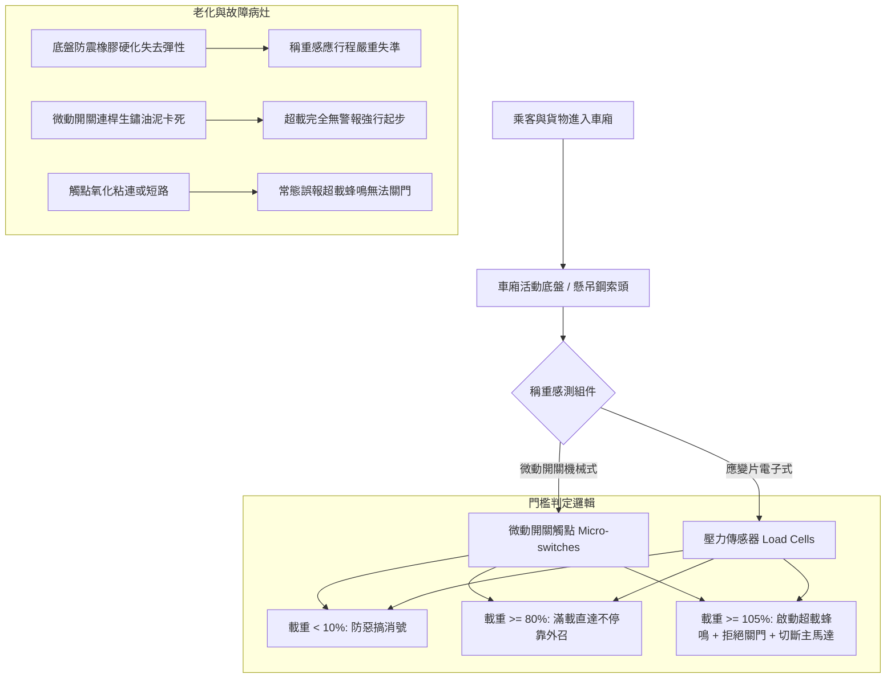

# 全案購屋實戰第五百一十一部_中古大樓社區各樓層電梯稱重感測微動開關超載蜂鳴保護過載不關門與滿載直達功能體檢工序全書

## 壹、核心體檢宗旨與家庭居住安全意涵

在中古集合住宅大樓中，電梯垂直運轉的「載重管理體系」是維護乘廂安全、防止鋼索曳引輪打滑與保障尖峰乘載效率的核心中樞。電梯稱重裝置（Load Weighing Device / Overload Detection System）透過安裝於車廂底盤、鋼索固定端或曳引機座下方的彈簧式微動開關、差動變壓器（LVDT）或電子應變壓電感測器（Load Cell），即時量測車廂內人員與貨物的總重量，並提供三大關鍵控制信號：

1. **滿載直達信號（Full Load Bypass，通常設定為額定載重的 80% ~ 85%）**：當車廂載客達 80% 時，外召按鈕自動失效，電梯直達車廂內所登記之樓層，避免沿途反覆停靠開門造成車廂內乘客擁擠及能耗浪費。
2. **過載保護信號（Overload Protection，通常設定為額定載重的 100% ~ 105%）**：當車內超載時，蜂鳴器連續發出刺耳警報聲、車內「超載指示燈」亮起、車門保持完全敞開拒絕關門，且曳引控制迴路強制斷電切斷啟動，防止電梯在超載狀態下啟動導致曳引力不足下滑或煞車制動力矩不足。
3. **輕載/空載防惡作劇消除（Anti-Nuisance Function）**：若車廂內僅有 1 人（感測載重 < 10%），卻登記超過 3~4 個以上樓層，系統自動判定為惡作劇並清除所有內召指令。

然而，在屋齡達 20 至 25 年以上的中古大樓（如大安紫金城 13 樓、長億南園 8 樓），底盤稱重橡膠減震墊硬化龜裂、微動開關觸點氧化積碳、連動槓桿因灰塵油泥卡阻，常衍生出極度危險的兩大極端病灶：
- **「超載不警報、照常關門運轉」**：感測器卡死在輕載狀態，遇搬家或超額乘載時強行運轉，極易引發曳引鋼索劇烈刮削打滑甚至溜梯衝頂/蹲底。
- **「空車或微載誤報超載、卡死拒絕關門」**：感測器接點短路或彈簧斷裂，導致住戶受困於車廂內或造成單棟電梯全日癱瘓。

本手冊針對小寶家庭的核心考量物件，建立標準化的電梯稱重系統現場體檢工序、參數判讀指標與談判特約防護。

---

## 貳、稱重感測系統結構原理與老化故障機制

### 1. 常見機械式底盤微動開關（Platform Micro-Switch）
- **安裝位置**：車廂框架（Car Frame）與活動車廂底盤（Movable Platform）之間，置有橡膠減震緩衝墊與數組微動開關。
- **作動機制**：當載重增加時，橡膠墊受壓下陷，下方的碰塊壓下微動開關滾輪，依序觸發「滿載」與「超載」接點。
- **老化病灶**：橡膠墊歷經 20 年長年重壓已完全塑性變形（硬化扁平），喪失彈性行程，導致微動開關無法被觸發或持續處於受壓狀態。

### 2. 鋼索吊頭應變片電子傳感器（Rope Hitch Load Cell）
- **安裝位置**：機房或對重架頂部的鋼索固定端彈簧拉桿處。
- **老化病灶**：應變片放大器（Amplifier）內部運算放大 IC 溫漂老化、接線端子受潮氧化阻抗漂移，造成零點飄移（Zero Drift），使控制主機誤判載重。

---

## 參、實地帶看搭乘感受與稱重機能現場檢驗 SOP

購屋現場檢驗中古社區電梯時，買方可透過簡易而精準的步驟驗證其安全邏輯：

| 檢驗步驟 | 檢驗場域與操作工序 | 正常指標 | 異常警訊與安全危害 |
| :--- | :--- | :--- | :--- |
| **步驟一：低載防惡作劇消號測試** | 單人搭乘進入電梯（如大安紫金城 13 樓或長億南園 8 樓），依序按壓 5 個樓層按鈕。 | 電梯關門起步後，系統自動將多餘樓層取消（保留 2~3 個以內）。 | 5 個樓層全數接受且每層皆停靠，代表稱重系統之「輕載感測」已完全失效或被保養商拔除。 |
| **步驟二：滿載模擬與外召跳過檢驗** | 於尖峰時段觀察搭乘人數達 8 人以上（約額定載重 70~80%）時的運轉狀態。 | 電梯運轉經過其他樓層有外召按鈕時，車內顯示「滿載」，過站不停直達目的樓層。 | 明明車廂已擠滿人，卻仍每層停靠開門，造成車門反覆夾人與住戶爭執，大幅損耗門機壽命。 |
| **步驟三：超載蜂鳴與關門連鎖實測** | 於房仲或管委會陪同下，協同多人進入車廂或利用重物壓踏車廂底盤角落。 | 觸發超載時，車內警報蜂鳴器長鳴，車門敞開拒絕關閉，按關門鍵完全無動作。 | 警報不響、車門正常關閉並起步運轉；或僅發出微弱雜音，車廂有沉降抖動感，此為重大安全隱患！ |
| **步驟四：調閱電梯保養紀錄表稱重項目** | 查核管委會管理室存查之「電梯定期保養紀錄表」。 | 「稱重裝置及超載警報」每月均有檢驗打勾，並註記微動開關行程校正。 | 該項目連續空白、打叉，或註記「微動開關損壞待料」，代表社區電梯帶病運轉多年。 |

---

## 肆、高樓層住宅安全價值與買賣合約特約防護

對於鎖定高樓層（大安紫金城 13 樓、靜園 A 區 11 樓、長億南園 8 樓）的住戶而言，電梯稱重系統失靈將直接導致**尖峰上下班等不到電梯（滿載不直達、每層被外召攔截停靠）**，或是**搬遷大型家具時因超載無法檢知引發溜梯與撞底意外**：

### 1. 稱重感測系統修繕與重置成本
- **更換車廂底盤微動開關組與調整行程**：連工帶料約 **\$12,000 ~ \$20,000**。
- **全套底盤減震橡膠緩衝墊（8~12 顆）全面換新**：需頂起車廂底盤施工，工程款約 **\$28,000 ~ \$42,000**。
- **升級現代化微電腦電子式鋼索稱重傳感器（含數位顯示控制盒）**：改善老舊機械式微動開關頻繁失準，整套改裝約 **\$45,000 ~ \$65,000**。

### 2. 不動產買賣買方特約防護條款
> **買賣特約防護範本**：  
> 「賣方擔保本買賣標的所在棟別之昇降設備（電梯），其載重管理與超載安全警報機能運作正常，符合建築物昇降設備安全法規標準。若交屋日前經主管機關指定安全檢查機構或原廠保養技師勘驗認定超載蜂鳴連鎖拒關門機能、滿載直達機能或稱重感測器失效而需停機更換零件，相關修繕費用或管委會因此產生之工程專案攤派款，全數由賣方於交屋日前清償完畢，賣方不得推諉。」
