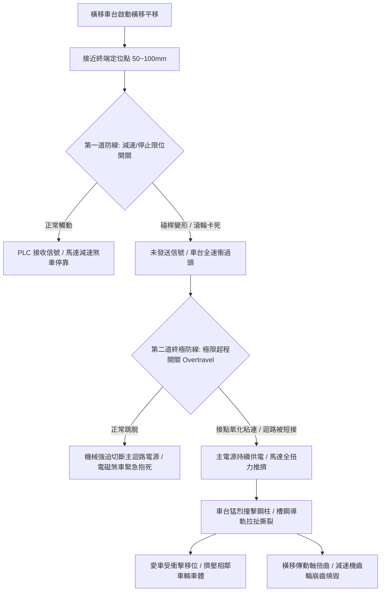

# 全案購屋實戰第五百一十七部_中古大樓社區地下室機械停車設備車位限位極限開關碰桿變形接點氧化短路與橫移車台衝撞邊柱體檢工序全書

## 壹、核心體檢宗旨與家庭居住安全意涵

在中古集合住宅大樓中，機械停車設備（以小寶家庭考量名單中的**長億南園 8 樓**隨戶配置之升降橫移二層式車位為典型代表）的安全定位，完全依賴安裝於車台四周、導軌兩端與鋼構立柱上的「機電限位極限開關（Position Limit Switches & Overtravel Switches）」。

在屋齡達 20 至 25 年的中古社區地下室中，機械車位每日歷經數次至數十次車輛進出與震動，且地下室環境濕度高（常年 RH 75%~90%）、伴隨車輛排放之廢氣與底坑積水蒸發之腐蝕性水氣，機械車位的限位極限開關系統極易衍生出四大毀滅性病灶：

1. **行程定位開關碰桿（Roller Lever Arm）受撞擊彎曲變形與軸銷鏽死**：車台在長年往復橫移或升降中，撞弓（Actuating Cam）震動位移或車輛底盤輪胎碰撞，導致開關金屬搖臂彎曲變形，或滾輪軸銷因紅鏽卡阻無法旋轉，造成車台抵達定位時無法精準下壓開關。
2. **微動開關接點氧化、積碳電弧燒結與常開/常閉接點誤動作**：開關內部密封橡膠護套（Rubber Boot）硬化破裂，潮氣與粉塵入侵，銀合金接點嚴重氧化發黑，導致即使碰桿被壓下，電氣信號卻因接觸不良（阻抗超過數十歐姆）無法傳回 PLC 控制盤，控制電腦誤判車台「尚未抵達目標位置」而持續對馬達全額供電。
3. **極限超程開關（Overtravel Safety Limit Switch）被維保人員短接（Jump Wire）**：為了解決老舊開關頻繁接觸不良引發的跳機報警，部分非原廠或低價得標的維保技師，在控制箱端子排私自以銅線短接極限安全迴路，使車台徹底失去最後一道防撞保護防線。
4. **橫移車台全速衝撞邊柱引發結構變形與相鄰車輛擠壓擠扁事故**：一旦減速限位與停止極限全數失效，橫移車台（含載重達 1.5 至 1.8 噸之車輛）將以額定橫移速度（約 6~8 m/min）直接硬生生撞擊兩側 H 型鋼或槽鋼立柱，強大動能直接將端部橡膠緩衝墊砸碎，引發驅動減速機齒輪碎裂、傳動軸扭曲斷裂，甚至造成車台出軌翻覆或擠壓相鄰車位的停放車輛，產生高達數十萬元的連帶車損賠償責任。

本手冊針對長億南園 8 樓等隨戶配置機械車位之社區，建立標準化的限位開關現場工序體檢清單、電氣阻抗量測法、修繕更新成本與買賣契約專屬特約防線。

---

## 貳、限位極限開關安全連鎖體系與故障失控力學

### 1. 雙重限位開關法定間距標準
- **正常停止限位開關（Normal Stop Limit）**：安裝於車台兩端預定停靠位置，車台停靠後，車身邊緣與立柱應保留至少 **50 ~ 100 mm** 的緩衝淨距。
- **極限超程開關（Overtravel Limit）**：安裝於正常停止位置後方 **20 ~ 30 mm** 處。碰桿觸動時必須為「直接強制斷開（Direct Opening Action）」機構，且必須使整個停車單元斷電閉鎖，只能由人工手動檢修復歸。

### 2. 接點氧化與短接（Jumping）的高危險辨識
- **萬用電表電氣阻抗檢測**：正常接點閉合時電阻應 **< 0.5 Ω**。若實測電阻介於 **5 ~ 50 Ω**，代表接點已嚴重氧化蝕孔，隨時會在震動中發生斷路或電弧焊接。
- **PLC 輸入模組 LED 指示燈判讀**：車台推至定位時，控制盤內對應之 `X` 輸入端子指示燈若未即時亮起或忽明忽暗閃爍，即為典型的接點氧化病灶。

---

## 參、實地帶看機械車位限位極限開關現場檢驗 SOP

小寶帶看現場（特別是長億南園 8 樓隨戶之機械車位）時，應要求現場實地操作並進行以下四步電氣與機械查驗：

| 檢驗步驟 | 檢驗場域與操作工序 | 正常指標 | 異常警訊與深層機械病灶 |
| :--- | :--- | :--- | :--- |
| **步驟一：限位開關外觀與碰桿靈活度檢查** | 攜帶強光手電筒檢視橫移導軌兩端之限位開關與車台撞弓。 | 開關外殼金屬密封完好無紅鏽，滾輪橡膠完好，手動扳動碰桿回位迅捷清脆。 | 1. 碰桿彎曲變形超過 15 度、滾輪卡死無法轉動。 2. 橡膠防塵套破裂，開關內部積滿黑油泥甚至有水滴。 |
| **步驟二：實機操作橫移端點減速與停靠驗證** | 操作車位執行橫移行程，觀察車台接近邊柱時的動態。 | 車台於抵達邊柱前 100mm 明顯平穩減速，並精準停靠於定位點，車體與立柱保持安全間隙。 | 1. 完全無減速動作，直接以全速硬衝撞擊橡膠擋塊，發出「碰」巨大震動聲。 2. 車台停靠後車身已經貼在鋼柱上，間隙小於 10mm。 |
| **步驟三：控制盤端子排查驗防短接跳線** | 陪同總幹事或設備保養廠商開啟車位操作控制箱（Control Box）。 | 箱內配線整齊走線槽，接線端子無任何額外跳接的臨時雙絞線或鱷魚夾。 | 在標示「LIMIT / OVERTRAVEL」端子上發現彩色跨接線（Jumper），此為蓄意廢除極限保護，極度危險！ |
| **步驟四：調閱機械車位月保養單「電氣開關」紀錄** | 檢視管理室存查之「機械停車設備維護保養月報表」。 | 技師按月檢驗「橫移行程開關」與「極限保護裝置」並打勾合格，填寫調整紀錄。 | 該項目長年空白，或備註欄註明「橫移開關接觸不良建議換新」，管委會卻因經費拖延未修。 |

---

## 肆、長億南園機械車位置產防衛與合約特約保障

對於鎖定**長億南園 8 樓**（主附 32 坪超大居住空間，但隨戶配置機械車位）的小寶家庭而言，機械車位的限位極限開關若失效，將直接面臨愛車被撞扁或整套設備癱瘓的重大風險：

### 1. 限位開關更新與控制盤整修工程預算基準
- **更換橫移車台重載防水平面限位開關（1 組 4 顆，採用日本歐姆龍 Omron 或台安）**：連工帶料約 **\$8,000 ~ \$14,000**。
- **更換極限超程安全開關與重新配線調整撞弓**：約 **\$6,000 ~ \$10,000**。
- **更換被撞擊變形之橫移端部液壓/彈簧緩衝擋塊與導軌校正**：約 **\$15,000 ~ \$25,000**。
- **橫移減速馬達齒輪箱受撞擊崩齒全組換新**：約 **\$22,000 ~ \$35,000**。

### 2. 購屋買賣合約機械車位極限安全特約條款範本
> **機械車位限位安全與結構無受撞保證特約條款**：  
> 「賣方保證本買賣標的所隨附之機械停車位（車位編號：___），其橫移及升降行程限位開關、極限超程安全開關功能均完整正常，安全迴路無任何跳線短接，且該車位結構無因衝撞邊柱造成之鋼構變形或軸承損傷情事。點交當日賣方應現場實機操作橫移行程往復至少各兩次，確認定位停靠精準且無劇烈衝撞擋塊之異音。若交屋日前經檢查發現開關接點氧化失靈、迴路短接或有撞擊損壞情事，賣方應全額負擔更換原廠合格零件並經專業廠商出具檢驗合格證明，否則買方得扣留尾款新台幣三萬元整。」
