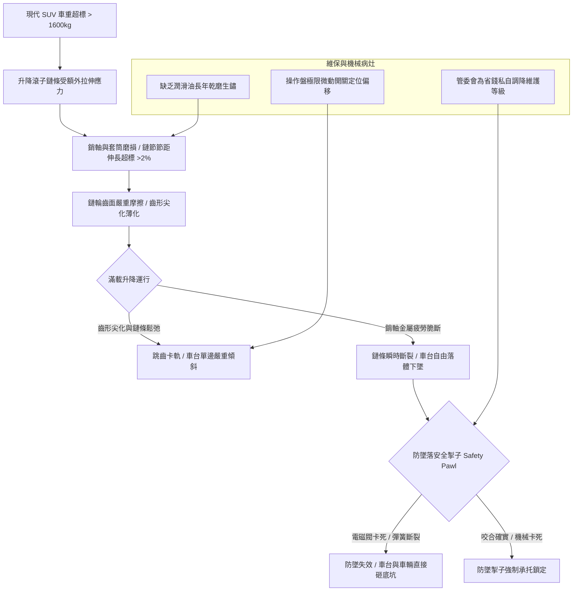

# 全案購屋實戰第五百一十三部_中古大樓社區地下室機械停車設備車台升降鏈條磨損拉伸鏈輪齒形尖化跳齒卡軌與防墜落機構安全體檢工序全書

## 壹、核心體檢宗旨與家庭居住安全意涵

在台中地區中古集合住宅大樓中，機械停車設備（Mechanical Parking System，尤以二層升降橫移式、多層升降式為主）是許多特定社區（例如小寶家庭列入考慮名單的**長億南園 8 樓**，其隨戶配置即為機械車位）不可或缺的附屬停車設施。

對於家中有日常通勤、接送小孩與載物需求的家庭而言，機械停車設備的安全妥善率直接關乎人身安全、愛車防護與每日生活的便利度。然而，隨著社區屋齡超過 20 至 25 年，機械車位的傳動體系長年承受車輛重壓（通常原設計載重上限僅為 **1,600 kg**，面對現代中大型休旅車動輒 1,800~2,200 kg 已嚴重超載），極易產生極度危險但外觀不易察覺的四大深層機械疲勞病灶：

1. **升降傳動鏈條（Drive Roller Chain）節距伸長與金屬疲勞**：滾子鏈條長年承載升降往復拉扯，銷軸（Pin）與套筒（Bush）磨損，導致鏈條總長度塑性伸長超過極限（超過 2%~3%）。若未即時更換，鏈條隨時可能在車台滿載升降中發生瞬時「拉斷」，造成車台垂直墜落之毀滅性事故。
2. **鏈輪（Sprocket）齒形尖化磨耗與跳齒（Tooth Skipping）**：老舊鏈輪齒面長年與伸長的鏈條摩擦，齒形逐漸削薄「尖化」（呈現如鯊魚齒狀）。一旦跳齒，車台兩側升降行程瞬間失步，引發車台單邊嚴重傾斜、愛車滑落或車體直接擠壓刮撞兩側鋼構立柱。
3. **防墜落安全掛鉤/掣子（Anti-falling Safety Pawl / Hook）電磁閥卡阻**：安全法規要求車台上行定位後，兩側機械防墜安全掣子必須確實嵌入支撐架中鎖死。老舊設備常因回位彈簧斷裂、電磁鐵線圈受潮燒損、潤滑油泥硬化，造成防墜掣子「未卡入」或「無法彈開」，形成形同虛設的虛假防護或導致車台卡死於半空中。
4. **鏈條潤滑乾涸、鏽蝕起毛與油泥砂石積聚**：地下室通風不良且潮濕，鏈條若長年未以專業高滲透鏈條油保養，內外鏈片間鏽蝕咬死，關節轉動阻力暴增，直接燒毀升降驅動馬達與蝸輪減速機。

本手冊針對小寶家庭的核心考量物件（特別是長億南園 8 樓），建立完整標準化的機械車位鏈條與防墜機構現場體檢工序、量測指標與談判合約特約防禦機制。

---

## 貳、升降鏈條與防墜機構系統病灶力學演變

### 1. 鏈條節距伸長率（Elongation Rate）法定報廢標準
- **標準測量工序**：以游標卡尺量測鏈條 20 個鏈節（Pitch）之中心距。
- **極限伸長率**：
  $$\text{伸長率 (\%)} = \frac{\text{實測長度} - \text{新品標稱長度}}{\text{新品標稱長度}} \times 100\%$$
- **判定標準**：伸長率超過 **1.5%** 即需調整張緊裝置；伸長率超過 **2.5%** 必須強制全組更換，嚴禁繼續運轉。

### 2. 鏈輪齒面尖化檢驗指標
- **標準齒形**：齒頂平整，兩側過渡弧度圓滑均勻。
- **報廢形態**：若齒頂寬度磨損超過原厚度的 **30%**，或齒面出現明顯階梯狀凹痕、齒頂變尖銳如刀刃，鏈條與鏈輪嚙合角將嚴重改變，極易引發高負載跳齒。

---

## 參、實地帶看機械車位現場運轉體檢工序（SOP）

小寶帶看現場（特別是長億南園）檢驗機械車位時，應要求房仲或管理員現場通電實地操作升降與橫移：

| 檢驗步驟 | 檢驗場域與操作工序 | 正常指標 | 異常警訊與深層機械病灶 |
| :--- | :--- | :--- | :--- |
| **步驟一：靜態外觀與鏈條垂度查驗** | 檢視車台兩側懸吊鏈條，觀察鏈條垂度（Sag）與表面油膜。 | 兩側鏈條張力均勻一致，鏈片呈金屬亮光並覆蓋均勻防鏽油膜。 | 1. 兩側鏈條一緊一鬆（下垂超過 50mm）。 2. 鏈片佈滿紅鏽、乾涸積碳黑垢，有鏈片開裂起毛。 |
| **步驟二：滿載升降運轉聲音監聽** | 請房仲或管委會操作車位升至最高定位點，並降回地面。 | 運行平順，聲音為低沈均勻之鏈條捲動聲，無卡頓與金屬劇烈撞擊。 | 1. 發出「喀、喀、喀」跳齒衝擊聲。 2. 車台在升降過程中左右劇烈晃動，兩側高度差超過 **15 mm**。 |
| **步驟三：防墜落安全掣子咬合實測** | 當車台升至定位後，觀察頂部兩側機械安全掛鉤是否確實「啪」聲彈入鎖孔。 | 安全掣子完全扣入承重梁孔洞中，且電磁閥回位靈活俐落。 | 掛鉤半懸空未卡入、彈簧鬆弛懸吊；或需人工拿鐵棍敲擊才能卡入。 |
| **步驟四：調閱機械車位安全檢查合格證** | 檢視控制箱旁是否張貼由「中華民國立體停車設備安全協會」等核發之年度安全合格證。 | 領有有效期限內合格證，載重標示清晰，且每月維護紀錄簽章齊全。 | 合格證逾期未驗（重大違規黑戶）、無固定保養廠商，或備註欄註記「鏈條磨耗建請改善」。 |

---

## 肆、機械車位限制防禦與買賣契約特約條款

長億南園 8 樓室內實坪大（主附 32 坪），但其配置之機械車位具有「限重 1,600 kg、車高限 1,550 mm」之物理天花板。若家庭擁有 SUV（如 RAV4、CR-V、Model Y），將面臨無法停放或超載損壞設備之風險：

### 1. 機械車位重大修繕工程預算基準
- **升降傳動鏈條整組更換（含兩側雙排鏈）**：連工帶料約 **\$18,000 ~ \$28,000**。
- **驅動鏈輪與傳動軸承全數更換**：需拆卸減速馬達組，工程款約 **\$22,000 ~ \$35,000**。
- **防墜落電磁閥與機械掣子總成換新**：單一車位約 **\$15,000 ~ \$25,000**。
- **車位載重升級或結構強化**：中古機械車位結構多無法直接升級載重至 2,000kg 以上，若無法停放休旅車，周邊需另尋平面車位租賃（台中南區周邊平面月租約 **\$2,500 ~ \$3,500/月**）。

### 2. 購屋買賣合約機械車位專屬特約防護條款
> **機械車位現況保證與特約條款**：  
> 「賣方擔保本買賣標的所隨附之機械停車位（車位編號：___），其機械傳動結構（包括升降鏈條、傳動鏈輪、馬達減速機及防墜落安全機制）均處於正常運作狀態，領有主管機關有效使用許可證，且無跳齒、卡軌或結構損壞變形情事。雙方約定於交屋點交當日，賣方應實地通電操作車位完整升降及橫移行程至少三次，確認無任何故障異音方得辦理點交。若交屋日前經檢驗有零件損壞需更換，相關工程費用全數由賣方負擔清償，否則買方得扣留相當於車位修繕費用之尾款。」
