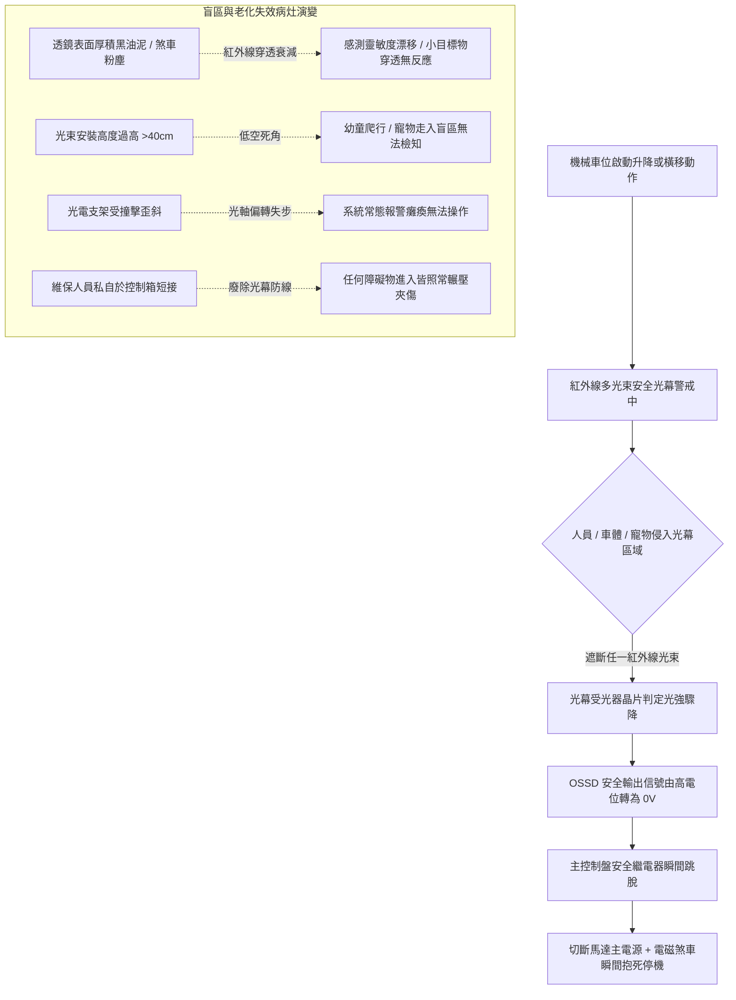

# 全案購屋實戰第五百一十九部_中古大樓社區地下室機械停車設備車台出入口光電防夾安全光幕鏡面遮蔽線路斷線與盲區防禦體檢工序全書

## 壹、核心體檢宗旨與家庭居住安全意涵

在中古集合住宅大樓中，機械停車設備（包含小寶家庭考量名單中的**長億南園 8 樓**所附屬之機械車位）在車輛與人員頻繁進出的車台出入口，依建築法規與機械停車設備安全規範，必須設置「光電防夾安全光幕（Photoelectric Safety Light Curtain / Optical Interlock Sensors）」作為人身防護的第一道主動安全防線。

安全光幕由安裝於兩側立柱對稱佈局的「紅外線投光器（Emitter）」與「受光器（Receiver）」組成，透過密集的紅外線光束形成一道隱形的安全防護網。當車位在執行升降或橫移動作時，若有住戶（特別是幼童奔跑、長輩緩慢通行）、寵物或未完全停妥之後視鏡、後保險桿遮蔽任何一道光束，光幕控制系統必須在數毫秒（ms）內切斷主回路電源並緊急抱死煞車，防止人身遭受車台剪切、擠壓夾傷或致命碾壓。

然而，在屋齡達 20 至 25 年的中古地下室中，光電安全防護系統常因環境惡劣與缺乏專業校準，衍生出四大極具威脅的深層機能病灶：

1. **光學壓克力透鏡油污、灰塵與煞車碳粉重度遮蔽引發「假信號或感度盲區」**：地下室通風不良，光學透鏡表面覆蓋黏稠油塵，紅外線光強大幅衰減（衰減達 70%~90%）。部分不肖保養廠商為避免光衰頻繁跳機，將接收靈敏度調至極限或私自更換非安全級之劣質單點對射開關，導致細小障礙物（如幼童手腳或寵物）穿過時完全無感應，產生致命的「感測死角盲區」。
2. **安裝支架震動鬆動、光軸偏轉失步與投受光角度偏差**：車輛進出車台時的強烈震動與輪胎碰撞，導致立柱側邊的光電支架扭曲變形，紅外線光軸偏移超過容許光束散角（通常僅 ±2.5°~±5°）。一旦光軸未對準，系統常態性報警卡死，或在某個特定高度震動時突然中斷防護。
3. **出線電纜長年折彎疲勞脆化、內部銅絲微斷與信號短接**：隨車台移動或暴露於立柱外的多芯屏蔽信號線，外皮硬化龜裂，內部細銅絲因震動產生間歇性接觸不良。少數廠商為了交差，在操作盤內將光幕常閉安全迴路（OSSD）直接「短接跳線（Jumper）」，徹底廢除光電防夾功能！
4. **低高度盲區與長輩孩童進出夾死夾傷事故**：早期中古機械設備常僅安裝「單光束」或「雙光束」對射開關（高度約 50cm 與 100cm），地面至 30cm 間完全無光束覆蓋。幼童跌倒爬行或小狗走入時，系統無法偵測照常降下車台，恐釀成無法挽回的骨折、窒息或夾死人倫悲劇。

本手冊針對長億南園 8 樓等具備機械車位之社區，建立標準化的安全光幕光軸對齊度、多點防夾遮斷響應實測 SOP、修繕更新成本與買賣契約專屬特約防線。

---

## 貳、光電防夾安全光幕結構架構與盲區失效力學

### 1. 安全光幕國家標準與光束密度規範
- **CNS 14386-1 機械停車設備安全標準**：
  - 車台出入口兩側必須設置防夾偵測裝置。
  - **多光束安全光幕（Multi-beam Safety Light Curtain）**：光軸間距（Resolution）應在 **40 ~ 70 mm** 以內，有效防護高度應自地面 **100 mm 至 1,500 mm** 全面覆蓋，確保成人、幼童及矮小障礙物均能被即時檢知。
- **單點對射式（已淘汰規格）**：早期僅有一上一下兩條光束，中間落差達 50 公分以上，屬於高風險過時配置，購屋時應將其列為重大安全扣分項。

### 2. OSSD 雙迴路安全輸出與自檢機能（Self-Checking）
- **專業安全光幕標準**：具備 OSSD（Output Signal Switching Device）雙獨立固態開關輸出，且開關內部每隔數微秒發送極短之自檢測試脈衝。
- **病灶徵兆**：若設備僅採用一般工業用繼電器輸出（無自檢防短接機能），接點一旦氧化粘連，即便光幕遮斷，繼電器依然維持通電狀態，無法達到安全等級要求。

---

## 參、實地帶看機械車位安全光幕現場檢驗 SOP

小寶帶看現場（特別是長億南園 8 樓隨戶之機械車位）時，應要求現場實地通電操作車位，並執行以下四步防夾機能動態查驗：

| 檢驗步驟 | 檢驗場域與操作工序 | 正常指標 | 異常警訊與深層安全病灶 |
| :--- | :--- | :--- | :--- |
| **步驟一：光電透鏡外觀與立柱安裝剛性勘驗** | 攜帶強光手電筒檢視立柱兩側之安全光幕光柱外殼與光學壓克力面板。 | 面板透亮清澈無油垢，外殼鋁擠型平直堅固，手推無晃動位移。 | 1. 壓克力面板發黃霧化、覆蓋厚重黑油泥。 2. 支架螺栓鬆脫，整支光柱用手一碰即搖晃偏轉超過 5 度。 |
| **步驟二：動態運轉中「多點遮斷」急停測試** | 請房仲操作車位橫移或升降運轉，於車台運動中以捲尺或書本隨機切斷不同高度的光束。 | 遮斷瞬間（0.1 秒內），車台立即發出「喀」煞車抱死聲並完全靜止，控制箱發出警報。 | 1. 書本遮斷光束後，車台毫無停頓繼續運行（防夾機能完全喪失！）。 2. 必須用整隻手臂完全擋死才有反應（感度衰減鈍化）。 |
| **步驟三：低高度地面「爬行盲區」遮斷檢驗** | 以鞋子或小障礙物放置於地面上方 **15 ~ 20 cm** 處，嘗試啟動車位操作盤。 | 操作盤拒絕啟動，按鍵蜂鳴器長鳴，故障指示燈亮起。 | 車位正常啟動運轉，完全無法偵測低空障礙物（存在幼童與寵物夾傷致命死角）。 |
| **步驟四：控制箱安全迴路防短接檢查** | 檢視機械車位控制箱端子排上標示「PE / LIGHT CURTAIN / SAFETY」端子。 | 配線整齊進入端子，無任何並聯跳接的短路銅線或鱷魚夾線。 | 發現色彩異常的跳線短接，證明光幕早已故障，被廠商以跳線強行維持運轉！ |

---

## 肆、長億南園機械車位置產防衛與合約特約保障

對於鎖定**長億南園 8 樓**（主附 32 坪超大空間，但隨戶配置機械車位）的小寶家庭而言，機械車位若缺乏合格的光電防夾光幕，未來家中孩童進出地下室時將暴露於難以預料的夾死夾傷人身風險中：

### 1. 安全光幕升級更新與維修成本基準
- **清潔光學透鏡、重新校準雙側光軸與更換訊號線**：約 **\$4,000 ~ \$8,000**。
- **淘汰單點老舊對射開關，全面升級安裝高規格「多光束區域安全光幕組」（高度 1.2m ~ 1.5m，符合歐洲 Type 4 / SIL3 安全等級）**：整套連工帶料約 **\$28,000 ~ \$45,000**。
- **更換主控制箱安全繼電器模組（Safety Relay Module，防粘連專用）**：約 **\$8,000 ~ \$15,000**。

### 2. 購屋買賣合約機械車位防夾安全專屬特約條款範本
> **機械車位光電防夾裝置與人身安全特約條款**：  
> 「賣方保證本買賣標的所隨附之機械停車位（車位編號：___），其出入口光電防夾安全光幕及急停連鎖機能完整正常，無光軸偏移、感應盲區或安全迴路短接情事，符合主管機關立體停車設備安全法規標準。點交當日雙方應現場通電實測：於車台運轉中以物體遮斷光幕時，車台必須於零點二秒內完全煞停停機。若交屋日前經檢查發現安全光幕損壞失效、感應不良或有短接情事，賣方應全額負擔更新合格原廠零件並經專業廠商簽證，否則買方得扣留尾款新台幣三萬元整。」
