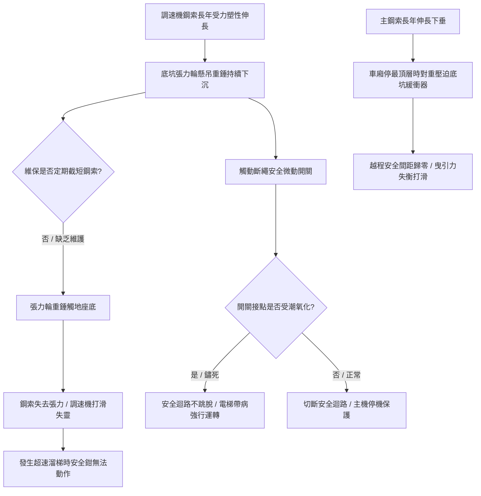

# 全案購屋實戰第五百一十二部_中古大樓社區各樓層電梯底坑張力輪斷繩開關滑輪偏擺配重鋼索伸長與緩衝器安全間距體檢工序全書

## 壹、核心體檢宗旨與家庭居住安全意涵

在中古集合住宅大樓中，高樓層（如大安紫金城 13 樓、靜園 A 區 11 樓、長億南園 8 樓）電梯升降系統的底坑（Pit），不僅是整棟垂直運輸鏈的力學終端基座，更是承擔「調速機張力輪（Governor Tension Sheave）」、「斷繩安全開關（Broken Rope Safety Switch）」與「液壓/彈簧緩衝器（Buffer）」的生死交會處。

隨著社區屋齡超過 20 至 25 年，電梯長年高頻率載客，底坑系統往往出現極度隱蔽卻攸關全棟住戶安危的四大結構性病灶：

1. **調速機鋼索長年疲勞拉伸與張力輪下沉觸地**：調速機鋼索因自重與拉力產生塑性伸長（Elongation），懸掛於底坑導軌上的張力輪重錘（Tension Weight）隨之逐年下沉。若未定期截短鋼索，張力輪重錘將直接「坐底觸地」，喪失維持鋼索張力的重力拉緊機能，導致調速機鋼索在滑輪槽內劇烈打滑；一旦發生超速溜梯，調速機夾繩鉗無法有效嚙合，電梯將直衝井道頂部或底坑。
2. **斷繩安全開關（Tension Sheave Safety Switch）接點受潮鏽蝕卡死**：安全法規要求張力輪下沉超過極限或鋼索斷裂時，必須立即觸碰斷繩開關切斷主安全迴路。但底坑長年潮濕、甚至滲漏地下水，斷繩開關之擺臂軸承常生鏽卡阻、內部微動開關觸點氧化積碳，在張力輪脫軌時完全無法發出跳脫停機指令。
3. **張力滑輪軸承磨損偏擺與刮軌發出金屬敲擊異音**：張力輪內部滾珠軸承缺乏潤滑脂，造成滑輪旋轉時產生幾何歪斜偏擺（Runout），運轉時鋼索在輪槽邊緣劇烈磨擦產生高頻尖叫聲，甚至滑輪鑄鐵邊緣直接擦撞底坑導軌支架。
4. **主鋼索永久伸長導致車廂/對重與緩衝器「頂死」安全間距喪失**：主鋼索長年受載延伸數公分至十數公分，導致當乘廂停靠最頂層（如大安紫金城 13 樓）時，井道底坑的「對重緩衝器頂部」與「對重撞座」之間的垂直越程間距（Over-travel Clearance）嚴重不足，甚至在一般平層時對重已經直接壓在緩衝器橡膠墊上，使主鋼索張力瞬間釋放而造成曳引輪打滑磨損。

本手冊針對小寶家庭的核心考量物件，建立標準化的電梯底坑張力輪與緩衝器安全間距查驗工序、量測指標與談判特約防護。

---

## 貳、底坑張力輪與緩衝器系統病灶演變力學

### 1. 底坑張力輪重錘下沉與安全間距法定規範
- **標準懸空高度**：張力輪配重塊底面距離底坑地坪應保持在 **100 ~ 200 mm** 的懸空自重行程。
- **極限安全保護**：當鋼索伸長使重錘下沉超過 **50 mm** 時，必須觸發斷繩安全開關切斷主電源；若重錘已接觸底坑地面，張力輪已完全喪失張緊機能，屬於重大公安缺失。

### 2. 對重緩衝器（Counterweight Buffer）越程安全間距
- **油壓緩衝器（Oil Buffer）行程與間距**：車廂停於最高平層位置時，對重撞座底面至緩衝器柱塞頂面的垂直距離，依電梯額定速度規定通常需維持在 **150 ~ 350 mm**。
- **病灶徵兆**：若該間距縮小至 **小於 50 mm**，甚至兩者已完全接觸壓實，代表主鋼索已嚴重鬆弛下垂，必須立即實施「主鋼索截短（Rope Shortening）」工程。

---

## 參、實地帶看搭乘感受與管委會底坑維保體檢工序（SOP）

| 檢驗步驟 | 檢驗標的與實務工序 | 正常指標 | 異常警訊與潛在重大風險 |
| :--- | :--- | :--- | :--- |
| **步驟一：最頂層停靠頓挫感勘驗** | 於大樓最頂層（如大安紫金城 13 樓、靜園 A 區 11 樓）搭乘停靠，感受煞車瞬間的垂直頓挫與車廂微幅反彈。 | 停靠平穩柔和，平層精準，無任何硬碰撞撞擊感。 | 車廂進站時有金屬重擊震動感，多為底坑對重塊已直接砸在緩衝器頂蓋上（主鋼索伸長超標）。 |
| **步驟二：搭乘至最底層聆聽底坑異音** | 電梯由高樓層直降至地下室最底層（B1 或 B2），出車廂前細聽地坪下方聲音。 | 無金屬刮削聲、無鏈條滑輪甩動撞擊聲。 | 聽聞連續「喀啦喀啦」或高頻尖叫聲，通常為張力滑輪軸承乾涸偏擺，或補償鏈在底坑導向輪處摩擦跳齒。 |
| **步驟三：請總幹事開啟底坑檢修孔查驗** | 陪同總幹事或管理員於地下室電梯廳檢視底坑（或透過機房維護日誌佐證）。 | 底坑乾爽無積水，張力輪配重懸空且油漆完好，緩衝器防塵套完整無漏油。 | 1. 底坑積水長青苔，張力輪泡水鏽蝕。 2. 張力輪配重塊已直接放置在地磚上（完全觸地失效）。 |
| **步驟四：調閱電梯維護保養月報表** | 查核「底坑檢查項目」中之「調速機張力輪」、「斷繩安全開關」與「緩衝器間距」。 | 技師定期填寫實測間距數據（如間距 200mm），各項合格。 | 1. 連續數期無填寫具體數值，僅敷衍打勾。 2. 備註欄註記「主鋼索伸長過長需截短」、「張力輪需調整」，管委會卻因經費拖延未做。 |

---

## 肆、高樓層置產防衛與合約特約保障

對於鎖定高樓層（大安紫金城 13 樓、靜園 A 區 11 樓、長億南園 8 樓、歌德堡 8 樓）的買方而言，底坑張力輪與主鋼索伸長問題將直接影響日常乘坐的舒適度與極限狀況下的安全保障：

### 1. 底坑與鋼索修繕工程行情基準
- **主鋼索截短重新索頭澆鑄工程（3~5 口主鋼索）**：工程需吊掛車廂並以巴氏合金（Babbitt Metal）或楔形索套重新製作索頭，工程款約 **\$25,000 ~ \$40,000**。
- **更換調速機鋼索與更換底坑張力滑輪組**：連同斷繩開關更新，工程款約 **\$18,000 ~ \$30,000**。
- **底坑油壓緩衝器漏油更換（每組 2 支）**：若底坑受潮導致緩衝器柱塞鏽蝕漏油，更換油壓緩衝器約 **\$35,000 ~ \$55,000**。

### 2. 購屋買賣合約安全特約條款範本
> **底坑機能與安全特約條款**：  
> 「賣方保證本買賣標的所在棟別之電梯昇降設備運作安全正常，其井道底坑之調速機張力輪、斷繩安全開關及緩衝器安全越程間距，均符合建築物昇降設備安全檢查規範。自簽約日起至交屋日止，若經電梯專業維保機構檢查判定該棟電梯有鋼索伸長過量需截短、張力輪下沉觸地失效或底坑滲水損壞機件之情事，其修繕支出或管委會因此產生之工程專案分攤款，概由賣方全額負擔繳清，賣方不得要求買方負擔。」
