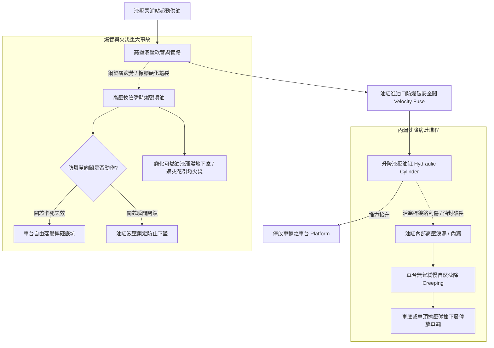

# 全案購屋實戰第五百一十八部_中古大樓社區地下室機械停車設備油壓升降油缸內漏液壓油乳化油管爆裂與沈降溜車體檢工序全書

## 壹、核心體檢宗旨與家庭居住安全意涵

在中古集合住宅大樓中，機械停車設備除了常見的鏈條傳動式外，另一大廣泛應用的主流為「油壓驅動升降式（Hydraulic Lifting System）」（尤見於地下室限高較低、追求運行靜音之社區，如二層升降橫移或沈下式停車位）。以小寶家庭考量名單中的**長億南園 8 樓**而言，該社區地下室車位即為機械車位系統。

油壓升降車台透過「液壓泵浦站（Hydraulic Power Unit）」提供高壓油動力，推動「單作用或雙作用液壓油缸（Hydraulic Cylinder）」伸出與縮回，帶動車台平穩升降。然而，油壓系統在屋齡達 20 至 25 年的中古地下室環境中，長年承受車輛重壓（特別是現代休旅車重達 1.8~2.2 噸，遠超油壓額定設計壓力）、液壓油高溫劣化以及地下室濕氣侵蝕，極易衍生出四大災難性油壓病灶：

1. **液壓油缸活塞桿（Piston Rod）硬鉻層刮傷脫落與油封（Oil Seal）內漏**：油缸活塞長年往復伸展，表面鍍硬鉻層因油泥砂石刮傷起槽或出現點蝕鏽斑；聚氨酯（PU）或氟橡膠主油封在高溫與高壓下硬化、撕裂，導致高壓油經活塞環間隙洩漏回油箱（內部內漏）。當車輛停放於上層車台數小時後，車台因油壓洩壓而發生緩慢「沈降溜車（Platform Creeping / Drifting Down）」，車頂直接擠壓碰撞下層停放之車輛！
2. **液壓油乳化變質、酸化腐蝕與氣蝕空化（Cavitation）**：地下室常年高濕（RH > 80%），空氣中水氣經油箱呼吸蓋吸入油液中，液壓油與水分高速剪切乳化成乳白色牛奶狀液體。乳化油潤滑性暴跌且具弱酸性，加速閥體內部精密閥芯（Spool）鏽蝕卡阻；油中氣泡在高壓下爆破產生高達數千度局部微射流，將齒輪泵浦齒面與閥門座打出孔洞氣蝕。
3. **高壓液壓軟管（High-Pressure Hydraulic Hose）老化龜裂與爆管噴油火災隱患**：連通泵浦站與升降油缸的高壓橡膠鋼絲編織油管，在長年承受 100 ~ 160 bar 脈衝高壓及油溫熱脹冷縮後，外層橡膠硬化龜裂、內部鋼絲層生鏽疲勞。一旦在車台滿載升降瞬間發生「高壓爆管」，數十公升霧化高壓液壓油瞬間噴發至整個地下室，遇電氣接點火花極易引發毀滅性地下室大火；且車台失去支撐油壓，若防爆單向閥失效，車台將以自由落體摔碎！
4. **防爆單向閥（Velocity Fuse / Pipe Rupture Safety Valve）閥芯卡死**：安全法規要求油缸進油口必須直鎖機械式防爆破安全閥。當油管爆裂流量暴增時，閥芯應立即瞬間自動關閉鎖死油路。老舊設備常因油垢油泥卡死閥芯，爆管時完全無法閉鎖。

本手冊針對長億南園 8 樓等隨戶配置機械車位之社區，建立標準化的油壓系統壓力保壓檢測工序、乳化油判讀、爆管防護檢核與買賣特約自保防禦法。

---

## 貳、油壓升降系統結構原理與沈降溜車病灶力學

### 1. 自然沈降量（Drift Rate）法定安全標準
- **標準測量工序**：車台升至最高定位點後，停放額定重量之車輛（或空車測試），關閉電源切斷供油，靜置量測 24 小時。
- **合格判定標準**：
  - 24 小時內車台自然沈降位移量必須 **< 10 mm**。
  - 若在 1 小時內沈降即超過 **20 mm**，或半天內已下沉數公分，代表油缸主油封或比例電磁閥（Solenoid Valve）閥芯已嚴重內漏，必須立即停機檢修。

### 2. 液壓油健康度現場簡易四步鑑別
- **正常健康油**：清澈透明、金黃色或淡琥珀色、無刺鼻酸焦味、流動性均勻。
- **乳化變質油**：呈現渾濁不透明的乳白色或咖啡牛奶色，滴在白色衛生紙上有明顯水環擴散圈。
- **高溫碳化油**：呈現焦黑色或深褐色，伴隨強烈燃燒塑膠的焦臭味，代表油溫長年超過 60°C 且泵浦長期過載乾磨。

---

## 參、實地帶看機械車位油壓系統現場檢驗 SOP

小寶在帶看長億南園 8 樓現場檢驗隨戶配置的機械車位時，應偕同房仲與總幹事進行以下現場查驗：

| 檢驗步驟 | 檢驗標的與操作工序 | 正常指標 | 異常警訊與深層機械病灶 |
| :--- | :--- | :--- | :--- |
| **步驟一：車台下方油缸與活塞桿外觀勘驗** | 攜帶強光手電筒照射車台正下方的升降液壓油缸（特別是頂出之活塞桿鏡面）。 | 活塞桿金屬表面光亮如鏡，無刮痕、無鏽斑，油缸端蓋處無油液滲漏滴落。 | 1. 活塞桿表面有縱向深道刮痕，有明顯脫鉻凹坑。 2. 端蓋防塵圈下垂破裂，大量黏稠黑油順桿流淌並滴落底坑積成油潭。 |
| **步驟二：泵浦站油箱油質與油位檢視** | 檢視液壓泵浦機組油箱之圓形液位油溫計（Oil Level Gauge）。 | 油位介於最高（H）與最低（L）刻度之間，油液清澈透亮。 | 1. 油液渾濁呈乳白牛奶狀（嚴重乳化變質）。 2. 油位低於最低刻度，油箱周圍金屬閥件滿布滲油灰塵。 |
| **步驟三：高壓橡膠油管龜裂與膨脹檢查** | 檢視連通泵浦站至油缸之高壓軟管全段（特別是接頭壓接處）。 | 管壁橡膠平整有彈性，彎曲處無死褶，金屬接頭無滲油與鏽蝕。 | 軟管外皮滿布細微龜裂網紋，手觸管壁有硬化脆化感，加壓時管身有局部鼓包膨脹。 |
| **步驟四：靜置保壓沈降實測體檢** | 請房仲操作車位升至最高位置，斷電後在立柱與車台接縫處以鉛筆畫線標記，靜置 30 分鐘後檢視。 | 標記線完全重合，車台無可見沈降位移（位移 < 2mm）。 | 30 分鐘內車台肉眼可見持續下沉超過 **10 ~ 20 mm**，伴隨閥組微弱「嘶嘶」洩壓漏油聲。 |

---

## 肆、長億南園機械車位置產防衛與合約特約保障

對於鎖定**長億南園 8 樓**（主附 32 坪超大空間，但配置機械車位）的小寶家庭而言，油壓系統的內漏與老化將直接帶來修繕費用攤派及愛車壓損的巨大風險：

### 1. 油壓升降系統維修與更換成本基準
- **更換液壓油缸高壓密封件組（含拆裝油缸、更換活塞與導向套油封）**：連工帶料約 **\$18,000 ~ \$28,000 / 支**。
- **全系統更換國光牌或美孚 68 號耐磨液壓油（含油箱清洗廢油清運）**：約 **\$12,000 ~ \$18,000**。
- **更換全套耐高壓雙層鋼絲編織液壓軟管組（含防爆破單向閥）**：約 **\$15,000 ~ \$22,000**。
- **更換全新液壓泵浦馬達組（含比例電磁閥組與溢流閥）**：整套更新約 **\$45,000 ~ \$65,000**。

### 2. 購屋買賣合約機械車位油壓安全專屬特約條款範本
> **機械車位油壓系統無內漏與安全保證特約條款**：  
> 「賣方擔保本買賣標的所隨附之機械停車位（車位編號：___），其油壓升降系統（包括液壓油缸、液壓泵浦站、高壓管路、控制電磁閥及防爆安全裝置）運轉功能完整正常，油缸無內漏沈降溜車、管路無膨脹滲漏，且液壓油無乳化變質情事。雙方同意於交屋點交當日，於車台升至最高定位點後斷電靜置至少三十分鐘，沈降位移量不得大於五公釐（5mm）。若交屋日前經檢查發現油缸漏油沈降、管路龜裂需修復或油質劣化者，賣方應全額出資維修換新並取得設備保養合格簽證，否則買方得扣留尾款新台幣三萬元整。」
