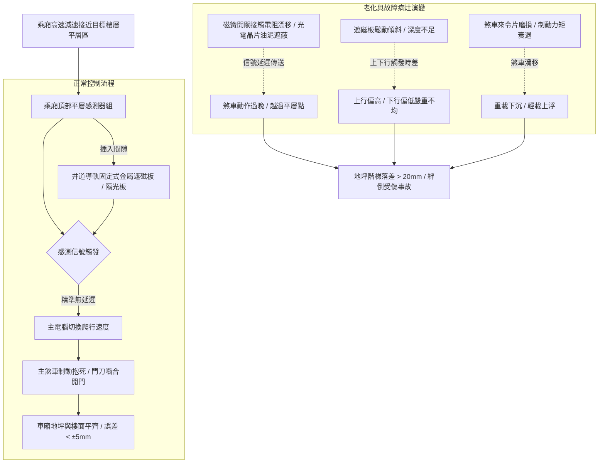

# 全案購屋實戰第五百一十六部_中古大樓社區各樓層電梯乘廂平層感應器遮磁板偏移磁簧開關老化與高低地坪絆倒人身傷害體檢工序全書

## 壹、核心體檢宗旨與家庭居住安全意涵

在中古集合住宅大樓中，電梯乘廂（Car）停靠各樓層時的「平層精準度（Leveling Accuracy）」，是長輩、孩童與全體住戶每日出入安全的第一道人身防護線。電梯平層系統由安裝於井道各樓層的「金屬隔磁板/遮光板（Vane / Cam Plate）」與安裝於乘廂外側頂部的「光電感應器（Photoelectric Sensor）」或「磁簧感應開關（Magnetic Reed Switch）」所構成。

隨著社區屋齡達到 20 至 25 年以上（如小寶家庭重點關注的**大安紫金城 13 樓**、**長億南園 8 樓**、**歌德堡 8 樓**與**靜園 A 區 11 樓**），在經歷數百萬次起步、煞車減速震動以及地震晃動後，平層系統極易衍生出隱蔽卻危害極大的機能老化病灶：

1. **磁簧感應開關內部接點彈性疲勞與充磁消磁退化**：傳統磁簧開關在真空玻璃管內由兩片磁性金屬簧片組成，長年受熱與高頻振動下，簧片彈性疲乏、磁化延遲或接觸電阻劇增，造成感測信號延遲數十至數百毫秒傳回主電腦，導致煞車制動時機滯後。
2. **光電感應開關光學透鏡油污粉塵遮蔽與發光二極體光衰**：光電式感測器紅外線發光管與接收晶片表面積覆厚重煞車碳粉、滑軌潤滑油泥與棉絮塵埃，紅外線穿透率大幅衰減，導致感應靈敏度下降，甚至在光線穿透臨界點引發信號抖動（Chattering）。
3. **井道遮磁板/隔光板固定架鬆脫歪斜與垂直度漂移**：安裝於導軌或壁面之金屬隔磁板受車廂高速穿堂風與主鋼索擺動撞擊，固定螺栓鬆動，隔磁板產生幾何角度傾斜。當乘廂上行或下行進站時，感測器插入隔磁板的深度與時間產生嚴重方向性落差（例如：上行停靠高出 15mm，下行停靠卻低落 20mm）。
4. **地坪高低落差導致長輩孩童絆倒摔傷與賠償糾紛**：依中華民國 CNS 昇降設備安全檢查標準，電梯平層誤差應控制在 **±5 mm** 以內，最大不得超過 **±10 mm**。當平層誤差超過 **15 ~ 30 mm** 時，住戶進出電梯極易踢到「門檻階梯」撲地重摔，造成骨折或頭部外傷，管委會與區分所有權人恐面臨侵權損害賠償訴訟。

本手冊為小寶家庭量身打造，針對考慮標的建立嚴密的各樓層平層誤差現場量測工序、感測器病灶判讀法、修繕成本指標與買賣特約防護。

---

## 貳、平層感測系統工作架構與高低差病灶力學

### 1. 平層誤差法定規範與安全門檻
- **CNS 10594 標準規範**：
  - 一般乘用電梯平層精度應在 **±5 mm** 範圍內。
  - 老舊中古電梯容許公差極限為 **±10 mm**。
- **危險門檻判定**：
  - 若誤差在 **10 ~ 15 mm**：行走時有明顯「踢腳」頓挫感。
  - 若誤差 **> 15 mm**：長輩、幼童或推嬰兒車、輪椅出入時，極易直接絆倒或輪椅卡死傾覆。

### 2. 「上下行平層不對稱」的深層診斷
- 若某樓層無論空車或滿載，**「由下往上停」總是偏高，但「由上往下停」總是偏低**：此為標準的「平層感測器信號延遲」或「制動器抱死響應過慢（煞車彈簧疲勞）」。
- 若**「只有特定樓層」出現嚴重高低差，其他樓層正常**：此為該特定樓層的「遮磁板鬆脫移位或角度扭曲」，非全棟系統問題。

---

## 參、實地帶看乘廂平層精準度體檢工序（SOP）

小寶在實地檢驗大安紫金城 13 樓、長億南園 8 樓、歌德堡 8 樓或靜園 A 區 11 樓時，應依循以下工序嚴格檢驗：

| 檢驗步驟 | 檢驗標的與操作工序 | 正常指標 | 異常警訊與深層機械病灶 |
| :--- | :--- | :--- | :--- |
| **步驟一：目標樓層（所在樓層）雙向平層實測** | 分別由 1 樓上行至目標樓層（如 13 樓），以及由頂樓下行至目標樓層停靠開門，以硬幣或鋼尺量測高低差。 | 車廂地坪與走廊地磚完全平齊，落差在 **±3 ~ 5 mm** 以內。 | 1. 出入處出現高達 **15 ~ 25 mm** 的斷崖式階梯落差。 2. 上行偏高 15mm、下行偏低 20mm，上下行誤差方向相反且數值巨大。 |
| **步驟二：進站減速爬行段平穩度體檢** | 在車廂內仔細體會由額定速度切換至爬行速度（Creep Speed）的轉換過程。 | 減速過程線性平順，低速爬行時間在 **1.0 ~ 2.0 秒** 之間柔和停靠。 | 1. 無爬行段直接緊急急煞，乘客身體前傾。 2. 爬行時間超過 4 秒，車廂龜速蠕動，代表感測板位置偏移過大。 |
| **步驟三：空車與多人負載對比勘驗** | 單人空車測試一次平層；隨後協同房仲與家人共 3~4 人搭乘再次停靠同一樓層。 | 空車與載人狀態下，地坪高度落差變化在 **±3 mm** 以內。 | 載人後車廂顯著下沉超過 **15 mm**，代表煞車來令片磨損打滑或平層感應修正機能失效。 |
| **步驟四：調閱電梯每月維護保養單紀錄** | 檢視管委會保存之保養日誌中「平層感應裝置與平層精度」項次。 | 技師註記實測平層精度為合格（如註記 ±3mm），且感應器有清潔除塵。 | 紀錄表勾選「平層不良調整」，或備註「XX樓遮磁板歪斜需校正」，管委會未安排排修。 |

---

## 肆、高樓層住宅置產防禦與合約特約保障

對於鎖定高樓層（大安紫金城 13 樓、靜園 A 區 11 樓、長億南園 8 樓、歌德堡 8 樓）的小寶家庭而言，電梯是每日生活不可或缺的垂直通路。若平層系統不良，不僅危及家中長輩孩童安全，更暗示社區電梯維保品質低落：

### 1. 平層感測系統修繕與重置成本基準
- **單一樓層金屬隔磁板重新固定與垂直度校正**：約 **\$3,000 ~ \$5,000 / 樓層**。
- **更換乘廂頂部雙向平層感應器組（光電/磁簧式）**：連工帶料約 **\$12,000 ~ \$20,000**。
- **主煞車來令片研磨與制動器彈簧扭力調整（改善平層滑移）**：約 **\$15,000 ~ \$25,000**。
- **升級現代化絕對值編碼器（Absolute Encoder）井道位置學習系統**：若中古電梯頻繁平層失準，需全面改裝數位式井道定位系統，工程款約 **\$60,000 ~ \$90,000**。

### 2. 購屋買賣合約電梯平層安全特約條款範本
> **電梯平層精度與公共安全特約條款**：  
> 「賣方保證本買賣標的所在棟別之電梯昇降設備運作正常，其停靠各樓層（特別是本買賣標的所在樓層及一樓大廳）之平層精度符合中華民國國家標準（CNS），車廂地坪與樓面高低落差不得大於正負十公釐（±10mm），無任何足以造成行人絆倒之人身安全隱患。自簽約日起至交屋日止，若經現場量測確認所在樓層平層落差超過標準，賣方應負責協調管委會或自行出資促請電梯保養廠商於交屋日前完成校正完畢；若因平層感測器損壞需更換零件且管委會向住戶徵收特別修繕款者，該項分攤款全額由賣方負擔清償。」
