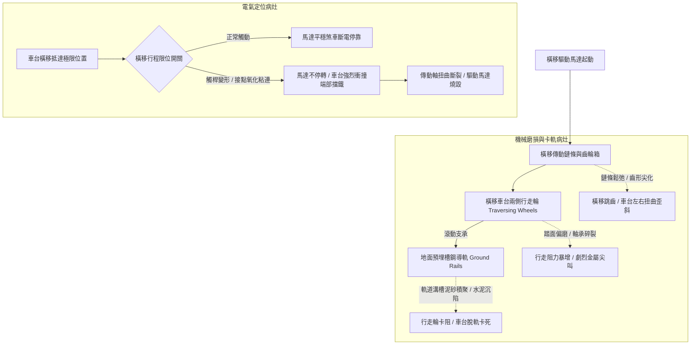

# 全案購屋實戰第五百一十四部_中古大樓社區地下室機械停車設備橫移車台行走輪踏面偏磨導軌積垢跳齒卡軌與限位開關失效體檢工序全書

## 壹、核心體檢宗旨與家庭居住安全意涵

在中古集合住宅大樓中，二層升降橫移式或多層矩陣式機械停車設備（Puzzle Mechanical Parking System）是社區滿足法定停車位數量的重要配置。以小寶家庭列入考慮名單的**長億南園 8 樓**為例，該社區車位即為機械車位系統。

機械停車設備中，「橫移車台（Traversing Platform）」位於地面層或基坑層，負責在水平軌道上左右平移，為上層或下層車台空出升降通道。橫移車台的結構與運轉特性看似簡單，但在屋齡達 20 至 25 年的中古社區中，卻是**故障率最高、卡軌事故最頻繁、最常引發住戶清晨上班「車子被困在裡面出不來」**的罪魁禍首。其核心病灶涵蓋：

1. **行走鋼輪（Traversing Wheels）踏面偏磨與滾珠軸承碎裂**：橫移車台長年承載重車（如 SUV、休旅車）左右滾動，行走輪踏面因受力不均產生單側偏磨或輪緣起毛脫落；輪芯內部深溝球軸承在粉塵與潮濕侵蝕下潤滑脂乾涸、滾珠碎裂，引發劇烈刺耳的金屬摩擦尖叫聲與行走阻力劇增。
2. **橫移導軌（Guide Rails）水泥沉陷、積垢與變形**：地下室地面熱脹冷縮或地坪微幅不均勻沉陷，導致預埋槽鋼導軌水平度偏差（單側高低差超過 5mm）；軌道內溝常年堆積泥砂、油垢、掉落的螺絲或雨天車輪帶入的污水，導致行走輪在滾動時跳軌、卡死。
3. **橫移行走驅動鏈條/齒輪嚙合跳齒（Tooth Skipping）**：驅動馬達透過橫移鏈條拉動車台，鏈條鬆弛下垂或鏈輪齒形尖化，啟動時產生劇烈震動撞擊並引發跳齒，使車台左右兩側無法同步行走而橫向卡死在兩側支柱之間。
4. **極限行程限位開關（Limit Switch）觸桿變形與接點氧化短路**：車台兩端設置定位限位開關與極限超越開關。老舊開關外殼常因車體震動或撞擊而歪斜，內部接點受潮氧化粘連，造成車台橫移到位時「馬達不停機」，強行撞擊端部機械極限緩衝擋塊，引發驅動軸扭曲斷裂或馬達線圈過載燒毀。

本手冊針對長億南園 8 樓等具備機械車位之社區，建立標準化的橫移車台行走機構、導軌平整度、極限開關現場體檢工序、修繕成本指標與買賣契約防護特約。

---

## 貳、橫移車台傳動與導軌定位病灶力學演變

### 1. 行走輪與導軌幾何公差標準
- **水平度偏差極限**：橫移導軌在全行程內的水平度偏差不得超過 **±2 mm/m**，兩軌道間之跨距誤差需小於 **±3 mm**。
- **行走輪輪緣磨耗極限**：雙輪緣行走輪的輪緣厚度磨損若超過原始厚度的 **20%**，或踏面徑向跳動（Radial Runout）超過 **1.5 mm**，車台即極易在轉向或受偏載時發生跳軌。

### 2. 限位開關電氣安全防線
- **工作減速/停止限位開關**：車台抵達定位前 50~100mm 觸發減速或斷電停靠。
- **極限超程開關（Over-travel Switch）**：若工作開關失效，車台超越平移位置 30mm 內，機械強制切斷整組機械車位之主電源。若被維修工短接跳線，將失去最後安全屏障。

---

## 參、實地帶看機械車位橫移機構體檢工序（SOP）

小寶在帶看長億南園現場時，必須會同房仲與管理員實地操作該機械車位的橫移行程：

| 檢驗步驟 | 檢驗場域與操作工序 | 正常指標 | 異常警訊與深層機械病灶 |
| :--- | :--- | :--- | :--- |
| **步驟一：地面軌道溝槽平整度查驗** | 攜帶強光手電筒照射橫移車台下方的預埋槽鋼導軌。 | 軌道平直無凹陷，溝槽內乾淨無積水、無厚重泥砂與雜物堆積。 | 1. 導軌內塞滿黑色油泥砂石，甚至有生鏽積水。 2. 軌道鋼材邊緣被行走輪啃咬出明顯鐵屑毛邊。 |
| **步驟二：實機操作橫移行程與異音監聽** | 在操作盤按下車位號碼，啟動橫移車台由最左側平移至最右側。 | 車台平穩滑動，聲音為均勻低沈之滾動聲，無卡頓與左右扭動。 | 1. 發出尖銳的金屬摩擦聲或「喀拉喀拉」軸承破裂碎珠聲。 2. 車台啟動時劇烈抖動跳齒，行走過程中車體明顯歪斜。 |
| **步驟三：到位定位與極限停止精準度** | 觀察車台橫移抵達端點時的停止狀態與碰塊接觸情況。 | 車台輕柔減速並準確停於定位點，防護擋塊與車輪保持 10~20mm 安全間隙。 | 1. 車台以全速直接硬碰硬撞擊端點鐵塊，發出巨響震動。 2. 停止位置偏差超過 30mm，導致相鄰升降車台無法順利下放。 |
| **步驟四：查驗橫移馬達外觀與減速機漏油** | 檢視橫移車台內側所搭載的臥式減速馬達組。 | 馬達外殼乾淨乾燥，減速機油封密封良好無滲油，接線盒蓋密封。 | 減速機外殼滲滿黑油並滴落底坑，馬達外表發燙且伴隨微焦異味。 |

---

## 肆、長億南園機械車位置產防衛與合約特約保障

對於鎖定**長億南園 8 樓**（主附 32 坪超大空間，但配置機械車位）的小寶家庭而言，機械車位若故障將嚴重影響通勤作息，必須在簽約前建立嚴密的工程預算防禦與法律特約：

### 1. 橫移系統維修與重置成本基準
- **更換橫移車台行走輪與高精度滾珠軸承（1 套 4 輪）**：連工帶料約 **\$15,000 ~ \$24,000**。
- **更換橫移驅動鏈條、驅動鏈輪與張緊輪組**：連工帶料約 **\$12,000 ~ \$18,000**。
- **更換橫移臥式減速馬達（0.4kW ~ 0.75kW 附電磁煞車）**：單顆更換約 **\$22,000 ~ \$32,000**。
- **更換橫移極限行程開關組（含線路檢測調整）**：約 **\$6,000 ~ \$10,000**。

### 2. 購屋買賣合約橫移車位專屬特約防護條款
> **機械車位橫移功能與現況保證特約條款**：  
> 「賣方保證本買賣標的所隨附之機械停車位（車位編號：___），其橫移及升降機構均運轉正常，無行走輪偏磨卡死、導軌變形跳齒或極限開關失靈等情事。交屋前雙方應於現場實地通電操作該車位之完整橫移行程及升降行程，確認運作平順無異音。若交屋日前經檢驗有橫移馬達漏油、行走輪損壞或開關故障需維修之情事，賣方應於交屋日前全額出資修復完畢並取得保養廠商合格簽章，否則買方得逕行自尾款中扣除修繕所需費用新台幣三萬元整。」
