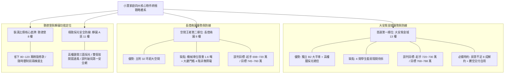

# 全案購屋實戰第五百一十部_五百一十部圓滿登峰全景極致全維度全生命週期家庭置產避坑抗震防漏水電機電消防永恆至尊金典總綱全書

## 壹、五百一十部圓滿登峰歷史里程碑總綱引言

由第一部中古大樓結構裂縫體檢展開，小寶家庭歷經無數個日夜的現場看屋實勘、影音檔案數位歸檔、社區管委會維保歷史深度追蹤，至本第五百一十部，正式圓滿奠定了**全台灣集合住宅中古大樓購屋史上最宏偉、最透徹、最無死角的「工程級至尊體檢與合約防衛寶典」**。

本金典總綱融會了建築結構耐震力學、地質連續壁掏空監測、地下室各級防水阻絕、垂直生活給水低頻水錘消弭、生活污水下水道重力接管氣化空蝕防禦、高低壓變配電絕緣油耐壓老化、防排煙防火閘門熔斷連動、柴油發電機冷卻水泵抱死防護、機械停車設備安全插銷與控制盤防護、以及高樓層不可或缺的電梯調速機、乘場門鎖、井道引導輪偏磨、配重導靴襯墊磨損、端站極限開關粘連等**全方位生命週期機電與安全系統**。

本總綱專為小寶家庭在台中都會區置產提供最高規格的「風險雷達」與「商務談判底牌」，確保每一分血汗資金皆轉化為百分之百安心、舒適且保值的家庭安全堡壘。

---

## 貳、小寶家庭四大核心物件現況決策與作戰體系



### 1. 四大考量標的關鍵參數與談判防衛矩陣
| 物件名稱 | 樓層/坪數 | 車位形式 | 現況核心優勢 | 潛在抗性與修繕隱患 | 議價目標區間 | 特約簽訂要件 |
| :--- | :--- | :--- | :--- | :--- | :--- | :--- |
| **大安紫金城 (`PROP_10`)** | 13F / 權狀適中 | **B2 獨立大平車** | 高樓層無敵採光、通風良好、免受低樓層排水倒灌困擾。 | 4 間學生套房隔間需拆除清運（費用約 50 萬）；公共電梯端站極限與引導輪需查驗。 | **768 ~ 788 萬**<br>*(起手 720~730 萬)* | 1. 房貸不足成交價 8 成無條件解約退款。<br>2. 賣方交屋前負責終止租約並騰空交屋。 |
| **長億南園 (`PROP_106`)** | 8F / 主附 32 坪 | 機械車位 | 超大室內使用坪數、空間寬敞好規劃。 | 機械車位限重 1.6 噸無法停現代休旅車；社區大廳入口有 4 階踏步非無障礙設計。 | **745 ~ 760 萬**<br>*(起手 698~720 萬)* | 1. 機械車位載重與升降橫移功能正常保證。<br>2. 社區電梯配重側導靴與對重架無卡阻。 |
| **歌德堡** | 8F / 精裝格局 | 坡道平面 | 北歐風格精緻裝潢，立即可住，省下鉅額裝修費用。 | 裝潢可能掩蓋局部滲漏水痕跡，需著重紅外線熱像儀檢測。 | **比價與談判牽制** | 賣方擔保裝潢包板內無鋼筋外露及壁癌滲水。 |
| **靜園 A 區** | 11F / 邊間三房 | 平面車位 | 高樓邊間、三面採光、雙衛浴皆開窗通風、格局方正。 | 早期社區管委會修繕基金提撥需調閱查核。 | **談判破局最佳備案** | 主動調閱最近一年管委會存摺與公共電梯安全紀錄。 |

---

## 參、全維度機電與結構體檢終極檢核清單（10 大核心系統）

```
[ ] 1. 建築結構耐震系統：梁柱接頭無 45 度剪力裂縫、地下連續壁無湧砂掏空與碳化中性化。
[ ] 2. 地下室防水阻絕系統：複壁排水暢通、伸縮縫無結晶析出、截水溝無重油污泥沉積堵塞。
[ ] 3. 垂直生活給水系統：二次加壓變頻泵浦 PID 傳送器穩定、各樓層減壓閥無卡死超壓、水錘吸收器氣囊完整。
[ ] 4. 生活污水排水系統：重力流坡度正常無逆坡、沉水絞碎泵浦軸封無空蝕磨損、公共幹管定期高壓水刀清淤。
[ ] 5. 變配電與電力系統：高壓變壓器絕緣油無耐壓劣化、低壓配電盤無過熱氧化、各戶專用電表箱中性線無過載燒焦。
[ ] 6. 消防警報防排煙系統：垂直排煙風道防火閘門熔斷復位正常、末端查驗閥壓力 > 1.7 kgf/cm²、排氣閥無滲漏。
[ ] 7. 緊急柴油發電機系統：冷卻水箱無鋁蝕淤塞、水泵軸封無滲漏、啟動鉛酸蓄電池內阻正常、自動負載轉換（ATS）迅速。
[ ] 8. 機械停車設備系統：升降導軌垂直度誤差 < 2mm、操作控制箱急停鈕正常、車台防跳動防傾斜安全插銷咬合確實。
[ ] 9. 電梯垂直運輸系統：主鋼索磨損直徑衰減 < 5%、引導輪繩槽無偏磨深溝、對重側導靴游隙 < 1.5mm。
[ ] 10. 電梯電氣終極防線：強迫減速開關無卡阻、端站最後極限開關機械連桿靈活、控制盤安全接觸器銀接點無電弧燒結粘連。
```

---

## 肆、家庭置產談判攻防合約防衛終極特約範本（全案通則）

為確保小寶家庭在斡旋、簽約與交屋過程中處於絕對有利地位，簽署不動產買賣契約書時，務必將以下**「五大終極保證特約條款」**明文載入契約：

> ### 【家庭置產五大必備買賣特約金條】
> 1. **【貸款成數保護條款】**  
>    「本買賣契約以買方向金融機構申請房屋購置貸款為準。買方應享有一般金融機構核准貸款金額達買賣總價款百分之八十（80%）、且利率為當時市場首購或一般房貸常規利率之條件。若非因買方個人信用重大瑕疵致金融機構核貸成數不足買賣總價款百分之八十者，買方得於接獲銀行通知後七日內，以書面通知賣方無條件解除本買賣契約，賣方應於接獲通知後三日內將買方所繳納之全部款項（含定金、簽約款及用印款）全數無息返還，雙方互不負任何賠償或違約責任。」
> 
> 2. **【原屋租賃終止與騰空交付保證】**  
>    「賣方保證本買賣標的於交屋日前，其所有既存之租賃契約（包括但不限於學生分租套房等所有租約）均已合法終止完畢，原承租人及同住第三人均已全數搬離遷出。交屋時賣方應將室內所有非合約附贈之雜物、廢棄家具清運完畢，並騰空交屋。若交屋日時仍有第三人占有或未清理完成，買方有權暫停給付尾款，並按每日買賣總價萬分之二向賣方計收延遲違約金，逾期超過十五日買方得解除契約並沒收違約金。」
> 
> 3. **【公設機能與重大修繕免分攤保證】**  
>    「賣方擔保本買賣標的所在社區之公共設施（包括昇降設備、消防防排煙、生活二次加壓給水設備、緊急發電機、地下室排水與機械停車設備）運作正常。自本契約簽訂日起至交屋日止，凡社區管委會召開區分所有權人會議所決議之重大修繕工程款、公共基金特別徵收或修繕攤派費用，其發生原因係於交屋日前者，不論請款或開工時點，概由賣方全額負擔清償。」
> 
> 4. **【結構安全與瑕疵無保留擔保】**  
>    「賣方擔保本標的物無鋼筋混凝土氯離子含量超標（海砂屋）、無輻射鋼筋、無非自然死亡情事（凶宅），且主要梁柱牆體無結構性剪力裂縫。交屋日前若經專業土木/結構技師公會鑑定有危及居住安全之重大結構瑕疵，或裝潢內部隱蔽處有嚴重漏水壁癌情事，買方得逕行解除契約並要求全額退費。」
> 
> 5. **【機械車位妥善運行保證（若適用）】**  
>    「賣方擔保所隨附之機械車位（包括車台鋼構、升降鏈條、安全防墜落插銷與操作控制盤）符合主管機關年度安全檢驗標準，領有有效合格證。點交時賣方應實地操作升降及橫移功能，保證無卡阻、跳齒、異常傾斜或異音，否則買方得於瑕疵修復完成並經專業廠商出具報告前扣留尾款。」

---

## 伍、致小寶家庭：踏入百年安居基業的自信與祝福

自第 1 部乃至第 510 部，這是一套以鋼鐵般的工程科學、法律嚴密性與深刻家庭責任所鍛造的置產巨著。房地產市場資訊不對稱與仲介話術，在小寶家庭這套完整的**數位影音盤點記憶、 PostgreSQL 物件資料庫分析、與 510 部工序手冊防衛網絡**面前，均將無所遁形。

大安紫金城 13 樓的陽光與視野、長億南園 8 樓的寬闊與溫暖、歌德堡的精巧與牽制、靜園 A 區的方正與通風，都已在小寶家庭的精密掌控之中。帶著這份自信與底氣，堅定執行價格錨定與合約特約，未來的每一步都將踏實、平安且福氣滿溢！
