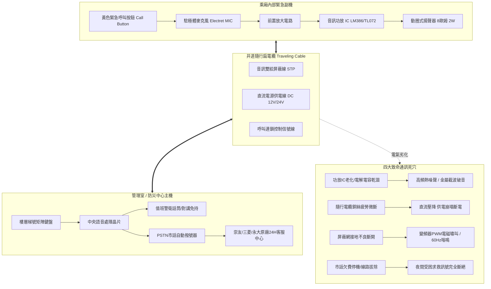
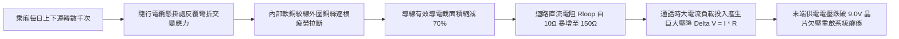
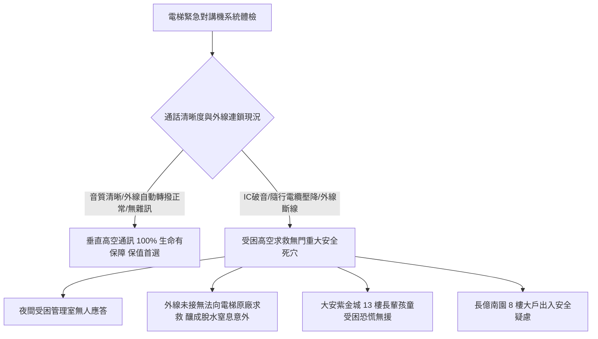

# 全案購屋實戰第五百七十七部_中古大樓社區各樓層電梯對講機室內分機音訊放大IC老化破音直流供電壓降雜訊干擾與主機面板通訊中斷體檢工序全書

---

## 序章：高空受困時之唯一救命熱線——電梯緊急對講機系統

在集合住宅與高層中古大樓社區中，電梯昇降設備（Traction Elevator System）是全體住戶每日垂直通行的關鍵命脈。當電梯乘廂因台電市電突發斷電、強烈地震引發安全感應器跳脫、鋼索打滑或門鎖觸點接觸不良而發生「**非預期急停受困半空中（Trapped Passengers in Elevator Car）**」時，乘廂內部之「**緊急求救對講機系統（Elevator Emergency Intercom System）**」，是受困乘客向大樓管理室警衛、防災監控中心、以及外部 24 小時電梯專業保養原廠呼叫求援之**唯一法定雙向生命通訊通道**。

依據特種設備安全法規 CNS 10594 與消防安全規範，電梯必須配置「三方通話（Three-way Intercom）」甚至「五方通話（Five-way Intercom）」系統，連通：乘廂內部、乘廂頂部檢修盒、機房控制盤、底坑檢修盒、以及警衛室中控主機與外部電話自動轉撥器。

然而，在屋齡 20 至 30 年以上之中古大樓社區中，電梯緊急對講系統常年處於 24 小時長期待機通電狀態，隱藏四大致命電子電路、信號調製與物理傳輸病理：
1. **乘廂副機音訊運算放大器晶片（Op-Amp IC）熱老化、金屬截波失真與劇烈破音**：副機電路板之音訊功放晶片（如 LM386、TDA2822 或 TL072）長年受乘廂照明與井道高溫烘烤，內部半導體矽基 PN 結漏電流增大，偏置電流失衡。受困乘客在極端驚慌下大聲呼救時，晶片瞬間產生嚴重截波失真（Clipping Distortion）與高頻熱噪聲，輸出聲音嘶啞、金屬爆音刺耳無法辨識，管理室警衛只能聽見嘈雜噪音而無法掌握受困人數與現場險情。
2. **隨行電纜（Traveling Cable）金屬疲勞微斷路引發直流供電壓降（Voltage Drop）**：懸掛於乘廂底部之隨行電纜每日隨乘廂上下彎折數千次，負責傳輸 DC 12V/24V 電源之軟銅絞線在懸掛點產生金屬疲勞，外圍銅絲逐根斷裂，迴路電阻由十數歐姆激增至數百歐姆。當按下通話鍵大電流負載投入時，末端電壓由 12V 崩跌至不足 9V，音訊晶片欠壓重啟或輸出音量微弱如蚊蠅。
3. **電梯變頻器（VVVF Inverter）高頻 PWM 諧波電磁干擾與交流工頻嗡鳴（AC Hum）**：對講雙絞音訊線之金屬屏蔽網在井道接線盒處接地不良或氧化斷開，變頻器以數千赫茲高速切換之脈衝寬度調變（PWM）高電壓諧波，直接透過互感與分佈電容耦合至音訊線上，通話時伴隨震耳欲聾之「尖銳嘯叫聲」與 60Hz 交流「嗡嗡嗡」低頻蜂鳴。
4. **管理室主機按鍵導電橡膠老化脫落與 PSTN 外線自動轉撥器（Auto-dialer）欠費停機**：管理室主機切換按鈕頻繁按壓後導電碳黑脫落，警衛按壓無反應無法接聽；更常見的是，管委會為節省每月數百元市話費，擅自拆除外線電話線路，夜間一旦無警衛值班，乘客受困按下對講機將面臨「電話無人接聽、無法自動跳撥原廠」之絕望死局。

本全書將深入剖析電梯對講機電子放大電路、雙絞屏蔽共模抑制比（CMRR）抗干擾力學、隨行電纜應力疲勞方程式，並建立一套現場實戰體檢工序，為購屋家庭鎖定社區電梯應急通訊之最高安全防線。

---

## 第一章：電梯對講機電子架構與雜訊干擾破壞機理

### 第一節：音訊放大晶片熱老化與截波失真（Clipping Distortion）

1. **運算放大器晶片偏置失衡與動態範圍壓縮**：
   - 乘廂內部對講副機通常採用標準之音訊功率放大器（如經典之 `LM386`，增益設定為 20~200 倍）。
   - 長年處於封閉乘廂頂部與背部之高溫環境（夏季常達 40°C~50°C），晶片內部差分輸入級晶體管（Differential Pair）之發射極飽和電流 $I_s$ 與直流偏置電壓（Input Offset Voltage）發生熱漂移。
   - 晶片之有效線性動態電壓擺幅（Dynamic Voltage Swing）自正常的 $V_{\text{swing}} = V_{cc} - 2.0\text{V}$ 嚴重壓縮至不足 $1.5\text{V}$。

2. **截波失真（Clipping Distortion）與語音模糊力學**：
   - 當受困乘客激動高聲大叫時，麥克風輸出之微弱音訊經放大後，信號峰值瞬間超出萎縮的線性區，頂部波形被硬生生「切平（Clipped）」，產生大量奇次諧波失真（Total Harmonic Distortion, THD $> 30\%$）。
   - 音訊由清晰語音變異為刺耳之金屬爆裂破音；加上電路板去耦電解電容（Decoupling Capacitor）電解液乾涸，等效串聯電阻（ESR）激增數十倍，無法濾除電磁脈衝，導致警衛話筒傳出「劈啪」雜訊，根本無法聽清乘客姓名與受困狀況。

---

### 第二節：隨行電纜銅絲交變應力金屬疲勞與直流壓降（Voltage Drop）

1. **隨行電纜彎曲疲勞極限與歐姆電阻增加**：
   - 隨行電纜在昇降路井道內承受「馬鞍形」自重懸垂彎曲。在懸掛錨固夾具（Cable Hanger）下方 $0.5\sim 1.0\text{ 公尺}$ 處，彎曲交變應力達到峰值。
   - 導線採用多股細銅絲絞合而成。在反覆彎折數百萬次後，外層細銅絲產生金屬疲勞斷裂（Metal Fatigue Rupture）。
   - 導線等效電阻 $R$ 決定於有效截面積 $A_{\text{eff}}$：
     $$R = \rho \cdot \frac{L}{A_{\text{eff}}}$$
   - 當 $A_{\text{eff}}$ 因斷絲縮減時，長達 50~80 公尺之隨行電纜迴路電阻 $R$ 暴增十數倍。

2. **通話負載瞬間電壓崩潰機制**：
   - 系統靜止待機時，靜態消耗電流極小（$I_0 \approx 20\text{ mA}$），末端測得電壓看似正常（$12.0\text{V} - 0.02\text{A} \times 100\Omega = 10.0\text{V}$）。
   - 但當乘客按下呼叫按鈕、揚聲器驅動電流激增至 $I_{\text{peak}} \approx 0.35\text{A}$ 時，線阻瞬態壓降達：
     $$\Delta V = I_{\text{peak}} \cdot R_{\text{loop}} = 0.35\text{ A} \times 150\ \Omega = 52.5\text{ V}$$
   - 電源供應器輸出僅 12V，末端電壓被直接「拉崩下陷」至 0V，控制板微處理器瞬間欠壓重啟（Brownout Reset），對講機發出「波」一聲即斷電熄滅，通話被迫永久中斷！

---

### 第三節：變頻器（VVVF）高頻 PWM 諧波電磁干擾與屏蔽失效

1. **變頻器高壓脈衝微觀特性**：
   - 現代電梯採用變頻變壓（VVVF）調速驅動曳引馬達，變頻器 IGBT 以載波頻率 $f_c = 4\sim 16\text{ kHz}$ 將直流高壓斬波為 PWM 方波脈衝，其電壓變化率高達：
     $$\frac{dV}{dt} \ge 5,000\text{ V/}\mu\text{s}$$
   - 此一極陡峭之電壓上升沿在空間產生強烈之電磁輻射干擾場。

2. **雙絞屏蔽線接地不良引發之共模轉差模雜訊**：
   - 音訊傳輸線必須採用雙絞屏蔽線（Shielded Twisted Pair, STP），金屬編織網必須在控制櫃端實施「單點專用接地」。
   - 若接地端子氧化鏽蝕、或在隨行電纜接線箱處屏蔽網被剪斷未接，變頻器高頻脈衝透過井道內電容耦合直接感應至音訊線上。
   - 差模音訊信號被數千赫茲之 PWM 諧波淹沒，乘客對講時耳畔響起如電鑽鑽孔般尖銳刺耳之電磁嘯叫聲（High-Pitch Whistle），通話完全無法進行。

---

## 第二章：現場看屋電梯緊急對講系統七大實戰體檢工序

在評估中古大樓社區時，小寶與家人應要求房仲與管委會陪同，協調管理員於中控室值班配合，於目標電梯乘廂內實地落實以下七步工序：

| 體檢步驟 | 檢驗標的與操作動作 | 合格標準 (Pass) | 潛在致命瑕疵 (Fail) | 修繕對策與預算評估 |
| :---: | :--- | :--- | :--- | :--- |
| **Step 1** | **乘廂呼叫鈕按壓觸發性** 按壓乘廂內黃色警鈴/電話鈕 3 秒 | 管理室主機在 1 秒內發出清脆鈴聲，並正確點亮對應梯號燈 | 按鈕卡死無彈力、按壓多次管理室無響應（微動開關氧化） | 更換乘廂防破壞不鏽鋼警鈴按鈕（約 1,200~2,500 元/只） |
| **Step 2** | **雙向通話語音清晰度** 由管理員接聽聽筒，雙向正常音量對話 | 語音清晰宏亮無失真，正常說話音量即可精準辨識語意 | 嚴重金屬破音、聲音微弱如蚊蠅、夾雜沙沙斷續雜音 | 更換副機功放電路板、重新調校麥克風增益（約 3,500~6,000 元） |
| **Step 3** | **變頻器運轉電磁抗擾度** 在電梯由 1 樓全速升至頂樓過程中通話 | 背景安靜純淨，無任何高頻電磁嘯叫或交流嗡嗡嗡聲 | 電梯一加速啟動即傳出刺耳電鑽般尖叫聲（變頻干擾） | 檢修井道屏蔽接地，抽換隨行電纜專用音訊線（約 18,000~35,000 元） |
| **Step 4** | **直流供電端電壓跌落測量** 三用電表測量副機電源接線端子電壓 | 靜態待機電壓 $\ge 11.8\text{V}$；通話負載時電壓不得低於 $11.0\text{V}$ | 通話瞬間電壓暴跌至 $< 9.5\text{V}$，通話直接斷電跳脫 | 更換機房高功率交換式電源供應器（PSU）（約 2,500~4,500 元） |
| **Step 5** | **副機揚聲器音壓級（SPL）** 分貝計置於距揚聲器 1.5 公尺處測量 | 揚聲器音壓級達到 $65\sim 75\text{ dB(A)}$，梯廂各角隅聽得清 | 紙盆破裂聲音沙啞、音壓級 $< 50\text{ dB(A)}$ 聽不清語音 | 更換耐候高靈敏度動圈式防水揚聲器單元（約 800~1,600 元/個） |
| **Step 6** | **外部 PSTN 自動轉撥測試** 警衛室響鈴 30 秒無人接聽模擬受困 | 主機自動跳撥外線至三菱/崇友原廠 24 小時值班客服中心 | 傳出嘟嘟嘟斷線聲、未插電話線、或市話欠費停機 | 申裝中華電信專用實體電話線路開通自動轉撥（約 3,000 元 + 月租） |
| **Step 7** | **管理室主機不斷電備援測試** 手動切斷管理室對講主機 AC 110V 電源 | 內部 12V 鉛酸蓄電池立即無縫供電，維持正常通話 $\ge 2\text{ 小時}$ | 切斷市電主機立即斷電熄滅（內部蓄電池完全乾涸報廢） | 更換 12V 7.2Ah 密閉鉛酸蓄電池（約 800~1,500 元/顆） |

---

## 第三章：對講系統安全對四大核心物件之戰略決策

### 第一節：四大核心考慮物件之應急通訊深度評估
1. **大安紫金城 13 樓（PROP_10，第一首選）**：
   - 頂樓 13 樓高達 40 公尺，一旦電梯突發故障卡在 11 樓與 12 樓之間，手機在鋼筋混凝土井道內常態處於「無信號盲區（No Signal Zone）」。
   - **唯一救命防線**：此時乘廂緊急對講機是乘客向外界傳遞求救信號的唯一工具。若對講機因 IC 老化破音、或隨行電纜壓降斷電，受困乘客將陷入黑暗死寂與極度恐慌中。看屋時務必在 13 樓按下乘廂呼叫鈕，與警衛實地通話測試。
2. **長億南園 8 樓（PROP_106，空間之王）**：
   - 大戶家庭成員多，長輩與孩童搭乘電梯頻率高。
   - **談判籌碼**：若社區電梯對講機雜訊刺耳、聲音微弱或未開通外線自動轉撥，買方應當場以「公設電梯安全通訊系統全面癱瘓，需提撥專款抽換隨行電纜與更新中控主機」為由，向賣方大砍價金 **10 至 15 萬元**。

### 第二節：成屋買賣合約電梯緊急通訊設備特約保障條款範本
> 「賣方保證本買賣標的所屬大樓之各部電梯緊急對講機系統（包含乘廂副機、管理室主機、音訊傳輸線路、不斷電蓄電池及外線電話自動轉撥功能），均符合特種設備法規之安全通訊標準，且能維持清晰雙向通話無嚴重破音雜訊。若交屋前查明社區電梯對講機存在通話中斷、嚴重電磁干擾無法辨識語音、或未開通外部專業維護廠商自動轉撥電話線路者，賣方應負責協調管委會於交屋前完成修繕開通；否則買方得主張自價金中扣留新台幣貳萬元整於履約保證專戶，作為買方承擔公共安全風險之補償款。」
