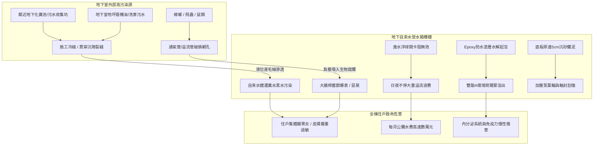
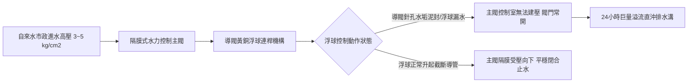
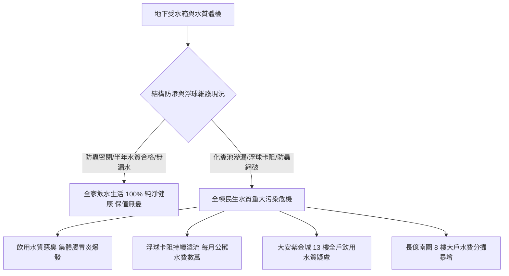

# 全案購屋實戰第五百七十三部_中古大樓社區地下室生活自來水受水箱蓄水池池體裂縫滲水進水浮球閥卡阻無效溢流管防蟲網破裂與水質二次污染體檢工序全書

---

## 序章：高層建築飲水生命源頭之暗疾——地下自來水受水箱

在集合住宅大樓與都會中古社區之給水工程體系中，自來水公司輸送至建築物之公共民生自來水，必須先匯流儲存於地下最底層之「**地下自來水受水箱（Suction Water Tank / Underground Cistern）**」，再藉由二次加壓揚水泵浦將水源輸送至各樓層住戶或頂樓蓄水池。

地下受水箱深埋於大樓地下室地底、或由基礎結構大底（Raft Foundation）隔間而成，是全棟全體住戶每日飲用、烹飪、洗滌、沐浴用水之源頭樞紐。然而，受水箱屬於封閉性極高、常態處於黑暗潮濕且難以巡檢之地下隱蔽空間。在屋齡 20 至 30 年以上之中古大樓社區中，受水箱常年隱藏四大致命結構、機械與公共衛生病理：
1. **水箱混凝土槽壁結構貫穿裂縫與外部污水反向滲透**：受 921 地震等歷史地震剪力破壞、地盤不均勻沉陷及混凝土中性化影響，池壁防水層完全水解老化。更致命的是，早期老舊大樓常將「自來水受水箱」與「化糞池/污水坑」相鄰共用單層混凝土隔牆。當受水箱抽水處於低液位時，外部高濃度大腸桿菌與氨氮污水藉由水頭壓差，透過混凝土毛細裂縫反向滲入自來水中，引發全棟飲用水嚴重糞源性污染。
2. **水力導閥式進水浮球閥（Diaphragm Float Valve）水垢卡阻失靈與巨額溢流浪費**：大口徑進水浮球控制閥之導閥針閥孔遭自來水中碳酸鈣硬垢淤塞，或不鏽鋼浮球破裂進水下沉，導致浮球浮起時主閥隔膜無法關閉。數個大氣壓之市政自來水 24 小時不斷自溢流管狂流排入陰井，導致社區單月公用水費暴增數萬元，造成全體住戶沈重財務負擔。
3. **溢流管（Overflow Pipe）與鵝頸通氣管（Gooseneck Vent）防蟲網罩鏽蝕破裂引發生物污染**：頂部通氣管與溢流管出口之 SUS304 防蟲金屬網罩（法定孔徑需 $\ge 16\text{ 目}$），因地下室潮濕酸霧腐蝕穿孔脫落。地下室飛行的蚊蚋、蛾蚋、甚至老鼠與蟑螂在吸氣負壓下被直接吸入水箱內溺斃腐爛，滋生致病菌與屍毒。
4. **水箱底板沉砂鐵鏽淤泥積存與環氧樹脂（Epoxy）內襯水解剝落**：底板缺乏 1/50 洩水坡度，自來水管網夾帶之重金屬鐵泥與細砂沉積厚達數公分；原塗布之環氧樹脂防水層長年水解起泡剝落，溶出雙酚 A 等環境荷爾蒙化學毒素。

本全書將深入剖析地下受水箱結構防滲力學、水力隔膜閥流體控制方程、生物膜滋生化學機制，並建立現場實戰體檢工序，為購屋家庭鎖定社區民生飲用水之終極安全防線。

---

## 第一章：地下自來水受水箱結構滲透與水質二次污染機理

### 第一節：混凝土池體結構裂縫與外水滲漏流體靜力學

1. **水頭差驅動之達西毛細滲流定律（Darcy's Law）**：
   - 設自來水受水箱與鄰近污水池僅隔一道厚度為 $L$ 之單層混凝土隔牆。
   - 當受水箱處於抽空低水位 $H_{\text{clean}}$、而污水池處於滿溢高水位 $H_{\text{waste}}$ 時，兩側形成強烈之水頭壓差 $\Delta H = H_{\text{waste}} - H_{\text{clean}}$。
   - 滲透流速 $v$ 符合達西定律：
     $$v = -K \cdot \frac{dH}{dL} = K \cdot \frac{\Delta H}{L}$$
     其中 $K$ 為混凝土之水力滲透係數（Hydraulic Conductivity）。

2. **混凝土碳化中性化與毛細孔擴張**：
   - 老舊混凝土在地下室二氧化碳與酸性水氣侵蝕下，游離氫氧化鈣被碳化中性化，微觀孔隙率激增數倍。
   - 伴隨地震造成的剪力微裂隙（裂縫寬度 $> 0.2\text{ mm}$），滲透係數 $K$ 暴增數千倍，外部高濃度含氨氮、大腸桿菌之高污染污水透過裂縫長驅直入乾淨之自來水中，引發肉眼難辨之致病性二次水質污染。

---

### 第二節：水力隔膜浮球控制閥（Diaphragm Float Valve）卡阻與消能破壞

1. **隔膜式水力控制主閥運作力學方程式**：
   - 大口徑進水主閥依靠上腔控制室與下腔入口處之微壓差控制啟閉。
   - 閥瓣閉合力 $F_{\text{close}}$ 為：
     $$F_{\text{close}} = P_{\text{chamber}} \cdot A_{\text{diaphragm}} - P_{\text{in}} \cdot A_{\text{seat}} - F_{\text{spring}}$$
     其中隔膜面積 $A_{\text{diaphragm}}$ 大於閥座面積 $A_{\text{seat}}$（通常為 $1.3\sim 1.5\text{ 倍}$）。
   - 當導閥浮球隨水面上升閉合針閥孔時，上腔壓力 $P_{\text{chamber}}$ 上升至與入口壓力 $P_{\text{in}}$ 同壓，因面積差產生強大向下淨推力，將閥瓣緊壓於閥座上截斷進水。

2. **微孔淤塞與浮球破裂沉底死穴**：
   - 導閥針閥孔直徑僅約 $1.0\sim 2.0\text{ mm}$。自來水中的細砂、鐵鏽泥極易嵌入針閥孔，使控制室無法洩壓或建壓。
   - 不鏽鋼薄壁浮球（SUS304 Float Ball）受進水湧浪長期上下劇烈拍擊震盪，銲接頸部產生金屬疲勞裂縫。自來水滲入浮球內部，浮球自重激增喪失浮力而沉底，導閥永遠處於全開狀態，市政自來水如脫韁野馬日夜不斷溢流排入陰井。

---

### 第三節：溢流管間接排水破口與通氣孔生物污染

1. **通氣管（Gooseneck Vent）之「吸氣呼吸效應」**：
   - 當二次加壓揚水泵高速抽水時，水箱內液位以數公分/秒速度驟降，槽內形成負壓（真空效應），頂部鵝頸通氣管必須高速吸入大量空氣維持平衡。
   - 若通氣管頂部之 **SUS304 不鏽鋼防蟲網罩（孔徑需 $\ge 16\text{ 網目}$）** 鏽蝕破裂，地下室飛行的蚊蚋、蛾蚋、甚至老鼠與蟑螂在強烈吸氣負壓下被直接吸入水箱內，於水面產卵孵化，造成全棟水質致命污染。

2. **溢流管（Overflow Drain）間接排水空氣間隙（Air Gap）**：
   - 建築法規強制規定受水箱溢流管必須採「**間接排水（Indirect Drainage）**」，管口必須高出地下室集水坑或排水溝格柵至少 **$15\text{ 公分}$ 以上** 之有效空氣間隙。
   - 若施工人員便宜行事將溢流管直插排污溝內，當暴雨地下室排水不及倒灌時，污水溝內之糞水與蟑螂將沿著溢流管直接回吸倒灌入乾淨之自來水受水箱中！

---

## 第二章：現場看屋自來水受水箱七大實戰體檢工序

在評估中古大樓社區時，小寶與家人應要求房仲協調管委會總幹事或機電主任，開啟地下室自來水受水箱人孔蓋（Manhole）實地落實以下七步工序：

| 體檢步驟 | 檢驗標的與操作動作 | 合格標準 (Pass) | 潛在致命瑕疵 (Fail) | 修繕對策與預算評估 |
| :---: | :--- | :--- | :--- | :--- |
| **Step 1** | **人孔蓋基座加高與氣密檢查** 檢視受水箱頂部人孔蓋構造與邊緣 | 人孔基座高出地坪 $\ge 15\text{ cm}$，配備氣密橡膠墊圈與鎖定扣件 | 人孔蓋與地坪齊平（污水可漫入）、蓋板鏽穿無密封墊圈 | 加高鋼筋混凝土人孔基座並更換雙層氣密防臭蓋（約 15,000~28,000 元） |
| **Step 2** | **通氣管與溢流口防蟲金屬網** 手電筒檢查鵝頸通氣管與溢流管出口 | 採用 SUS304/SUS316 細目防蟲網（$\ge 16\text{ 目}$），網面無破洞 | 網罩破損失蹤、管口敞開、網面被蛛網油污完全封死 | 更換全不鏽鋼可拆洗式鵝頸防蟲透氣罩（約 2,500~5,000 元/座） |
| **Step 3** | **進水隔膜浮球閥手動閉合測試** 手動將浮球向上托起至水平位置 | 水力控制主閥於 3~5 秒內平穩完全閉合，出水口無殘流水滴 | 浮球頂起後進水閥依然大量噴水、閥體漏水嘶嘶作響 | 拆解更換主閥隔膜片、疏通針閥導管或換整組浮球閥（約 8,000~18,000 元） |
| **Step 4** | **溢流管無外洩偷漏水監控** 在未進水或進水停止時觀察溢流管口 | 溢流管口完全乾燥，無任何涓涓細流外洩痕跡 | 溢流管日夜不停排水、排水溝內長滿青苔水垢 | 徹底調校浮球關閉液位、更換閥座密封膠圈（約 3,000~6,000 元） |
| **Step 5** | **池壁防水層與結構裂縫檢視** 強力防爆手電筒照射池壁與天花板 | 內壁磁磚或食品級無溶劑 Epoxy 塗層平整無龜裂剝落 | 塗層大面積起泡脫落、混凝土粉化露筋、裂縫滲水發霉 | 刮除舊塗層，全池施作食品級無毒聚脲/環氧樹脂防水（約 60,000~150,000 元） |
| **Step 6** | **底部沉澱淤泥與洩水斜度** 觀察水箱底板是否有排泥洩水坑 | 池底平整或具備 1/50 洩水坡度，底部無泥沙、鐵屑泥 | 底板積聚數公分厚爛泥污垢、沉澱物泛黑發臭 | 委託專業領有執照廠商進行全池清洗消毒（約 8,000~15,000 元/次） |
| **Step 7** | **管委會法定水質檢驗報告** 查閱管理室近 1 年半年度自來水水質報告 | 大腸桿菌群、濁度、總菌落數、餘氯符合國家飲用水標準 | 無法提供報告、報告超標未複驗、蓄水池已逾 1 年未洗 | 責成管委會限期完成水箱清洗與合格檢測（列入契約點交前提） |

---

## 第三章：受水箱安全對四大核心物件之戰略決策

### 第一節：四大核心考慮物件之水質安全深度評估
1. **大安紫金城 13 樓（PROP_10，第一首選）**：
   - 屋齡約 28 年，全家人每日飲用水皆來自地下受水箱之一次儲水。
   - **實地必查要點**：務必向管理室調閱「近一年兩次蓄水池水塔清洗紀錄與 SGS 水質合格檢測報告」，確認大腸桿菌群為 0、濁度合格。
   - **裝修專用解法**：在室內水電裝修時，廚房出水端配置「**生飲級 RO 逆滲透純水機（0.0001 微米）**」，後陽台進水端加裝「**40 微米全戶反洗前置過濾器**」，築起雙重室內防禦。
2. **長億南園 8 樓（PROP_106，空間之王）**：
   - 社區基地規模大，水箱容量大。
   - **財務查核死穴**：查閱管委會財務收支明細表中之「公共水費」項目。正常社區每月公共水費應在 8,000~15,000 元左右；若單月突破 3~5 萬元，代表地下受水箱浮球閥嚴重卡阻溢流、或地下管線大漏水。以此為籌碼向賣方大砍價金 **10 至 15 萬元**。

### 第二節：成屋買賣合約自來水受水箱特約保障條款範本
> 「賣方保證本買賣標的所屬大樓之地下室自來水受水箱、頂樓水塔及進水控制閥均符合國家建築技術規則衛生安全標準，且管委會依法每半年定期委託領有合格執照之專業廠商完成清洗與水質檢驗合格。若交屋前查明社區受水箱存在結構滲漏水、溢流管長年持續漏水、或已逾一年未實施水箱清洗檢驗者，賣方應負責協調管委會於交屋前完成清洗消毒與複驗；否則買方得主張自價金中扣留新台幣貳萬元整於履約保證專戶，作為買方自行加裝全戶級生飲過濾設備之補償款。」
