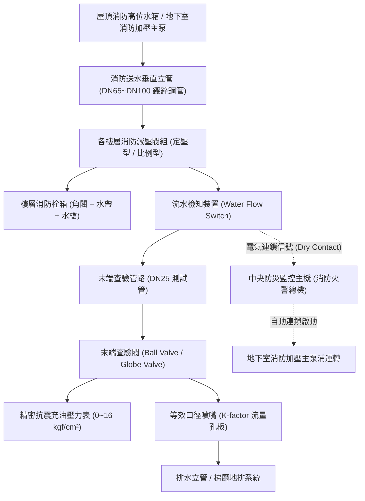
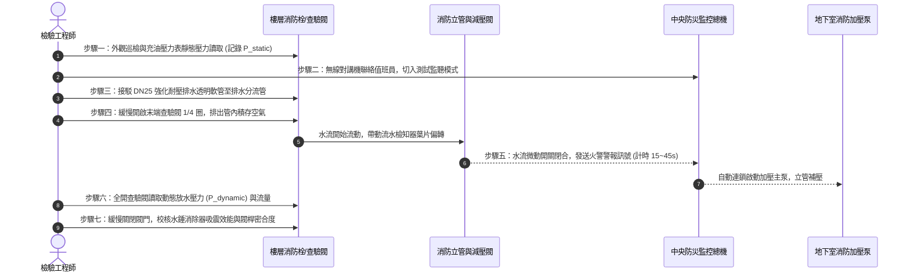

# 全案購屋實戰第五百七十九部：中古大樓社區各樓層消防栓箱末端查驗閥壓力試驗、微動開關警報連鎖失效、排氣水錘與閥門填料滲漏體檢工序全書

---

## 壹、前言與核心體檢宗旨

在中古集合住宅（屋齡 20～35 年）之機電消防安全評估中，各樓層梯廳配置之「室內消防栓箱系統」（包含消防立管、減壓閥、消防水帶、水霧瞄子及末端查驗閥測試管路），乃是火災初中期撲滅火勢、阻止濃煙擴散與維護逃生動線安全的生命防線。

然而，諸多中古社區因長年缺乏正統「末端查驗閥壓力試驗（Inspector's Test Valve Pressure & Flow Testing）」，導致以下嚴重致命暗病長年隱匿：
1. **末端查驗閥微動開關與警報連鎖失效**：末端查驗閥開啟時，未能即刻驅動流水檢知裝置（Water Flow Detector）或壓力開關，導致中央防災監控主機無法接收啟動訊號，消防加壓排組無法自動連鎖跳起。
2. **管網高處滯留空氣與水錘爆管**：消防立管頂端排氣閥堵塞或排氣不全，於末端查驗閥快速開啟或關閉時，管內殘存氣囊劇烈壓縮膨脹，引發極限水錘波，直接撕裂管壁脆弱接頭或震裂樓層減壓閥隔膜。
3. **閥體閥桿填料老化滲漏**：消防栓箱內之角閥、查驗凡而填料（Gland Packing）長年未維護硬化脆裂，一經轉動即發生大量漏水，浸濕梯廳公共走道與電梯廳底板。

本工序全書旨在提供買方與社區管委會一套精密、實戰且具標準檢驗數據之體檢實戰工序，確保消防火警防護網零死角。

---

## 貳、各樓層消防栓箱與末端查驗閥結構與運作原理

### 1. 末端查驗閥（Inspector's Test Connection）之法定功能
- **模擬單一放水狀態**：末端查驗管徑通常為 25mm（1 吋），末端裝設與該區撒水頭或瞄子同等孔徑之限流孔板（Orifice），開啟時可精確模擬火警發生時系統之真實流量與動態放水壓力。
- **驗證流水檢知裝置動作時效**：水流流經檢知器葉片（Vane-type）時，推動微動開關，必須於 **15 至 45 秒之內**（延時電路設定）將訊號回傳至防災中心主機，並驅動樓層蜂鳴器與加壓泵浦。

---

## 參、中古社區現場五大常見致命病徵與工程成因

| 病徵分類 | 現場常見故障現象 | 工程深層成因分析 | 對住戶家庭置產之潛在危害 |
| :--- | :--- | :--- | :--- |
| **一、末端連鎖失效** | 開啟末端查驗閥放水後，中央消防主機無聲無息，消防泵浦未起動 | 1. 水流檢知器葉片卡阻或斷裂。 2. 微動開關接觸點氧化積碳阻抗過高。 3. 訊號傳輸線路斷線或接地短路。 | 火災發生時拉出水帶無水可用，水壓不足無法壓制初期火勢，延誤黃金滅火時機。 |
| **二、管網空氣水錘** | 開放閥門時管路產生巨大金屬撞擊巨響「匡噹！」，水表指針劇烈狂甩 | 消防立管頂部自動排氣閥水垢卡死，管內積存大量高壓氣囊，水流衝擊氣囊引發二次反射水錘震盪。 | 水錘應力震裂立管接頭、車牙處斷裂、法蘭墊片噴飛，造成大樓嚴重垂直淹水。 |
| **三、閥桿填料滲漏** | 現場輕轉查驗閥或消防角閥時，閥桿軸封處立刻水柱激射或持續滴漏 | 閥桿石棉/PTFE 鐵氟龍填料長年處於高壓受壓狀態，橡膠硬化、失去彈性，一經操作旋轉即破損。 | 測試或火災時梯廳淹水，消防水漫入電梯井道造成電梯故障停擺或電腦基板燒毀。 |
| **四、靜態動態超壓** | 壓力表指針超過 7 kgf/cm²，甚至直逼 10~12 kgf/cm² | 樓層減壓閥閥芯水垢咬死、阻尼孔堵塞，使高壓水直接灌入樓層箱體。 | 救火時反作用力過大，水帶爆管甩飛重傷住戶或打穿裝潢天花板。 |
| **五、排水分流倒灌** | 進行末端放水試驗時，排水管路回湧，污水倒灌蔓延梯廳 | 社區末端查驗排水管與一般生活廢水混接，或排水立管內油垢毛髮淤塞，通氣管堵塞。 | 梯廳木質地板泡水損毀、公設壁紙發霉剝落，公設修繕基金長年透支爭吵。 |

---

## 肆、標準末端查驗閥壓力試驗七步工序法

### 工序詳解規範要點：
1. **讀取靜態壓力（Static Pressure Check）**：
   - 合格標準值：**$3.5 \sim 7.0\ \text{kgf/cm}^2$**。
   - 若高於 $7.0\ \text{kgf/cm}^2$，代表減壓閥失效；若低於 $3.5\ \text{kgf/cm}^2$，代表高位水箱水位不足或定壓補水泵故障。
2. **啟動連鎖計時（Time Delay Test）**：
   - 閥門全開瞬間使用碼錶精準計時，防災總機接收到「第 X 棟 X 樓水流檢知」信號之延遲時間必須落在 **15 至 45 秒** 間。
   - 若少於 15 秒，極易因管網微幅壓力波動造成假警報；若超過 60 秒，則微動開關接點已氧化劣化需即刻更換。
3. **動態放水壓力校核（Dynamic Residual Pressure）**：
   - 放水達到穩定狀態時，動態壓力表讀數不得低於 **$2.5\ \text{kgf/cm}^2$**，放水量應符合各法規口徑之流量標準。
4. **閥桿防漏與復歸防護（Packing Gland Inspection）**：
   - 測試完成關閉後，以乾淨擦拭布擦拭閥桿外圓周，觀察 3 分鐘內不得有水珠滲出；若有水滲出，以套筒扳手緊固迫緊螺帽 1/6 圈，若仍持續滲漏則判定填料失效。

---

## 伍、買方看屋現場 3 分鐘自我快檢表

| 檢驗項目 | 快檢手法與工具 | 合格標準 | 致命危險特徵（一票否決） |
| :--- | :--- | :--- | :--- |
| **1. 壓力表指針狀態** | 檢視消防栓箱內壓力表 | 指針靜止於 3.5~7 kgf/cm² 綠色安全區間 | 指針歸零（無水無壓）或破表超過 10 kgf/cm² |
| **2. 閥體外觀鏽蝕** | 強光手電筒照射角閥、查驗閥閥體 | 鑄銅金屬光澤正常，無銅綠結晶、無鏽蝕 | 閥體周圍附著厚重白色水垢或綠色碳酸銅結晶，表示長年滴漏 |
| **3. 箱體內部乾燥度** | 檢查箱體底板與水帶狀況 | 箱體內無水痕、無發霉，水帶乾燥潔淨 | 底板積水腐蝕、箱底生鏽穿孔、水帶發霉黏連發臭 |
| **4. 警報連鎖手動按鈕** | 觀察火警發信機與指示燈 | 紅色標示燈恆亮，保護罩完整無損 | 指示燈熄滅、外殼破碎、總機長年常閉靜音（被管委會拔線） |

---

## 陸、購屋談判與公設瑕疵防禦合約條款範本

> **公設消防系統查驗與特約修繕專款條款：**  
> 「賣方保證本買賣標的所在樓層及社區公共消防安全設備（包含室內消防栓、末端查驗閥、減壓閥及消防幫浦連鎖系統）符合現行消防法規標準，且能正常連鎖起步運作。  
> 雙方約定於點交日前，由買方會同合格消防設備師進行樓層末端查驗閥壓力與啟動連鎖實測。若發現放水壓力低於 $2.5\ \text{kgf/cm}^2$、減壓閥超壓故障或警報無法連鎖啟動消防泵浦等重大瑕疵，賣方應於點交日前督促管委會修復完畢；若未能於期限內修復，賣方同意自買賣尾款中提撥新台幣 **伍萬至壹拾萬元整** 作為公共機電修繕保留款，待完全修復檢驗合格後始得撥付。」

---

## 柒、結語

消防系統是家庭置產「平時看不見、大難臨頭救全家」的終極關鍵資產。買房絕不能僅看室內精美裝潢，務必推開樓層消防栓箱，藉由末端查驗閥的靜態與動態數據，洞悉整個社區地下室機房、垂直立管及中央防災監控系統的真實維護底蘊，為家人打造堅不可摧的居住堡壘！
