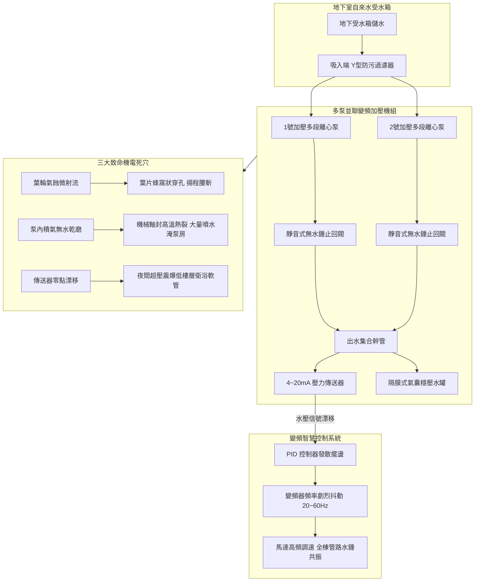
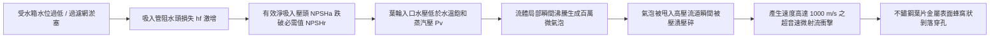
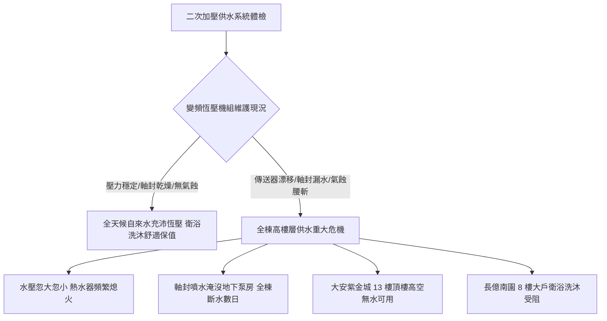

# 全案購屋實戰第五百七十二部_中古大樓社區地下室生活自來水二次加壓變頻泵浦PID控制恆壓傳送器漂移葉輪氣蝕剝落與機械軸封高溫乾磨體檢工序全書

---

## 序章：高層建築生活供水之關鍵中樞——二次加壓變頻機組之隱患

在現代高層集合住宅大樓與中古社區之自來水工程體系中，自來水公司之市政管網水壓通常僅能滿足 1 樓至 3 樓之自然重力供水。自 4 樓以上之中高樓層至頂樓住戶，必須依賴設於地下室之「**自來水二次加壓變頻泵浦機組（Secondary Booster Pumping Station with VFD）**」，透過多台並聯離心泵、交流變頻器（Variable Frequency Drive, VFD）及 PID 閉迴路微電腦控制器，將自來水以恆定壓力（Constant Pressure）輸送至各住戶水龍頭與熱水器。

二次加壓泵浦是全體住戶每日飲用水、衛浴洗沐、廚房洗滌與馬桶沖洗之命脈心臟。然而，在屋齡 20 至 30 年以上之中古大樓社區中，地下室加壓機組長年處於 24 小時高負荷、高頻繁起停之連續運轉狀態，隱藏三大致命機電、流體力學與熱力學病理：
1. **PID 閉迴路恆壓傳送器（Pressure Transmitter, 4~20mA）零點漂移與全棟水壓振盪喘振（Hunting）**：壓阻式擴散矽薄膜因長年水錘震盪產生塑性形變，或 1/4" 毛細引壓管遭自來水中碳酸鈣硬垢與鐵鏽雜質泥封，導致回授給控制盤之水壓信號產生「零點正/負向漂移」。控制系統誤判管網水壓而瘋狂在 20Hz 與 60Hz 之間激烈來回跳動，造成全棟住戶出水忽大忽小、熱水器忽冷忽熱頻繁熄火，並誘發各樓層管路強烈共振水錘，震裂老舊管件牙口。
2. **淨吸入壓頭（NPSHa）不足誘發葉輪超音速氣蝕（Cavitation）與海綿狀穿孔**：地下受水箱水位過低、或泵浦吸入端 Y 型過濾網長年未清淤，管內局部流體壓力跌破該水溫之飽和蒸汽壓（$P_v$），大量微氣泡在高壓區瞬間被壓潰，產生速度高達 $1,000\text{ m/s}$ 之超音速微射流（Micro-jet）。不鏽鋼葉片在微射流持續轟擊下金屬疲勞點蝕，表面產生蜂窩狀穿孔剝落，加壓揚程斷崖式腰斬達 50% 以上。
3. **機械軸封（Mechanical Seal）高溫乾磨碳化與地下泵房噴泉大淹水**：受水箱進水不及抽空或維修後排氣閥未完全排氣，旋轉環（動環）與靜止環（靜環）端面潤滑水膜汽化消失。高速旋轉（3,000 RPM）下剛性乾摩擦使端面溫度在數十秒內飆破 250°C，碳化矽（SiC）端面產生放射狀熱裂紋，彈簧氟橡膠（FKM）O 型環碳化脆裂，高壓自來水呈噴泉狀自泵軸處噴射而出，淹沒地下室變配電設備。

本全書將深入剖析二次加壓泵浦流體力學方程式、PID 閉迴路調校數學模型、機械軸封摩擦學，並建立一套現場實戰體檢工序，為購屋家庭鎖定社區供水與機電之最高安全防線。

---

## 第一章：二次加壓變頻給水泵浦流體力學與三大失效病理

### 第一節：壓力傳送器零點漂移與 PID 控制迴路振盪（Hunting）

1. **壓阻式擴散矽傳送器之信號轉換方程式**：
   - 壓力傳送器感測管網壓力 $P$，輸出標準直流電流信號 $I$：
     $$I(P) = 4.0\text{ mA} + \left(\frac{P}{P_{\max}}\right) \times 16.0\text{ mA}$$
     其中 $P_{\max}$ 為量程上限（通常為 $10.0\text{ kg/cm}^2$）。
   - 當管網水壓由 $0\sim 10.0\text{ kg/cm}^2$ 變化時，電流在 $4.0\sim 20.0\text{ mA}$ 之間精確線性變化。

2. **引壓管水垢泥封與零點漂移（Zero Drift）**：
   - 傳送器前端之 1/4" 引壓小管長年受碳酸鈣硬垢結晶沉澱封堵，內部水壓傳導延遲。
   - 矽應變晶圓薄膜長期承受水錘疲勞，金屬基底產生微觀塑性形變，輸出基準電流產生正向漂移（例如無水壓時即輸出 $6.5\text{ mA}$，相當於虛報 $1.56\text{ kg/cm}^2$）。
   - 當管網實際水壓已跌至 $1.8\text{ kg/cm}^2$ 時，控制盤誤判水壓仍高達 $3.36\text{ kg/cm}^2$，變頻器強制降頻進入睡眠狀態，導致頂樓住戶水龍頭出水驟減、強排瓦斯熱水器因水壓不足強制熄火。
   - 反之，若產生負向漂移，變頻器將持續拉升至 60Hz 超頻運轉，夜間管網水壓飆破 $6.0\text{ kg/cm}^2$，震爆低樓層住戶室內編織軟管。

---

### 第二節：淨吸入壓頭（NPSH）失衡與超音速氣蝕破壞物理學

1. **有效淨吸入壓頭（NPSHa）計算準則**：
   - 加壓泵必須滿足無氣蝕條件：
     $$\text{NPSHa} = \frac{P_0 - P_v}{\rho g} + H_s - h_f \ge \text{NPSHr} + 0.6\text{ 公尺}$$
     其中 $P_0$ 為大氣壓，$P_v$ 為該水溫之飽和蒸汽壓，$H_s$ 為受水箱液位距泵軸之靜水頭（正壓為上、負壓為下），$h_f$ 為吸入管路及 Y 型過濾網之沿程水頭摩擦損失。

2. **微射流（Micro-jet）金屬剝蝕力學**：
   - 當吸入端 Y 型過濾器被泥沙、青苔封死時，$h_f$ 激增數公尺，$\text{NPSHa} < \text{NPSHr}$，水流在葉片背面入口處瞬間汽化。
   - 汽化微氣泡隨水流被甩至葉輪外緣高壓區，在數微秒（$\mu\text{s}$）內被外部高壓水流壓潰破裂，形成速度高達 **$1,000\text{ m/s}$**、局部瞬態壓力衝破 **$10,000\text{ 個大氣壓}$** 之聚焦微射流。
   - 泵體內部發出類似「攪拌鐵砂碎石」之劇烈刺耳爆裂聲，不鏽鋼葉輪表面在數月內被切削成海綿狀穿孔，泵浦出水量與加壓揚程銳減達 50%~70%。

---

### 第三節：機械軸封（Mechanical Seal）端面乾磨熱裂與噴射洩漏

1. **動靜環摩擦副（Friction Pair）水膜潤滑平衡**：
   - 機械軸封依靠隨軸旋轉之碳化矽（SiC）動環與固定於泵殼之碳化鎢（WC）靜環，兩端面平面度達到光學干涉帶級別（$< 0.0009\text{ mm}$）。
   - 兩端面之間依靠厚度僅 $1\sim 3\mu\text{m}$ 之自來水微薄液膜提供潤滑並帶走旋轉摩擦熱。

2. **乾摩擦熱失控與碳化噴射**：
   - 當地下室受水箱進水不及抽空、或加壓機組維修後排氣閥未排盡空氣時，泵體內部積存大量壓縮空氣（氣阻 Air Binding）。
   - 在 3,000 RPM 高速旋轉下，動靜環端面直接發生剛性金屬乾摩擦，端面溫度在 30 秒內由室溫飆升至 **250°C~350°C**。
   - 極端熱梯度引發碳化矽材料產生放射狀「熱應力裂紋（Thermal Stress Cracks）」；後方彈簧補償機構之氟橡膠（FKM）O 型密封圈受極端高溫烘烤瞬間碳化硬化、失去彈性。
   - 當自來水重新灌入時，高壓水流沿著爆裂之端面裂隙呈扇形噴霧狀向外噴射，每小時噴水量達數噸，迅速淹沒地下泵房地坪。

---

## 第二章：現場看屋自來水二次加壓機組七大實戰體檢工序

在評估中古大樓社區時，小寶與家人應協調管委會機電人員或水電技師，至地下室給水加壓泵房實地落實以下七步工序：

| 體檢步驟 | 檢驗標的與操作動作 | 合格標準 (Pass) | 潛在致命瑕疵 (Fail) | 修繕對策與預算評估 |
| :---: | :--- | :--- | :--- | :--- |
| **Step 1** | **水泵運轉聲音與氣蝕聽診** 拿金屬聽診棒抵住加壓泵渦室聽診 | 聲音平穩細密，僅有純淨水流均勻旋轉聲，無金屬雜音 | 爆發強烈「卡啦卡啦」碎石研磨爆裂巨響，泵體劇烈震顫 | 清洗吸入端 Y 型過濾網，調整受水箱最低補水液位（約 2,500~5,000 元） |
| **Step 2** | **機械軸封處滴水與滲水檢查** 手電筒照射馬達與泵頭聯軸器下方 | 軸承座下方完全乾燥無積水，滴水速率 $< 3\text{ 滴/分鐘}$ | 軸封處持續有水滴下滴如涓流、或噴濺褐色鐵鏽水花 | 拆卸更換原廠高品質碳化矽耐磨機械軸封組（約 4,500~9,000 元/台） |
| **Step 3** | **壓力傳送器數位與指針比對** 比對控制盤數位顯示值與機械甘油壓力錶 | 兩者壓力讀數誤差 $\le \pm 0.15\text{ kg/cm}^2$，數值穩定無跳動 | 兩者偏差 $> 0.5\text{ kg/cm}^2$，數位顯示值大幅擺盪飄忽不定 | 更換高精度 4~20mA 擴散矽壓力傳送器並重新校驗（約 3,500~6,500 元） |
| **Step 4** | **變頻器調頻升降順暢度測試** 在機房現場開啟大口徑放水閥模擬用水 | 變頻器頻率由 20Hz 線性平順升至 45~55Hz，水壓無超調 | 頻率在 20Hz 與 60Hz 之間激烈來回振盪拉扯，管路持續水錘震動 | 重新整定 PID 參數（增大積分時間、調小比例增益）（約 3,000~6,000 元） |
| **Step 5** | **多泵自動交替與備援切換** 手動將 1 號主泵電源無熔絲開關切斷 | 2 號備用泵浦在 3 秒內自動無縫接替啟動恆壓供水 | 備用泵卡死無動靜、控制盤蜂鳴報警癱瘓全棟斷水 | 檢修控制盤交替控制器與更換損壞之交流接觸器（約 6,000~15,000 元） |
| **Step 6** | **隔膜式氣囊穩壓水罐預充壓力** 胎壓錶測量穩壓罐頂部美式氣嘴氣壓 | 預充氮氣壓力應為系統恆壓設定值之 80%~90%，按壓只出氣 | 按壓氣嘴直接噴出自來水、或胎壓為 0（內部橡膠氣囊破裂） | 更換進口重載型 EPDM 隔膜式穩壓氣囊罐（約 12,000~28,000 元） |
| **Step 7** | **馬達軸承運轉溫度紅外線掃描** 紅外線測溫槍測量馬達前後軸承蓋溫度 | 連續加壓運轉 30 分鐘後軸承溫度 $\le 75^\circ\text{C}$，手摸微溫 | 軸承溫度 $> 90^\circ\text{C}$，發出高頻金屬刮磨尖叫聲 | 更換 NSK/SKF 高溫高速雙封閉滾珠軸承並重新校正同軸度（約 3,500~7,000 元） |

---

## 第三章：二次加壓系統對四大核心物件之戰略決策

### 第一節：四大核心考慮物件之供水安全深度評估
1. **大安紫金城 13 樓（PROP_10，第一首選）**：
   - 位處頂樓 13 樓，距離頂樓水塔垂直高度過低（落差 $< 5\text{ 公尺}$），自然重力水壓僅約 $0.3\sim 0.5\text{ kg/cm}^2$。
   - **雙重加壓戰略**：
     - 若社區採地下室二次加壓變頻泵直供（Direct Booster System），13 樓位處水壓最末端，若傳送器零點漂移，13 樓將最先發生水壓不足與熱水器點火失敗。
     - **裝修專用解法**：在室內水電重配時，於後陽台冷水進戶總管處加裝一台「**葛蘭富 SCALA2 或木川電子穩壓直流變頻加壓機（1/4 HP）**」，將全室恆壓鎖定在 $2.2\sim 2.5\text{ kg/cm}^2$，確保雙衛浴淋浴暢快無憂。
2. **長億南園 8 樓（PROP_106，空間之王）**：
   - 8 樓位處受壓中樓層，室內面積達 32 坪且配置雙衛浴。
   - **談判籌碼**：若地下室二次加壓泵浦存在劇烈水錘震盪、變頻器喘振尖叫或軸封滲水，買方應當場以「公設二次加壓供水機組面臨葉輪氣蝕大修與更換變頻系統特別公費」為由，向賣方大砍價金 **10 至 15 萬元**。

### 第二節：成屋買賣合約加壓供水系統特約保障條款範本
> 「賣方保證本買賣標的所屬大樓之地下室二次加壓供水泵浦機組、變頻控制盤、壓力傳送器及氣囊穩壓罐均處於合格正常運作狀態，標的物室內給水水壓穩定充沛、無劇烈壓力振盪或斷水歷史紀錄。若交屋前查明社區加壓機組存在嚴重葉輪氣蝕、機械軸封大量噴水或控制盤故障無法恆壓供水者，賣方應負責協調管委會於交屋前完成修繕復原；否則買方得主張自價金中扣留新台幣貳萬元整於履約保證專戶，作為買方承擔公設供水修繕風險之補償款。」
