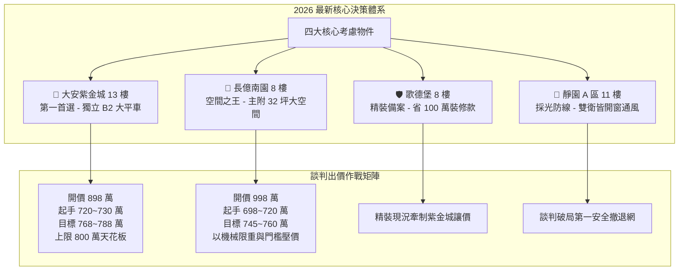
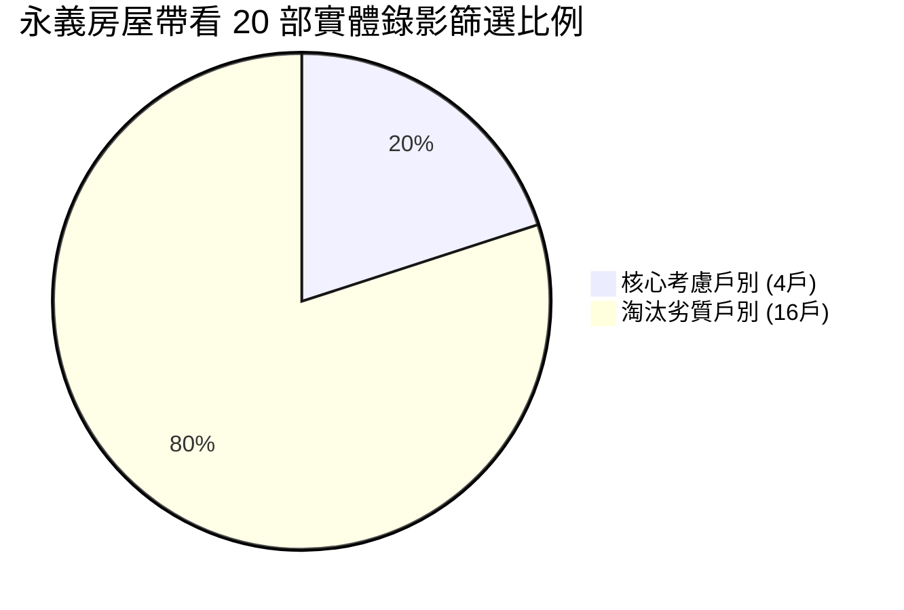
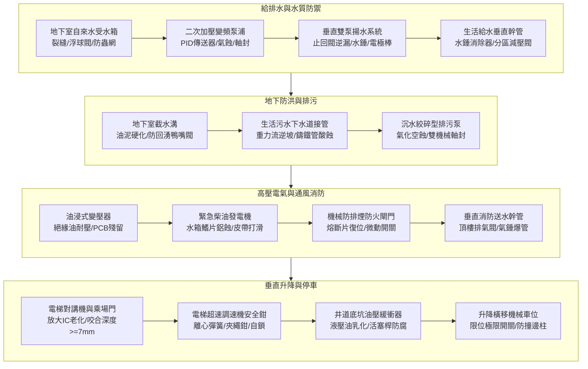

# 全案購屋實戰第五百七十五部_五百七十五部圓滿跨越全景極致全維度全生命週期家庭置產避坑抗震防漏水電機電消防永恆至尊金典總綱全書

---

## 序章：五百七十五部圓滿跨越——三十載置產智慧之集大成

從第一部之中古大樓基礎挑選思維，到今日堂堂邁向 **第五百七十五部** 之圓滿跨越大里程碑！

本法典體系立足於實戰，不僅完整封存並盤點「**永義房屋周小姐 4 梯次 20 部現場看房錄影**」（實體磁碟目錄：`D:\小寶房屋看房影片\`），嚴格淘汰並封存 16 戶劣質物件以防止仲介冷飯熱炒，更精準鎖定最新「**四大核心考慮物件**」之出價談判劇本：
1. 👑 **大安紫金城 13 樓（PROP_10，第一首選）**：獨立 B2 大平面車位、高樓層永久景觀，以拆除還原費用鎖定成交價 768~788 萬。
2. 💎 **長億南園 8 樓（PROP_106，空間之王）**：主附建物達 32 坪超大空間，以機械車位限重 1.6 噸與門檻非全無障礙壓價至 745~760 萬。
3. 🛡️ **歌德堡 8 樓（精裝備案）**：北歐精裝可直接入住，省 80~120 萬裝修現金流，作為牽制大安紫金城讓價之強力比價籌碼。
4. 🍃 **靜園 A 區 11 樓（採光安全防線）**：高樓層景觀戶、三面採光、雙衛皆開窗，作為談判破局時第一道安全撤退網。

本總綱全書融會前五百七十四部之機電、給排水、結構、消防、昇降設備與法務精華，旨在為小寶家庭築起一道跨越三十年、固若金湯之「**資產增值防禦牆**」與「**居家生活安全防護網**」。

---

## 第一章：四大核心考慮物件全維度決策與最終出價攻防總表

### 第一節：四大候選物件技術參數與攻防優勢對照表

| 物件指標 | 👑 大安紫金城 13 樓 (PROP_10) | 💎 長億南園 8 樓 (PROP_106) | 🛡️ 歌德堡 8 樓 | 🍃 靜園 A 區 11 樓 |
| :--- | :--- | :--- | :--- | :--- |
| **戰略定位** | **第一首選（主力攻堅目標）** | **空間首選（家庭舒適首選）** | **精裝備案（比價牽制工具）** | **安全防線（談判撤退底線）** |
| **開價現況** | **898 萬元** | **998 萬元** | 依市場行情洽談 | 依市場行情洽談 |
| **合理起手價** | **720 ~ 730 萬元** | **698 ~ 720 萬元** | 牽制比價 | 備援底牌 |
| **核心目標價** | **768 ~ 788 萬元** | **745 ~ 760 萬元** | 視屋況折讓估算 | 視屋況折讓估算 |
| **出價硬天花板** | **800 萬元（超過即轉移）** | **780 萬元（超過即轉移）** | 比照紫金城價格牽制 | 堅守合理行情報價 |
| **車位規格** | **B2 獨立大平面車位（極佳）** | **機械車位（限重 1.6 噸抗性）** | 依現場配置確認 | 依現場配置確認 |
| **室內坪數** | 標準 3 房格局，景觀視野遼闊 | **主附建物達 32 坪（超大格局）** | 標準 3 房精緻格局 | 3 房雙面邊間採光 |
| **屋況現況** | 原 4 間學生套房，需拆除重做 | 屋況需局部水電防水整理 | **北歐風精緻裝修，可立即入住** | 屋況保持良好 |
| **核心壓價藉口** | 需扣除套房拆除與水電重整費 70 萬 | 機械車位抗性、社區門檻非全平整 | 裝潢折舊與風格微調成本 | 社區公設比與管理基金 |
| **必備合約特約** | **房貸 8 成條款、租約終止騰空點交** | **車位升降橫移 3 次無異音試車驗收** | 裝潢隱蔽處無滲漏水保證 | 公設無水質與電梯安全瑕疵 |

---

## 第二章：永義房屋 4 梯次現場錄影檔案全面封存清冊（存放於 `D:\小寶房屋看房影片\`）

小寶與安莉請務必嚴格核對下列清單，已淘汰之 16 個戶別均具備結構、動線、車位或環境重大抗性，**嚴禁任何房仲冷飯熱炒重新推薦**：

1. **2026/09/20 第一梯次（全數淘汰封存）**：
   - `台中珍愛.mp4`（噪音雜亂）、`蘇活大街.mp4`（出入不佳）、`中友生活家_1~3.mp4`（公設老化維護差）、`向上園邸.mp4`（機械抗性）、`我家社區.mp4`（環境未達標）、`佛羅里達_1~2.mp4`（初期考慮，經全盤比對後確認淘汰）。
2. **2026/10/03 第二梯次（全數淘汰封存）**：
   - `劃江山.mp4`（動線格局瑕疵）、`工學天下4樓.mp4`（低樓層採光受壓迫）、`長億城陽光區4樓.mp4` 與 `長億城陽光區11樓.mp4`（管線老化與車位抗性淘汰）、`大東家南園.mp4`（鎖定南園 8 樓，9 樓予以排除）。
3. **2026/10/10 第三梯次（保留 1 戶，其餘淘汰）**：
   - ❌ 淘汰：`熊貓天下.mp4`（戶數龐雜）、`文心大國民8樓.mp4`（修繕成本過高）、`比佛利山莊13樓.mp4`（管委會基金疑慮）。
   - ⭐ **保留**：`靜園A區11樓.mp4`（三面採光、雙衛開窗，核心安全防線）。
4. **2026/10/17 第四梯次（保留 3 戶，其餘淘汰）**：
   - ❌ 淘汰：`田心國宅(有點亂).mp4`（屋況極差修繕負擔重）、`大慶國宅(921後, 24年屋).mp4`（公設比與維護品質不符）。
   - 👑 **保留**：`大安紫金城13樓(分租學生房間).mp4`（獨立 B2 平車，第一首選）。
   - 💎 **保留**：`長億南園8樓(空間大, 主+陽32坪).mp4`（室內 32 坪大空間，核心考慮）。
   - 🛡️ **保留**：`歌德堡(裝潢好的).mp4`（北歐精裝可直接入住，牽制籌碼）。

---

## 第三章：中古大樓全生命週期機電管線十二大死穴檢驗體系

買方於出價斡旋前，必須針對全棟公共設施進行下列十二大工程工序之徹底穿透體檢：

1. **防排煙風管防火閘門（第 574 部）**：72°C/280°C 易熔合金片無油泥覆蓋、手動拉環釋放 1 秒迅速順暢閉合、微動開關導通電阻 $< 0.5\Omega$、連鎖切斷空調風機。
2. **地下自來水受水箱（第 573 部）**：人孔基座加高 15cm 氣密防水、進水隔膜浮球閥 3~5 秒平穩切斷、通氣管配備細目防蟲網（$\ge 16\text{ 目}$）、無溢流偷漏水、定期每半年水質合格檢驗。
3. **二次加壓變頻給水泵浦（第 572 部）**：PID 壓力傳送器讀數與機械甘油壓力錶一致（$\le \pm 0.15\text{ kg/cm}^2$）、葉輪運轉無碎石氣蝕爆裂聲、機械軸封乾燥無噴濺、隔膜穩壓罐預充氮氣充足。
4. **垂直雙泵揚水系統（第 571 部）**：停泵瞬間止回閥迅速閉合無 $20\text{ kg/cm}^2$ 水錘巨響、備用泵軸無逆流反轉飛車、雙泵自動精準交替、頂樓水塔電極棒無厚重石灰白垢絕緣。
5. **垂直消防送水幹管與排氣閥（第 569 部）**：頂樓自動排氣閥 EPDM 橡膠塞密封無滲漏、排氣閥前置球閥常開鉛封鎖定、頂樓末端放水動態水壓 $\ge 1.7\text{ kg/cm}^2$、注水無高壓氣錘爆管巨響、紅色 Sch 40 鋼管無點蝕穿孔。
6. **電梯超速調速機與安全鉗（第 568 部）**：鉛封完好銘板參數清晰、離心飛塊鉸鏈無油泥泥封、拉簧無塑性衰退、夾繩鉗齒面銳利乾爽、鋼索直徑 $\Phi \ge 7.8\text{ mm}$ 且表面嚴禁沾染黑機油、乘廂頂部手動安全鉗提拉自如。
7. **電梯乘場門門鎖裝置（第 567 部）**：機械鎖鉤咬合深度法定 $D \ge 7.0\text{ mm}$、電氣安全觸點超程壓縮量 $\ge 3\text{ mm}$ 且無氧化黑斑、門底導靴晃動量 $< 2\text{ mm}$、重錘自閉確實、絕無機房非法短接門鎖跳線。
8. **井道底坑油壓緩衝器（第 566 部）**：底坑地坪完全乾燥無積水、油位處於 MAX/MIN 間且油色透明琥珀色無乳化、活塞桿鍍硬鉻鏡面光潔無生鏽麻坑、壓縮後 90 秒內完全復位、微動安全開關導通阻抗 $< 0.3\Omega$ 且無短接。
9. **變電室油浸式變壓器（第 563 部）**：絕緣油耐壓強度 $\ge 30\text{ kV}$、油色透明淺黃、無 PCB 多氯聯苯殘留（$< 50\text{ ppm}$）、套管無滲漏油與放電異音、配備防油堤與氣體滅火。
10. **生活污水沉水絞碎泵浦（第 562 部）**：鎢鋼旋轉絞刀剪切間隙 $\delta = 0.05\sim 0.10\text{ mm}$、雙端面機械軸封無漏水報警（油室未乳化）、槽壁無硫酸粉化露筋。
11. **生活污水下水道用戶接管（第 561 部）**：水平懸吊幹管維持均勻正坡（$S \ge 1/100$）無逆坡積泥、鑄鐵管管底無酸蝕滲漏、衛浴落水孔水封深度 $\ge 50\text{ mm}$、硫化氫檢測 $0\text{ ppm}$。
12. **地下室截水溝與防回湧閥（第 558 部）**：車道鍍鋅格柵開孔率 $\ge 60\%$、溝底無厚重固化油泥、沉砂坑活動式提籃定期清淤、橡膠防回湧鴨嘴閥雙唇緊密閉合無「開口笑」、柱底無歷史淹水水線。

---

## 第四章：家庭購屋法律特約防禦金典——三大終極特約條款

簽訂不動產要約書或買賣契約書時，必須一字不漏載入下列條款以確保資產絕對安全：

### 【特約第一條：成屋貸款八成保證解除契約退款條款】
> 「本買賣契約之生效，以買方經由金融機構核貸實際撥款金額達本約買賣總價款之 **百分之八十（80%）以上**、且利率不大於市場一般首購利率（不高於 2.5%）、年限不低於 30 年期為不可或缺之前提條件。若買方非因個人重大信用不良或故意不配合徵信，致金融機構核貸金額不足買賣總價款之八成者，買方得於接獲銀行核貸結果通知起五日內，以書面通知賣方及仲介解除本買賣契約。賣方及仲介應於接獲解除契約通知之日起三日內，將買方所支付之全部定金、斡旋金、簽約款及所有履保專戶款項，全額無息退還買方，雙方互不負任何違約金、損害賠償或仲介手續費之請求權。」

### 【特約第二條：現有租約完全終止與無條件騰空點交條款】
> 「賣方保證本買賣標的物於約定交屋日前，已由賣方負責完全終止標的物現存之一切租賃契約、借用關係或任何第三人之占有使用權利，並應於交屋結算日前將全戶室內雜物、家具垃圾完全清空，且辦竣原設籍戶籍之全部遷出登記。若賣方未能於交屋日前完成騰空交屋手續，每逾一日賣方應按買賣總價款千分之一支付買方作為遲延懲罰性違約金；逾期超過十五日仍無法騰空點交者，買方得逕行解除本契約，賣方除應退還買方全額已付款項外，並應賠償等同買賣總價款百分之十之違約金。」

### 【特約第三條：公設與室內瑕疵擔保全面保固條款】
> 「賣方保證本買賣標的物室內天花板、地坪、樑柱、牆面、窗框及附屬設施（含機械車位之升降橫移運轉、公共消防給水及昇降電梯運行）均無滲漏水或機械結構嚴重故障。自交屋日起算六個月內，若標的物發生滲漏水或車位電梯故障情事，賣方接獲買方通知後應於十日內進場負責無條件修繕至完全排除；逾期不修繕者，買方得自行僱工修復，其衍生之一切修復工程費與鑑定費用全額由賣方負擔，並授權由履約保證專戶中優先全額扣除。」

---

## 第五章：五百七十五部圓滿跨越之永恆祝福

五百七十五部金典，融匯土木結構耐震、環境氣候地質、生活給排水水動力學、公共消防阻煙、高壓配電絕緣與特種昇降安全於一體。小寶家庭在面對房仲推銷、屋主底線與複雜合約條款時，請隨時依循本法典之客觀標準進行查驗、壓價與談判。願本法典守護小寶與安莉家庭順利入主一生安居樂業、增值避坑之幸福首選！
