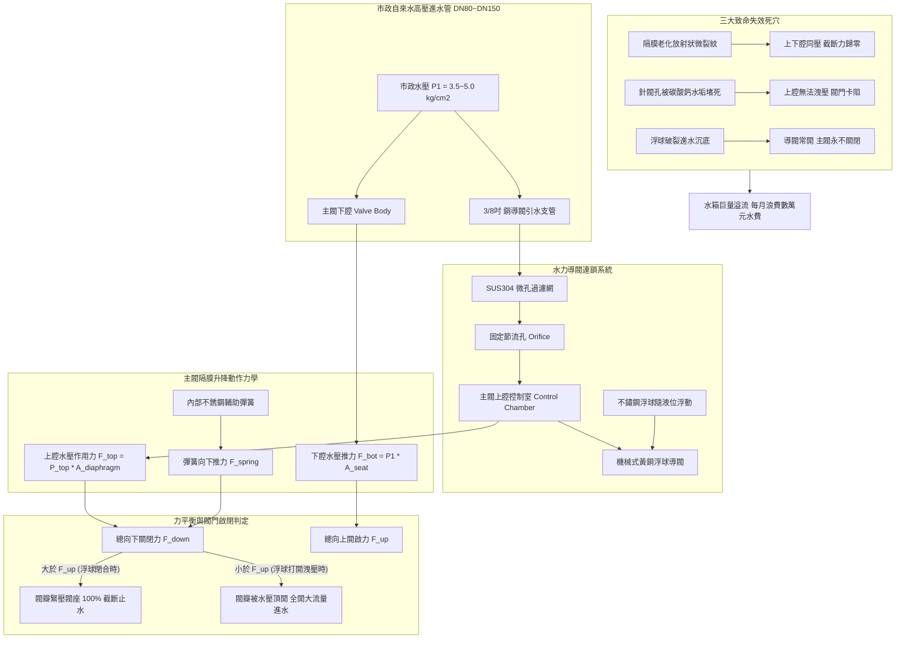
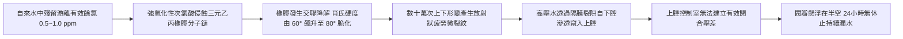
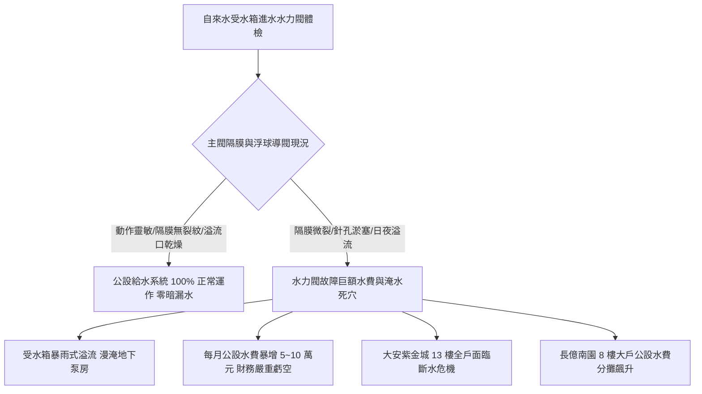

# 全案購屋實戰第五百七十八部_中古大樓社區地下室生活自來水受水箱進水水力浮球閥主閥隔膜微裂紋導閥濾網水垢淤塞洩壓孔堵塞與自來水狂流溢流淹水體檢工序全書

---

## 序章：地下自來水庫之溢流浩劫——進水水力隔膜浮球閥

在現代集合住宅高層大樓與都會中古社區之給水工程體系中，自來水公司之市政管網以數個大氣壓之高壓水流引入建築物地下最底層之「**自來水地下受水箱（Underground Suction Cistern）**」。大樓進水管徑通常為 3" 至 6"（DN80~DN150），其每小時進水量高達數十噸至上百噸。

為自動控制受水箱液位，工程法規與實務皆強制採用「**水力隔膜式進水浮球控制閥（Hydraulic Diaphragm Float Control Valve）**」。該設備利用管網自身水壓作為動力源，透過水力導閥（Pilot Float Valve）連鎖放大，控制主閥橡膠隔膜之升降，實現平穩無水錘之全開進水與全關截斷。

然而，在屋齡 20 至 30 年以上之中古大樓社區中，地下受水箱進水水力閥常年承受市政管網高壓水流反覆衝擊、自來水中砂石鐵屑磨損、以及水中鈣鎂離子硬垢沉澱，隱藏四大致命流體力學、材料疲勞與公共衛生病理：
1. **主閥橡膠隔膜（Reinforced EPDM Diaphragm）老化疲勞與放射狀微裂紋（Micro-cracking）**：高強度尼龍加強型三元乙丙橡膠隔膜，歷經 20 年數十萬次上下彎曲鼓動與餘氯化學降解，橡膠分子鏈斷裂硬化，隔膜表面產生肉眼難以察覺之放射狀貫穿微裂隙。高壓水流自下腔透過裂隙直接穿透至上腔控制室，打破了水力平衡，主閥瓣無法被推下閉合，進水口形成 24 小時無休止之狂流噴射。
2. **導閥不鏽鋼過濾網（Pilot Line Strainer）與洩壓針閥孔水垢泥封淤塞**：導閥控制銅管管徑僅 3/8"，內部濾網孔徑僅 40 目，針閥（Needle Valve）節流孔直徑僅 $1.2\sim 1.5\text{ mm}$。自來水中的鐵鏽垢塊與水垢結晶極易泥封針孔，使控制室腔體無法洩壓排空，主閥卡死在「全開或半開」位置，大量自來水持續外溢狂流。
3. **溢流管（Overflow Pipe）吞吐不及引發地下泵房大淹水**：老舊大樓常因施工偷工，溢流管徑設計過小（例如進水管為 4" 但溢流管僅配置 3"），當水力浮球閥卡阻全開時，進水量遠大於溢流管重力排水量，大水自水箱人孔蓋處劇烈湧出漫延，淹沒鄰近之二次加壓變頻泵浦與發電機底座。
4. **巨額公共水費暴增引發管委會財務危機**：閥門微漏常具有隱蔽性，往往在收到水費帳單時，才驚覺社區單月公設水費自正常的 1 萬元暴增至 **5 萬至 12 萬元**，由全體住戶強制分攤，引發劇烈鄰里糾紛。

本全書將深入剖析水力隔膜閥流體靜力學微差壓方程式、橡膠隔膜應力應變疲勞壽命、導閥毛細節流孔流阻模型，並建立現場實戰體檢工序，為購屋家庭鎖定社區公設與財務安全。

---

## 第一章：水力隔膜式進水浮球閥流力力學與失效破壞機理

### 第一節：水力隔膜主閥微差壓平衡方程式與截斷力學

1. **主閥啟閉受力平衡分析**：
   - 設主閥橡膠隔膜之有效受壓面積為 $A_{\text{diaph}}$，閥座密封口（Valve Seat）通水面積為 $A_{\text{seat}}$。
   - 工程幾何設計上，隔膜面積顯著大於閥座面積：
     $$\beta = \frac{A_{\text{diaph}}}{A_{\text{seat}}} \approx 1.35\sim 1.50$$
   - 閥瓣組件所承受之垂直淨作用力 $F_{\text{net}}$ 為：
     $$F_{\text{net}} = P_{\text{chamber}} \cdot A_{\text{diaph}} + F_{\text{spring}} - P_{\text{in}} \cdot A_{\text{seat}}$$
     其中 $P_{\text{chamber}}$ 為上腔控制室水壓，$P_{\text{in}}$ 為進水管網水壓，$F_{\text{spring}}$ 為輔助彈簧預壓力。

2. **浮球閉合截斷力計算**：
   - 當受水箱水位上升至滿水位時，浮球升起截斷導閥排水口。自來水透過節流引壓管充入上腔，使上腔壓力達到市政水壓：$P_{\text{chamber}} \approx P_{\text{in}}$。
   - 代入面積比 $\beta = 1.4$：
     $$F_{\text{net}} = P_{\text{in}} \cdot (1.4 \cdot A_{\text{seat}}) + F_{\text{spring}} - P_{\text{in}} \cdot A_{\text{seat}} = 0.4 \cdot P_{\text{in}} \cdot A_{\text{seat}} + F_{\text{spring}} > 0$$
   - 產生強大之向下淨閉合推力，將加厚型丁腈橡膠（NBR）或 EPDM 閥瓣密封墊牢牢壓死在青銅閥座上，實現零滴漏截斷。

---

### 第二節：隔膜橡膠微裂紋水解與壓力平衡崩潰

1. **餘氯氧化降解（Chlorine Degradation）與交聯斷鏈**：
   - 台灣自來水為維持管網殺菌，常態保持 $0.4\sim 0.8\text{ mg/L}$ 之游離餘氯（Free Chlorine, $\text{HClO} / \text{ClO}^2-$）。
   - 橡膠隔膜長期浸泡在高壓含氯水中，強氧化劑持續進攻 EPDM 分子鏈之不飽和雙鍵，造成橡膠交聯密度（Crosslink Density）失衡，增塑劑析出，材料微觀出現孔隙。

2. **微裂隙引發之水力短路（Hydraulic Short-circuit）**：
   - 當隔膜背部生成數條深達厚度一半以上之微觀微裂紋時，即使導閥浮球已完全閉合，下腔高壓自來水仍能藉由微裂隙源源不絕地滲入上腔，並經由閥桿導套間隙洩漏。
   - 上腔控制室永遠無法建立起足以壓垮下腔水壓推力的有效閉合壓差，主閥瓣長年處於「半開」懸浮狀態，出水口形成高壓射流，日夜不休沖刷水箱。

---

### 第三節：導閥節流孔結垢泥封（Orifice Scaling）流阻失控

1. **導閥流阻與流量守恆方程**：
   - 上腔控制室之水壓建立與釋放，取決於進口固定節流孔（Fixed Restrictor, 面積 $A_1$）與導閥出口針閥孔（Pilot Orifice, 面積 $A_2$）之分流比：
     $$Q_{\text{in}} = C_{d1} \cdot A_1 \cdot \sqrt{\frac{2(P_{\text{in}} - P_{\text{chamber}})}{\rho}}$$
     $$Q_{\text{out}} = C_{d2} \cdot A_2 \cdot \sqrt{\frac{2(P_{\text{chamber}} - P_{\text{drain}})}{\rho}}$$

2. **水垢沉澱泥封死穴**：
   - 台中地區自來水總硬度常在 $150\sim 250\text{ mg/L}$（以 $\text{CaCO}_3$ 計）。在節流孔高壓差、高流速之局部低壓區，碳酸氫鈣 $\text{Ca(HCO}_3)_2$ 熱分解析出堅硬之白色碳酸鈣結晶。
   - 節流孔有效通流直徑自 $1.5\text{ mm}$ 縮減至 $< 0.3\text{ mm}$。
   - 當受水箱水位下降、浮球下沉開啟導閥時，由於進口節流孔與針孔被硬垢完全泥封，上腔控制室的水根本無法排出，壓力無法卸除，主閥被水壓死死封在關閉狀態，造成大樓「明明水箱沒水、進水閥卻卡死不進水」之全棟大停水災難！

---

## 第二章：現場看屋進水水力浮球閥七大實戰體檢工序

在評估中古大樓社區時，小寶與家人應協調管委會總幹事或機電廠商陪同，進入地下室受水箱上方檢驗孔，實地落實以下七步工序：

| 體檢步驟 | 檢驗標的與操作動作 | 合格標準 (Pass) | 潛在致命瑕疵 (Fail) | 修繕對策與預算評估 |
| :---: | :--- | :--- | :--- | :--- |
| **Step 1** | **水力控制主閥外觀與滲漏** 強力手電筒檢查鑄鐵/球墨鑄鐵閥體 | 閥體外觀乾燥無水痕，頂蓋法蘭螺栓無滲水鏽蝕痕跡 | 頂蓋接縫處持續有高壓水柱微噴、閥體外觀長滿黃褐色水垢厚殼 | 拆卸頂蓋更換全套進口尼龍增強型 EPDM 隔膜組（約 6,500~14,000 元） |
| **Step 2** | **3/8" 銅導閥控制管路與濾網** 檢查主閥側邊外部微管與銅過濾器 | 銅管平直無凹折，Y型過濾網螺塞旋緊無滲水，管路暢通 | 銅管扁折變形、過濾網螺塞生鏽卡死（代表多年未清洗清砂） | 拆洗 Y 型微孔過濾網，疏通更換 304 不鏽鋼導閥管件（約 2,500~4,500 元） |
| **Step 3** | **手動托起浮球關閉反應時間** 用長木桿手動將浮球向上平穩托起 | 主閥瓣在 $3\sim 5\text{ 秒}$ 內平穩向下移動直至完全截斷出水 | 浮球頂起後主閥依然大量噴水、或耗時超過 30 秒仍微漏 | 拆檢主閥內部閥座密封面，研磨閥座並更換密封膠墊（約 4,500~8,500 元） |
| **Step 4** | **浮球本體重量與滲水檢測** 觸摸並用手晃動 SUS304 不鏽鋼浮球 | 浮球輕盈手感乾燥，內部無液體晃動撞擊聲，連桿無變形 | 浮球沈重（內部灌滿自來水）、銲接縫鏽蝕穿孔、連桿歪斜卡阻 | 更換加厚型 SUS316 食品級耐震高浮力不鏽鋼浮球（約 1,800~3,500 元/只） |
| **Step 5** | **溢流口無偷漏水靜態觀察** 在水箱滿水位進水停止時觀察溢流管口 | 溢流管口完全乾燥，無任何涓涓流水或水漬痕跡 | 溢流口日夜不停排出自來水、排水溝渠底長滿綠色青苔水垢 | 重新校準浮球閉合高度，確保停水液位距溢流口 $\ge 15\text{ cm}$（約 1,500~3,000 元） |
| **Step 6** | **大口徑手動旁通閘閥（Bypass Valve）** 檢查主閥兩側隔離閥與中間旁通閥 | 具備「前隔離閥、後隔離閥、中間旁通閥」，以便在線維修 | 無旁通管路（水力閥故障時全棟必須立即斷水搶修）、閥桿鏽死轉不動 | 重新配管增設標準三閥式手動旁通管路組（約 18,000~35,000 元） |
| **Step 7** | **管委會近半年自來水水費單核對** 調閱管理室最近 6 個月之公用自來水費單 | 公用自來水費穩定，單月度數無異常翻倍飆升現象 | 某月份水費突然飆增數萬元且無合理施工說明（嚴重漏水鐵證） | 責成管委會全面追查漏水點並要求賣方扣抵公設修繕分攤（列入談判籌碼） |

---

## 第三章：水力進水閥安全對四大核心物件之戰略決策

### 第一節：四大核心考慮物件之水力閥風險深度評估
1. **大安紫金城 13 樓（PROP_10，第一首選）**：
   - 社區總戶數較多，地下受水箱規模大。
   - **雙重財務與斷水隱患**：若主閥隔膜因 28 年水解產生微裂隙，主閥無法關閉，地下室水箱將日夜巨量溢流，公攤水費暴增；若維修時未設旁通管，搶修時頂樓 13 樓將面臨全天斷水。
   - **實地必查要點**：看屋時務必向管理室索取近半年的「大樓共用部分水費收據」，確認每期度數無異常劇增；並親自前往地下水箱旁確認水力閥運轉聲。
2. **長億南園 8 樓（PROP_106，空間之王）**：
   - 室內面積大且戶數規模大。
   - **談判籌碼**：若地下室受水箱進水閥長年滴漏、溢流管長滿厚綠青苔，買方應當場以「地下室受水箱大口徑進水水力隔膜閥組全面老化故障，需動用專款全面更換」為由，向賣方大砍價金 **10 至 15 萬元**。

### 第二節：成屋買賣合約受水箱進水控制設備特約保障條款範本
> 「賣方保證本買賣標的所屬大樓之地下自來水受水箱進水水力隔膜控制閥組、導閥浮球機構及溢流防護管路均處於合格正常運作狀態，且本大樓在賣方持有期間無任何因水力閥卡阻造成之水箱持續溢流或地下室淹水歷史紀錄。若交屋前查明社區進水水力閥存在隔膜嚴重微漏、浮球破裂卡阻或溢流管持續漏水情事，賣方應負責協調管委會於交屋前完成修繕更換至完全止水；否則買方得主張自價金中扣留新台幣貳萬元整於履約保證專戶，作為買方承擔公設修繕分攤風險之補償款。」
