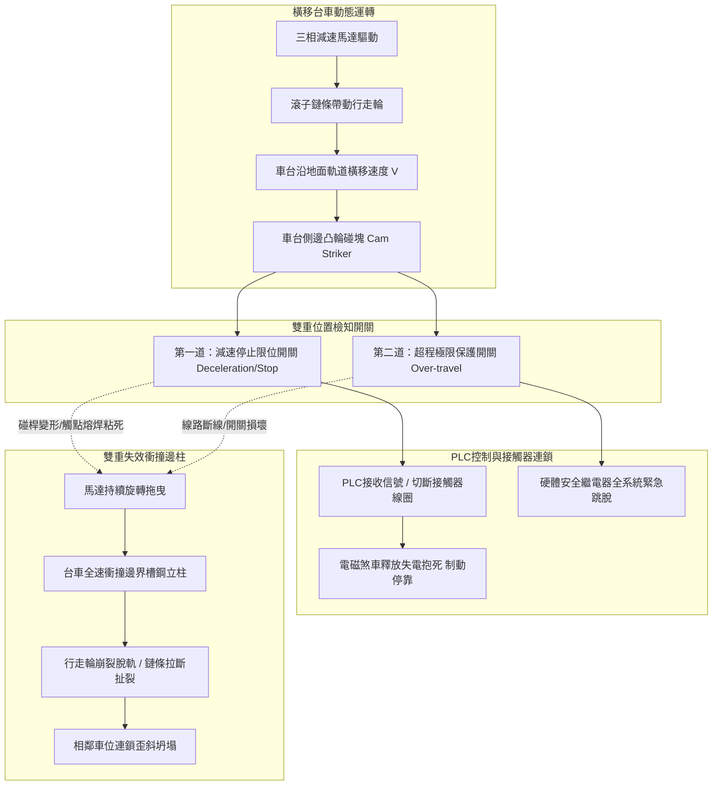
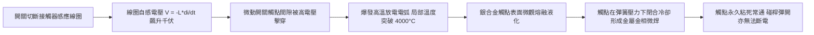
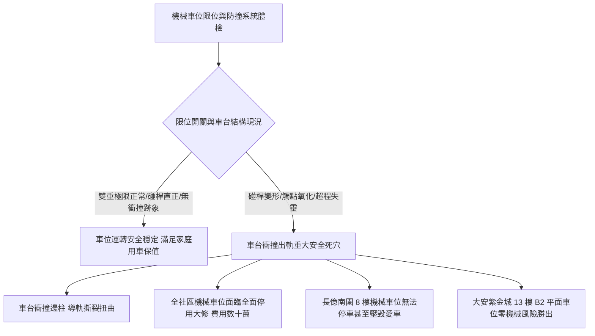

# 全案購屋實戰第五百七十六部_中古大樓社區地下室機械停車設備車位限位極限開關碰桿變形接點氧化短路與橫移車台衝撞邊柱體檢工序全書

---

## 序章：立體地下車庫之鋼鐵碰撞危機——限位開關之生死防線

在現代高層集合住宅大樓與都會中古社區中，為滿足法定停車位數量需求，地下室停車場普遍採用二層或三層之「**升降橫移式機械停車設備（Puzzle Mechanical Parking System）**」。其中，地面層之橫移車台（Traverse Platform）依靠底部鋼輪在預埋鋼軌上水平往復穿梭，騰出垂直通道供上層或下層車台垂直升降進出。

機械車台在地下室狹窄鋼構框架中之運動精度，完全仰賴安裝於導軌端點、鋼樑與車台側邊之「**位置極限開關（Limit Switch）**」與「**超程安全極限防護開關（Over-travel Limit Switch）**」。

然而，在屋齡 20 至 30 年以上之中古大樓社區中，地下室機械車位常年承受車輛每日進出之強烈動態衝擊震動、地下室反潮高濕、車輛底盤滴落之廢機油與雨水泥沙侵蝕，隱藏四大致命機械力學與電氣病理：
1. **限位碰桿（Actuator Arm / Roller Lever）金屬疲勞彎曲變形與滾輪軸承卡死**：車台側邊安裝之凸輪碰塊（Cam Dog / Striker）在每次橫移到位時，以水平速度猛烈撞擊開關之滾輪碰桿。滾輪內部微型軸承因粉塵鐵屑咬死，滾輪不再旋轉演變為剛性乾磨刮削。長期交變衝擊造成碰桿金屬疲勞彎曲，動作行程角度產生 10°~20° 之嚴重漂移，碰塊滑過時無法有效壓下開關觸發動作。
2. **微動電氣觸點（Micro-switch Contacts）氧化積碳與反向電弧熔焊粘連（Contact Welding）**：地下室相對濕度常年高達 80%~95% RH，加上鄰近化糞池揮發之硫化物侵蝕，開關內部銀觸點表面迅速生成高阻抗硫化銀絕緣層；更致命的是，傳統機械車位常由限位開關直接切斷 AC 220V/380V 馬達交流接觸器（Magnetic Contactor）之電感線圈，斷電瞬間爆發上千伏特之反向感應電弧，導致微動觸點金屬熔化焊死粘連。一旦觸點粘死，即使碰桿被碰塊頂起，電路依然常通，馬達無法斷電抱閘。
3. **橫移台車全速衝撞結構柱與邊界擋塊（Boundary Buffers）之結構力學毀滅**：當減速與停止雙重極限失靈時，重達數噸（含停放車輛）之鋼構台車以全速（$0.25\sim 0.35\text{ m/s}$）直接衝撞外圍鋼樑柱。瞬態碰撞衝擊力衝破數噸力，導向輪啃軌崩裂、行走輪跳脫導軌，驅動鏈條在減速機高扭力拉扯下拉伸崩斷，甚至引發整排車位連鎖坍塌傾覆。
4. **防跳動防傾斜安全插銷（Anti-falling Safety Pin）電磁鐵卡阻**：車台橫移到位後，必須藉由電磁鐵釋放水平鎖定安全插銷。但插銷滑槽積滿硬化黑油泥，回位彈簧斷裂，插銷無法順利插銷鎖死，車輛開上車台瞬間車台翹起翻覆。

本全書將深入剖析機械車位限位控制電氣架構、衝撞動量動能微分方程、接觸點電弧物理學，並建立現場實戰體檢工序，為購屋家庭鎖定社區專有車位之最高安全防線。

---

## 第一章：機械停車設備限位控制電氣架構與衝撞毀損機理

### 第一節：碰桿機械變形與滾輪乾磨力學

1. **碰塊與滾輪之衝擊接觸力學（Hertzian Contact Stress）**：
   - 橫移車台安裝之凸輪碰塊具有 $30^\circ\sim 45^\circ$ 之起坡斜角。當碰塊以橫移速度 $v = 0.25\text{ m/s}$ 衝撞限位開關之滾輪時，碰桿承受斜向動態衝擊載重 $F_i$：
     $$F_i = \frac{m_r \cdot \Delta v}{\Delta t} + F_{\text{spring}}$$
     其中 $m_r$ 為開關活動臂等效質量，$\Delta t$ 為接觸碰撞時間（通常僅數毫秒）。

2. **微型軸承咬死與碰桿塑性彎曲（Plastic Bending）**：
   - 滾輪直徑通常僅 $15\sim 20\text{ mm}$，內部滾珠軸承在地下室潮濕水氣與地坪塵土滲入下，潤滑脂迅速乳化固化，滾珠咬死不再旋轉。
   - 滾輪外圓與鋼製碰塊之間由「滾動摩擦」變異為「剛性滑動乾摩擦」，摩擦係數 $\mu$ 由 $0.01$ 暴增至 $0.35$。
   - 強大之摩擦剪切力產生向下之額外彎矩，超過碰桿黃銅或鋁合金懸臂樑之降伏強度（Yield Strength），碰桿向後彎折變形。
   - 彎折後之碰桿行程有效半徑縮小，當碰塊滑過時，碰桿擺角無法達到微動開關之觸發動作角（Operating Angle，通常需達 $15^\circ\sim 20^\circ$），開關觸點無法動作，控制系統判定「車台尚未抵達」，馬達持續全速運轉推動車台！

---

### 第二節：微動觸點電弧燒蝕與熔焊粘連（Contact Welding）物理學

1. **電感線圈斷電電弧能量公式**：
   - 馬達交流接觸器線圈具有顯著之電感 $L$（通常為數個亨利）。當開關斷開線圈電流 $I_0$ 時，儲存於磁場中之磁能 $E_m$ 必須透過觸點間隙釋放：
     $$E_m = \frac{1}{2} \cdot L \cdot I_0^2$$
   - 斷開瞬間觸點間隙僅數微米，電場強度 $E = V/d$ 瞬間衝破空氣絕緣強度（$> 30\text{ kV/cm}$），爆發猛烈之電弧放電。

2. **接觸點熔焊粘連（Welding Failure）**：
   - 電弧高溫使銀氧化鎘（AgCdO）或銀氧化錫（$\text{AgSnO}_2$）觸點金屬瞬間熔化為液態金屬熔池。
   - 當碰塊離開、碰桿復位彈簧試圖分開動靜觸點時，液態金屬在冷卻凝固過程中產生堅固的金相熔接（Welded Joint）。
   - 熔接力（Welding Retention Force）遠大於開關內部微弱之復位彈簧彈力，觸點被「永久焊死」在接通狀態。PLC 輸入點或接觸器迴路永遠處於常閉受電狀態，驅動馬達無法切斷電源，煞車無法閉合抱死。

---

### 第三節：橫移衝撞邊柱之動量衝擊與結構破壞力學

1. **碰撞動量定理與瞬態衝擊力計算**：
   - 設橫移台車載有一輛休旅車，總運動質量 $M = 2,500\text{ kg}$，橫移全速 $v = 0.25\text{ m/s}$。
   - 若台車未減速直接衝撞邊柱，端點橡膠緩衝墊因長年老化硬化，碰撞形變緩衝時間 $\Delta t$ 僅為 $0.05\text{ 秒}$。
   - 碰撞瞬態衝擊力 $F_{\text{crash}}$ 為：
     $$F_{\text{crash}} = \frac{M \cdot v}{\Delta t} = \frac{2500 \cdot 0.25}{0.05} = 12,500\text{ N} \approx 1.28\text{ 噸力}$$
   - 若緩衝橡膠已破裂脫落形成鋼對鋼直接撞擊，碰撞時間 $\Delta t < 0.01\text{ 秒}$，瞬態集中衝擊力將飆破 **6 噸力（$> 60,000\text{ N}$）**！

2. **導軌撕裂與脫軌坍塌連鎖效應**：
   - 強大之集中水平側向撞擊力直接作用於外圍輕型槽鋼邊柱，超過固定地腳膨脹螺栓之抗拔剪力極限，地腳螺栓連根拔起。
   - 行走輪輪緣承受巨大側向衝擊產生剪切脆裂，車輪跳脫水平導軌（Derailment）；驅動滾子鏈條因車台卡死產生極端張力，鏈片拉伸斷裂。
   - 車台單邊傾斜下墜，牽扯相鄰車位鋼構扭曲變形，造成整座機械立體車庫癱瘓停用。

---

## 第二章：現場看屋機械停車位限位系統七大實戰體檢工序

在評估中古大樓社區時，小寶與家人應協調管委會機電人員或機械車位特檢技師，開啟車位操作箱進行實地空載與帶載運轉，落實以下七步工序：

| 體檢步驟 | 檢驗標的與操作動作 | 合格標準 (Pass) | 潛在致命瑕疵 (Fail) | 修繕對策與預算評估 |
| :---: | :--- | :--- | :--- | :--- |
| **Step 1** | **碰桿外觀直度與滾輪靈活性** 目視並用手撥動各限位開關之滾輪碰桿 | 碰桿平直無彎曲，滾輪轉動滑順無阻滯，撥動後瞬間彈回原位 | 碰桿歪斜彎折、滾輪鏽死磨出扁平磨耗面、彈簧疲勞不復位 | 更換重載型金屬滾輪限位開關總成（約 1,800~3,200 元/只） |
| **Step 2** | **雙重極限開關配置檢查** 檢查導軌兩端點是否有兩道獨立開關 | 必須具備第一道「減速停止開關」與第二道「獨立超程極限保護開關」 | 僅有一道開關（無後備超程防線）、或超程開關被電線短接 | 增設超程極限開關並配線至硬體急停安全迴路（約 6,000~12,000 元/組） |
| **Step 3** | **邊柱端點防撞緩衝橡膠塊厚度** 測量邊柱末端防撞橡膠厚度與彈性 | 聚氨酯/橡膠塊厚度 $\ge 50\text{ mm}$，質地堅韌富彈性無龜裂碎裂 | 橡膠塊老化粉化脫落、厚度被壓扁至 $< 10\text{ mm}$、金屬底板外露 | 更換加厚型重載聚氨酯（PU）防撞吸能緩衝塊（約 800~1,500 元/個） |
| **Step 4** | **橫移停靠定位平整度與縫隙** 操作車台橫移到位後測量停靠間隙 | 車台與固定出入引道邊界縫隙在 $20\text{ mm} \pm 5\text{ mm}$ 以內，無偏移擦碰 | 台車撞擊邊界發出金屬巨響、左右縫隙嚴重歪斜超標 | 重新調整碰塊定位螺栓，緊固限位開關安裝支架（約 2,000~4,000 元） |
| **Step 5** | **開關電纜進線口密封防水** 檢視開關電纜葛蘭頭（Cable Gland）迫緊度 | 防水橡膠圈迫緊良好，外殼防護等級達到 IP67，內部乾燥無水滴 | 葛蘭頭鬆脫、電纜外皮破損、開關內部積滿黑鏽水與油污 | 重新更換耐高溫耐油型金屬電纜防水接頭（約 600~1,200 元/處） |
| **Step 6** | **馬達熱過載繼電器保護校準** 檢視控制盤內馬達熱過載電驛設定值 | 設定值精確符合馬達銘板滿載電流之 $1.0\sim 1.15\text{ 倍}$ | 設定值被蓄意調至最大（防跳脫）、或保護接點被短接作弊 | 重新精確校準熱過載電驛，更換電子式馬達保護器（約 2,500~4,500 元） |
| **Step 7** | **手動觸發超程開關緊急斷電測試** 在車台慢速運轉時手動壓下超程開關 | 系統發出高分貝警報蜂鳴，總主接觸器瞬間釋放切斷全系統電源 | 壓下開關系統毫無反應、馬達依然持續運轉推動車台 | 查修控制迴路斷線或更換損壞之安全連鎖繼電器（約 4,500~8,500 元） |

---

## 第三章：機械車位安全對四大核心物件之戰略決策

### 第一節：四大核心考慮物件之車位安全深度評估
1. **長億南園 8 樓（PROP_106，空間之王）之車位死穴**：
   - 本物件所附為「**機械停車位**」。
   - **兩大致命抗性**：
     - **載重規格抗性**：中古社區機械車位銘板限重通常僅 **1,500~1,600 kg**，現代主流家庭休旅車（如 RAV4、CR-V、Model Y 重量達 1.7~2.1 噸）停入極易壓垮車台或拉斷鏈條。
     - **衝撞事故抗性**：若橫移台車限位開關碰桿老化變形，車台橫移時極易衝撞相鄰車位或邊柱，造成愛車車體被金屬槽鋼刮傷擠壓。
   - **談判籌碼**：以此規格落後與機械老化隱患為由，強勢向賣方大砍價金 **30 至 50 萬元**。
2. **大安紫金城 13 樓（PROP_10，第一首選）之絕對優勢**：
   - 本物件配備「**獨立 B2 大平面車位**」，完全不受任何限位開關卡死、碰桿變形、馬達堵轉或鏈條斷裂之威脅，大型休旅車輕鬆停入，資產價值堅不可摧。

### 第二節：成屋買賣合約機械車位安全特約保障條款範本
> 「賣方保證本買賣標的所附屬之機械停車位（車位編號：＿＿號），其升降、橫移、控制開關、限位極限保護、防墜安全插銷及傳動鏈條均處於合格正常運作狀態，且附有合法維護廠商最近一期之保養合格紀錄表。交屋點交時，買方有權要求現場進行空車及滿載升降橫移試車運轉各三次，若發現限位開關失靈、碰桿變形、衝撞邊柱或結構卡死異音者，賣方應負責協調於交屋日前完成修繕更換至完全合格；否則買方得扣留車位等值價金新台幣伍拾萬元整於履約保證專戶，待修繕驗收完成後始得撥付。」
