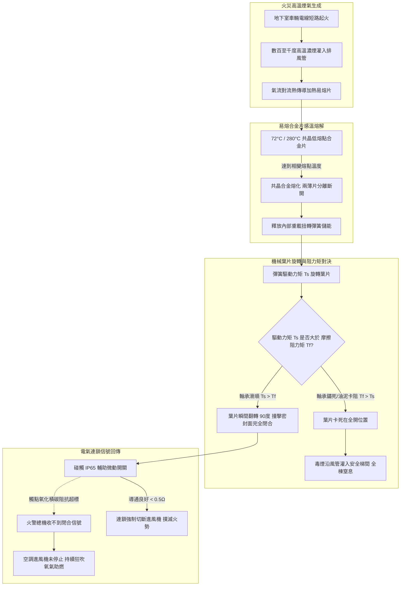
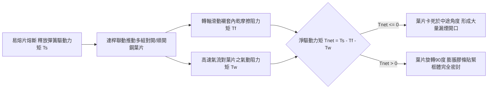
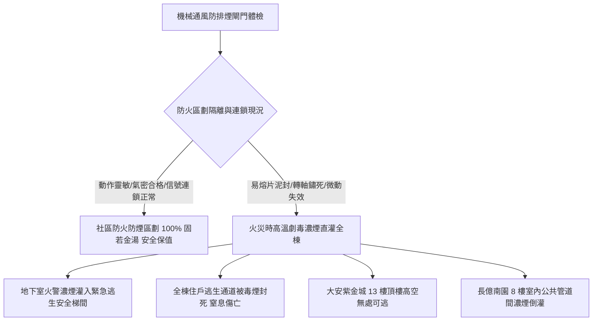

# 全案購屋實戰第五百七十四部_中古大樓社區地下室機械通風防排煙風管防火閘門熔斷手動復位卡死微動開關定位失效與風量衰減體檢工序全書

---

## 序章：火災濃煙阻隔之鋼鐵屏障——機械通風防排煙風管防火閘門

在現代集合住宅高層大樓與中古社區之防災機電體系中，火災致死最主要之致命殺手並非明火直接燒灼，**超過 80% 的火場罹難者，皆因吸入高溫劇毒濃煙（含高濃度一氧化碳 CO、氰化氫 HCN、光氣與懸浮碳黑粒子）導致窒息昏迷與急性呼吸道灼傷**。

為阻止火舌與高溫劇毒濃煙沿著大樓內部錯綜複雜之「空調通風風道」與「機械排煙風管」蔓延穿越不同的建築防火區劃（Fire Compartment），建築技術規則與消防安全設備法規強制規定：凡風管穿越防火牆、防火樓地板或垂直機電管道間之交界處，必須在貫穿部位安裝「**常開型防火閘門（Fire Damper, FD）**」或「**防排煙複合型防火閘門（Fire/Smoke Damper, FSD）**」。

防火閘門屬於「平時 99.9% 時間處於常開通風、火災高溫時必須在數秒內精準重力閉合」之最後阻煙隔火連鎖關鍵設備。然而，在屋齡 20 至 30 年以上之中古大樓社區中，防火閘門常年深埋於地下室停車場、公共管道間天花板上方等隱蔽潮濕死角，隱藏四大致命機電與物理力學病理：
1. **熱敏易熔合金片（Fusible Link）表面嚴重油泥粉塵泥封阻熱與熔斷點漂移**：法規設定之 72°C（一般通風空調風管）或 280°C（廚房排煙及地下室排煙風管）低熔點共晶合金片，長年受汽車廢氣碳黑、揮發性油脂與潮濕水泥粉塵覆蓋，形成厚達數公釐之隔熱保溫層。火災發生時，煙氣高溫無法及時傳導至金屬核心，熔斷反應時間自標準的 60 秒延遲至數分鐘以上；甚至因合金長期氧化發綠產生晶界腐蝕，造成超溫時依然無法分離脫扣。
2. **重型扭轉彈簧疲勞與轉軸軸承微動腐蝕（Fretting Corrosion）卡死**：閘門重型鍍鋅鋼多葉片之旋轉軸承長期處於靜止狀態，在管內高速氣流微震動與潮濕空氣侵蝕下，軸套潤滑脂乾涸並生成堅硬之赤褐色氧化鐵紅鏽（$\text{Fe}_2\text{O}_3$），將轉軸與襯套完全「鏽死咬死」。即使易熔片在火警高溫下斷裂，驅動葉片旋轉之扭轉彈簧儲能無法克服巨大的乾摩擦阻力矩，葉片死死卡在全開或半開位置，高溫毒煙沿著風道長驅直入相鄰樓層。
3. **電氣輔助微動開關（Auxiliary Micro-switch）觸點氧化積碳與排煙風機連鎖失效**：防火閘門關閉時，必須藉由碰觸微動開關將「已關閉就位信號」即時回傳給中央火警受信總機，並自動連鎖切斷該防火分區之空調送風機以防助燃。老舊微動開關外殼密封劣化，銀觸點表面生成高阻抗硫化銀薄膜，信號無法送達，空調送風機持續全速狂吹，產生「高爐風箱效應」將局部初起火災助燃為全面燃燒。
4. **手動測試復位機構（Manual Resetting Mechanism）鋼索鏽斷與風量衰減**：年檢人員若以暴力拉扯手動測試拉桿，極易拉斷內部不鏽鋼拉索，或使復位棘輪夾爪斷裂，造成閘門「閉合後卡死無法手動復位」；平日風道斷面被封死超過一半，地下室通風量衰減超過 50%，一氧化碳長期超標蓄積。

本全書將深入剖析防火閘門熱傳導熔斷微分方程、多葉片旋轉力矩平衡、防煙氣密流體力學，並建立一套現場實戰體檢工序，為購屋家庭鎖定社區防火防煙之最高安全防線。

---

## 第一章：防火閘門熱力熔斷與動態旋轉閉合失效機理

### 第一節：易熔合金片（Fusible Link）熱平衡微分方程與感溫延遲

1. **集總熱容法（Lumped Heat Capacity Method）熱平衡模型**：
   - 易熔金屬片之瞬態升溫過程取決於氣流對流熱傳導與熱容平衡：
     $$m \cdot c_p \cdot \frac{dT}{dt} = h \cdot A_s \cdot (T_\infty - T)$$
     其中 $m$ 為合金片質量，$c_p$ 為比熱容，$A_s$ 為受熱表面積，$h$ 為對流熱傳導係數，$T_\infty$ 為高溫煙氣溫度，$T$ 為合金片瞬時溫度。
   - 解微分方程得反應時間常數（Time Constant）：
     $$\tau = \frac{m \cdot c_p}{h \cdot A_s}$$

2. **油污粉塵熱阻層引發之反應時間激增（Time Delay）**：
   - 當易熔片表面沉積厚度為 $\delta$ 之有機油泥與水泥粉塵時，總熱傳導率 $U$ 急劇下降：
     $$\frac{1}{U} = \frac{1}{h} + \frac{\delta}{k_{\text{dirt}}}$$
     其中油泥之導熱係數 $k_{\text{dirt}} \approx 0.15\text{ W/(m}\cdot\text{K)}$，遠小於銅金屬的 $380\text{ W/(m}\cdot\text{K)}$。
   - 表面油泥將反應時間常數 $\tau$ 放大 $3\sim 5\text{ 倍}$。在火災初起黃金救援階段，風管內高溫煙氣即使已高達 150°C，易熔片內部溫度仍遲遲無法爬升至 72°C 熔點，導致防火閘門在關鍵時刻形同虛設，高達數千立方公尺之劇毒濃煙在數分鐘內完全封死大樓緊急逃生動線。

---

### 第二節：多葉片旋轉動力學平衡方程式與軸承微動腐蝕

1. **葉片軸系旋轉動力學方程式**：
   - 多葉片防火閘門之旋轉動態平衡方程式為：
     $$J \cdot \frac{d^2\theta}{dt^2} = T_s(\theta) - \sum_{i=1}^{n} T_{f,i} - T_{\text{aero}}(\theta)$$
     其中 $J$ 為所有連動葉片之等效轉動慣量，$T_s(\theta)$ 為高強度琴鋼線扭轉彈簧隨角度釋放之力矩，$T_{f,i}$ 為第 $i$ 個軸承襯套之摩擦阻力矩，$T_{\text{aero}}$ 為風管內高速氣流阻抗力矩。

2. **微動磨損（Fretting Corrosion）引發之轉軸脹死病理**：
   - 防火閘門轉軸通常採用鍍鋅碳鋼軸與青銅含油滑動軸套（Bronze Sleeve）。
   - 在長達數十年之待機過程中，大樓通風氣流使葉片常年處於微米級幅度的微小高頻振盪中，軸套內部之儲油微孔被震出之油污填死。
   - 接觸面之微動摩擦使金屬表層破壞產生極細微之鐵金屬粉末，在高濕空氣中迅速氧化為三氧化二鐵（$\text{Fe}_2\text{O}_3$）。鐵鏽晶體體積比原始金屬大 3 倍，在原本僅有 $0.15\text{ mm}$ 之軸孔間隙內產生巨大的微觀擠壓力，將轉軸牢牢「冷焊脹死」。
   - 當彈簧釋放時，扭力矩 $T_s$ 根本無法轉動被膨脹鐵鏽咬死的軸系，閘門維持大開狀態。

---

### 第三節：電氣輔助微動開關接點氧化與風機助燃災難

1. **微動開關電氣規格與乾接點傳輸**：
   - 防火閘門側邊配置專用限位微動開關（Micro-switch），內部配置常開（NO）與常閉（NC）接點，標稱容量通常為 AC 250V / 5A。
   - 閘門完全閉合瞬間，旋轉凸輪碰桿以斜楔方式壓下開關觸頭，將「常閉接點斷開、常開接點閉合」之開關信號傳送至消防控制中心。

2. **硫化銀絕緣層阻斷連鎖跳脫**：
   - 地下室潮濕廢氣中富含硫化氫（$\text{H}_2\text{S}$）與有機硫化物，微動開關外殼橡膠密封套老化後，硫化物侵入接點腔室。
   - 銀鎘合金觸點表面迅速生成緻密的高阻抗硫化銀（$\text{Ag}_2\text{S}$）絕緣薄膜，接觸電阻由正常的 $< 0.05\Omega$ 飆升至數千歐姆以上。
   - 儘管機械上閘門已完全閉合，但電氣信號無法導通，中央火警受信總機接收不到反饋信號，無法自動切斷大樓強大之空調進風機（Air Handling Unit, AHU）。新鮮氧氣持續以數萬 CFM 之風量瘋狂注入風道，強大風壓甚至將已閉合之葉片吹開微縫，源源不絕的氧氣直接將火場轉化為烈焰地獄。

---

## 第二章：現場看屋地下室防排煙防火閘門七大實戰體檢工序

在評估中古大樓社區時，小寶與家人應協調管委會機電人員或消防設備師陪同，攜帶高流明防爆手電筒、螺絲起子與風速計，進入地下室排風管道間與機房實地落實以下七步工序：

| 體檢步驟 | 檢驗標的與操作動作 | 合格標準 (Pass) | 潛在致命瑕疵 (Fail) | 修繕對策與預算評估 |
| :---: | :--- | :--- | :--- | :--- |
| **Step 1** | **風管檢查門（Access Door）檢查** 檢視防火閘門旁之金屬檢查手孔門 | 設有氣密可拆卸之鍍鋅手孔門（$\ge 30\times 30\text{ cm}$），膠條無漏風 | 無檢查手孔門（全封閉盲管無法維保）、手孔門鏽死無法開啟 | 於風管側壁切割加裝帶鎖扣之標準氣密檢查門（約 2,500~4,500 元/處） |
| **Step 2** | **易熔合金片表面清潔與鏽蝕** 透過檢查孔用手電筒目視易熔片 | 金屬光亮平整，合金銲接線清晰完整，無黏稠黑油泥覆蓋 | 易熔片被黑黃厚油泥泥封、銅片長滿綠色銅鏽、合金開裂分離 | 以專用除油溶劑徹底清洗，或更換原廠合格 72°C/280°C 易熔片（約 800~1,600 元/片） |
| **Step 3** | **手動測試拉環釋放閉合動作** 手動拉動閘門外部之測試釋放拉環 | 葉片在 1 秒內迅速順暢旋轉 90 度完全閉合，撞擊聲清脆有力 | 葉片紋絲不動卡死在原位、或僅旋轉一半即卡滯在中途 | 轉軸清洗並加注耐高溫二硫化鉬潤滑脂，更換重載高張力扭簧（約 3,500~7,000 元/台） |
| **Step 4** | **葉片耐火膨脹石墨密封膠條** 手電筒照射葉片閉合後四周金屬邊框 | 葉片與框體完全貼合，膨脹石墨膠條均勻完整無龜裂脫落 | 膠條老化粉化脫落、閉合後透光縫隙 $> 5\text{ mm}$（漏煙率嚴重超標） | 重新清理邊界，黏貼耐火高溫膨脹型石墨防火密封條（約 800~1,500 元/米） |
| **Step 5** | **手動復位手柄與棘輪定位夾爪** 手動搖動復位手柄將葉片重新拉回常開 | 搖動手感平穩順暢，棘輪定位夾爪精準將葉片鎖死在全開位置 | 手柄軸打滑空轉、棘輪崩齒無法將葉片固定在全開狀態 | 更換手動復位齒輪箱總成與不鏽鋼復位拉索（約 4,500~8,500 元/台） |
| **Step 6** | **微動開關到位信號電氣導通測試** 三用電表測量開關常開/常閉接點電阻 | 閘門閉合瞬間，導通電阻 $< 0.5\Omega$；開啟時呈完全斷路 | 閉合後電阻高達數百歐姆（觸點氧化虛接）、或線路斷線信號丟失 | 更換 IP67 防水防塵重載型金屬滾輪微動開關（約 1,200~2,200 元/只） |
| **Step 7** | **手持風速計測量通風排風風速** 於地下室對應排風出風口測量風速 | 測得排風速度 $\ge 4.0\text{ m/s}$，風管無嚴重負壓吸癟異音 | 風速 $< 1.5\text{ m/s}$，風管發出尖銳嘯叫（閘門半卡死造成巨大風阻） | 全面校正閘門開度至 100% 水平，清除風道內部阻礙雜物（約 5,000~12,000 元） |

---

## 第三章：防火閘門安全風險對四大核心物件之戰略決策

### 第一節：四大核心考慮物件之防煙安全深度評估
1. **大安紫金城 13 樓（PROP_10，第一首選）**：
   - 頂樓 13 樓住戶在遭遇地下室火警時，唯一的逃生路徑就是「垂直逃生安全梯」。
   - **生死防禦死穴**：若地下室或各樓層管道間防火閘門卡死無法閉合，劇毒濃煙將藉由建築物強烈的「煙囪效應（Stack Effect）」在短短 3 至 5 分鐘內灌滿整座逃生梯間，13 樓住戶將面臨無路可逃之致命絕境。
   - **實地必查要點**：看屋時務必查閱管委會最近一次「建築物公共安全檢查簽證及申報結果通知書」中，關於「防火區劃、排煙設備及防火閘門」之抽驗合格紀錄，並實地檢驗地下室防火閘門是否具備活動手孔門。
2. **長億南園 8 樓（PROP_106，空間之王）**：
   - 室內面積達 32 坪且緊鄰大樓公共通風管道間。
   - **談判籌碼**：若地下室排風管防火閘門長年失修鏽死、或手孔門鏽蝕無法開啟維護，買方應當場以「公設防排煙防火區劃存在重大公安隱患，需動用專款全面檢修風道防火閘門」為由，向賣方大砍價金 **10 至 20 萬元**。

### 第二節：成屋買賣合約防排煙與防火設備特約保障條款範本
> 「賣方保證本買賣標的所屬大樓之機械通風、防排煙系統及穿越防火區劃之防火閘門（含易熔片、手動復位機構及微動連鎖開關），均符合建築技術規則與消防法規之安全標準，且於最近一次法定公安與消防安檢中無任何列管重大缺失。若交屋前查明社區防火閘門存在普遍性鏽死卡阻、無法手動復位或信號斷線等重大安全瑕疵者，賣方應負責協調管委會於交屋前完成檢修更換；否則買方得主張自價金中扣留新台幣貳萬元整於履約保證專戶，作為買方承擔公共防火安全風險之補償。」
