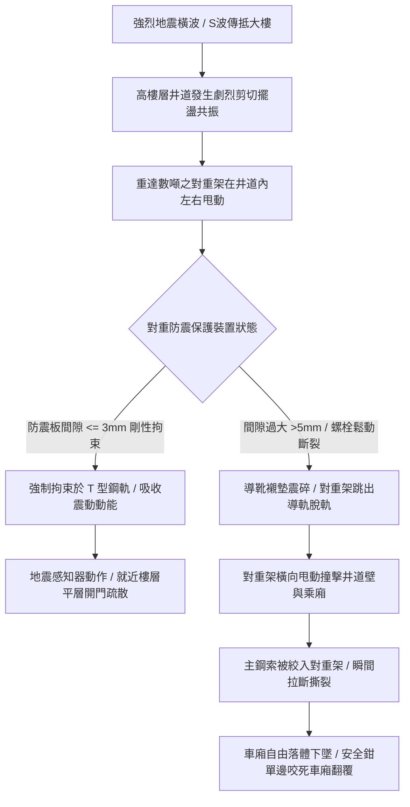

# 全案購屋實戰第五百三十一部_中古大樓社區各樓層電梯對重側防跳動防震保護裝置間隙超標地震脫軌與主鋼索絞斷體檢工序全書

## 壹、核心體檢宗旨與家庭居住安全意涵

台灣地處環太平洋地震帶，台中地區更曾承受 1999 年 921 集集大地震車籠埔斷層錯動帶來的劇烈剪切破壞。在集合住宅大樓中，電梯昇降系統的「對重側（Counterweight System，配重側）」因懸掛著重達數百公斤至上噸的鑄鐵塊或混凝土配重塊，在強烈地震（水平震波加速度超過 150~250 gal）引發的大樓結構擺盪共振中，對重架會產生劇烈的左右擺動與甩動。

依中華民國 CNS 10594 電梯耐震安全標準及建築技術規則，屋齡達 20 至 25 年的中古集合住宅（包含小寶家庭考量名單中的**大安紫金城 13 樓**、**長億南園 8 樓**、**歌德堡 8 樓**與**靜園 A 區 11 樓**），對重架上下兩端除了常規滑動導靴外，必須配置高剛性之「對重側防跳動防震安全保護裝置（Anti-Dislodgement Seismic Retainers / Seismic Snag Hooks）」：
1. **防止對重架脫軌（Anti-Derailment）**：防震保護板（Seismic Retainer Plate）環抱對重專用 T 型導軌，當滑動導靴的耐磨塑膠襯墊在強震震碎脫落時，金屬防震板能強制將對重架拘束在導軌上，防止對重架脫出軌道。
2. **消弭對重與乘廂空中擦撞及鋼索絞斷**：若對重架脫軌甩出，將在井道內如巨大鐘擺般橫向狂甩，與迎面高速升降的乘廂發生空中毀滅性對撞，或將多口主鋼索、調速機鋼索與隨行電纜瞬間絞碎拉斷，導致乘廂直墜底坑的重大公安慘劇。

然而，在屋齡達 20 至 25 年的中古社區井道中，防震保護裝置常因長年維護忽視，衍生出四大隱蔽致命病灶：
1. **防震拘束板與導軌間隙超標（> 5~8 mm）喪失拘束力**：防震板安裝螺栓因震動鬆脫後退，或導軌支架變形，間隙過大導致強震時對重架依然能在導軌上發生側向跳脫。
2. **防震鉤金屬疲勞變形與焊縫開裂**：早期以一般扁鐵焊接之防震鉤，長年承受穿堂風與微幅晃動，焊道產生微觀疲勞裂紋，強震一擊即碎。
3. **地震感測器（Seismic Detector / P波感應器）未連動或故障**：老舊電梯未加裝地震自動平層停機裝置，地震發生時電梯依然高速行駛，放大擺盪破壞力。
4. **井道防震擋桿（Seismic Guard Bars）缺乏或鬆脫**：對重與乘廂交會區域缺乏防止鋼索互相纏繞的防震隔離鋼條。

本手冊針對高樓層置產標的建立標準化的對重防震裝置現場體檢工序、間隙測量指標與買賣特約保障。

---

## 貳、對重側耐震安全體系與脫軌毀滅力學演變

### 1. 耐震安全防震板（Seismic Retainer）間隙標準
- **CNS 10594 耐震防護規範**：
  - 防震拘束板（或防脫軌安全金屬鉤）與 T 型導軌頂面及兩側之淨間隙，在常態運轉下應保持在 **2.5 mm ~ 4.0 mm** 之間。
  - 防震鋼板厚度不得小於 **12 mm**，且必須採用高強度鍛鋼或熱軋結構鋼，抗拉強度需大於 400 MPa。
- **危險淘汰界限**：實測間隙 **> 6.0 mm**，代表震動時導軌頂面已能輕易滑出拘束區，防震功能形同虛設。

---

## 參、實地帶看電梯對重防震裝置體檢工序（SOP）

| 檢驗步驟 | 檢驗標的與操作工序 | 正常指標 | 異常警訊與潛在重大風險 |
| :--- | :--- | :--- | :--- |
| **步驟一：高樓層運行擺盪與共振感知** | 搭乘電梯由 1 樓直上頂樓（如大安紫金城 13 樓），觀察過中樓層交會點動態。 | 車廂運行平順，無任何橫向左右大幅甩動或劇烈晃蕩感。 | 行經 6~8 樓時車廂有明顯「左右橫擺頓挫」，伴隨對重軌道金屬撞擊聲（防震間隙失準）。 |
| **步驟二：機房地震感測器（P/S波感應儀）勘驗** | 陪同總幹事至電梯機房，檢視控制盤旁是否安裝專用「電梯地震感知器」。 | 感測儀指示燈正常常亮（綠色），具備加速度感應器與水平儀，領有合格認證。 | 1. 根本未安裝任何地震感應器（重大耐震缺陷）。 2. 感測器被拔掉電源或報警開關被電線短接。 |
| **步驟三：查驗對重架防震保護板間隙** | 透過井道觀察孔或會同維保技師由機房頂部檢視對重架上下防震板。 | 防震拘束板厚實無鏽，緊密環抱導軌，間隙均勻在 **3 mm** 左右，固定螺栓有雙螺帽防鬆。 | 1. 防震板單邊嚴重傾斜刮軌、鋼板薄化鏽蝕。 2. 間隙高達 10mm 以上，或根本未配置防震鋼板！ |
| **步驟四：調閱電梯年度耐震安全申報紀錄** | 查閱管理室保存之昇降設備「年度安全檢查報告」中之耐震項目。 | 技師註記「對重防震脫軌裝置良好」、「地震管制運轉功能正常」。 | 該項目空白未填，或備註欄註記「對重導靴及防震件老化建議更新」，管委會未處理。 |

---

## 肆、高樓層住宅置產防衛與合約特約保障

大安紫金城 13 樓、靜園 A 區 11 樓、長億南園 8 樓等高樓層標的，地震發生時所受到的放大擺動加速度最大。若對重側缺乏健全的防震防脫軌保護，地震來襲時將陷入致命的空中對撞與鋼索絞斷威脅：

### 1. 對重防震系統修繕與更新成本基準
- **重新調校對重防震板間隙、更換防鬆螺栓與除鏽注脂**：約 **\$6,000 ~ \$10,000 / 台**。
- **加裝重載型防脫軌安全拘束鉤總成（上下共 4 組）**：約 **\$18,000 ~ \$28,000**。
- **增設全套電梯專用地震感知器（含 P 波預警、S 波平層停機連鎖模組）**：整套改裝約 **\$35,000 ~ \$55,000**。

### 2. 購屋買賣合約電梯耐震機能專屬特約條款範本
> **電梯耐震防脫軌機能保證特約條款**：  
> 「賣方保證本買賣標的所在棟別之電梯昇降設備具備符合主管機關標準之耐震安全性能，對重側防脫軌防跳動保護裝置完好無缺損，間隙符合安全規範，且無防震裝置拆除或功能失效情事。自簽約日起至交屋日止，若經電梯專業檢查機構判定該棟電梯對重防震裝置老化損壞需更新加固者，其修繕支出或管委會因此產生之工程專案攤派款，全數由賣方負擔清償，不得向買方主張任何補償。」
