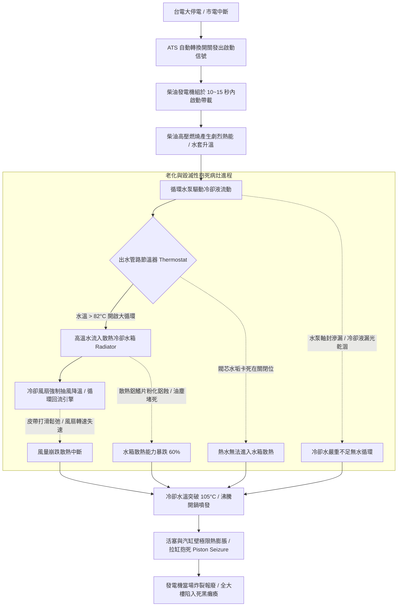

# 全案購屋實戰第五百三十七部_中古大樓社區地下室緊急柴油發電機冷卻水箱散熱鰭片鋁蝕淤塞冷卻風扇皮帶打滑水泵軸封滲漏與過熱高溫抱死體檢工序全書

## 壹、核心體檢宗旨與家庭居住安全意涵

在中古集合住宅大樓中，民生自來水、公共走廊照明、地下室機械停車設備、以及最攸關高樓層住戶生死存亡的「公共電梯垂直運輸」與「消防排煙排污抽水泵浦」，在遭遇台電區域性無預警大停電（如台灣歷年之 729、815、303 全台大停電或颱風天饋線跳脫）時，全棟建築的動力生命線完全仰賴設置於地下室發電機房的「緊急柴油發電機組（Emergency Diesel Generator Set）」。

柴油發電機能否在市電中斷後的 **10 至 15 秒內** 成功自啟動並平穩接管負載，是防止電梯卡死關人窒息、地下室污水暴漲淹沒車台、以及高樓層陷入全黑孤島狀態的終極防禦底牌。而在柴油引擎運轉過程中，柴油燃燒產生的高達數千度燃燒熱量，必須全時依賴由「冷卻水箱（Radiator）」、「循環冷卻水泵（Water Pump）」、「冷卻散熱風扇（Cooling Fan）」與「節溫器/水龜（Thermostat）」所構成的「封閉式液冷散熱循環系統」強制帶走。

然而，在屋齡達 20 至 25 年的中古地下室機房中（如小寶家庭重點關注的**大安紫金城 13 樓**、**長億南園 8 樓**、**歌德堡 8 樓**與**靜園 A 區 11 樓**），緊急柴油發電機常年處於靜止備用狀態，缺乏專業負載試車與水路維護，極易衍生出四大極具毀滅性的散熱與機械抱死病灶：

1. **水箱銅管與散熱鋁鰭片（Aluminum Fins）電化學氧化鋁蝕與油塵淤塞**：地下室發電機房常年處於潮濕油霧環境中，散熱水箱外側鋁鰭片產生嚴重的白灰色「粉末狀電化學鋁蝕（Aluminum Corrosion）」，鰭片粉化脆斷；空氣中油泥與懸浮粉塵將迎風面散熱通道完全堵死。當停電啟動全負載運轉時，水箱散熱能力暴跌 60% 以上，引擎冷卻水溫在數分鐘內飆升突破 **100°C 沸點（開鍋沸騰）**。
2. **冷卻水循環水泵機械軸封硬化滲漏與冷卻液長年漏光乾涸**：水泵旋轉軸密封陶瓷環受防凍防鏽劑老化酸化腐蝕，高壓冷卻水順著水泵軸頸持續慢速滴漏。由於發電機常年靜止，微幅滴漏在水泵下方地坪積聚厚重水垢結晶，水箱內部有效冷卻液在無人察覺下幾乎「完全漏乾」，引發無水乾燒毀滅性高溫。
3. **散熱風扇多楔傳動皮帶（V-Belt）老化龜裂鬆弛打滑與轉速驟降**：橡膠皮帶歷經 15~20 年高溫烘烤，橡膠硬化龜裂、纖維層斷裂伸長，張緊度嚴重不足。當引擎啟動高速旋轉時，皮帶在滑輪上劇烈「打滑摩擦發熱」，發出刺耳高頻尖叫聲，冷卻風扇實際風量不足原廠標稱之 30%，引擎無法形成穿堂風散熱。
4. **節溫器（Thermostat）水垢卡死閉合引發引擎過熱拉缸抱死（Piston Seizure）**：安裝於引擎出水口的節溫器，負責在低溫時走小循環、高溫（> 82°C）時開啟大循環流經水箱。老舊節溫器石蠟感溫元件漏油失效或閥門被厚重水垢硬生生卡死在「小循環關閉位置」。高溫冷卻水完全無法進入水箱散熱，引擎汽缸壁與活塞環在 150°C~200°C 極限高溫下瞬間發生熱膨脹熔融焊接「拉缸抱死」，活塞連桿擊穿汽缸體，發電機當場炸裂報廢，全社區徹底陷入全黑癱瘓！

本手冊針對考慮標的建立標準化的緊急發電機冷卻水箱、水泵軸封、皮帶張力與溫升保護現場體檢工序、修繕成本指標與買賣契約專屬特約防線。

---

## 貳、發電機水冷循環散熱體系與過熱抱死失效力學

### 1. 柴油發電機冷卻水溫法定安全標準規範
- **消防安全設備檢修申報規範 / CNS 2901 發電機組標準**：
  - 發電機在全負載運轉時，冷卻水出口水溫應維持在 **75°C 至 90°C** 之間。
  - **超溫警報與跳脫門檻**：水溫達到 **95°C ~ 98°C** 必須發出超溫預警蜂鳴；水溫超過 **103°C ~ 105°C**，高水溫保護開關（High Water Temperature Switch）必須強制切斷噴油泵電磁閥停機保護。
- **皮帶下垂張力標準**：以拇指（施力約 10 kgf）按壓風扇皮帶中央跨距處，下垂位移量應在 **10 ~ 15 mm** 範圍內。下垂超過 **25 mm** 必須立即調整或換新。

---

## 參、實地帶看地下室柴油發電機現場體檢工序（SOP）

小寶在實地帶看大安紫金城 13 樓、長億南園 8 樓、歌德堡 8 樓或靜園 A 區 11 樓時，應陪同總幹事至地下室緊急發電機房，進行以下四步深度工序體檢：

| 檢驗步驟 | 檢驗場域與操作工序 | 正常指標 | 異常警訊與深層機械病灶 |
| :--- | :--- | :--- | :--- |
| **步驟一：散熱水箱正面鰭片與風道外觀勘驗** | 攜帶強光手電筒照亮水箱正前方之金屬導風罩與散熱鋁鰭片。 | 鋁鰭片平整如梳、呈金屬銀色，無倒伏碰傷，通風微孔通透無雜物。 | 1. 鰭片表面大片長滿白灰色粉狀鋁蝕（一碰即碎成粉末）。 2. 鰭片迎風面被厚厚一層黑色油垢、棉絮與蜘蛛網完全堵死！ |
| **步驟二：冷卻水箱副水箱水位與冷卻液品質檢查** | 檢視透明塑膠副水箱（Expansion Tank）之冷卻液高度與液體顏色。 | 液位介於 FULL 與 LOW 之間，防凍液呈翠綠色或桃紅色，清澈無油花浮渣。 | 1. 副水箱完全乾涸見底，水箱壓力蓋內布滿褐色鐵鏽泥漿。 2. 冷卻液表面漂浮一層黑色機油（汽缸床墊片已衝破燒損！）。 |
| **步驟三：水泵旋轉軸頸滲漏與地坪水痕查驗** | 檢視循環水泵下方之檢查孔（Weep Hole）與正下方機座鋼樑。 | 水泵外殼鑄鐵乾燥，無水滴痕跡，地坪乾淨無水垢結晶。 | 水泵檢查孔周圍凝結厚重綠色或黃褐色防凍液結晶，下方積水長青苔。 |
| **步驟四：風扇傳動皮帶張力與龜裂檢查** | 用手按壓皮帶中段，並翻轉皮帶內側檢視橡膠齒面。 | 撓度在 10~15mm 之間緊實有彈性，內側平整無裂紋，無毛邊脫線。 | 1. 內側橡膠布滿深達 2~3mm 的龜裂斷縫，邊緣磨成粉末。 2. 皮帶鬆垮垮，用手可輕易在皮帶輪上滑動打滑。 |

---

## 肆、高樓層住宅置產防禦與合約特約保障

對於鎖定高樓層（大安紫金城 13 樓、靜園 A 區 11 樓、長億南園 8 樓、歌德堡 8 樓）的小寶家庭而言，一旦台中發生大停電，緊急發電機是維繫電梯運轉與給水加壓的唯一生命線。發電機若過熱抱死，高樓層將瞬間陷入「爬 13 樓樓梯」與「斷水斷訊」的生存浩劫：

### 1. 柴油發電機冷卻系統維修與更新成本基準
- **更換全套耐高溫散熱風扇多楔傳動皮帶組（1 組 2~3 條）**：連工帶料約 **\$3,500 ~ \$6,500**。
- **拆卸更換柴油發電機專用循環水泵總成（含機械軸封與墊片）**：約 **\$18,000 ~ \$28,000**。
- **水箱拆卸實施超音波高壓通管除水垢、化學除鋁蝕與更換冷卻水（美孚長效防凍液）**：約 **\$25,000 ~ \$40,000**。
- **散熱水箱全面換新銅管鋁鰭片總成（以 250kVA~500kVA 發電機計算）**：整套換新工程款高達 **\$60,000 ~ \$120,000**。

### 2. 購屋買賣合約公共緊急柴油發電機妥善運轉專屬特約條款範本
> **社區緊急發電機散熱與停電自啟動保證特約條款**：  
> 「賣方擔保本買賣標的所屬大樓社區之地下室公共緊急柴油發電機組運作正常，冷卻散熱系統（包括水箱散熱鰭片、循環水泵、散熱風扇皮帶及防凍冷卻水）妥善充沛無滲漏過熱，且具備停電時自動啟動供電至公共電梯及加壓給水設備之機能，符合建築消防安全規範。自簽約日起至交屋日止，若經消防安全設備檢修申報判定該發電機組冷卻水箱漏水嚴重、皮帶斷裂或水泵故障需進行重大修繕工程者，其修繕支出或管委會因此產生之工程專案攤派款，全數由賣方負責清償，賣方不得向買方主張任何補償。」
