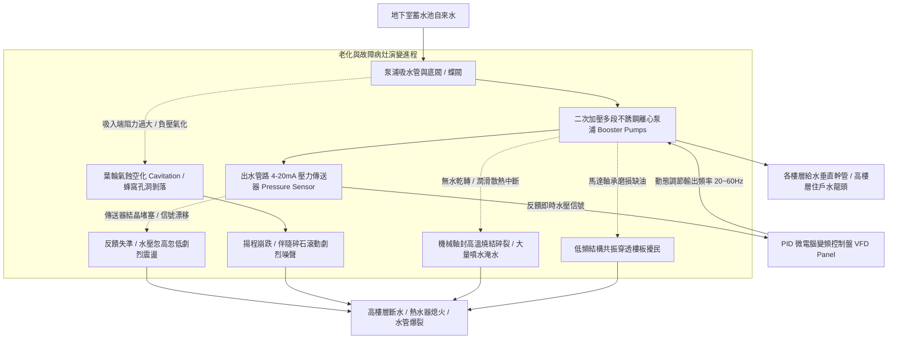

# 全案購屋實戰第五百三十三部_中古大樓社區地下室生活自來水二次加壓變頻泵浦PID控制恆壓傳送器漂移葉輪氣蝕剝落與機械軸封高溫乾磨體檢工序全書

## 壹、核心體檢宗旨與家庭居住安全意涵

在中古集合住宅大樓中，民生自來水供應體系是維持全體住戶每日飲水、烹飪、沐浴與衛浴沖洗的生命泉源。一般中古社區自來水系統採「兩段式加壓供水」架構：自來水廠自外管先注入大樓地下室蓄水池（受水箱），再由「地下室揚水泵浦」抽送至頂樓水塔，最後透過「二次加壓變頻泵浦組（Variable Frequency Booster Pumps System）」或重力流減壓閥分配至各住戶家中。

對於小寶家庭重點考量的高樓層物件（如**大安紫金城 13 樓**、**靜園 A 區 11 樓**、**長億南園 8 樓**與**歌德堡 8 樓**），由於高樓層距離頂樓水塔落差極小（重力靜水壓通常僅有 0.3 ~ 0.8 kgf/cm²，水壓嚴重不足無法點燃熱水器或造成蓮蓬頭出水如尿尿），必須百分之百仰賴二次加壓泵浦之「變頻器 PID 自動恆壓控制（PID Constant Pressure Control）」全時穩定增壓至 **2.5 ~ 3.5 kgf/cm²**。

然而，在屋齡達 20 至 25 年的中古地下室機房中，二次加壓泵浦系統每日 24 小時不間斷隨住戶用水量頻繁升降頻率運轉，長年累積高溫、水質水垢沉澱與氣蝕應力，極易衍生出四大極具威脅的深層水力與機電病灶：

1. **壓力傳送器（Pressure Transmitter / Transducer）壓電陶瓷晶片漂移與水壓劇烈忽大忽小**：安裝於出水主管上的 4~20mA 壓力傳送器，受長年水錘震盪與水垢結晶堵塞微孔，壓力反饋信號產生嚴重「零點漂移（Zero Drift）」。變頻器接收到錯誤虛假信號，引發馬達在極端頻率間反覆暴衝與急停，住戶洗澡時水壓忽強忽弱，水溫忽燙忽冰，甚至引發熱水器反覆熄火空燒爆炸風險。
2. **高壓水泵葉輪（Impeller）氣蝕空化（Cavitation）蜂窩狀剝落與出水量暴跌**：地下室水箱水位偏低或吸入管徑阻力過大時，泵浦吸入口局部產生真空負壓，水中溶氣析出微小氣泡。當氣泡進入高壓葉輪流道瞬間，在數萬大氣壓微射流撞擊下破裂，將不銹鋼或青銅葉輪表面打出蜂窩狀密集孔洞（氣蝕剝落）。葉輪流道殘破使揚程與出水量暴跌 40%~60%，並伴隨如「抽砂石滾動」般劇烈刺耳的碎裂噪聲。
3. **機械軸封（Mechanical Seal）陶瓷碳化鎢動靜環磨損與高溫乾磨燒死**：泵浦旋轉軸之機械軸封依賴流經之清水進行潤滑與散熱。老舊泵浦若遇水箱停水或浮球閥卡阻引發「泵浦無水乾轉（Dry Running）」，軸封動靜環在數十秒內摩擦發熱超過 200°C，碳化矽密封環碎裂、氟橡膠 O 型環碳化熔毀，地下室機房瞬間噴湧大量自來水淹沒配電箱。
4. **馬達軸承高溫潤滑脂乾涸引發低頻共鳴震動穿透樓板**：加壓馬達長年處於 50~60Hz 滿載轉速，雙側深溝球軸承在高溫下潤滑脂變質黑化，軸承滾動體出現疲勞點蝕。刺耳的旋轉機械摩擦聲透過建築梁柱剛性傳導，轉化為持續不斷的「低頻嗡鳴震動」，直接穿透至 1~2 樓低樓層住戶室內，引發嚴重的精神焦慮與鄰損抗議投訴。

本手冊針對高樓層置產標的建立標準化的地下室二次加壓變頻泵浦現場體檢工序、壓力波形勘驗法、修繕成本指標與買賣契約專屬特約防線。

---

## 貳、二次加壓變頻供水系統架構與失效水力力學演變

### 1. 變頻供水法定水壓標準規範
- **建築技術規則建築設備編第 32 條**：
  - 給水管路出水壓力在各樓層出水口處應維持在 **1.0 ~ 3.5 kgf/cm²（約 0.1 ~ 0.35 MPa）**。
  - 對於高樓層住戶，熱水器點火與蓮蓬頭暢快出水之最佳動態水壓建議維持在 **2.0 ~ 2.8 kgf/cm²**。
- **壓力波動容差門檻**：變頻 PID 恆壓控制之壓力波動公差在穩態用水下應控制在 **±0.2 kgf/cm²** 以內。若壓力波動超過 **±0.8 kgf/cm²**，代表傳送器已發生嚴重遲滯或控制參數發散。

---

## 參、實地帶看加壓供水系統現場體檢工序（SOP）

小寶在實地帶看大安紫金城 13 樓、長億南園 8 樓、歌德堡 8 樓或靜園 A 區 11 樓時，應進行室內水壓與地下室機房兩階段深度工序體檢：

| 檢驗步驟 | 檢驗場域與操作工序 | 正常指標 | 異常警訊與深層水電機電病灶 |
| :--- | :--- | :--- | :--- |
| **步驟一：目標戶室內全開水龍頭恆壓實測** | 於目標樓層（如 13 樓）同時打開廚房水龍頭、浴室臉盆與淋浴蓮蓬頭，觀察水流動態。 | 三處出水強勁均勻，水流穩定無噴濺空氣，水柱射程無可見衰減。 | 1. 開到第三個水龍頭時，蓮蓬頭水流瞬間銳減成細流，熱水器瞬間熄火。 2. 水龍頭噴出陣陣白霧水氣伴隨「砰砰」水管震跳聲（管內嚴重負壓氣化）。 |
| **步驟二：地下室加壓泵浦變頻控制盤壓力檢視** | 陪同總幹事至地下室給水機房，觀察變頻控制盤液晶螢幕上的設定壓力（SV）與反饋壓力（PV）。 | 設定值（如 3.0 kgf/cm²）與實際反饋值完全重合，波動在 **±0.1 kgf/cm²** 以內。 | 反饋數值如過山車般在 1.5 ~ 4.2 kgf/cm² 劇烈跳動，變頻器頻率狂升狂降。 |
| **步驟三：水泵運轉聲音與機械軸封滲漏查驗** | 在加壓泵浦運轉時，靠近泵體檢視旋轉軸頸處，並聆聽葉輪聲音。 | 運轉音為平順嗡嗡聲，軸頸處完全乾燥無滴水，無高溫灼熱感。 | 1. 軸封處如水龍頭般持續滴水或噴水，底座積水銹蝕。 2. 泵體內部傳出如「嚼碎鐵石」般極大喀啦喀啦氣蝕爆震聲。 |
| **步驟四：調閱二次給水設備半年洗塔維修單** | 查閱管理室存查之「自來水受水箱蓄水池清潔維護與泵浦保養日誌」。 | 每年至少清潔兩次水箱，泵浦每季檢測絕緣電阻與更換機械軸封注脂。 | 紀錄長年空白，或註記「加壓馬達異音待修」，管委會未安排排修。 |

---

## 肆、高樓層住宅置產防禦與合約特約保障

對於鎖定高樓層（大安紫金城 13 樓、靜園 A 區 11 樓、長億南園 8 樓、歌德堡 8 樓）的小寶家庭而言，二次加壓泵浦若損壞，高樓層將首當其衝面臨「完全斷水」或「忽冷忽熱無法洗澡」的生活災難：

### 1. 二次加壓供水系統維修與更新成本基準
- **更換出水端高精度 4~20mA 不銹鋼陶瓷微孔壓力傳送器組**：約 **\$6,500 ~ \$12,000 / 組**。
- **拆卸高壓多段泵浦、更換原廠碳化矽/鎢鋼機械軸封組（1 台）**：連工帶料約 **\$12,000 ~ \$18,000**。
- **泵浦葉輪氣蝕穿孔，更換全套 AISI 304/316 不銹鋼沖壓葉輪組與導流腔**：約 **\$22,000 ~ \$35,000**。
- **全面更換全新雙泵交替全自動變頻恆壓供水機組（含丹佛斯或富士變頻控制盤，7.5HP~10HP 雙泵）**：整套工程款高達 **\$160,000 ~ \$260,000**。

### 2. 購屋買賣合約高樓層水壓與加壓供水專屬特約條款範本
> **高樓層自來水供水壓力穩定保證特約條款**：  
> 「賣方保證本買賣標的所在樓層之民生自來水供應充足穩定，社區地下室二次加壓變頻供水機組運作正常，無水壓嚴重不足無法點燃熱水器、或變頻器故障引發水壓劇烈忽大忽小之情事。點交當日，雙方應實地於室內同時開啟兩處以上水龍頭，水壓應維持充沛穩定且熱水器能正常點火燃燒。若交屋日前經檢查發現供水壓力不合標準、或地下室加壓泵浦嚴重漏水異音需分攤修繕費用者，賣方應負責協調管委會於交屋日前修復完畢，相關專案攤派款全數由賣方負擔清償，否則買方得扣留尾款新台幣三萬元整。」
