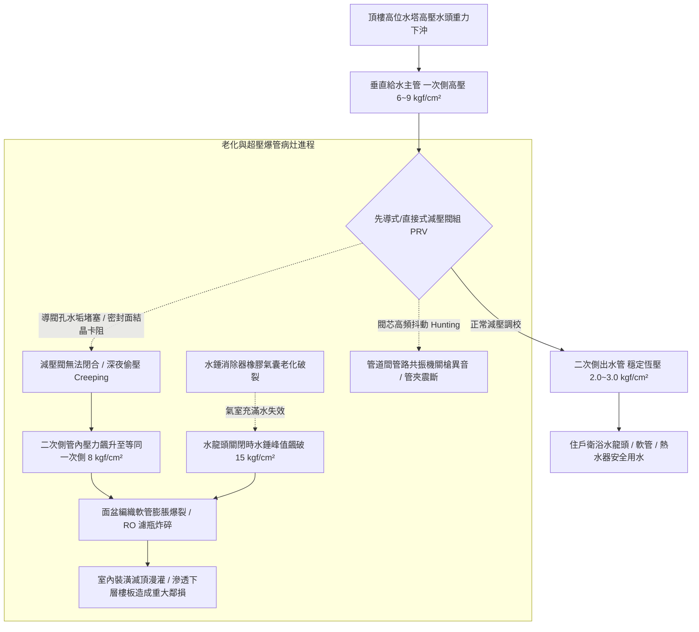

# 全案購屋實戰第五百三十九部_中古大樓社區各樓層生活給水垂直幹管減壓閥組閥芯水垢卡死超壓震盪水錘消除器氣囊破裂與低樓層水管爆裂體檢工序全書

## 壹、核心體檢宗旨與家庭居住安全意涵

在中古集合住宅大樓中，民生自來水由頂樓高位水塔或地下加壓泵浦輸送至各住戶室內時，由於大樓垂直高度產生的自然「重力靜水壓（Static Water Head，每下降 10 公尺樓高增加約 1.0 kgf/cm² 壓力）」，整棟大樓必須依據建築技術規則進行「垂直分區給水（Vertical Water Pressure Zonation）」。

為了使各樓層住戶水龍頭出水壓力維持在人體舒適且安全的 **1.5 ~ 3.5 kgf/cm²** 範圍內，大樓在各樓層管道間、或於中低樓層（通常設置於 6 樓至 10 樓的管道間內）配置「直接作用式或先導式減壓閥組（Direct-Acting / Pilot-Operated Pressure Reducing Valve, PRV）」，並隨同搭配「隔膜氣囊式水錘消除器（Water Hammer Arrester）」。

減壓閥是整棟垂直水力網絡的「降壓安全閥」。對於小寶家庭重點考量的各棟物件（包含高樓層的**大安紫金城 13 樓**、**靜園 A 區 11 樓**、**長億南園 8 樓**與**歌德堡 8 樓**），雖然高樓層本身不會承受低樓層的超額靜水壓，但全棟減壓閥與水錘消除器的健康妥善率，直接牽動整棟垂直幹管的壓力穩定度與公共維修基金的分攤風險。

然而，在屋齡達 20 至 25 年的中古管道間中，減速閥組長年承受自來水中高硬度碳酸鈣水垢結晶、砂石顆粒沖刷以及數百萬次水龍頭瞬間啟閉的動態脈衝，極易衍生出四大極具毀滅性的深層管路病灶：

1. **減壓閥內部黃銅導閥芯與節流孔水垢卡死失靈（Valve Creeping）**：水垢結石將導閥精密微孔堵死、或卡在主閥瓣橡膠密封面中，使閥門在住戶無用水時「無法完全關閉」。出水端壓力在深夜住戶停水時，慢慢向上「爬升偷壓（Pressure Creep）」，最終使二次側出水壓力完全等同於一次側高達 **6.0 ~ 9.0 kgf/cm²** 的高壓水頭！
2. **水錘消除器內部 EPDM 丁腈橡膠氣囊破裂充水失效**：安裝於減速閥旁或水龍頭端的水錘消除器，內部以充氮氣囊吸收壓力震波。橡膠氣囊在 20 年疲勞反覆擠壓下硬化破裂，原本充氮氣室充滿自來水，完全喪失吸收動能之彈性，化為一根毫無作用的金屬死管。
3. **住戶室內軟管爆裂、角閥噴飛與百萬裝潢滅頂大泡水**：當水垢卡死導致管路超壓（> 6 kgf/cm²），且失去水錘消除器緩衝時，住戶洗臉盆下方的編織冷熱水軟管、免治馬桶進水管或廚房 RO 淨水器濾瓶在深夜瞬間「爆裂撕裂」。高壓自來水每小時以數噸流量狂噴，數小時內淹沒木地板，並穿透樓板滴漏至下層天花板，造成數十萬至上百萬的鄰損裝潢賠償！
4. **垂直自來水幹管共振轟鳴與管夾震脫破裂**：減速閥在臨界開度時因水垢干擾產生高頻抖動（Hunting），引發整棟管道間給水幹管產生如「機關槍連射」般的劇烈水錘震盪，固定立管的 U 型管夾螺栓受震疲勞剪斷，無縫鋼管在樓板穿越套管處被刮破穿孔。

本手冊針對考慮標的建立標準化的管道間減壓閥組一次側/二次側壓力檢測工序、靜態偷壓量測法、水錘消除器敲擊測試與買賣契約專屬特約防線。

---

## 貳、垂直分區給水減壓閥系統架構與超壓爆管力學演變

### 1. 建築給水減壓閥法定壓力公差標準規範
- **建築技術規則建築設備編第 32 條**：
  - 給水栓（水龍頭）之靜水壓不得超過 **3.5 kgf/cm²（0.35 MPa）**；若超過此壓力，必須在該管段裝設減壓閥或減壓水箱。
  - **靜態偷壓（Pressure Creep）判定門檻**：在全戶完全不開水之靜態封閉狀態下，二次側壓力表數值在 30 分鐘內上升超過 **0.5 kgf/cm²**，即判定該減壓閥內部存在嚴重內漏磨損。

### 2. 水錘消除器氣囊預充壓力標準
- **水錘吸收器預充氣壓**：氣囊內部充填之高純度乾燥氮氣，其出廠預充壓力應為二次側工作水壓的 **1.1 至 1.2 倍（通常為 2.5 ~ 3.5 kgf/cm²）**。若內部氣囊破裂，水錘吸收率直接歸零。

---

## 參、實地帶看管道間減壓閥組現場體檢工序（SOP）

小寶在實地帶看大安紫金城 13 樓、長億南園 8 樓、歌德堡 8 樓或靜園 A 區 11 樓時，應進行管道間減壓閥組與室內水壓深度工序體檢：

| 檢驗步驟 | 檢驗場域與操作工序 | 正常指標 | 異常警訊與深層水力病灶 |
| :--- | :--- | :--- | :--- |
| **步驟一：管道間減壓閥一次側與二次側壓力表比對** | 請總幹事開啟公共樓道管道間檢修門，檢視安裝於減壓閥前後的兩顆壓力表。 | 一次側進水壓力約 5~7 kgf/cm²，二次側出水壓力精準穩定於 **2.0 ~ 2.8 kgf/cm²**。 | 1. 二次側壓力指針高達 **5.0 ~ 7.5 kgf/cm²**（與一次側同壓，減壓閥已完全擊穿失靈！）。 2. 壓力表指針劇烈抖動、表面破裂漏油。 |
| **步驟二：全室關閉水龍頭「靜態偷壓 15 分鐘」勘驗** | 於目標戶室內確認所有水龍頭、馬達與馬桶均關閉，觀察二次側壓力表指針。 | 15 分鐘內二次側壓力指針紋絲不動，數值保持在設定刻度。 | 關閉水龍頭後，二次側壓力指針以肉眼可見速度「緩緩向上攀升爬升」，超過 4.0 kgf/cm²（閥芯卡死偷壓）。 |
| **步驟三：水錘消除器金屬外殼敲擊測試** | 以硬幣或螺絲起子金屬端，輕敲水錘消除器筒身之上段（氣室）與下段（水室）。 | 上段發出清脆「噹噹」空心金屬聲，下段聲音微沈實心（氣囊完好充氣）。 | 整支金屬筒身由上到下全數發出沉悶「篤篤」實心水聲（氣囊早已破裂積滿死水！）。 |
| **步驟四：室內水龍頭急開急關「管路震跳監聽」** | 在目標戶衛浴快速將單槍陶瓷閥水龍頭由全開瞬間推至全關。 | 水流截斷瞬間聲音平順柔和，管道間無任何金屬震動敲擊聲。 | 1. 關水瞬間管道間傳出劇烈「匡啷！砰！」金屬撞擊巨響。 2. 洗臉盆下方的冷水角閥有肉眼可見的強烈彈跳震動。 |
| **步驟五：洗臉盆與馬桶進水編織軟管老化檢查** | 俯身檢視目標戶浴室面盆與馬桶下方的金屬編織高壓軟管。 | 軟管外層不銹鋼鋼絲編織平整，無生鏽凸起，橡膠無硬化，接頭無水漬。 | 軟管表面局部「鼓包膨脹」，金屬鋼絲斷裂刺出，接頭處長滿綠色銅鏽水痕（隨時爆管！）。 |

---

## 肆、全案置產防禦與買賣契約特約保障

對於小寶家庭而言，無論購入哪一個樓層，大樓公共給水管網的減壓閥若失靈超壓，不僅面臨室內軟管爆裂毀滅全家裝潢的直接危害，更會引發整棟大樓公共立管破裂與漏水糾紛：

### 1. 減壓閥組與水錘消除器修繕更新成本基準
- **更換全銅先導式或直接式生活減壓閥（DN50~DN80 口徑，含壓力表與調校工料）**：約 **\$18,000 ~ \$32,000 / 組**。
- **更換隔膜氣囊式不銹鋼水錘消除器（DN25~DN50 口徑，高壓充氮型）**：連工帶料約 **\$6,500 ~ \$12,000 / 支**。
- **全戶室內老舊老化高壓編織軟管與球閥全數更換為白鐵波紋防爆軟管（全室約 4~6 處）**：約 **\$3,500 ~ \$6,000**。

### 2. 購屋買賣合約公共分區給水減壓安全專屬特約條款範本
> **社區公共分區給水減壓閥組正常與防爆管保證特約條款**：  
> 「賣方擔保本買賣標的所屬大樓社區之生活給水垂直幹管減壓閥組及水錘消除器運作正常，出水二次側壓力符合安全標準（不得大於 3.5 kgf/cm²），無閥芯卡死超壓偷壓或水錘劇烈震盪情事。交屋點交當日，雙方應實地檢測該棟所在供水分區之二次側壓力表，確認無靜態壓力異常攀升超標情事。自簽約日起至交屋日止，若經檢查判定該減壓閥組損壞超壓需更換零件者，其修繕支出或管委會因此產生之工程專案攤派款，概由賣方全額清償負擔，賣方不得向買方主張任何補償。」
