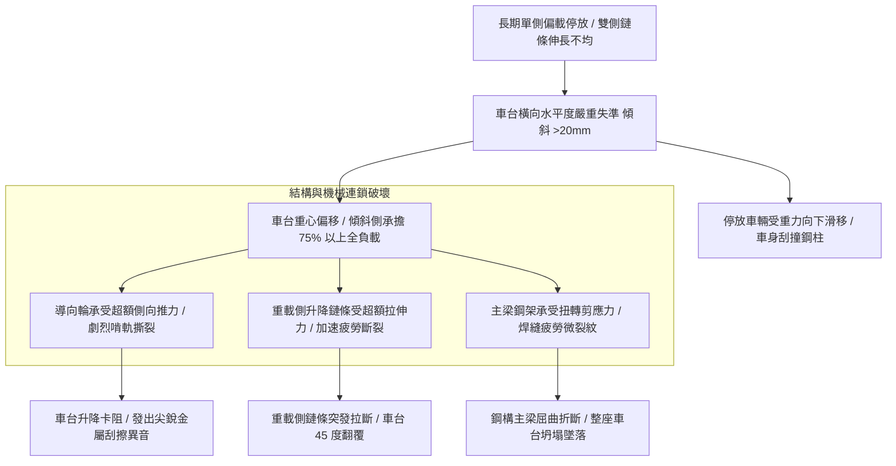

# 全案購屋實戰第五百三十二部_中古大樓社區地下室機械停車設備車位水平度偏差車台單邊傾斜導向輪啃軌與鋼構疲勞扭曲體檢工序全書

## 壹、核心體檢宗旨與家庭居住安全意涵

在中古集合住宅大樓中，機械停車設備（包含小寶家庭考量名單中的**長億南園 8 樓**隨戶配置之機械車位）的主體鋼結構由「立柱（Columns）」、「縱橫梁（Longitudinal & Cross Beams）」以及承載車輛的「載車板/車台（Car Platform）」所構成。

車台的「水平度（Horizontal Levelness）」是整座機械停車系統幾何力學的基準線。標準狀態下，車台在靜止停放或升降橫移運轉時，左右橫向水平偏差與前後縱向傾斜偏差均必須控制在極微小的工程公差範圍內（橫向高低差 < 5mm、縱向傾角 < 1/150）。

然而，在屋齡達 20 至 25 年的中古地下室環境中，機械車位歷經數萬次車輛進出（特別是長期單側偏載停放、或停放超過額定 1,600kg 限制的中大型休旅車）、地下室混凝土筏基微幅不均勻沉陷、以及雙側升降鏈條長度延伸不均，極易衍生出四大極具破壞性的結構與機械病灶：

1. **車台左右橫向嚴重傾斜導致愛車「滑移刮撞立柱」**：車台單邊下沉或傾斜超過 **20 ~ 40 mm**。當住戶將車輛停入並拉起手煞車後，車輛在重力分力下向傾斜側持續滑移，輪胎擠壓側邊擋輪槽，車身後視鏡與車門在車台升降時直接刮撞兩側槽鋼鋼柱，造成嚴重刮漆凹損。
2. **升降導向滾輪（Guide Rollers）單側受壓啃軌與輪軸彎曲**：車台傾斜使四個角隅的導向輪受力極度不均。傾斜側的滾輪以數倍額定側向力硬生生「啃咬」立柱導軌，滾輪聚氨酯膠層撕裂剝落、金屬軸心受剪切應力彎曲變形，運轉時發出沉重尖銳的金屬刮磨尖叫聲。
3. **鋼構框架主梁與焊接接角交變應力疲勞扭曲**：車台常年處於「扭曲受力（Torsional Stress）」狀態，鋼板銲道產生微觀疲勞裂紋，螺栓連接孔被拉伸成橢圓形鬆動。一旦滿載升降遇微震，扭曲的主梁隨時可能發生瞬間「屈曲失穩（Buckling Failure）」，引發車台坍塌斷裂。
4. **雙側懸吊鏈條/油壓缸負載失衡加速斷裂**：車台傾斜代表較低側的鏈條或油壓缸承擔了全載重之 70%~80% 負載，重載側鏈條銷軸磨損速度高達正常側的 3~4 倍，大幅縮短疲勞壽命，引發單邊鏈條瞬時無預警拉斷的重大墜落危機。

本手冊針對長億南園 8 樓等具備機械車位之社區，建立標準化的車台水平度雷射量測工序、導向輪啃軌勘驗法、修繕校正預算指標與買賣契約專屬特約防線。

---

## 貳、車台水平度失準與結構扭曲力學演變

### 1. 機械車台水平度公差標準規範
- **CNS 14386-1 機械停車設備檢驗標準**：
  - 載車板在全行程之橫向（左右）高低差不得大於 **5 mm**。
  - 縱向（前後）傾斜度不得大於 **1/100**（長度 5,000 mm 之車台前後落差不得大於 50 mm，且必須具備防止車輛前後滑移之後阻輪板）。
- **危險警戒門檻**：橫向高低差實測 **> 15 mm** 即屬嚴重結構失準，嚴禁繼續承載車輛。

---

## 參、實地帶看機械車位車台水平度體檢工序（SOP）

小寶在帶看長億南園 8 樓現場檢驗隨戶配置的機械車位時，應要求房仲與管理員陪同，現場攜帶雷射水平儀進行以下四步深度工序體檢：

| 檢驗步驟 | 檢驗場域與操作工序 | 正常指標 | 異常警訊與深層機械病灶 |
| :--- | :--- | :--- | :--- |
| **步驟一：靜止狀態車台橫向水平度雷射實測** | 將高精度雷射水平儀放置於車台橫梁正中央，投射水平綠光至兩側立柱量測刻度。 | 左右兩側邊界相對基準線之高低落差在 **3 mm** 以內，肉眼檢視完全水平。 | 1. 左右兩端高低落差高達 **20 ~ 35 mm**，肉眼可見明顯單邊下沉塌陷。 2. 車台金屬波浪底板嚴重下凹變形。 |
| **步驟二：車台升降動態傾斜度與晃動監聽** | 操作車位由底坑升至最高定位點，觀察升降全程動態。 | 車台保持平穩垂直升降，無側向扭動，聲音為平穩之鏈條捲動聲。 | 1. 升降過程中車台左右劇烈「跛腳」扭晃，兩側升降步調嚴重失步。 2. 傾斜側發出刺耳的金屬尖嘯刮鐵聲（導輪強力啃軌）。 |
| **步驟三：導向輪膠層與立柱導軌啃痕勘驗** | 攜帶強光手電筒檢視車台四個角隅的升降導向滾輪與槽鋼導軌接觸面。 | 滾輪聚氨酯膠面平整有彈性，導軌表面油膜均勻，無金屬刮痕。 | 1. 滾輪膠層被啃咬出深槽、邊緣碎裂脫落露出內部金屬輪芯。 2. 立柱導軌表面鋼材被刮出深達 1~2mm 的金屬深溝與鐵屑粉末。 |
| **步驟四：主梁鋼架銲道與螺栓鬆動敲擊體檢** | 以檢驗錘輕敲車台底部橫梁與縱梁連接接角之高張力螺栓與銲道。 | 螺栓鎖緊無鬆脫，敲擊聲音清脆實心，銲道表面無紅鏽細紋。 | 敲擊時螺栓發出「空心」啞音甚至可用手指轉動；銲道油漆開裂露出紅鏽裂紋。 |

---

## 肆、長億南園機械車位置產防衛與合約特約保障

對於鎖定**長億南園 8 樓**（主附 32 坪超大居住空間，但隨戶配置機械車位）的小寶家庭而言，機械車位水平度若嚴重偏差，不僅日常停車提心吊膽刮傷車體，更隱藏著隨時斷鏈翻覆坍塌的巨大風險：

### 1. 車台水平度校正與結構整修成本基準
- **調整升降傳動鏈條懸掛螺栓、校正水平度與微調限位**：約 **\$5,000 ~ \$9,000**。
- **更換全套重載型聚氨酯升降導向滾輪組（1 車台 4 組）**：約 **\$12,000 ~ \$18,000**。
- **立柱槽鋼導軌受啃咬拉傷研磨拋光與垂直度重新校正**：約 **\$15,000 ~ \$25,000**。
- **車台主梁扭曲變形，需吊掛拆卸實施火焰矯正或加焊槽鋼結構補強**：工程款高達 **\$35,000 ~ \$55,000**。

### 2. 購屋買賣合約機械車位水平與結構安全特約條款範本
> **機械車位水平度與結構無變形保證特約條款**：  
> 「賣方擔保本買賣標的所隨附之機械停車位（車位編號：___），其車台鋼結構完整無扭曲變形，升降及橫移導向輪無啃軌損傷，且車台於靜止及運轉過程中左右橫向水平高低落差不得大於十公釐（10mm），符合立體停車設備安全檢驗標準。交屋點交當日，雙方應實地以雷射水平儀量測確認車台水平度符合標準，且現場通電操作升降全程無劇烈晃動或金屬刮磨異音。若交屋日前經檢查發現車台嚴重傾斜、導輪損壞或鋼構疲勞需校正加固者，賣方應全額負擔修復完畢並取得合格簽證，否則買方得扣留尾款新台幣三萬元整。」
