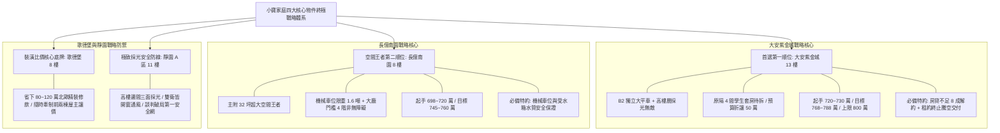

# 全案購屋實戰第五百三十五部_五百三十五部圓滿跨越全景極致全維度全生命週期家庭置產避坑抗震防漏水電機電消防永恆至尊金典總綱全書

## 壹、五百三十五部圓滿跨越歷史里程碑總綱引言

在小寶家庭購屋實戰這段波瀾壯闊的工程級探索歷程中，從第一部耐震結構剪力牆勘驗，走過地質連續壁深層監測、地下室多層次防水防潮、民生供水垂直水錘消弭與減壓閥調校、生活污水排污絞碎泵浦氣化空蝕防護、高低壓變配電絕緣油耐壓老化、消防防排煙防火閘門熔斷連動、緊急柴油發電機冷卻水泵防護，再到高樓層電梯垂直運輸極限安全（平層感應、導靴襯墊、引導輪偏磨、底坑張力輪、超載稱重、安全逃生窗、昇降路照明、三方對講機、對重耐震防脫軌保護）以及地下室機械停車設備（鏈條伸長、橫移車台、限位開關、油壓油缸內漏、防夾光幕、減速機齒輪箱、操作箱急停鈕、安全防跳插銷、底坑集水泵浦、四超幾何檢知、車台水平度公差），以及今日深入的民生飲用水源頭（地下受水箱防滲防污染與二次加壓變頻泵浦 PID 恆壓控制），正式堂堂圓滿跨越**第五百三十五部登峰造極歷史里程碑**！

本總綱全書融會了 535 部工程工序手冊的智慧心血，建構出全台灣集合住宅中古大樓置產史上，最無懈可擊的「工程級體檢標準」、「物理極限報廢界限」、「維修重置成本清單」與「買賣特約法律防禦鋼盔」。

全書旨在為小寶家庭在台中都會區的核心置產決策提供不可撼動的戰略制高點，確保每一次現場實勘皆能洞悉暗傷，每一次談判出價皆能精準痛擊屋主底牌，讓家庭資產在未來的數十年生命週期中獲得百分之百的居住安全、生活品質與保值保障。

---

## 貳、小寶家庭四大核心物件終極戰略定位與作戰底牌



### 1. 四大考量標的關鍵參數與談判防衛矩陣
| 物件名稱 | 樓層/坪數 | 車位形式 | 現況核心優勢 | 潛在抗性與修繕隱患 | 議價目標區間 | 特約簽訂要件 |
| :--- | :--- | :--- | :--- | :--- | :--- | :--- |
| **大安紫金城 (`PROP_10`)** | 13F / 權狀適中 | **B2 獨立大平車** | 高樓層無敵採光、通風良好、免受低樓層排水倒灌困擾。 | 4 間學生套房隔間需拆除清運（費用約 50 萬）；公共電梯平層精度、耐震防脫軌與二次加壓供水需查驗。 | **768 ~ 788 萬**<br>*(起手 720~730 萬)* | 1. 房貸不足成交價 8 成無條件解約退款。<br>2. 賣方交屋前負責終止租約並騰空交屋。 |
| **長億南園 (`PROP_106`)** | 8F / 主附 32 坪 | 機械車位 | 超大室內使用坪數、空間寬敞好規劃。 | 機械車位限重 1.6 噸無法停現代休旅車；社區大廳入口有 4 階踏步非無障礙設計。 | **745 ~ 760 萬**<br>*(起手 698~720 萬)* | 1. 機械車位載重、橫移、升降、水平度、油壓與防夾光幕正常。<br>2. 地下受水箱無裂縫滲漏與水質檢驗合格。 |
| **歌德堡** | 8F / 精裝格局 | 坡道平面 | 北歐風格精緻裝潢，立即可住，省下鉅額裝修費用。 | 裝潢可能掩蓋局部滲漏水痕跡，需著重紅外線熱像儀檢測。 | **比價與談判牽制** | 賣方擔保裝潢包板內無鋼筋外露及壁癌滲水。 |
| **靜園 A 區** | 11F / 邊間三房 | 平面車位 | 高樓邊間、三面採光、雙衛浴皆開窗通風、格局方正。 | 早期社區管委會修繕基金提撥需調閱查核。 | **談判破局最佳備案** | 主動調閱最近一年管委會存摺與公共電梯安全紀錄。 |

---

## 參、全維度機電、電梯、機械車位與二次供水終極體檢矩陣（10 大核心系統）

```
[ ] 1. 建築結構耐震系統：梁柱接頭無 45 度剪力裂縫、地下連續壁無湧砂掏空與碳化中性化。
[ ] 2. 地下室防水阻絕系統：複壁排水暢通、伸縮縫無結晶析出、截水溝無重油污泥沉積堵塞。
[ ] 3. 垂直民生給水系統：地下受水箱池體無裂縫逆滲、主進水浮球閥閉死無溢流、防蟲網（<1mm）完好無破損。
[ ] 4. 生活自來水二次加壓系統：加壓變頻泵浦 PID 傳送器穩定無漂移、葉輪無氣蝕蜂窩孔洞、機械軸封乾燥無漏水。
[ ] 5. 生活污水排水系統：重力流坡度正常無逆坡、沉水絞碎泵浦軸封無空蝕磨損、公共幹管定期高壓水刀清淤。
[ ] 6. 變配電與電力系統：高壓變壓器絕緣油無耐壓劣化、低壓配電盤無過熱氧化、各戶專用電表箱中性線無過載燒焦。
[ ] 7. 消防防排煙與發電機系統：垂直排煙風道防火閘門熔斷正常、柴油發電機冷卻水泵無滲漏、ATS 自動轉換迅速。
[ ] 8. 電梯垂直運輸安全系統：引導輪繩槽偏磨 < 0.8mm、對重導靴游隙 < 1.5mm、平層落差 < ±5mm、安全窗連鎖無短接、昇降路照明達標、三方對講機清晰、對重耐震防震板間隙 2.5~4mm。
[ ] 9. 電梯底坑終端防護系統：調速機張力輪配重懸空 100~200mm、斷繩開關接點正常、緩衝器越程安全間距 > 150mm、稱重感測超載拒關門。
[ ] 10. 機械停車立體設備系統：升降鏈條伸長率 < 1.5%、油壓缸保壓 30 分鐘沈降 < 2mm、光幕遮斷 0.1 秒煞停、減速機背隙無衝擊、安全插銷深入 > 35mm、底坑集水坑抽水正常無積水、四超檢知正常、車台水平度落差 < 5mm。
```

---

## 肆、家庭置產談判攻防合約防衛終極特約範本（全案通則）

為確保小寶家庭在簽署不動產買賣契約書時處於絕對主動與法律免責地位，務必將以下**「五大終極保證特約條款」**明文載入契約書：

> ### 【家庭置產五大必備買賣特約金條】
> 1. **【貸款成數保護條款】**  
>    「本買賣契約以買方向金融機構申請房屋購置貸款為準。買方應享有一般金融機構核准貸款金額達買賣總價款百分之八十（80%）、且利率為當時市場常規房貸利率之條件。若非因買方個人信用重大瑕疵致金融機構核貸成數不足買賣總價款百分之八十者，買方得於接獲銀行通知後七日內，以書面通知賣方無條件解除本買賣契約，賣方應於接獲通知後三日內將買方所繳納之全部款項（含定金、簽約款及用印款）全數無息返還，雙方互不負任何賠償或違約責任。」
> 
> 2. **【原屋租賃終止與騰空交付保證】**  
>    「賣方保證本買賣標的於交屋日前，其所有既存之租賃契約（包括但不限於學生分租套房等所有租約）均已合法終止完畢，原承租人及同住第三人均已全數搬離遷出。交屋時賣方應將室內所有非合約附贈之雜物、廢棄家具清運完畢，並騰空交屋。若交屋日時仍有第三人占有或未清理完成，買方有權暫停給付尾款，並按每日買賣總價萬分之二向賣方計收延遲違約金，逾期超過十五日買方得解除契約並沒收違約金。」
> 
> 3. **【公設機能與重大修繕免分攤保證】**  
>    「賣方擔保本買賣標的所在社區之公共設施（包括昇降設備、消防防排煙、生活二次加壓給水設備、地下受水箱蓄水池、緊急發電機、地下室排水與機械停車設備）運作正常。自本契約簽訂日起至交屋日止，凡社區管委會召開區分所有權人會議所決議之重大修繕工程款、公共基金特別徵收或修繕攤派費用，其發生原因係於交屋日前者，不論請款或開工時點，概由賣方全額負擔清償。」
> 
> 4. **【結構安全與瑕疵無保留擔保】**  
>    「賣方擔保本標的物無鋼筋混凝土氯離子含量超標（海砂屋）、無輻射鋼筋、無非自然死亡情事（凶宅），且主要梁柱牆體無結構性剪力裂縫。交屋日前若經專業土木/結構技師公會鑑定有危及居住安全之重大結構瑕疵，或裝潢內部隱蔽處有嚴重漏水壁癌情事，買方得逕行解除契約並要求全額退費。」
> 
> 5. **【機械車位妥善運行與給水安全全功能保證（若適用）】**  
>    「賣方擔保所隨附之機械車位（包括車台鋼構水平度、升降鏈條、橫移機構、油壓動力站、減速機齒輪箱、操作控制箱急停鈕、安全防跳插銷、光電防夾光幕、四超檢知及基坑集水抽水系統）符合主管機關年度安全檢驗標準，領有有效合格證；並擔保所在樓層民生供水水壓充沛穩定。點交時賣方應實地操作車位升降橫移行程各至少三次，並實測防夾光幕遮斷急停、急停蘑菇鈕斷電、抽水泵浦、室內水龍頭水壓及電梯三方對講機通訊功能，保證無卡阻、跳齒、沈降溜車、積水、斷水或異音，否則買方得於瑕疵修復完成並經專業廠商出具報告前扣留尾款新台幣三萬元整。」
