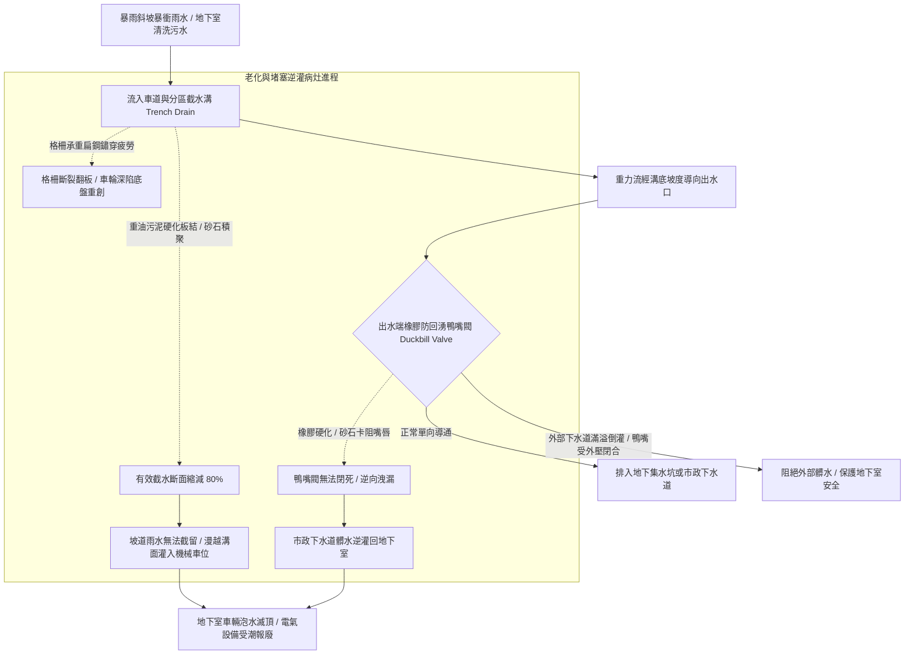

# 全案購屋實戰第五百三十八部_中古大樓社區地下室截水溝重油污泥沉積堵塞防回湧鴨嘴閥橡膠硬化與高壓水刀清淤體檢工序全書

## 壹、核心體檢宗旨與家庭居住安全意涵

在中古集合住宅大樓中，地下室各樓層（B1、B2 至 B3）是全社區機電設備、配電室、發電機房、生活蓄水池以及**機械停車設備基坑**的重鎮集中地。而橫亙於車道出入口下坡處、地下各分區防火鐵捲門前、以及機械停車位四周的「地下室排水截水溝系統（Basement Trench Drain & Interceptor System）」，是大樓防禦暴雨雨水倒灌與內部油水漫流的「第一道地面防洪戰壕」。

截水溝上方覆蓋鍍鋅鋼格柵或鑄鐵格柵板，內部藉由重力洩水坡度將水流導向地下集水坑，並在排入市政雨水或污水下水道前，配置防止外部洪水或沼氣逆流的「橡膠防回湧鴨嘴閥（Duckbill Check Valve / Backflow Preventer）」。

然而，在屋齡達 20 至 25 年的中古社區地下室中（如小寶家庭重點關注的**大安紫金城 13 樓**、**長億南園 8 樓**、**歌德堡 8 樓**與**靜園 A 區 11 樓**），截水溝常年承受車輛輪胎帶入的泥沙、洗車重油污、地坪油漆粉塵以及乾燥固化沉泥，極易衍生出四大極具威脅的排水癱瘓與淹水病灶：

1. **截水溝內重油污泥硬化板結（Caking）與有效斷面縮減 80%**：洗車泡沫中的介面活性劑與車輛底盤滴漏的機油、煞車油混合，在溝底與砂石結合成厚達數公分、堅硬如水泥般的「重油硬化層」。原本設計斷面為 30cm × 30cm 的排水溝，有效過水斷面縮減至不足 5cm，一旦夏季午後強降雨（時雨量超過 80~100mm）來襲，由坡道狂湧而下的雨水無法被截留，直接翻越截水溝漫灌淹入機械車位底坑！
2. **防回湧橡膠鴨嘴閥老化硬化、卡砂變形與外部雨水逆向回灌**：安裝於截水溝出水口端部的氯丁橡膠或三元乙丙（EPDM）鴨嘴閥，長年受油污浸泡膨脹硬化，或被砂石骨料卡在嘴唇縫隙中「無法完全閉合」。當暴雨導致外部市政下水道水位暴漲倒灌時，倒灌雨水經由未閉合的鴨嘴閥「由外向內逆灌」進入地下室，使地下室瞬間成為下水道的洩洪蓄水池！
3. **鑄鐵/鍍鋅鋼格柵板嚴重鏽蝕變形與車輛壓過斷裂翻車**：截水溝上方之鋼格柵長年受含鹽酸性廢水與輪胎重壓（特別是 2 噸休旅車頻繁碾壓），鍍鋅層脫落穿孔鏽蝕、承重扁鋼（Load Bar）撕裂扭曲。當車輛行經時，格柵板突然斷裂或翹起翻覆，車輪直接卡死在截水溝深槽內，導致輪圈破裂、底盤三角架撞斷或懸吊系統重創。
4. **溝內腐敗惡臭與甲烷易燃沼氣積聚引發爆炸隱患**：厚重油泥在厭氧環境下發酵腐敗，產生高濃度硫化氫（H2S）惡臭毒氣與易燃的甲烷（CH4）沼氣。若發電機房或機械車位操作盤產生電弧火花，恐引發地下溝渠氣爆引燃大火。

本手冊針對考慮標的建立標準化的地下截水溝沉積物清淤檢驗、鴨嘴閥密封性測試、格柵承重勘驗 SOP、修繕成本指標與買賣契約專屬特約防線。

---

## 貳、截水溝重力排水體系與暴雨逆灌失效力學

### 1. 地下室截水溝法定排水容量標準規範
- **建築技術規則建築設備編第 29 條 / 排水管溝規範**：
  - 地下室車道出入口之截水溝，其排水平面設計應能承載大樓所在地 **10 年或 20 年一遇** 之暴雨強度（時雨量需按至少 100 ~ 120 mm/hr 計算）。
  - 溝底必須施作至少 **1/100 至 1/200** 之平整洩水坡度，嚴禁產生反坡積水。
- **鴨嘴閥耐背壓性能指標**：
  - 合格鴨嘴閥在承受 **0.5 ~ 1.0 kgf/cm²（約 5~10 公尺水頭）** 之逆向水壓時，逆向洩漏量必須為 **零（完全密封滴水不漏）**。

---

## 參、實地帶看地下室截水溝現場體檢工序（SOP）

小寶在實地帶看大安紫金城 13 樓、長億南園 8 樓、歌德堡 8 樓或靜園 A 區 11 樓時，應沿車道步行至地下室，進行以下四步深度工序體檢：

| 檢驗步驟 | 檢驗場域與操作工序 | 正常指標 | 異常警訊與深層排水病灶 |
| :--- | :--- | :--- | :--- |
| **步驟一：車道入口截水溝格柵平整度勘驗** | 檢視車道斜坡底端橫向截水溝之金屬格柵板。 | 格柵平整嵌入水泥溝框內，受壓無晃動跳動，扁鋼無生鏽扭曲。 | 1. 格柵板中央明顯向下塌陷下凹超過 15mm，承重鋼條撕裂。 2. 車輛經過時發出極大「匡啷、匡啷」金屬撞擊聲，邊角已翹起。 |
| **步驟二：掀起格柵檢視溝內油泥淤積厚度** | 佩戴工作手套，以鐵鉤或螺絲起子掀起一塊格柵，檢視溝底沉積物。 | 溝底水泥平整光滑，僅有微量清澈流水，無厚重泥沙油污堆積。 | 1. 溝內被發黑發臭的黏稠硬化油泥塞滿超過 2/3 深度，散發刺鼻惡臭。 2. 溝底常年積有死水（代表施作反坡或後端已完全堵死！）。 |
| **步驟三：出水口端部防回湧鴨嘴閥外觀勘驗** | 攜帶強光手電筒檢視截水溝排入集水坑或放流井管口之橡膠鴨嘴閥。 | 鴨嘴橡膠柔軟有彈性，兩片嘴唇自然緊密閉合，外表無泥沙硬塊卡阻。 | 1. 鴨嘴橡膠硬化龜裂如枯木，嘴唇呈「張開圓孔」狀（失去單向機能）。 2. 鴨嘴內部卡滿小石子與樹枝，使外流口完全敞開無阻。 |
| **步驟四：調閱地下室水刀高壓清淤維護單** | 查閱管理室存查之「社區公共下水管路與車道截水溝水刀清洗工程日誌」。 | 管委會每年或每兩年定期委託專業水刀清淤廠商徹底沖洗管溝。 | 該項目自建案交屋起從未清淤過，或管理員反映「每逢大雨車道下坡處水排不及溢流」。 |

---

## 肆、高樓層住宅置產防禦與合約特約保障

雖然小寶家庭鎖定高樓層（大安紫金城 13 樓、靜園 A 區 11 樓、長億南園 8 樓、歌德堡 8 樓），但地下室截水溝若堵塞逆灌，愛車停放於地下室將面臨泡水滅頂風險，且修繕公共管溝常需動輒數十萬元的專案公共基金攤派：

### 1. 截水溝與管路高壓水刀清淤成本基準
- **車道截水溝人工刮除硬化油泥與高壓水刀（250~300 bar）全面通管沖洗**：單次工程款約 **\$15,000 ~ \$28,000**。
- **更換重載型耐化學腐蝕全橡膠防回湧鴨嘴閥（DN150~DN200 口徑）**：連工帶料約 **\$12,000 ~ \$20,000 / 個**。
- **更換車道重載熱浸鍍鋅防滑鋼格柵板（以 10 米車道長度計算，含邊框補強）**：約 **\$25,000 ~ \$42,000**。

### 2. 購屋買賣合約公共防洪截水排水專屬特約條款範本
> **社區公共地下室防洪截水排水設施保證特約條款**：  
> 「賣方保證本買賣標的所屬大樓社區之地下室車道截水溝、分區排水溝渠及防回湧逆止閥運作正常，管溝暢通無嚴重油泥沉積淤塞，且過去無因暴雨逆灌致使地下室車道淹水或停車設備受損之情事。自本契約簽訂日起至交屋日止，若經現場勘驗或專業水電機構判定該大樓截水溝嚴重堵塞需進行專案高壓水刀清淤或更換防回湧裝置者，其修繕支出或管委會因此產生之工程專案分攤款，概由賣方全額清償負擔，賣方不得向買方主張任何補償。」
