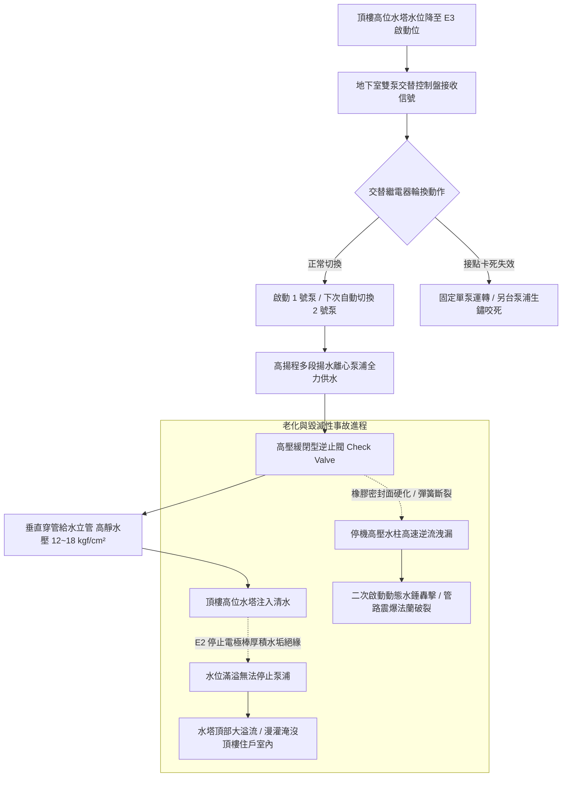

# 全案購屋實戰第五百三十六部_中古大樓社區地下室生活自來水雙泵揚水系統止回閥逆向洩漏低頻水錘震盪雙泵自動交替控制器故障與高樓層水塔溢流體檢工序全書

## 壹、核心體檢宗旨與家庭居住安全意涵

在中古集合住宅大樓中，民生自來水供應的命脈依賴「地下室至頂樓水塔的垂直揚水系統（Vertical Water Lifting / Transfer Pump System）」。該系統通常配置兩台高揚程多段離心揚水泵浦（一用一備或交替運轉），將地下室受水箱儲存的清水，經由垂直揚水幹管（立管口徑通常為 2.5 ~ 4 英吋，承載高達 10 ~ 18 kgf/cm² 之高靜水壓）全力推送至頂樓高位水塔。

對於小寶家庭重點考量的高樓層物件（如**大安紫金城 13 樓**、**靜園 A 區 11 樓**、**長億南園 8 樓**與**歌德堡 8 樓**），由於住家緊鄰頂樓水塔或位於垂直水管幹管行經的核心動線上，揚水系統的妥善率直接關乎每日用水的穩定度與居住安寧。

然而，在屋齡達 20 至 25 年的中古地下室機房與管道間中，垂直揚水系統在經歷數十萬次啟閉運轉後，長年承受高壓靜水頭、極端動態水錘與水垢侵蝕，極易衍生出四大極具破壞性的深層水力與電控病灶：

1. **出水端緩閉逆止閥（Slow-Closing Check Valve）橡膠閥瓣硬化磨損與高壓逆向洩漏**：每一台揚水泵浦出水端均必須裝設高壓逆止閥（止回閥），防止停機時數十公尺水柱重力逆流倒灌。老舊逆止閥橡膠密封面硬化龜裂、彈簧疲勞斷裂或閥軸水垢卡死，造成高壓清水無休止地逆流洩漏回地下水箱。當泵浦再度啟動時，管內水柱倒流與正向推力劇烈碰撞，引發毀滅性之「極限低頻水錘（Water Hammer）」，震波貫穿全棟管道間，造成管夾脫落、法蘭墊片撕裂，甚至將低樓層住戶室內水管震爆！
2. **頂樓水塔高低水位電極棒（Water Level Electrodes）水垢結石包覆與信號誤判**：控制地下室揚水泵浦啟停的依據是懸掛於頂樓水塔內的不銹鋼電極棒（E1 溢流、E2 停止、E3 啟動、E4 缺水、E5 共同極）。電極棒歷經 20 年水垢、碳酸鈣結晶厚重包覆，水垢形成絕緣阻抗，導致當水塔已注入滿水位時，E2 停止電極卻因斷路而「無法檢知滿水」。揚水泵浦持續全速狂抽，引發頂樓水塔「嚴重溢流大水氾濫」，自來水順著頂樓女兒牆、逃生梯與通風管道間傾瀉而下，直接淹入 13 樓頂樓住戶室內裝潢！
3. **地下室雙泵自動交替控制器（Automatic Alternating Relay）接點氧化卡死引發單泵過勞燒毀**：控制箱內負責將 1 號泵與 2 號泵每次輪流啟動的交替繼電器，接點氧化積碳。系統卡死在固定單一泵浦運轉，備用泵浦長年不轉導致軸承生鏽咬死；而常用泵浦在 24 小時連續高頻過度操勞下，馬達線圈漆包線耐熱劣化，最終過載燒毀，全社區面臨突發性斷水危機。
4. **垂直幹管無縫鋼管管壁內部銹蝕結瘤（Tuberculation）與揚水阻力暴增**：早期大樓揚水立管常採用鍍鋅鋼管，20 年後管內滿布鏽瘤，管徑有效流通截面積縮減 30%~50%，揚水水阻暴增，馬達運轉電流長期處於超載臨界點，能耗暴增且抽水時間延長數倍。

本手冊針對高樓層置產標的建立標準化的垂直揚水系統逆止閥防洩漏勘驗、頂樓水塔水位電極測試、雙泵交替檢驗 SOP、修繕成本指標與買賣特約防護。

---

## 貳、垂直雙泵揚水系統架構與水力水錘失效演變

### 1. 揚水立管水力壓力標準與水錘極限
- **揚水幹管設計工作壓力**：以 15 層中古大樓為例，地下室至頂樓落差約 50 公尺，基底靜水壓約 **5.0 ~ 6.0 kgf/cm²**；當泵浦運轉時動態揚程壓力通常達 **8.0 ~ 12.0 kgf/cm²**。
- **水錘峰值安全容許極限**：停機瞬間之水錘波峰值壓力不得超過管路公稱耐壓的 **1.5 倍**。若逆止閥無緩閉或無水錘吸收器，瞬間水錘衝擊波可高達 **25 ~ 35 kgf/cm²**，足以撕裂老舊鐵管彎頭與閥門！

### 2. 水位控制器電極棒電阻阻抗標準
- **正常導通阻抗**：水質正常時，水浸沒電極棒間之導通電阻應 **< 5 kΩ**。
- **水垢失效臨界值**：當碳酸鈣水垢結晶厚度超過 1mm 時，實測電阻飆升至 **> 50 kΩ**，控制器判定為「空氣斷路狀態」，喪失滿水切斷機能。

---

## 參、實地帶看揚水系統與水塔現場體檢工序（SOP）

小寶在實地帶看大安紫金城 13 樓、長億南園 8 樓、歌德堡 8 樓或靜園 A 區 11 樓時，應進行地下室泵浦房與頂樓水塔雙向工序體檢：

| 檢驗步驟 | 檢驗場域與操作工序 | 正常指標 | 異常警訊與深層水電機電病灶 |
| :--- | :--- | :--- | :--- |
| **步驟一：地下室揚水泵浦出水逆止閥保壓勘驗** | 當揚水泵浦運轉停機瞬間，攜帶強光手電筒觀察出水管壓力表與逆止閥體。 | 停機時壓力指針柔和回落並穩定維持於靜水壓值，逆止閥輕柔無聲閉合。 | 1. 停機瞬間管路發出「砰！」如巨石撞擊之震耳巨響，全棟立管劇烈抖動跳躍。 2. 停機後壓力指針瞬間歸零，伴隨閥體內部「嘩嘩」持續水流逆流聲。 |
| **步驟二：控制盤手動切換與「雙泵自動交替」實測** | 在地下室揚水控制箱前，連續按壓啟動按鈕兩次，觀察馬達交替動作。 | 第一次由 1 號泵啟動，關閉後第二次按下必定由 2 號泵啟動，交替指示燈正常切換。 | 1. 連續兩次均由同一台泵浦運轉，交替器完全無動作。 2. 備用泵浦強行手動啟動時發出刺耳卡死燒焦味（軸承早已生鏽抱死）。 |
| **步驟三：頂樓水塔人孔開啟與水位電極棒檢查** | 爬上頂樓水塔頂部平台，開啟水塔防塵人孔蓋檢視內部懸吊電極棒組。 | 5 支不銹鋼電極棒表面光亮潔淨，無纏繞水草雜物，各棒長度落差階梯分明。 | 1. 電極棒被厚達數公釐的黃褐色石灰水垢厚厚裹覆，棒體互相碰觸短路。 2. 水塔內壁有溢流管持續流水的水痕，溢流口滿是青苔。 |
| **步驟四：頂樓通風管與管道間外壁水痕勘驗** | 於大安紫金城 13 樓或各物件之頂樓走廊，檢視管道間外牆與天花板角隅。 | 水泥牆面乾燥無滲斑、無起泡脫漆，管道間檢修門乾燥無銹。 | 牆角有明顯縱向泛黃大水痕跡、踢腳板木作發霉腐爛（此為水塔曾嚴重溢流漫灌的鐵證！）。 |

---

## 肆、高樓層住宅置產防禦與合約特約保障

對於鎖定高樓層（大安紫金城 13 樓、靜園 A 區 11 樓、長億南園 8 樓、歌德堡 8 樓）的小寶家庭而言，頂樓水塔若因電極棒故障溢流，高樓層將首當其衝承受「屋頂水漫金山」的裝潢損毀慘劇；而揚水逆止閥水錘更會日夜產生低頻敲擊震動，嚴重破壞睡眠品質：

### 1. 垂直揚水系統維修與更新成本基準
- **更換地下室高壓多功能緩閉逆止閥（DN80~DN100 口徑，含水錘吸收功能）**：約 **\$18,000 ~ \$30,000 / 支**。
- **更換頂樓水塔 SUS 316 不銹鋼電極棒組與地下室五位水位控制器（日本 OMRON 61F-G3N）**：約 **\$8,000 ~ \$15,000**。
- **地下室雙泵交替控制盤全套微電腦化翻新（含固態交替繼電器與馬達電子過載保護器）**：約 **\$25,000 ~ \$42,000**。
- **更換全套高揚程直立多段不銹鋼揚水泵浦機組（10HP~15HP 雙泵）**：整套工程款高達 **\$120,000 ~ \$180,000**。

### 2. 購屋買賣合約公共揚水與水塔防溢流專屬特約條款範本
> **公共垂直揚水系統正常運作與防溢流水錘保證特約條款**：  
> 「賣方擔保本買賣標的所屬社區大樓之公共垂直揚水泵浦系統運作正常，地下室出水逆止閥保壓良好無逆向洩漏，揚水停機時無異常破壞性水錘震盪，且頂樓水塔水位控制電極機能確實無虞，過去無因水塔溢流漫灌致使本標的室內漏水受損之情事。自簽約日起至交屋日止，若經電梯專業水電機構檢查發現揚水系統逆止閥故障引發嚴重水錘、或水塔電極失效引發溢流需進行重大維修工程者，其修繕支出或管委會因此產生之工程專案分攤款，全額由賣方清償負擔，賣方不得向買方主張任何補償。」
