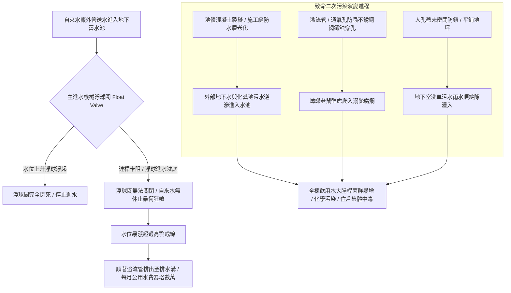

# 全案購屋實戰第五百三十四部_中古大樓社區地下室生活自來水受水箱蓄水池池體裂縫滲水進水浮球閥卡阻無效溢流管防蟲網破裂與水質二次污染體檢工序全書

## 壹、核心體檢宗旨與家庭居住安全意涵

在中古集合住宅大樓中，民生自來水供應體系的源頭是設置於地下室最底層的「自來水受水箱 / 地下蓄水池（Water Receiving Cistern / Underground Water Reservoir）」。自來水公司自道路自來水主管線引水入大樓後，必須先注入地下受水箱，再藉由二次加壓或揚水泵浦輸送至頂樓水塔。

蓄水池常年儲存著全社區數百位住戶每日飲用、烹飪、洗滌、刷牙漱口的全部用水。對於重視家庭生活品質與幼童健康的購屋家庭而言，蓄水池的物理結構密封度、進水閥門妥善率以及空氣防污染隔離機制，直接決定了家人的健康防線。

然而，在屋齡達 20 至 25 年的中古社區地下室中（如小寶家庭關注的**大安紫金城 13 樓**、**長億南園 8 樓**、**歌德堡 8 樓**與**靜園 A 區 11 樓**），地下蓄水池常年處於潮濕地下深層，且與污水化糞池、機械停車坑相鄰，極易衍生出四大極具衛生物理威脅的致命污染病灶：

1. **鋼筋混凝土池體結構裂縫滲漏與地下污水逆向滲透（Cross-Contamination）**：池壁在地震剪力、混凝土乾縮與基礎沉陷下產生貫穿性微裂縫。當蓄水池在低水位時，池外高水壓的地下髒水、化糞池外洩污水或機械車位油水，順著池體裂縫與施工縫「逆向滲透」進入飲用水池內，引發大腸桿菌群暴增與化學油污污染，全棟住戶在毫不知情下每日飲用被污染的毒水！
2. **機械式主進水浮球閥（Float Ball Valve）連桿變形卡阻失靈與自來水狂溢浪費**：自來水廠進水由浮球閥控制水位。老舊銅質或不銹鋼浮球長年受水流衝擊，連桿軸銷磨損卡死或浮球破裂進水沈底，造成閥門在水箱滿水位時「無法完全閉死」。自來水 24 小時無休止地狂噴注入水箱，導致每月公用水費暴增數萬元，甚至造成水費分攤糾紛。
3. **高位溢流管（Overflow Pipe）與通氣孔防蟲防鼠不銹鋼紗網破裂腐蝕**：水箱頂部依規定必須設置通氣管與溢水管。老舊防蟲網長年被水氣侵蝕鏽蝕穿孔，蟑螂、蒼蠅、老鼠甚至壁虎順著管道爬入水箱內溺斃腐爛，整池自來水滋生惡臭細菌，引發全棟住戶集體急性腸胃炎。
4. **水箱人孔人孔蓋（Manhole Cover）未氣密防鎖、雨水油污漫流灌入**：水箱頂部人孔蓋未高出地面 15~30cm（平鋪於地下室地面），蓋板無橡膠氣密密封條且未上鎖。地下室洗車污水、車道倒灌雨水甚至貓狗排泄物，順著人孔蓋縫隙直接滴漏淌入水箱內部。

本手冊針對考慮標的建立標準化的地下自來水受水箱池體裂縫、浮球閥閉合、溢流防蟲網現場體檢工序、修繕成本指標與買賣契約專屬特約防線。

---

## 貳、地下蓄水池結構與二次污染失效力學演變

### 1. 自來水蓄水池法定衛生成本標準規範
- **自來水用戶用水設備標準第 14 條至第 18 條**：
  - 蓄水池與受水箱之底面、頂面及側面，不得與其他建築物之牆壁或地盤直接接觸（必須採用「獨立水箱」或施作「內外雙層維護檢修空間」，四周留有至少 **60 公分** 之巡檢距離）。
  - 人孔蓋頂部必須高出周邊地坪至少 **15 至 30 公分**，並配置防水墊圈及防盜加鎖裝置。
  - 溢流管及通氣管之開口端必須朝下，並安裝網目小於 **1.0 mm** 之耐腐蝕不銹鋼防蟲網（SUS 316 規格）。

### 2. 水箱混凝土池壁防滲水壓力指標
- 水箱內外壓差在滿水位時可達 **0.2 ~ 0.3 kgf/cm²**。若外側地下水水位高於底板，池壁微裂縫（寬度 **> 0.2 mm**）即會成為毛細滲透通道，嚴禁與化糞池槽體共用任何單一結構牆體。

---

## 參、實地帶看地下受水箱現場衛生體檢工序（SOP）

小寶在帶看大安紫金城 13 樓、長億南園 8 樓、歌德堡 8 樓或靜園 A 區 11 樓時，應陪同總幹事至地下室蓄水池機房，進行以下四步深度工序體檢：

| 檢驗步驟 | 檢驗場域與操作工序 | 正常指標 | 異常警訊與深層水質病灶 |
| :--- | :--- | :--- | :--- |
| **步驟一：水箱外觀池壁與底板四周乾燥度勘驗** | 攜帶強光手電筒檢視蓄水池四面側壁、頂板與底部基座周邊。 | 池壁混凝土乾燥平整，塗刷之環氧樹脂無起泡脫落，四周排水溝乾燥無死水。 | 1. 池壁外表面出現大片滲水潮濕發黑、有白色鐘乳石碳酸鈣結晶（代表結構貫穿漏水！）。 2. 水箱緊鄰化糞池，中間無安全隔離空間。 |
| **步驟二：主進水浮球閥手動壓合閉死測試** | 佩戴工作手套，開啟人孔蓋（或透過觀察窗），手動將浮球向上抬起。 | 浮球向上抬至水平位置時，進水閥門立即完全閉死，出水口滴水不漏。 | 1. 浮球已抬至最高點，出水口依然「嘩嘩」持續噴水（閥芯橡膠密封墊硬化磨爛）。 2. 浮球本體沉甸甸充滿積水，無法自主漂浮。 |
| **步驟三：通氣孔與溢流管防蟲網破損檢查** | 檢視水箱頂部伸出之彎頭通氣管與溢流管端部金屬濾網。 | 防蟲鋼網完好無破損，網目緊密（< 1mm），管口朝下且無泥塵堵塞。 | 1. 防蟲網已被鏽穿大洞，或被油垢完全堵塞無法排氣。 2. 管道周圍有蟑螂排泄物黑點，甚至管口無任何防蟲網（完全裸露！）。 |
| **步驟四：調閱每年兩次自來水水質檢驗報告** | 查閱管理室張貼之「環保署認可實驗室大腸桿菌群、濁度、餘氯水質檢測單」。 | 檢驗報告日期在半年內，總菌落數、大腸桿菌群與總三鹵甲烷均全數合格。 | 報告已逾期一年以上未檢測，或註記「總菌落數超標需複檢」，管委會未落實洗池消毒。 |

---

## 肆、高樓層住宅置產防禦與合約特約保障

自來水受水箱是全大樓共同飲水的源頭。對於重視家人健康的買方而言，水箱結構若滲漏污染，全家人每日都在飲用劣質髒水，且水箱修繕往往牽涉全棟停水與高額土木工程：

### 1. 蓄水池與閥件修繕更新成本基準
- **更換主進水不銹鋼連桿大型定水位閥或機械浮球閥（DN50~DN100 口徑）**：連工帶料約 **\$15,000 ~ \$28,000**。
- **更換全套頂部 SUS 316 不銹鋼防蟲網通氣管與防水人孔蓋總成**：約 **\$18,000 ~ \$30,000**。
- **池體內部全面高壓清洗、裂縫高壓灌注親水性止水針與塗布食品級飲用水專用環氧樹脂（Epoxy）**：單一蓄水池工程款約 **\$60,000 ~ \$120,000**。

### 2. 購屋買賣合約自來水受水箱公共衛生專屬特約條款範本
> **社區公共自來水蓄水池結構與水質衛生保證特約條款**：  
> 「賣方擔保本買賣標的所屬大樓社區之地下室自來水受水箱蓄水池結構完整無裂縫滲漏，進水浮球控制閥機能正常無溢流浪費，且通氣孔及溢流管具備合格防蟲防鼠裝置，水質符合中華民國飲用水水質標準。自簽約日起至交屋日止，若經主管機關或專業水質檢驗機構判定該大樓受水箱有池體滲漏、遭外部污水污染或水質檢驗不合格需進行重大防滲改善工程者，其修繕支出或管委會因此產生之工程專案攤派款，全數由賣方負責清償負擔，賣方不得推諉或向買方主張任何補償。」
