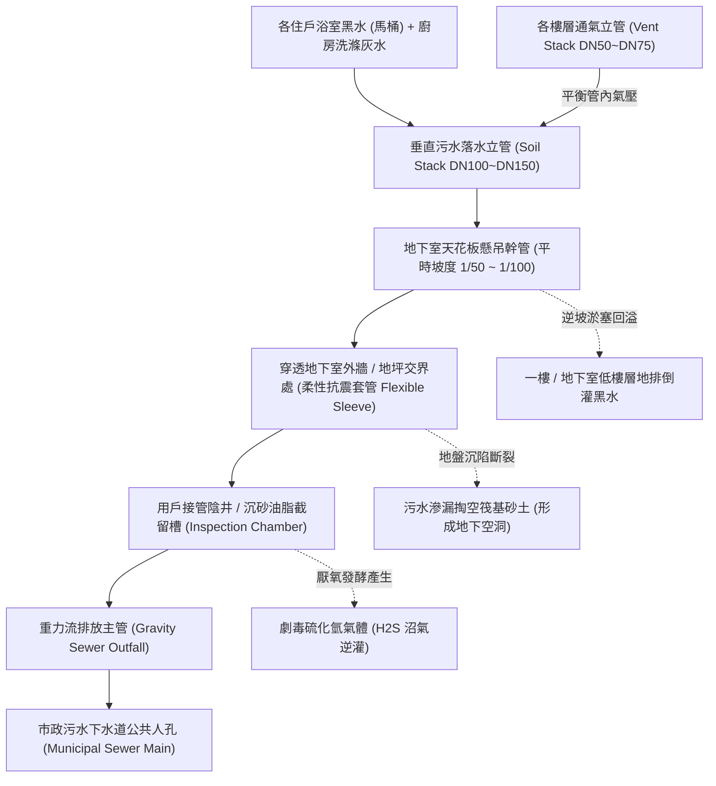
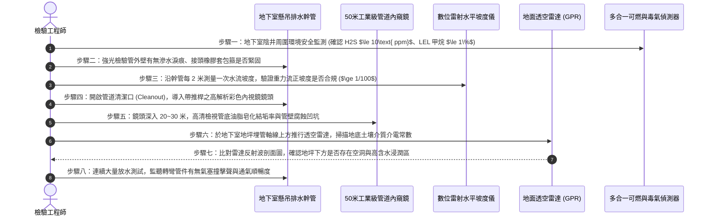

# 全案購屋實戰第五百九十一部：中古大樓社區地下室生活污水下水道用戶接管重力流破管滲漏地盤掏空沉砂淤塞逆坡回沖與惡臭毒氣逆灌室內體檢工序全書

---

## 壹、前言與核心體檢宗旨

在現代集合住宅高層建築（屋齡 20～35 年）之公衛與結構安全體系中，整棟大樓數百戶居民每日排放之生活污水（包含糞便尿液黑水與廚房洗滌灰水），必須經由垂直排水管道間，匯流至地下室懸吊幹管或地坪埋設之「生活污水下水道重力流排放系統（Gravity Sewer Drainage System）」，並順利接入市政污水下水道人孔。

然而，在許多經歷過 921 等歷史地震衝擊的中古集合住宅中，地下室底層污水重力流管網常年承受地盤微幅不均勻沉陷（Differential Settlement）、污水腐蝕酸鹼交替衝擊及管壁油脂皂化固結，常年暗藏以下**四項極其致命的結構與公衛暗病**：
1. **重力流排放管逆坡（Back Slope / Negative Grade）與油脂沉砂淤塞**：基礎沉陷或吊架鬆脫導致重力排水管產生波浪狀下垂甚至逆坡，固體糞便與含油脂洗滌廢水在管底長年沉積硬化，管徑縮減超過 70%，引發嚴重回沖。
2. **埋設管沉陷破裂與地下水土掏空（Soil Piping & Cavity Formation）**：貫穿地下室地坪埋入筏基土層之鑄鐵或厚管 PVC 污水管，因沉陷剪切破裂，高濃度污水長年向地下土壤滲透，掏空基礎下方砂土，導致地坪空鼓龜裂、甚至引發筏基底板不均勻沉陷。
3. **硫化氫（$H_2S$）腐蝕與化糞槽體酸化穿孔**：未妥善接管之化糞池或污水轉向坑內，厭氧細菌分解有機物釋放劇毒硫化氫氣體，與水氣結合成硫酸，腐蝕 RC 池壁保護層，造成鋼筋鏽蝕膨脹爆裂。
4. **存水彎水封（Trap Seal）破壞與惡臭毒氣逆灌室內**：立管通氣管（Vent Stack）堵塞造成管道間負壓吸啜（Siphonage），低樓層住戶之地排與馬桶存水彎水封被瞬間抽乾，沼氣、一氧化碳與下水道蛾蚋蟲蟻長年逆向直灌室內。

本工序全書旨在深入剖析生活污水重力流坡度水力學、地下掏空音波雷達探測、氣密防臭與結構耐震防護，提供買方與社區完整的檢驗指引。

---

## 貳、地下室污水下水道重力流與通氣排水架構

---

## 參、中古社區現場五大常見致命病徵與工程成因

| 病徵分類 | 現場常見故障現象 | 工程深層成因分析 | 對住戶家庭置產之潛在危害 |
| :--- | :--- | :--- | :--- |
| **一、懸吊管逆坡淤積** | 地下室車位上方白色 PVC/鑄鐵污水粗管嚴重下垂，敲擊管底傳出實心悶響 | 固定吊架螺栓鏽蝕鬆脫、長度間距過大（$>1.5\text{m}$），管重加上污水油脂重量造成管體永久塑性彎曲逆坡。 | 管路極易全面堵死，污水自管道清潔孔（C.O.）爆發噴濺，淹沒地下室百萬名車。 |
| **二、埋地管破裂掏空** | 地下室一樓或二樓水泥地坪出現不規則沉陷裂縫，敲擊地坪呈現空洞迴音 | 建物與周邊地基沉陷量不均，穿透地坪交界之硬質管路被強大剪切力折斷，污水長年淘刷砂土。 | 筏基地坪下方形成巨型空洞，嚴重削弱地基承載力，遇大地震極易發生局部塌陷。 |
| **三、沼氣逆灌撲鼻臭** | 一進房屋室內即聞到淡淡化糞池惡臭，洗臉盆或地排不時傳出「咕嚕咕嚕」水聲 | 排水立管頂樓通氣帽被鳥巢、油垢雜物堵塞，排水時管內負壓打破住戶地排存水彎水封。 | 住戶長年吸入硫化氫與甲烷毒氣，引發頭痛、呼吸道黏膜發炎與中樞神經慢性中毒。 |
| **四、鑄鐵管腐蝕蝕穿** | 地下室排污鑄鐵管外壁長出如白霜、黑瘤般的結晶物，底部持續滴落黑褐色污水 | 污水中酸性洗劑與硫化物長年化學電蝕，管壁由內而外銹穿，砂孔微漏擴大為縱向裂痕。 | 惡臭污水滴落在地下室公設通道或車頂，腐蝕汽車烤漆並造成公共衛生嚴重惡化。 |
| **五、清潔口遭封死** | 地下室污水轉彎處之清潔口（Cleanout）被裝潢天花板包死，或螺栓銹死無法開啟 | 歷屆管委會或住戶裝潢時缺乏機電常識，為美觀直接以封板封死，維修孔盲封。 | 管道堵塞時無法進行電動通管鋼索或高壓水刀清淤，往往需破壞結構暴力鋸管。 |

---

## 肆、標準污水重力流系統八步精密體檢工序

### 關鍵檢驗數據與判定標準表：

| 檢驗參數 | 標準工程健康值 | 異常警戒數值 | 致命危險特徵（一票否決） |
| :--- | :--- | :--- | :--- |
| **1. 重力流排水坡度** | 順向正坡度 $\ge 1/100$ ($1\%$) | 坡度平緩 $1/150 \sim 1/200$ | 呈現反坡（逆坡 $<0$），管內長年積水成死水塘 |
| **2. 管內斷面淤積率** | 油脂積垢厚度 $\le 10\%$ 管徑 | 積垢達 $11\% \sim 30\%$ 管徑 | 淤積厚度 $>50\%$，內視鏡探頭無法推進通過 |
| **3. 地下土壤掏空深度** | 地底介質均勻，無空洞反射 | 局部鬆散含水層深度 $<10\text{ cm}$ | 雷達波呈現強烈空洞雙曲線反射，空洞深度 $>30\text{ cm}$ |
| **4. 硫化氫毒氣濃度** | 陰井開口處 $H_2S \le 1\text{ ppm}$ | 濃度 $2\text{ ppm} \sim 9\text{ ppm}$ | $\ge 10\text{ ppm}$（超過法定安全值，具致命毒害危險） |
| **5. 存水彎水封高度** | 存水深度 $\ge 50\text{ mm}$ | 水封深度 $30\text{ mm} \sim 49\text{ mm}$ | 水封完全乾涸（$0\text{ mm}$），空氣毫無阻隔直通室內 |
| **6. 吊架固定間距** | 支撐間距 $\le 1.2\text{ 米}$（PVC/鑄鐵） | 間距 $1.3\text{ 米} \sim 1.8\text{ 米}$ | 間距 $>2.0\text{ 米}$ 或吊桿螺栓脫落懸空 |

---

## 伍、買方看屋現場 3 分鐘排水氣密實戰快檢表

| 查驗步驟 | 操作手法與觀察重點 | 合格健康特徵 | 致命隱患警訊（高危險折價項） |
| :--- | :--- | :--- | :--- |
| **1. 室內地排封水嗅聞** | 靠近浴室地排、廚房流理台下排水管深吸一口氣 | 僅有輕微清潔劑氣味或完全無味 | 散發濃烈撲鼻的化糞池糞臭味、下水道腐敗餿水惡臭 |
| **2. 馬桶大量沖水瞬測** | 連續按壓馬桶沖水按鈕 2 次，觀察水位起落 | 漩渦強勁、水流迅速抽光，隨後回蓄穩定清澈水封 | 沖水緩慢水面直逼馬桶邊緣、伴隨大量氣泡翻滾「咕嚕」聲 |
| **3. 地下室車位上方仰望** | 走到地下室停車位，抬頭檢視頂部粗大排水明管 | 管身雪白乾燥，橡膠接頭緊固，支撐鐵件漆面良好 | 管壁結滿黃黑污垢水痕，接頭處包著塑膠袋、甚至滴水在車道 |
| **4. 地坪敲擊空洞回音** | 用腳跟或硬幣輕敲地下室排污管旁之地坪水泥 | 聲音扎實清脆（代表底層泥土密實） | 傳出空洞飄忽的「咚咚」空心迴音（下方地基已被淘空） |
| **5. 查驗公設下水道公告** | 檢視一樓公佈欄有無「污水用戶接管施工」或堵塞通知 | 公告顯示已完成公辦污水下水道接管，定期清淤正常 | 頻繁張貼「地下室排污管爆裂緊急維修」、「低樓層逆流爭議」 |

---

## 陸、購屋特約條款範本：生活污水排放系統安全擔保

> **社區生活污水排放與下水道管網妥善率擔保特約：**  
> 「賣方保證本買賣標的及所屬社區之生活污水重力流排放管線（包含地下室懸吊排污幹管、沉砂油脂陰井、通氣平衡立管及市政用戶接管）排放順暢無阻，無重力流逆坡、管壁穿孔滲漏或化糞沼氣逆灌室內之情事。  
> 點交日前若經實地檢驗發現污水幹管淤塞超過斷面百分之三十、重力流逆坡導致污水回溢、地下室地坪因破管掏空下陷、或室內存水彎水封遭負壓吸乾導致惡臭逆流等重大瑕疵，賣方應於交屋日前督促管理委員會及專業下水道清淤工程廠商修復完畢；若未能於期限內修復，賣方同意自買賣尾款中提撥新台幣 **伍萬元整** 作為排水機電修繕保留款，交由買賣價金履約保證專戶保管，待管委會複驗合格後始得撥付。」

---

## 柒、結語

下水道是城市良心的度量衡，而社區地下室的重力流污水管網，則是衡量一棟建築內在健康與生活尊嚴的最嚴酷試金石。
買房不僅要看室內光鮮亮麗的衛浴設備，更必須俯身深入地下室底層，審視那一根根承載全棟廢水的重力管道是否平直通暢、滴水不漏。
用精準的流體力學與工程檢測標準守護產權，方能徹底杜絕暗黑污水倒灌與地盤掏空的夢魘，讓家人享受真正清新乾淨、安居樂業的清爽好宅！
