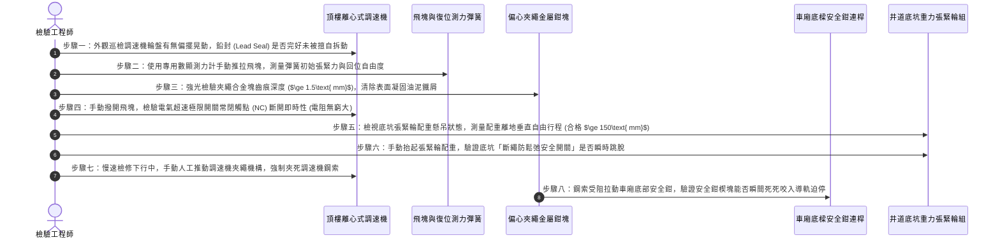

# 全案購屋實戰第五百九十七部：中古大樓社區電梯調速機夾繩鉗磨損飛塊離心彈簧疲勞失準與超速溜梯下墜體檢工序全書

---

## 壹、前言與核心體檢宗旨

在現代集合住宅高層建築（屋齡 20～35 年）之電梯主動安全防護系統中，當電梯車廂因主曳引機抱閘（Brake）打滑、傳動鋼索斷裂、蝸輪蝸桿齒輪箱崩齒或電子變頻速度控制完全失控而發生「超速失控下墜（Overspeed Downward Free-Fall）」或「暴衝超速上升（Unintended Car Movement）」時，設置於頂樓電梯機房之「調速機（Overspeed Governor / 限速器）」與車廂底樑之「安全鉗（Safety Gear）」，是整棟大樓防止電梯自由落體墜毀的**終極主動機械抓軌煞車防禦系統**。

依據我國中華民國國家標準 CNS 10594（電梯製造與安裝安全規範），調速機必須在電梯運行速度達到額定速度之 **115%** 時，先切斷電梯主電源迴路（電氣跳脫）；若速度持續飆升達到規定極限動作速度（通常為額定速度之 **125%～140%**）時，調速機夾繩鉗（Governor Rope Gripper）必須以機械力死死咬住調速機專用鋼索，透過鋼索拉力強力拉動車廂底部之漸進式安全鉗，將楔形合金鋼塊死死咬入井道實心導軌，於數十公分內強迫迫停數噸重之失控車廂。

然而，在屋齡 20～35 年之中古集合住宅中，頂樓機房常年承受西曬高溫（夏季常達 $40^\circ\text{C}\sim 48^\circ\text{C}$）、空氣揚塵油泥與數十年缺乏載荷動態測試，導致調速機長年暗藏以下**四項極其致命的機械與電氣安全暗病**：
1. **飛塊離心校準彈簧（Centrifugal Springs）金屬疲勞失準**：高溫環境下回位彈簧微觀晶格產生高溫蠕變（Creep），彈性係數衰減，導致調速機動作速度嚴重漂移，要麼頻繁誤動作卡死電梯，要麼在真正超速時「飛塊甩不出來」徹底失靈。
2. **夾繩鉗合金鉗口（Rope Gripper Jaws）磨損打滑**：夾繩偏心輪或滑動夾塊刃口齒痕被磨平成光面，且表面沾滿黏稠黃油與鐵屑，夾持力暴跌 70% 以上，超速時無法產生足夠摩擦拉力拉開車廂底部的安全鉗連桿。
3. **調速機鋼索（Governor Wire Rope）油泥硬化與直徑縮減**：專用小口徑鋼索（通常為 $\Phi 6\text{ mm}\sim \Phi 8\text{ mm}$）因長年缺乏清洗潤滑，內部麻芯乾涸斷絲，鋼索變細變硬，在夾繩器滑槽內產生空轉打滑。
4. **井道底坑調速機張緊輪（Tension Pulley）卡死浮起**：底坑張緊輪轉軸軸承生鏽咬死、配重塊卡在井道導軌雜物上無法自由下垂，導致調速機鋼索處於鬆弛無張力狀態，夾繩時鋼索直接被拉長滑動無法傳遞拉力。

本工序全書旨在深入剖析電梯調速機離心力學、夾繩鉗抓緊拉力校驗、底坑張緊輪懸吊平衡及超速連鎖測試工序，為買方與社區築起最堅固的垂直防墜堡壘。

---

## 貳、電梯調速機與漸進式安全鉗雙重防墜連鎖架構

```mermaid
flowchart TD
    A["電梯車廂 (異常超速失控加速下墜)"] --> B["調速機專用閉環循環鋼索 (Governor Rope)"]
    B --> C["頂樓機房離心式調速機 (Centrifugal Overspeed Governor)"]
    
    subgraph 第一階段：電氣超速保護 (額定速度 115%)
        C --> D["調速機飛塊 (Flyweights) 克服離心彈簧向外甩出"]
        D --> E["觸動電氣超速極限開關 (Overspeed Switch)"]
        E --> F["切斷主控制迴路 + 曳引機主抱閘強迫抱死"]
    end
    
    subgraph 第二階段：機械終極夾繩制動 (額定速度 125%~140%)
        D -->|速度持續上升| G["棘輪棘爪機械咬合 (Ratchet & Pawl Lock)"]
        G --> H["調速機夾繩鉗 (Rope Gripper) 瞬間死死夾死鋼索"]
        H --> I["鋼索產生強大向下相對拉力 ($F_{\text{pull}} \ge 3000\text{ N}$)"]
    end
    
    I --> J["拉動車廂底部安全鉗提升連桿機構 (Safety Gear Linkage)"]
    J --> K["左右對稱漸進式安全鉗 (Progressive Safety Gear)"]
    K --> L["特種合金楔形咬合塊 (Wedges) 死死咬入 T 型鋼導軌"]
    L --> M["摩擦耗散劇烈動能 (制動減速度 $0.2\text{ g} \sim 1.0\text{ g}$)"]
    M --> N["車廂完全被死死錨定於導軌上 (防止自由落體墜地)"]
    
    B --> O["井道底坑重力張緊輪 (Pit Tension Pulley + 安全斷繩開關)"]
```

---

## 參、中古社區現場五大常見致命病徵與工程成因

| 病徵分類 | 現場常見故障現象 | 工程深層成因分析 | 對住戶家庭置產之潛在危害 |
| :--- | :--- | :--- | :--- |
| **一、飛塊生鏽離心失靈** | 電梯在超速測試時，速度已達額定速度 150%，調速機輪盤瘋狂飛轉但飛塊紋絲不動 | 飛塊樞軸銷（Pivot Pin）因機房高溫潮濕黃油乾涸結焦，金屬轉軸生鏽卡死，阻力大於離心力。 | 發生斷繩或抱閘失效時，電梯直接如同自由落體以數十米高空砸向底坑，全車人員粉身碎骨。 |
| **二、夾繩鉗打滑無拉力** | 棘爪已鎖死調速機輪，但鋼索像泥鰍一樣從夾繩鉗口哧哧滑過，拉不動安全鉗 | 夾繩口合金齒長年磨損鈍化，且被鋼索甩出的黑油膏填平，動摩擦係數自 0.4 暴跌至 0.08。 | 機械防墜最後一道防線徹底失效，安全鉗完全無法被觸發啟動。 |
| **三、彈簧疲勞頻繁誤動作** | 電梯正常運行中突然「轟隆」一聲劇烈急煞停在半空中，乘客被摔倒撞傷 | 飛塊復位彈簧金屬疲勞彈力衰減 30% 以上，電梯在正常額定速度下飛塊即被甩出誤觸發。 | 住戶頻繁在高速運行中遭遇緊急煞車撞擊受傷，老幼孕婦極易骨折或流產。 |
| **四、底坑張緊輪卡滯浮起** | 調速機鋼索在井道內晃動甩動拍打井壁「啪啪」作響，鋼索垂弛無張力 | 底坑張緊輪滑動導軌積滿黑油泥砂石，張緊輪配重被卡在高處無法自由下沉保持鋼索預緊力。 | 夾繩時鋼索大量打滑延遲，等安全鉗拉起時車廂早已撞擊底坑緩衝器。 |
| **五、電氣超速開關遭短接** | 超速測試時，電氣開關已被撞開，但曳引馬達依然持續通電全速旋轉 | 開關內部微動接點熔焊短路，或不肖保養員為防止電梯跳脫，私自將機房超速開關端子跳接。 | 失去電氣預警保護，將所有衝擊力直接硬推給機械安全鉗承受，極易拉斷導軌或車架。 |

---

## 肆、標準調速機與安全鉗八步精密體檢工序



### 關鍵檢驗數據與判定標準表：

| 檢驗參數 | 國家法規標準健康值 (CNS 10594) | 臨界警告數值 | 致命危險特徵（一票否決 - 立即停機） |
| :--- | :--- | :--- | :--- |
| **1. 電氣動作速度** | 額定速度之 $110\% \sim 115\%$ | 偏離基準值 $\pm 10\%$ | 速度達 $130\%$ 仍未切斷，或已被短接跳線 |
| **2. 機械動作夾繩速度** | 額定速度之 $120\% \sim 140\%$ | 偏離基準值 $\pm 15\%$ | 速度 $>150\%$ 飛塊仍甩不出（完全卡死） |
| **3. 夾繩鉗靜態拉力** | 鋼索夾持拉力 $\ge 3000\text{ N}$ (或安全鉗提拉力 2 倍) | 拉力 $1500\text{ N} \sim 2999\text{ N}$ | 拉力 $<1000\text{ N}$（鋼索哧哧打滑空轉） |
| **4. 夾繩鉗口齒槽深度** | 合金齒痕深度 $\ge 1.5\text{ mm}$ | 齒深 $0.8\text{ mm} \sim 1.4\text{ mm}$ | 齒痕已完全磨平成光面鏡面（失去咬合力） |
| **5. 底坑張緊輪下垂裕度**| 張緊輪離底板高度 $\ge 150\text{ mm}$ | 高度 $50\text{ mm} \sim 149\text{ mm}$ | 配重直接跌落平貼地坪（鋼索完全鬆弛無張力） |
| **6. 安全鉗咬軌制動痕跡**| 兩側 T 型導軌咬痕深度均勻 ($\sim 1\text{ mm}$)| 僅單側咬入，另一側無痕 | 導軌無任何咬合刮痕，車廂繼續下滑溜梯 |

---

## 伍、買方看屋現場 3 分鐘電梯機房與運行快檢表

買方在仲介陪同看屋時，雖無法進行破壞性超速試驗，但可透過以下專業視角與訪談，100% 摸清調速機之保養真相：

| 查驗步驟 | 操作手法與檢驗重點 | 合格優質特徵 | 致命隱患警訊（高危險折價項） |
| :--- | :--- | :--- | :--- |
| **1. 登頂樓機房俯視調速機**| 陪同仲介至頂樓電梯機房，檢視黃色調速機本體 | 調速機輪盤乾淨無油泥、飛塊靈活、防護罩完好，鉛封無破壞 | 調速機本體落滿厚灰與結焦黑油，鉛封已脫落被鐵絲隨意死捆 |
| **2. 檢視調速機鋼索外觀** | 強光手電筒照射進出機房地板孔洞的調速機鋼索 | 鋼索均勻塗抹極微薄潤滑防銹油，鋼絲光亮無斷絲 | 鋼索表面掛滿油泥黑油垢，甚至能看到炸開如刺蝟般的金屬斷絲 |
| **3. 詢問安全鉗實載試驗** | 詢問大樓主委或管委會：「電梯年度大保養時，有沒有做過『全載安全鉗抓軌試驗』？」 | 回答：「有，每年依國土署規範由專業檢查員會同實施載荷煞車測試」 | 回答：「那個太危險會弄壞軌道啦，我們只有換機油沒有做抓軌」 |
| **4. 電梯下行進站平穩度** | 搭乘電梯從最高樓以全速直降至一樓，感受速度控制 | 全程加速均勻、高速巡航平穩、減速進站線性柔和無抖動 | 下降過程中車廂不時出現突發性「沉降微頓」、甚至伴隨刺耳金屬顫抖聲 |
| **5. 查閱昇降設備保養紀錄卡**| 檢視掛在機房牆上的「昇降設備每月維護保養紀錄表」 | 紀錄卡上「調速機、安全鉗動作試驗」欄位明確勾選合格並有技師簽名 | 該欄位長期空白、或被畫橫線直接略過不驗 |

---

## 陸、購屋特約條款範本：電梯調速防墜安全設施保證

> **電梯昇降設備調速機與安全鉗防墜裝置妥善率擔保特約：**  
> 「賣方保證本買賣標的所屬大樓電梯之調速機（限速器）、專用調速鋼索、底坑張緊輪連鎖開關及車廂底樑漸進式安全鉗裝置功能完全正常，其動作速度與機械夾持力符合現行中華民國國家標準 CNS 10594 之嚴格規範，且調速機鉛封完好、未經擅自更動校準。  
> 點交日前若經合格昇降設備檢查機構或專業電梯技師檢驗發現調速機離心飛塊鏽蝕卡死、夾繩鉗打滑無拉力、安全鉗連桿機構鏽蝕無法抓軌、或超速電氣安全迴路存在人為跳線短接等重大危害生命安全缺失，賣方應督促管理委員會及電梯保養廠商於交屋日前全額修復更換完畢並出具原廠載荷合格測試報告；若未能於期限內修復，賣方同意提撥新台幣 **伍萬元整** 作為電梯防墜公共安全修繕保留款，自本買賣尾款中扣留，待完全修復檢驗合格後始得撥付。」

---

## 柒、結語

電梯車廂是懸掛在數十公尺水泥高井中的垂直密室。每一次滿載家人長輩與幼童歡聲笑語的升降，背後全賴那座隱匿於頂樓、靜默旋轉的調速機與車底安全鉗在默默守護。
它不允許有千分之一秒的遲疑，更不容許有一毫米的齒痕打滑。
買房買的不只是眼前的裝潢與坪數，更是這份在最危難時刻能夠死死咬住鋼軌、托起全家人生命底線的絕對安全底氣！
