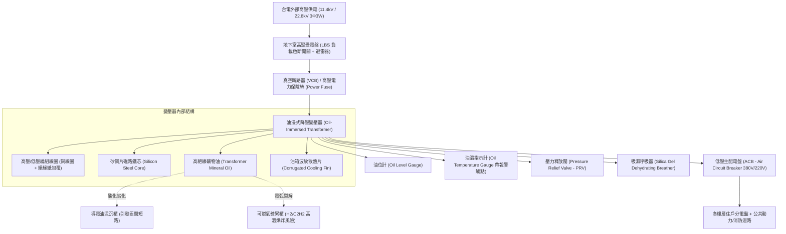
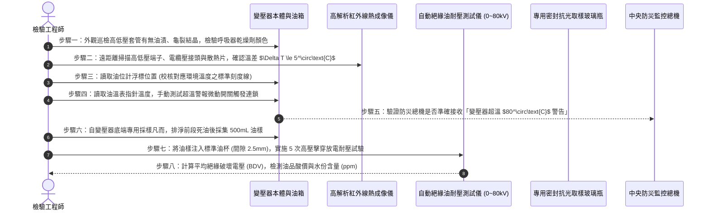

# 全案購屋實戰第五百九十三部：中古大樓社區地下室變電室油浸式變壓器絕緣油耐壓劣化油泥碳化PCB多氯聯苯殘留油封滲漏與高溫爆炸體檢工序全書

---

## 壹、前言與核心體檢宗旨

在現代集合住宅高層建築（屋齡 20～35 年）之供電中樞系統中，由台電引進之 11.4kV 或 22.8kV 高壓交流電，必須經由地下室受電室之高壓配電盤，送至「油浸式變壓器（Oil-Immersed Distribution Transformer）」降壓為 380V/220V/110V 常用低壓電，方能分配至全棟各家各戶及公共梯廳動力設施。

油浸式變壓器內部仰賴「變壓器絕緣油（Transformer Mineral Insulating Oil）」同時擔負**高壓電氣絕緣**與**散熱熱對流冷卻**兩大核心機能。

然而，在屋齡 20～35 年之中古集合住宅大樓中，變電室長期處於地下封閉、高溫悶熱（夏季常達 $45^\circ\text{C}\sim 50^\circ\text{C}$）且空氣對流不良之極限環境中，變壓器絕緣油長年暗藏以下**四項極其致命的電氣與化學爆炸隱患**：
1. **絕緣油高溫氧化、介電強度（Dielectric Breakdown Voltage）驟降**：絕緣油長期接觸空氣微量氧氣與水氣，油品酸化產生導電油泥（Sludge），絕緣耐壓自新油之 $>30\text{ kV}$ 暴跌至 $<15\text{ kV}$，引發匝間高壓電弧擊穿。
2. **金屬油箱橡膠油封（Gasket Seal）硬化脆裂與毛細滲油**：高低壓瓷套管（Bushing）根部、人孔法蘭及放油凡而之丁腈橡膠墊圈老化硬化，微量變壓器油持續滲漏形成大片黑油泥，內部油位跌落至散熱散熱片下方引發線圈過熱。
3. **老舊變壓器含劇毒多氯聯苯（PCB - Polychlorinated Biphenyls）殘留**：早期（民國 70～80 年代）生產之部分變壓器或再生絕緣油，可能殘留一級致癌物 PCB，若遇電弧高溫汽化或火警，將釋放劇毒戴奧辛，釀成不可逆之環境公害。
4. **油氣累積引發變電室內部閃絡（Arc Flash）與高溫爆炸**：匝間微小放電電弧裂解絕緣油，產生氫氣（$H_2$）、乙炔（$C_2H_2$）及甲烷等易燃性氣體，壓力釋放閥（PRV）卡死時，油箱瞬間爆裂引發地下室毀滅性大火，全棟陷入大斷電黑燈。

本工序全書旨在深入剖析油浸式變壓器絕緣化學物理、油中氣體分析（DGA）、油封更換工序與現場快檢標準，守護大樓供電心臟與生命財產安全。

---

## 貳、地下室油浸式變壓器高壓變電架構

---

## 參、中古社區現場五大常見致命病徵與工程成因

| 病徵分類 | 現場常見故障現象 | 工程深層成因分析 | 對家庭置產之潛在危害 |
| :--- | :--- | :--- | :--- |
| **一、瓷套管滲油流黑泥** | 變壓器頂部高低壓絕緣瓷瓶根部滲漏黑油，油沿箱體外壁流淌至地面 | 瓷套管壓緊橡膠墊圈受紫外線、高溫及電場應力作用硬化失去回彈性。 | 絕緣油大量流失，繞組線圈暴露在空氣中吸收水氣，引發高壓相間短路爆開。 |
| **二、變壓器嗡鳴劇烈** | 走在地下室變電室門外，即聽到異常大聲且顫抖的「嗡——嗡——」沉悶低頻雜音 | 內部矽鋼片鐵芯夾件螺栓鬆弛，或電網諧波（Harmonic）注入引發磁致伸縮共振。 | 鐵芯局部過熱，低頻噪音穿透樓板直灌一樓住戶客廳與臥室，造成精神耗損。 |
| **三、油溫指針直逼警戒** | 變壓器油溫指針常態指向 $75^\circ\text{C}\sim 85^\circ\text{C}$，表面波紋散熱片滾燙燙手 | 變電室機械通風風機停擺、散熱進氣濾網堵塞，散熱片被油垢毛屑包覆無法對流。 | 絕緣油熱裂解加速，絕緣紙壽命以每升高 $6^\circ\text{C}$ 減半之速率急速衰亡。 |
| **四、呼吸器矽膠變粉紅** | 懸掛在變壓器側邊的玻璃呼吸器內，藍色乾燥劑顆粒完全轉變為粉紅色或乳白色 | 矽膠乾燥劑吸水飽和失效長達數年未更換，外界潮濕水氣直接自大氣吸入油箱。 | 水分溶入絕緣油，油品絕緣耐壓直線崩跌，隨時面臨絕緣擊穿跳脫大斷電。 |
| **五、油色發黑沉澱雜質** | 透過油位計視窗觀察，油液呈現深琥珀色、深棕色甚至帶有黑色懸浮絮狀物 | 絕緣油長期在過熱環境下氧化碳化，金屬催化劑使油品分子鏈斷裂分解形成游離碳。 | 絕緣油完全喪失滅弧功能，微小操作突波即可在油箱內引發連環短路大爆炸。 |

---

## 肆、標準油浸式變壓器八步精密體檢工序

### 關鍵檢驗數據與判定標準表：

| 檢驗參數 | 法定標準與運轉健康值 | 臨界警戒數值 | 致命危險特徵（必須立即停電濾油或換新） |
| :--- | :--- | :--- | :--- |
| **1. 絕緣油介電擊穿電壓 (BDV)** | $\ge 30\text{ kV}$ (間隙 2.5mm) | $20\text{ kV} \sim 29\text{ kV}$ | $< 15\text{ kV}$（絕緣崩潰，隨時擊穿爆炸） |
| **2. 絕緣油酸價 (Acid Value)** | $\le 0.1\ \text{mg KOH/g}$ | $0.11 \sim 0.2\ \text{mg KOH/g}$ | $> 0.4\ \text{mg KOH/g}$（呈強酸性，腐蝕線圈銅排） |
| **3. 絕緣油含水量 (Water Content)**| $\le 25\ \text{ppm}$ | $26\ \text{ppm} \sim 40\ \text{ppm}$ | $> 50\ \text{ppm}$（油中含游離水，絕緣耐壓減半） |
| **4. 散熱散熱片外殼最高溫** | $\le 65^\circ\text{C}$（環境 $35^\circ\text{C}$ 時）| $66^\circ\text{C} \sim 80^\circ\text{C}$ | $> 90^\circ\text{C}$（嚴重過載或油道堵塞熱積蓄） |
| **5. 呼吸器矽膠顆粒顏色** | 深藍色（乾燥健康） | 淡紫色（吸濕半程） | 玫瑰粉紅色或乳白色（吸水飽和完全失效） |
| **6. PCB 多氯聯苯含量** | 未檢出（ND $<2\text{ ppm}$） | $2\text{ ppm} \sim 49\text{ ppm}$ | $\ge 50\text{ ppm}$（法定有害事業廢棄物，強制列管汰換） |

---

## 伍、買方看屋現場地下室變電室 3 分鐘實戰快檢表

| 查驗步驟 | 操作手法與觀察重點 | 合格健康特徵 | 致命隱患警訊（高危險折價項） |
| :--- | :--- | :--- | :--- |
| **1. 變電室門外聲音聆聽** | 站在地下室變電室鐵門外靜止聆聽 10 秒 | 僅有均勻柔和、微弱平穩的低頻電流聲 | 傳出異常刺耳的巨大振動轟鳴聲、或金屬放電劈啪碎裂聲 |
| **2. 檢視地面防油堤與油漬** | 透過百葉或隨仲介引導檢視變壓器基座 | 基座水泥乾燥潔淨，防油溢流堤無積油 | 地面黑油流淌成灘、變壓器底座布滿厚重黑色凝固油泥膏 |
| **3. 觀察側邊呼吸器顏色** | 強光手電筒照射變壓器外掛玻璃呼吸罐 | 內部顆粒呈現鮮艷之「深藍色」結晶 | 顆粒呈現完全粉紅色、白色、甚至罐內積水起霧珠 |
| **4. 仰望變電室排風散熱** | 檢視變電室天花板通風排氣風機運轉狀態 | 散熱抽風機正常運轉，室內空氣流動涼爽 | 風機靜止停擺，室內悶熱如蒸籠、飄散焦臭絕緣油烤漆味 |
| **5. 查閱高壓定期檢驗紀錄** | 檢視貼於門上之「電氣負責人年度檢驗合格標籤」 | 每半年或每年由甲級電氣承裝業合格定檢，日期在有效期限內 | 標籤泛黃破損、定檢過期超過 2 年以上、甚至無任何保養紀錄 |

---

## 陸、購屋特約條款範本：變電設備公共安全與絕緣妥善率擔保

> **社區高壓受配電與變壓器設備效能擔保特約：**  
> 「賣方保證本買賣標的所屬社區地下室高壓受配電設備及油浸式降壓變壓器組運作正常，絕緣油無耐壓不足、無嚴重滲漏油污，且絕緣油品絕無多氯聯苯（PCB）超標污染之情事，符合經濟部『用戶用電設備裝置規則』標準。  
> 點交日前若經專業電氣檢驗發現變壓器絕緣油擊穿耐壓低於 $20\text{ kV}$、油箱嚴重滲漏油、呼吸器失效或溫升異常超過安全標準等重大公產機電缺失，賣方應於交屋日前督促管理委員會及電氣保養廠商完成濾油、補油或油封更換修復完畢；若未能於期限內改善，賣方同意提撥新台幣 **伍萬元整** 作為公共變電設備修繕保留款，自本買賣尾款中扣留，待管委會出具合格試驗報告後始得撥付。」

---

## 柒、結語

電力是現代文明的生活動脈，而深埋地下室的變壓器，就是大樓源源不絕供應能量的心臟。
絕緣油的一滴滲漏、一度過熱，均關係著整座社區數百戶居民的用電安全與火災防禦。
買房不僅要看室內設計的電燈插座多麼齊備，更必須以嚴格的電化學工程標準審視地下室那台沉睡的油浸巨獸，為全家人守住電氣安全的終極命脈，成就真正高枕無憂的永恆家園！
