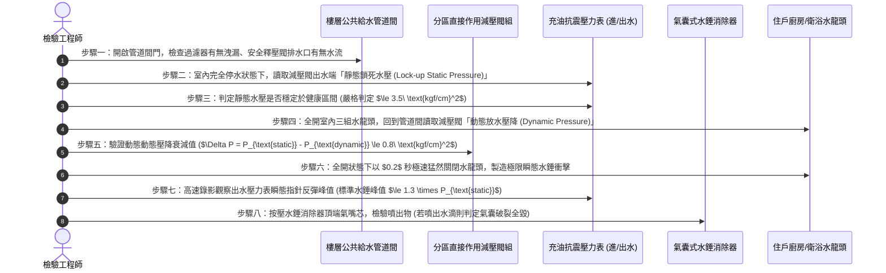

# 全案購屋實戰第五百九十九部：中古大樓社區各樓層生活給水垂直幹管減壓閥組閥芯水垢卡死超壓震盪水錘消除器氣囊破裂與低樓層水管爆裂體檢工序全書

---

## 壹、前言與核心體檢宗旨

在現代集合住宅高層建築（樓高 10～25 層，屋齡 20～35 年）之供水流力體系中，由屋頂高位水塔經由垂直給水幹管（Gravity Downfeed Riser）藉重力流向各樓層供水時，每下降 10 公尺高度即增加約 $1.0\ \text{kgf/cm}^2$ 之靜水頭水壓。若未設置減壓分區，底層與低樓層住戶承受之靜態水壓將高達 $6.0\sim 8.0\ \text{kgf/cm}^2$ 以上。

為此，大樓中低樓層（通常為 1 樓至 7 樓）之給水垂直管道間內，必須配置「各樓層分區減壓閥組（Pressure Reducing Valve Station / PRV）」與「氣囊式水錘消除器（Water Hammer Arrestor）」，將進戶水壓精準鉗制在舒適安全的 **$2.5\sim 3.5\ \text{kgf/cm}^2$** 區間。

然而，在屋齡 20～35 年之中古集合住宅大樓中，因自來水中的碳酸鈣水垢結晶長年沉積、管內鐵鏽剝落及水錘消除器橡膠氣囊脆化，常年暗藏以下**四項極其致命的流力與爆管漏水暗病**：
1. **直接作用式/導閥引導式減壓閥閥芯（Valve Spool）水垢卡死**：減壓閥內部活塞導向套被硬質碳酸鈣結垢卡死在全開位置，失去動態節流減壓功能，高達 $7.0\sim 8.5\ \text{kgf/cm}^2$ 之超高靜水壓直灌低樓層住家，熱水器水箱脹裂、廚房檯下 RO 濾殼爆裂、衛浴三角凡而脫牙噴水。
2. **減壓閥微觀阻尼平衡孔堵塞引發超壓「壓力震盪（Pressure Hunting）」**：閥體內部微小阻尼反饋孔被微砂泥沙堵死，閥芯在啟閉瞬間產生極高頻率之機械劇烈顫抖（Chattering），低頻共振穿透牆體傳出恐怖的金屬嘶鳴怪聲。
3. **氣囊式水錘消除器（Water Hammer Arrestor）橡膠隔膜破裂進水**：消除器內部丁基橡膠氣囊在數十萬次水流開關衝擊下疲勞穿孔，內部氮氣預充電壓完全洩漏，整個金屬罐體被死水充滿，徹底喪失吸收水錘衝擊波之彈性緩衝功能。
4. **住戶夜間關水瞬間之瞬態水錘（Water Hammer Transient Spike）震裂管壁**：在超壓與水錘吸收失效雙重打擊下，住戶快開單把手水龍頭或抽水馬桶進水閥關閉瞬間，管內瞬態動態壓力飆升至破表的 $12\sim 15\ \text{kgf/cm}^2$，直接震裂浴室暗管彎頭或冷熱不銹鋼壓接管接頭，黑夜中爆管水淹整棟樓梯間。

本工序全書旨在深入剖析高層給水流體力學靜水頭分布、減壓閥流道節流壓差計算、水錘動態壓力波傳導速度及管道間實測工序，為買方守護室內水管安全與防範爆管淹水災難。

---

## 貳、高層建築垂直給水分區減壓與水錘防護架構

```mermaid
flowchart TD
    A["屋頂高位生活蓄水塔 (15F~20F)"] --> B["垂直重力給水主管 (DN65~DN100 不銹鋼管)"]
    
    subgraph 高樓層分區 (10F~頂樓)
        B --> C["高區住戶 (重力直供，水壓 1.5~2.5 kgf/cm²，有時需二次局部加壓)"]
    end
    
    subgraph 中低樓層減壓分區 (1F~9F 靜水壓高達 5~8 kgf/cm²)
        B --> D["管道間隔離檢修球閥 (Isolation Ball Valve)"]
        D --> E["Y型管道過濾器 (Strainer 60 mesh)"]
        E --> F["直接作用式定比/定壓減壓閥組 (PRV Station)"]
        
        F --> G["出水端充油避震壓力表 (Outlet Gauge 0~10 kgf/cm²)"]
        F --> H["氣囊式水錘消除器 (Pre-charged Water Hammer Arrestor)"]
        F --> I["安全釋壓閥 (Safety Relief Valve 預設 5.0 kgf/cm²)"]
        
        G --> J["各樓層住戶獨立自來水分表"]
        J --> K["住戶室內配管 (廚房洗滌 / 衛浴熱水器 / 抽水馬桶)"]
    end
    
    F -.->|水垢卡死全開| L["超高靜壓直灌室內 (爆管滅頂)"]
    H -.->|氣囊破裂進水| M["關水瞬間劇烈水錘 (震裂牆內暗管)"]
```

---

## 參、中古社區現場五大常見致命病徵與工程成因

| 病徵分類 | 現場常見故障現象 | 工程深層成因分析 | 對家庭置產之潛在危害 |
| :--- | :--- | :--- | :--- |
| **一、減壓閥卡死超壓** | 低樓層住戶一打開水龍頭，水柱像消防水槍一樣狂噴飛濺，甚至將水槽物品打翻 | 減壓閥閥芯活塞被硬質碳酸鈣水垢咬死在全開位置，高達 7~8 kgf/cm² 的屋頂重力靜水壓直接殺進室內。 | 室內軟管、淨水器濾瓶、免治馬桶進水閥承受不住而爆裂，全家淹水深達數公分。 |
| **二、關水水錘金屬撞擊**| 每次關閉浴室水龍頭，牆壁內部立即傳來沉重撞擊聲「匡！咚！」，伴隨牆體震顫 | 水錘消除器內部橡膠氣囊破裂進水失效，水流動能無法被空氣彈簧吸收，衝擊波在管內劇烈反射。 | 長期高頻衝擊使牆內暗埋冷熱水管彎頭車牙處疲勞斷裂，引發暗管慢性滲水全屋壁癌。 |
| **三、減壓閥嘯叫震盪** | 開水時管道間發出刺耳尖銳的「吱吱——嗡嗡」高頻蜂鳴聲，整層樓梯廳都能聽見 | 減壓閥導向套磨損偏心，流體產生卡門渦街（Von Kármán Vortex）引發高頻自激機械共振。 | 噪音穿透牆壁直灌臥室，夜間鄰居用水時尖銳嘯叫嚴重干擾睡眠品質。 |
| **四、出水壓力忽大忽小**| 洗澡時熱水忽冷忽熱，蓮蓬頭出水量如同呼吸般一陣強一陣弱，水溫無法恆定 | 減壓閥內部阻尼小孔被鐵鏽微砂半堵塞，閥芯動態調整嚴重滯後，在微小流量下產生壓力尋標震盪。 | 洗澡極易被突然變燙之滾燙熱水燙傷皮膚，或熱水器因瞬間水壓過低頻繁熄火。 |
| **五、釋壓閥狂噴水洩漏**| 管道間底板常年積水潮濕，安全釋壓閥排水管口持續大量噴出熱水或冷水 | 減壓閥失效超壓，使出水端壓力超過安全閥設定值（$5.0\ \text{kgf/cm}^2$），釋壓閥強迫開啟洩壓。 | 管道間積水沿樓板裂縫下漏至下層住戶天花板，造成嚴重的上下樓公設漏水糾紛。 |

---

## 肆、標準各樓層減壓閥與水錘消除器八步精密體檢工序



### 關鍵檢驗數據與判定標準表：

| 檢驗參數 | 法定與工程健康標準值 | 臨界警戒數值 | 致命故障特徵（一票否決 - 隨時爆管） |
| :--- | :--- | :--- | :--- |
| **1. 減壓閥出水靜壓** | $2.5\sim 3.5\ \text{kgf/cm}^2$ | $3.6 \sim 4.5\ \text{kgf/cm}^2$ | $> 5.0\ \text{kgf/cm}^2$（閥芯完全卡死，全開直通） |
| **2. 鎖死靜壓升高率** | 停水後靜壓攀升 $\le 0.3\ \text{kgf/cm}^2$| 靜壓攀升 $0.4\sim 0.8\ \text{kgf/cm}^2$| 停水後數分鐘內直奔進水端高壓（閥座內漏） |
| **3. 關水水錘瞬態峰值**| 瞬態壓力 $\le 1.3 \times P_{\text{static}}$ | 瞬態壓力 $1.4\sim 1.8 \times P_{\text{static}}$| 壓力狂飆破表 $>2.5 \times P_{\text{static}}$（震破水管） |
| **4. 水錘器氣囊密封** | 按壓氣嘴只有乾燥壓縮氣體 | 氣嘴氣壓不足（$<1.5\ \text{kgf/cm}^2$）| 按壓氣嘴瞬間噴出水柱（橡膠氣囊破裂進水） |
| **5. 減壓閥動態壓降** | 動態放水壓降 $\le 0.8\ \text{kgf/cm}^2$ | 壓降 $0.9 \sim 1.5\ \text{kgf/cm}^2$ | 壓降 $>2.0\ \text{kgf/cm}^2$（過濾網或流道嚴重堵塞） |
| **6. 運轉自激共振噪音**| 管道間外測量 $\le 40\text{ dBA}$ | 噪音 $41\text{ dBA} \sim 55\text{ dBA}$ | 爆發 $>70\text{ dBA}$ 刺耳金屬尖叫與管道震顫 |

---

## 伍、買方看屋現場 3 分鐘給水減壓實戰快檢表

買方隨仲介看屋時，無須拆卸水管，只需透過以下「一開、二關、三照」實測手法，即可 100% 摸清該戶水壓與減壓閥健康度：

| 查驗步驟 | 操作手法與檢驗動作 | 合格健康特徵 | 致命隱患警訊（高危險折價項） |
| :--- | :--- | :--- | :--- |
| **1. 單把水龍頭極速關閉**| 將廚房或浴室水龍頭開至最大，隨後以手掌瞬間用力猛力切斷關水 | 關水安靜平順、水流應聲而斷，牆壁內部無任何聲響 | 關水瞬間牆內傳來沉重撞擊聲「匡啷！」，水龍頭本體強烈跳動震顫 |
| **2. 觀察洗臉盆水花飛濺**| 將浴室水龍頭開到最大，手掌置於出水口下方 10 公分處 | 水流充沛柔和、形成均勻水柱，水花自然順著臉盆流下 | 水柱像高壓噴槍猛烈噴濺、水珠彈飛到整個浴室牆面與衣服全濕 |
| **3. 強光照射管道間水表**| 請仲介打開該樓層梯廳的「給水管道間檢修門」 | 減壓閥組漆面乾淨、充油壓力表指針在 3kg 左右，地面乾燥 | 壓力表破表指針歪斜、減壓閥銅體長滿厚重綠色銅鏽，地面潮濕積水 |
| **4. 熱水器進水軟管觸摸**| 檢視陽台熱水器下方冷水與熱水不銹鋼編織波紋管 | 軟管外觀平順、金屬編織網均勻緊密、無局部凸起變形 | 編織網局部鼓起如「金屬動脈瘤」、金屬絲斷裂刺出、接頭滴水 |
| **5. 連續沖水熱水器點火**| 連續按壓馬桶沖水同時開啟洗臉盆熱水龍頭 | 水流微降但熱水器持續穩定燃燒點火，水溫保持恆定 | 水流瞬間變成涓涓細流，熱水器發出「噠噠噠」點火失敗熄火聲 |

---

## 陸、購屋特約條款範本：給水減壓閥組與防爆管妥善率擔保

> **社區給水分區減壓閥與水錘防護設備妥善率擔保特約：**  
> 「賣方保證本買賣標的戶所屬樓層之生活自來水分區減壓閥組、氣囊式水錘消除器及管道間給水設施運作完全正常，入戶靜態水壓穩定符合中華民國自來水給水設備標準（靜態水壓不超過每平方公分三點五公斤力），且無水垢卡阻超壓、水錘敲擊震裂暗管或減壓閥自激震盪噪音之情事。  
> 點交日前若經實地檢驗發現入戶靜態水壓超過每平方公分四點五公斤力、水龍頭急關時產生嚴重水錘金屬撞擊、水錘消除器氣囊破裂進水、或減壓閥體嚴重漏水滲透等重大機電瑕疵，賣方應督促管理委員會及合格水電水利廠商於交屋日前全額更換修復完畢；若未能於期限內修復改善，賣方同意提撥新台幣 **參萬元整** 作為室內給水安全修繕保留款，自本買賣尾款中扣留，待完全修復驗收合格後始得撥付。」

---

## 柒、結語

高樓層的自來水重力水頭，既是帶來充沛水量的自然恩賜，也是懸在低樓層住戶頭頂上的一座隨時可能引爆的無形蓄水重壓堰塞湖。
那座安裝在公共管道間裡、日夜承受數十噸水壓節流衝擊的減壓閥與水錘消除器，就是守護家庭每一個水龍頭、每一根暗埋水管與昂貴木地板的唯一忠實哨兵。
買房不僅要檢視衛浴龍頭的精美品牌，更必須把耳朵貼在管道間牆上，驗證減壓閥是否靜默平穩地守護著每一滴清泉，為家人打造一個永不爆管、安枕無憂的祥和家園！
