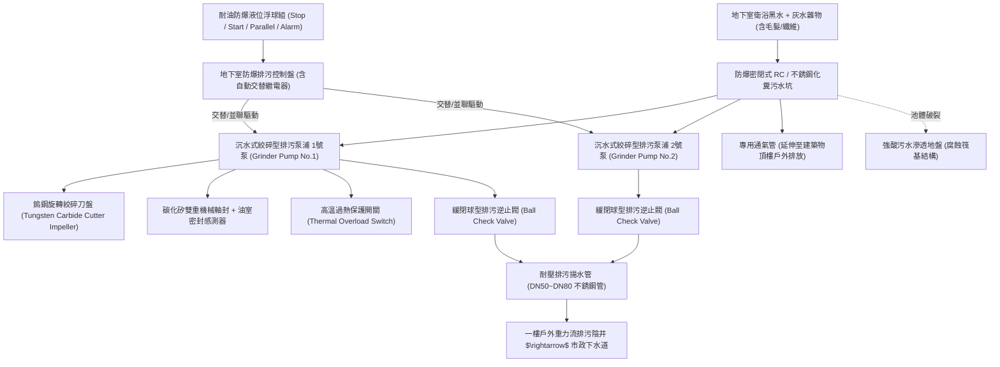
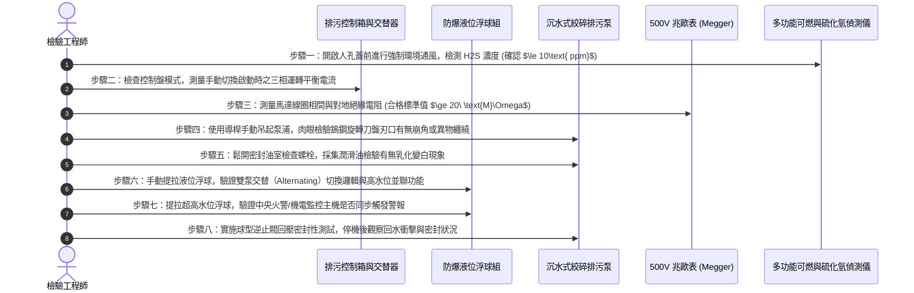

# 全案購屋實戰第五百九十二部：中古大樓社區地下室生活污水下水道用戶接管沉水式絞碎型排污泵浦氣化空蝕機械軸封砂石刮傷與化糞池槽體酸化滲漏體檢工序全書

---

## 壹、前言與核心體檢宗旨

在現代集合住宅高層建築中，對於無法藉由自然重力流直接排入戶外市政污水下水道人孔之低樓層（如地下各層公共廁所、管委會辦公室、司機休息室及各類洗滌廢水），必須依賴地下最底層之「污水沉水泵坑（Sump Pit）」或「密閉式生活污水化糞槽」，經由「沉水式絞碎型排污泵浦（Submersible Grinder Sewage Pump）」將固態糞便雜物高速絞碎成懸浮微粒，強制加壓提升至一樓戶外污水陰井。

然而，在屋齡 20～35 年之中古大樓中，地下室污廢水強制提升系統長年浸泡於高腐蝕性酸鹼廢液、含細砂雜物及油脂混合物之惡劣密閉環境中，長年暗藏以下**四項極其致命的機電與環境公害隱患**：
1. **硬質合金旋轉絞碎刀盤卡阻與氣化空蝕（Cavitation）**：衛生棉、濕紙巾、抹布或住戶違規丟棄之塑膠毛髮纖維纏繞絞刀，使轉速驟降；同時因坑內有效吸入水頭不足引發強烈氣化空蝕，鑄鐵葉輪與刀盤被剝蝕成蜂窩狀穿孔，抽水揚程暴跌。
2. **碳化矽機械軸封（Mechanical Seal）遭細砂刮傷穿孔**：洗車或地坪沖洗之硬質石英細砂進入泵浦渦流室，在數千轉高轉速下強烈研磨動靜環端面，軸封微裂失效，高導電度之強酸性污水灌入馬達定子線圈，引發對地絕緣擊穿短路。
3. **鋼筋混凝土化糞槽體酸化腐蝕與地下水層滲漏**：長期厭氧發酵產生之硫化氫（$H_2S$）在槽頂氣相空間氧化成高濃度硫酸（$H_2SO_4$），將頂板與側壁 RC 結構之水泥砂漿徹底「石膏化」酥碎剝落，池體破裂滲漏，黑臭污水常年污染大樓地基與地下水層。
4. **液位電極浮球結油失靈與雙泵跳脫癱瘓**：油污黏附在浮球連桿上形成厚重「油脂鎧甲」，浮球無法感知水位暴漲，控制盤無法連鎖啟動備用泵，污水自人孔蓋縫隙狂噴漫流，淹沒整座地下室機房。

本工序全書旨在深入剖析排污絞碎泵浦流體力學、雙重機械軸封檢測、槽體防腐蝕中性化鑑定及自控連鎖測試，提供買方與社區管委會一套完整的驗收標準。

---

## 貳、沉水式絞碎型排污泵浦與提升系統架構

---

## 參、中古社區現場五大常見致命病徵與工程成因

| 病徵分類 | 現場常見故障現象 | 工程深層成因分析 | 對家庭置產之潛在危害 |
| :--- | :--- | :--- | :--- |
| **一、絞刀纏繞卡死** | 泵浦啟動時控制盤傳來「嗡嗡」沉悶電流聲，數秒後熱過載跳脫（OL Trip） | 濕紙巾與化纖抹布纏死鎢鋼刀盤縫隙，阻力矩超過馬達啟動轉矩，轉子遭鎖死。 | 排污停擺，污水自地下室管道溢流孔反冒，淹沒車位並破壞車輛底盤與線路。 |
| **二、機械軸封滲漏** | 檢測油室潤滑油發現由透明色變成乳白色混濁液體，馬達絕緣阻抗暴跌 | 污水中細砂石磨損碳化矽動靜環密封面，或微纖維卡入密封端面，污水侵入油室。 | 馬達線圈燒毀、相間短路，單台維修或更換新品費用高達數萬至十數萬元。 |
| **三、化糞池酸化塌陷** | 化糞槽頂部水泥地坪出現不均勻龜裂，人孔蓋邊框水泥酥脆如餅乾渣 | 硫化氫氣體與空氣中氧氣結合生成硫酸，長期侵蝕水泥中的氫氧化鈣，混凝土中性化脫落。 | 槽體結構崩塌，地下室地坪破洞，人員或車輛行經隨時有掉入化糞池之危險。 |
| **四、球型止回閥沉砂** | 泵浦停止後出水管傳來「嘩嘩」強烈倒流聲，排污坑水面急速回升 | 沉水球型逆止閥內部橡膠包覆鋼球被油脂硬塊或骨頭毛髮卡在閥座上方，無法回閉。 | 抽上去的污水完全倒灌回坑，泵浦陷入無限循環無效抽水，耗電量暴增且極易過熱。 |
| **五、槽內氣體逆向竄流** | 靠近排污坑周邊時，眼睛刺痛、喉嚨發癢，甚至聞到臭雞蛋劇毒味 | 排污坑專用通氣管斷裂或未獨立延伸至頂樓，反而偷接至一般雨水管，沼氣向地下室擴散。 | 硫化氫毒氣在低窪處沉積，遇微小火花引發地下室瓦斯爆炸，危害全體住戶生命安全。 |

---

## 肆、標準排污絞碎泵與槽體八步精密體檢工序

### 關鍵檢驗數據與判定標準表：

| 檢驗參數 | 標準健康數值 | 異常警戒數值 | 致命故障特徵（一票否決） |
| :--- | :--- | :--- | :--- |
| **1. 馬達絕緣電阻** | 對地電阻 $\ge 20\ \text{M}\Omega$ | $2\ \text{M}\Omega \sim 19\ \text{M}\Omega$ | $< 1\ \text{M}\Omega$（線圈已進水，隨時擊穿跳脫） |
| **2. 密封油室油品狀態** | 澄清透明金屬潤滑油 | 油色微黃混濁（含微量水分） | 呈乳白色泥狀乳化液（機械軸封已徹底穿孔） |
| **3. 絞刀刃口間隙** | 旋轉刀與固定盤間隙 $\le 0.1\text{ mm}$ | 間隙 $0.2\text{ mm} \sim 0.5\text{ mm}$ | 間隙 $>0.8\text{ mm}$，刃口嚴重鈍化崩角（失去切碎能力） |
| **4. 槽壁中性化深度** | 酚酞噴塗呈深紅色（未中性化） | 表面中性化深度 $5\sim 15\text{ mm}$ | 深度 $>30\text{ mm}$ 或呈無色，混凝土碎成泥灰 |
| **5. 硫化氫空間濃度** | 人孔處 $H_2S \le 1\text{ ppm}$ | 濃度 $2\text{ ppm} \sim 9\text{ ppm}$ | $\ge 10\text{ ppm}$（達職業安全警戒值，具致命毒害） |
| **6. 逆止閥回壓密封** | 停機後水管壓力保持 $\ge 60$ 秒 | 壓力在 10~30 秒內漏光 | 停機瞬間逆流狂湧，伴隨管路劇烈撞擊震動 |

---

## 伍、買方看屋現場 3 分鐘地下室排污機房快檢表

| 查驗步驟 | 操作手法與觀察重點 | 合格健康特徵 | 致命隱患警訊（高危險折價項） |
| :--- | :--- | :--- | :--- |
| **1. 控制盤燈號與切換** | 檢視地下室牆面「污水泵控制箱」指示燈 | 綠燈正常，開關切在「自動（AUTO）」位置 | 開關切在「OFF」或手動，面板閃爍紅色過載（OVERLOAD）警報燈 |
| **2. 人孔周圍氣味快嗅** | 走近地下室污水坑或化糞池人孔蓋周邊 | 僅有輕微排水潮濕氣味，無明顯刺鼻惡臭 | 飄散極度刺鼻的濃烈臭雞蛋味、硫磺沼氣味，令人作嘔 |
| **3. 人孔蓋基座水泥外觀** | 檢視人孔蓋鐵框與水泥基座接縫 | 水泥堅固光整，邊框密封完好無縫隙 | 基座水泥大塊崩解碎裂、鋼筋裸露，蓋板邊緣溢出黑色污油泥痕跡 |
| **4. 抽水運轉聲音聆聽** | 待泵浦啟動運轉時，貼近傾聽內部聲音 | 運轉聲音低沉、平穩，排水管傳來順暢水流聲 | 傳出「喀喀喀」金屬強烈摩擦敲擊聲，或馬達低頻悶哼聲但不出水 |
| **5. 出水管壁冷凝與生鏽** | 檢視從坑內向上延伸之不銹鋼/厚鐵排污管 | 管件乾燥平整，法蘭螺栓無嚴重鏽瘤 | 管壁滿布結露發霉，接頭處長出大量黃褐色銹瘤，甚至有黑水滴落痕跡 |

---

## 陸、購屋特約條款範本：沉水排污與化糞設備妥善率擔保

> **社區公共排污設備與化糞坑結構妥善率擔保特約：**  
> 「賣方保證本買賣標的所屬社區地下室生活污水提升系統（包含沉水式絞碎排污泵浦組、防爆自動控制盤、液位浮球連鎖裝置、球型防砂逆止閥及化糞槽體結構）運作正常，無馬達絕緣漏電、絞刀卡死、止回閥倒流或槽體滲水酸化等重大瑕疵。  
> 點交日前若經實地檢驗發現排污泵馬達絕緣阻抗低於 $2\ \text{M}\Omega$、機械軸封滲油乳化、槽體中性化深度超標造成地坪塌陷風險、或控制盤無法自動交替運轉，賣方應督促管理委員會於交屋日前修復完畢；若未能於期限內修復改善，賣方同意提撥新台幣 **參萬元整** 作為公共機電排污修繕暫扣款，自本買賣尾款中扣留，待管委會複驗合格後始得撥付。」

---

## 柒、結語

高雅寬敞的居住空間固然令人心曠神怡，但支撐這份優雅的，正是地下深處默默運轉的排污絞碎泵與化糞槽網。
一旦排污系統癱瘓，隨之而來的惡臭毒氣與黑水泛濫，將在幾小時內摧毀全棟住戶的生活品質與資產尊嚴。
買房不僅要看明面上的裝潢與地段，更應以最冷靜專業的工程眼光，驗證每一座泵浦的絞碎韌性與槽體的結構抗蝕力，為家人購得一座內外兼修、一生無憂的傳世吉屋！
