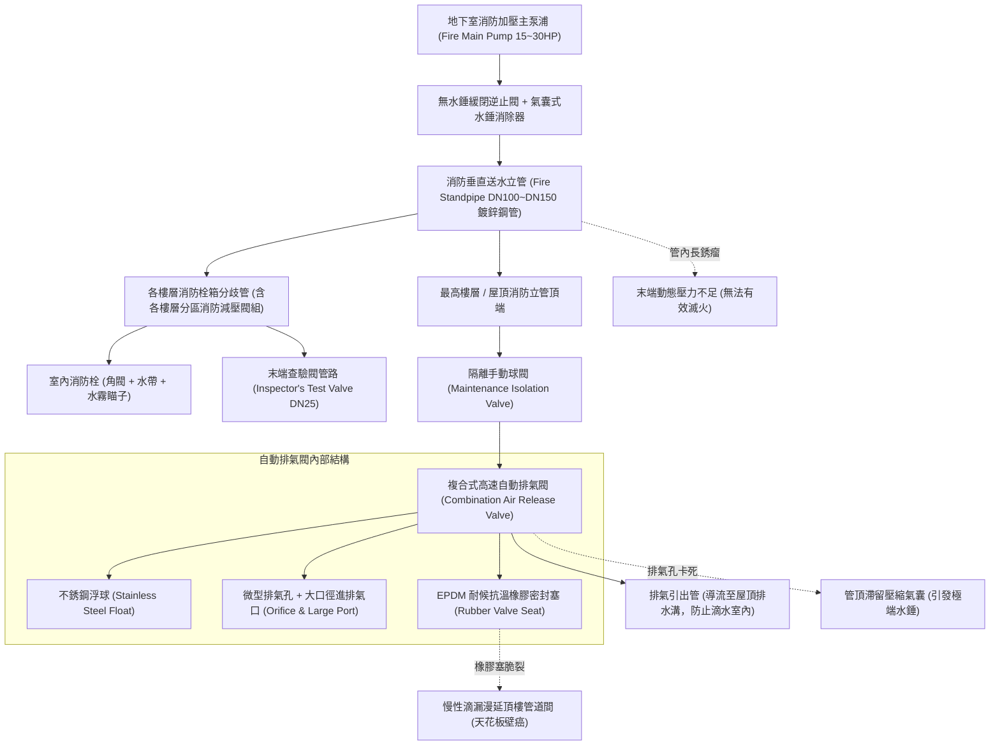
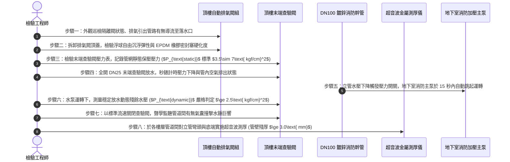

# 全案購屋實戰第五百九十八部：中古大樓社區消防送水幹管排氣閥橡膠塞老化洩漏立管水錘震盪末端放水試驗壓力不足與管壁穿孔體檢工序全書

---

## 壹、前言與核心體檢宗旨

在現代集合住宅高層建築（屋齡 20～35 年）之消防水系統中，貫穿整棟大樓地下室消防泵浦房、各樓層消防栓箱直達屋頂之「消防送水垂直幹管（Fire Standpipe Riser DN80～DN150 鍍鋅鋼管或無縫鋼管）」，是當火警發生時輸送高壓滅火水源的最核心大動脈。

依據我國各類場所消防安全設備設置標準，消防立管平時必須由地下室定壓補水泵維持滿水高壓狀態（通常為 $5.0\sim 8.0\text{ kgf/cm}^2$）。為排除充水時管網內部殘存之大量空氣，立管頂端最高處必須配置「自動排氣閥（Automatic Air Release Valve）」。

然而，在屋齡 20～35 年之中古集合住宅大樓中，因長年缺乏對排氣閥微觀橡膠老化與立管動態水錘之預防性檢驗，常年暗藏以下**四項極其致命的機電消防與漏水暗病**：
1. **排氣閥三元乙丙橡膠（EPDM）閥塞老化硬化與慢性滲漏**：排氣閥閥芯橡膠塞長期在高溫、水垢與高壓自來水浸泡下脆裂，失去密封彈性，自來水沿排氣孔細微滴漏，沿管道間牆壁向下浸潤，引發次頂樓住戶天花板滲水壁癌。
2. **氣閥排氣孔水垢雜質卡阻與「氣塞水錘（Air Pocket Water Hammer）」爆管**：排氣孔被鐵鏽水垢泥沙卡死無法排氣，管內聚集大量壓縮氣囊。當地下室消防主泵啟動或末端查驗閥驟開驟關時，氣囊劇烈壓縮再反彈，引發峰值達靜壓 3～5 倍之極端水錘震盪，直接撕裂立管車牙螺紋或震裂減壓閥。
3. **管壁電化學點蝕（Pitting Corrosion）與沙孔微穿孔噴水**：熱浸鍍鋅鋼管經 20 多年酸鹼水質浸泡，鍍鋅層消耗殆盡，管壁由內向外生長「鐵鏽瘤（Tubercles）」，局部管壁厚度自 $4.5\text{ mm}$ 減薄至 $<1.0\text{ mm}$，高壓測試時瞬間爆穿噴水。
4. **末端查驗閥動態放水壓力不足與管網嚴重淤塞**：幹管底部彎頭因沉澱厚重鐵鏽泥沙，流通斷面積萎縮超過 50%，導致各樓層消防栓箱動態放水壓力暴跌至 $<1.5\text{ kgf/cm}^2$，火警時水柱噴射無力，無法壓制高層火勢。

本工序全書旨在深入剖析消防立管兩相流排氣力學、水錘吸收阻尼、超音波管壁測厚與末端動態壓力試驗工序，守護大樓消防動脈與防水安全。

---

## 貳、消防送水垂直立管與頂端自動排氣閥架構

---

## 參、中古社區現場五大常見致命病徵與工程成因

| 病徵分類 | 現場常見故障現象 | 工程深層成因分析 | 對家庭置產之潛在危害 |
| :--- | :--- | :--- | :--- |
| **一、頂樓排氣閥滴漏** | 頂樓梯廳天花板管道間傳來滴水聲，牆面油漆大片發黃鼓脹起泡 | 自動排氣閥橡膠塞老化硬化變形，或自來水水垢雜質卡在閥孔密封口上。 | 頂樓與次頂樓住戶室內天花板嚴重漏水、昂貴木作裝潢發霉損毀。 |
| **二、啟動水錘驚天巨響**| 消防泵浦定期啟動保養時，全棟管道間發出如同炸彈爆炸般的巨響「咚！」 | 立管頂端排氣閥堵塞，空氣無法排出被壓縮成高彈性氣囊，流速驟變引發共振水錘波。 | 水錘強烈衝擊撕裂立管螺紋接頭，管道爆開造成整棟樓梯間瀑布式大淹水。 |
| **三、末端放水水壓微弱**| 頂樓消防栓放水時，水流軟弱無力垂落地面，壓力表讀數不到 $1.0\ \text{kgf/cm}^2$ | 垂直立管底端轉彎處被鐵鏽水垢硬塊完全淤塞，流通截面積嚴重受阻縮減。 | 火災發生時拉出水槍卻無射程，眼睜睜看著火勢延燒整層住家。 |
| **四、幹管外壁長銹瘤** | 管道間打開檢視，鍍鋅鋼管外壁長出如葡萄串般的黃褐色凸起鏽瘤 | 鋼管內部產生氧濃差腐蝕（Oxygen Concentration Cell），管壁已被蝕穿成沙孔，靠外層鐵鏽勉強堵住。 | 任何輕微壓力波動或外力碰觸，鏽瘤瞬間爆開噴水，大樓公共消防癱瘓。 |
| **五、排氣引出管偷接** | 自動排氣閥排氣口未妥善引接至戶外，直接懸空對著管道間內部噴氣滴水 | 當年建商或水電工偷工減料，未安裝 DN15 不銹鋼導水洩漏排引管。 | 排氣時帶出的微量水沫長年在封閉管道間積聚，導致高壓電纜發霉漏電。 |

---

## 肆、標準消防立管與排氣系統八步精密體檢工序

### 關鍵檢驗數據與判定標準表：

| 檢驗參數 | 法定標準與健康正常值 | 臨界警戒數值 | 致命故障特徵（一票否決） |
| :--- | :--- | :--- | :--- |
| **1. 末端動態放水壓力** | 放水殘壓 $\ge 2.5\ \text{kgf/cm}^2$ | 殘壓 $1.8 \sim 2.4\ \text{kgf/cm}^2$ | $< 1.5\ \text{kgf/cm}^2$（水柱射程 $<5$ 米，無滅火能力） |
| **2. 幹管靜態保壓穩定度**| 靜壓維持 $3.5\sim 7.0\ \text{kgf/cm}^2$ | 24小時降壓 $0.5\sim 1.0\ \text{kgf/cm}^2$| 停泵後 1 小時內壓力歸零（管網嚴重穿孔大漏水） |
| **3. 自動排氣閥密封性** | 高壓下完全乾燥、無滴水氣泡 | 每分鐘微量慢滴 $<5$ 滴 | 水柱成線狀連續自排氣孔噴漏（閥塞徹底損壞） |
| **4. 水錘壓力震盪峰值** | 停機波動峰值 $\le 1.2 \times P_{\text{static}}$ | 波動達 $1.3 \sim 1.5 \times P_{\text{static}}$ | 波動 $>2.0 \times P_{\text{static}}$，伴隨管道強烈跳動震顫 |
| **5. 立管金屬管壁殘厚** | DN100 鍍鋅管殘厚 $\ge 3.5\text{ mm}$ | 殘厚 $2.5\text{ mm} \sim 3.4\text{ mm}$ | 殘厚 $<2.0\text{ mm}$（局部點蝕隨時爆裂穿孔） |
| **6. 主泵自動連鎖時效** | 放水後 $\le 15$ 秒內自動起步送水 | 啟動延遲 $16 \sim 30$ 秒 | 放水水流流盡主泵毫無動靜（電氣連鎖完全斷線） |

---

## 伍、買方看屋現場 3 分鐘頂樓消防管網快檢表

| 查驗步驟 | 操作手法與檢驗重點 | 合格優質特徵 | 致命隱患警訊（高危險折價項） |
| :--- | :--- | :--- | :--- |
| **1. 登頂樓檢視立管頂端** | 隨仲介登上大樓屋頂，尋找紅色粗大消防立管最高點 | 頂端設有黃銅或不銹鋼自動排氣閥，排氣口裝有透明軟管導至地排 | 排氣閥閥體布滿白色厚重水垢與綠色銅鏽，閥口直接在屋頂水泥上漏出一灘積水 |
| **2. 次頂樓天花板巡檢** | 檢視頂樓及次頂樓梯廳天花板檢修孔內部 | 管道間內部乾燥、通風良好，管線無水痕、無壁癌 | 管道間內部瀰漫發霉霉味，RC 牆壁有明顯長條形深褐色滴水水漬 |
| **3. 梯廳消防栓箱壓力表**| 打開物件所在樓層與頂樓之室內消防栓箱門 | 箱內充油壓力表指針穩穩停留在 4~6 kgf/cm² 綠色安全刻度 | 壓力表指針直接躺平在 0（整棟消防無水），或指針破表指向 10 以上 |
| **4. 管道間幹管手電筒照**| 透過管道間百葉縫隙或門扉，強光照射立管外觀 | 紅色防鏽漆面光整平滑，支撐槽鋼吊架螺栓堅固無鏽 | 管壁長出大量黃褐色如腫瘤般的「鏽包」，管身嚴重脫漆紅鏽斑斑 |
| **5. 詢問年度消防安檢複查**| 詢問管委會或檢視公佈欄：「本社區最近一次消防局安檢有沒有通過？」 | 公告欄張貼消防局核發之「消防安全設備檢修申報合格標籤」 | 張貼「消防設備限期改善公文」，且載明「立管壓力不足、排氣閥漏水待修」 |

---

## 陸、購屋特約條款範本：公共消防立管管網與水壓擔保

> **社區公共消防送水立管設備效能與防漏妥善率擔保特約：**  
> 「賣方保證本買賣標的所屬大樓之公共垂直消防送水幹管、頂樓自動排氣閥、減壓閥組及末端放水系統功能健全，管體無穿孔滲漏，且頂樓末端查驗閥放水動態壓力符合現行各類場所消防安全設備設置標準（放水殘壓不低於每平方公分二點五公斤力）。  
> 點交日前若經實地檢驗發現頂樓排氣閥嚴重漏水浸濕管道間、消防幹管管壁穿孔銹蝕嚴重、末端放水動態壓力不足或無法自動連鎖啟動消防主泵浦等重大公產消防安全缺失，賣方應督促管理委員會及合格消防保養廠商於交屋日前修復更換完畢；若未能於期限內修復改善，賣方同意提撥新台幣 **參萬元整** 作為公共消防機電修繕保留款，自本買賣尾款中扣留，待管委會複驗合格後始得撥付。」

---

## 柒、結語

消防立管是建築在遭遇烈火淬煉時，源源不斷注入生命甘霖的神經脈絡。
而那只看似毫不起眼、安裝在狂風吹拂屋頂高處的自動排氣閥，則是維持這條動脈在日常沉靜保壓、在危機時防震防爆的關鍵氣孔。
買房買的不只是眼前的裝潢與視野，更需要用嚴密的流體力學數據檢視這條隱形動脈的健康，為家庭安居鑄造一座真正固若金湯、水火不侵的永恆堡壘！
