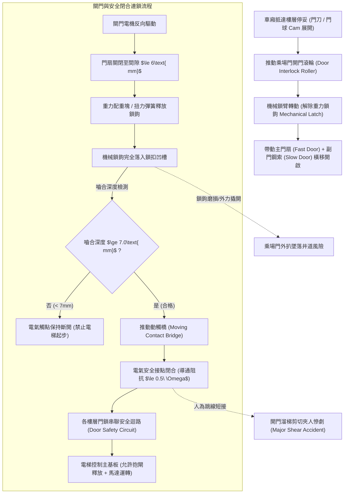
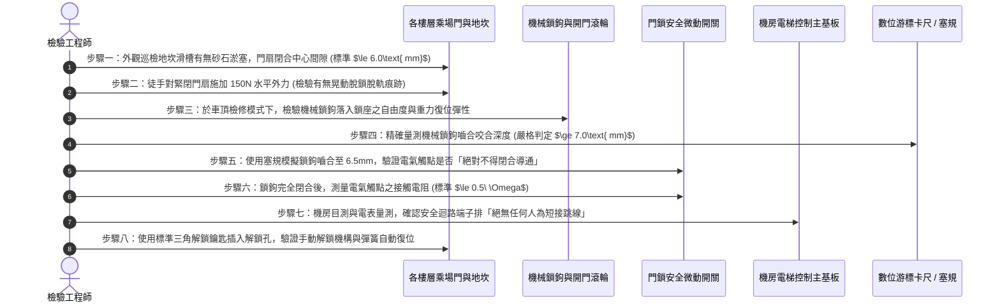

# 全案購屋實戰第五百九十六部：中古大樓社區電梯乘場門門鎖裝置機械咬合嚙合深度不足電氣安全觸點氧化積碳與剪切夾人事故體檢工序全書

---

## 壹、前言與核心體檢宗旨

在現代集合住宅大樓中，「電梯乘場門門鎖裝置（Landing Door Interlock / Door Lock Device）」是當電梯車廂在井道內高速上下穿梭時，防止住戶失足跌落井道底坑，以及防止電梯在門扉未完全關妥前違法行駛之**最關鍵第一道人命安全連鎖屏障**。

依據我國《建築物昇降設備設置及檢查管理辦法》與中華民國國家標準 CNS 10594（電梯製造與安裝安全規範），乘場門必須配置同時具備「機械重力鎖定（Mechanical Latch Engagement）」與「電氣安全接點連鎖（Electrical Safety Contact）」之雙重聯鎖裝置。規範明訂：**只有當機械鎖鉤之嚙合深度至少達到 $7.0\text{ mm}$ 以上時，電氣安全觸點方允許閉合通電**，以杜絕任何「門鎖假閉合、電梯啟步剪切夾人」之重大慘劇。

然而，在屋齡 20～35 年之中古集合住宅大樓中，因數十年來數百萬次之開關門撞擊磨損、缺乏潤滑及梯廳灰塵油泥堆積，乘場門鎖長年暗藏以下**四項極其致命的機械與電氣安全暗病**：
1. **機械鎖鉤（Locking Hook）磨損與嚙合咬合深度不足**：鎖鉤刃口磨損倒角、重力擺錘或復位彈簧疲勞無力，嚙合深度衰減至 $<4.0\text{ mm}$，住戶甚至僅憑徒手用力扒門即可將乘場門扳開，極易發生幼童失足墜入黑洞井道底坑之墜樓悲劇。
2. **電氣安全觸點（Safety Interlock Contacts）電弧氧化積碳與接觸電阻劇增**：門鎖微動開關觸點長年處於頻繁啟閉狀態，接點產生微電弧灼傷、積碳發黑，導致安全迴路阻抗暴增，電梯頻繁發生無預警「關門後走不動、卡在樓層中」的假故障。
3. **不肖保養員私自惡意短接（Bypass / Jumper）門鎖迴路**：為求省事或排除頻繁跳脫報修，不肖技師竟在機房控制盤直接以跳線將門鎖安全迴路短路，使電梯在「門扉敞開狀態下依然可以運轉行駛」，形成極其恐怖的「電梯斬首剪切斷頭台」。
4. **門聯鎖帶動鋼索（Door Linkage Wire Rope）鬆弛斷股與偏心吊掛滾輪磨損**：副門連動鋼索疲勞鬆弛，導致主門雖關閉，副門卻留有數公分之危險縫隙。

本工序全書旨在深入剖析乘場門鎖機械運動學、嚙合深度精密量測、電氣安全開關連鎖校驗與外力徒手扒門快檢工序，守護住戶每次出入電梯時的生命安全。

---

## 貳、電梯乘場門門鎖雙重連鎖架構與運動原理

---

## 參、中古社區現場五大常見致命病徵與工程成因

| 病徵分類 | 現場常見故障現象 | 工程深層成因分析 | 對住戶家庭置產之潛在危害 |
| :--- | :--- | :--- | :--- |
| **一、鎖鉤嚙合過淺** | 站在電梯門外，用雙手稍微用力左右一推，門縫立刻被拉開 3~5 公分 | 門鎖鉤刃口磨損、水平門軌地坎積沙導致門關閉不到位，機械咬合深度不足 3mm。 | 孩童打鬧推擠或倚靠門扉時，門扇直接脫鎖敞開，整個人墜落井道底坑身亡。 |
| **二、門鎖接點積碳** | 電梯門已關妥，但車廂靜止不動，內外按鈕全滅，數秒後門又重新打開 | 門鎖觸點表面因長期微型電弧燒蝕形成黑色碳化絕緣層，接觸電阻 $>50\ \Omega$，主板判定門未關妥。 | 住戶頻繁被困在車廂內，下班尖峰時段電梯罷工引發整棟民怨沸騰。 |
| **三、惡意短接門鎖** | 電梯門還在緩慢關閉中、甚至門開著一條大縫，車廂竟已開始向上或向下加速運行 | 保養人員查不出哪一層門鎖接觸不良，便宜行事在機房將門鎖回路直接以銅線短接。 | **最頂級致命公害**！乘客進出時若電梯突發移動，人體將被梯廳地坎與車廂頂部直接剪切腰斬。 |
| **四、緊急解鎖孔卡死** | 發生緊急狀況時，消防員或保養員插入三角鑰匙（Drop Key），轉動卻無法開鎖 | 門扇頂部的三角鑰匙偏心凸輪連桿生鏽卡阻、或解鎖拉繩脫落斷裂。 | 發生火警或受困窒息時，外部救援人員無法在第一時間由梯廳手動開啟門扇實施救援。 |
| **五、地坎鋁合金變形** | 門扇滑動時發出刺耳的金屬摩擦尖叫聲，滑動卡滯甚至在半途卡死 | 梯廳地坎（Landing Sill）因推車重壓凹陷變形，槽溝內塞滿裝潢泥沙碎石未曾清掃。 | 門扇關閉受阻導致鎖鉤無法下落，連鎖迴路永久中斷，電梯整日處於癱瘓狀態。 |

---

## 肆、標準乘場門門鎖裝置八步精密體檢工序

### 關鍵檢驗數據與判定標準表：

| 檢驗參數 | 國家法規標準健康值 (CNS 10594) | 臨界警告數值 | 致命危險特徵（一票否決 - 立即停機） |
| :--- | :--- | :--- | :--- |
| **1. 機械鎖鉤嚙合深度** | $\ge 7.0\text{ mm}$ (鎖齒完全咬入) | $5.0\text{ mm} \sim 6.9\text{ mm}$ | $< 5.0\text{ mm}$（徒手外扒即可拉開門扉） |
| **2. 觸點閉合前之嚙合量**| 嚙合未達 $7.0\text{ mm}$ 嚴禁導通 | 嚙合 $6.0\text{ mm}$ 提前導通 | 嚙合 $<5.0\text{ mm}$ 即導通（完全失去防剪切保護） |
| **3. 電氣觸點接觸電阻** | $\le 0.5\ \Omega$ (接點光潔無積碳) | $0.6\ \Omega \sim 2.0\ \Omega$ | $> 5.0\ \Omega$ 或內部進水氧化發黑 |
| **4. 兩扇門中縫閉合間隙**| 靜止閉合間隙 $\le 6.0\text{ mm}$ | 間隙 $6.1\text{ mm} \sim 9.0\text{ mm}$ | 間隙 $>10.0\text{ mm}$（手指甚至幼童手臂可伸入） |
| **5. 徒手外扒抗力測試** | 施加 $300\text{ N}$ 外力無法扒開門 | 施加外力門縫擴大 $>15\text{ mm}$ | 施力後鎖鉤彈開，門扉直接被敞開大縫 |
| **6. 安全迴路跳線檢測** | 端子排乾淨無任何短路外接線 | 存在標籤不明之線路 | 發現門鎖安全端子被迴紋針、銅線跨接短路 |

---

## 伍、買方看屋現場 3 分鐘電梯門鎖實戰快檢表

買方隨仲介看屋搭乘電梯時，無須拆卸任何蓋板，只需透過以下「三步徒手快檢法」，即可精準摸清該大樓電梯之真實維護水平：

| 查驗步驟 | 操作手法與檢驗動作 | 合格健康特徵 | 致命隱患警訊（高危險折價項） |
| :--- | :--- | :--- | :--- |
| **1. 梯廳門扉外扒測試** | 當電梯在其他樓層時，在梯廳用雙手手掌向兩側輕推外門 | 門扇紋絲不動、鎖定扎實，門中縫間隙幾乎不擴大 | 雙手輕輕一掰，門縫立刻被拉開超過 2~3 公分，能看到井道內部黑洞 |
| **2. 進站開門時機觀察** | 搭乘電梯進站時，觀察車廂「完全停止」與「開門」的時間點 | 車廂完全平層靜止後，門扇才平順安靜地開啟 | 車廂尚未停妥、仍在晃動滑行中，外門竟然已提前打開大縫（極度危險） |
| **3. 梯廳地坎溝槽目視** | 低頭檢視各樓層梯廳地坎鋁合金滑槽 | 溝槽乾淨明亮、無積石砂礫，門靴導向平穩 | 滑槽內積滿菸蒂、裝潢砂石泥塊，門扇滑動時發出刺耳刮鐵摩擦聲 |
| **4. 關門反覆彈開試驗** | 在門扇關閉過程中，用手掌擋住安全觸板或光幕 | 門扇立即瞬間柔和彈開復位，無撞擊夾痛感 | 門扇毫無反應持續強烈夾擊、或撞到障礙物發出劇烈撞擊聲才勉強彈開 |
| **5. 檢視門扇防震膠條** | 觀察兩片門扇中央接縫之黑色防撞密封膠條 | 膠條柔軟完整、彈性良好，關門時無金屬撞擊聲 | 膠條已完全脫落、硬化脆裂，關門時傳出「框啷！框啷！」劇烈鐵撞鐵巨響 |

---

## 陸、購屋特約條款範本：電梯門鎖安全連鎖妥善率擔保

> **電梯昇降設備乘場門門鎖裝置與安全連鎖擔保特約：**  
> 「賣方保證本買賣標的所屬社區大樓電梯之各樓層乘場門門鎖裝置（包含機械鎖鉤、開門滾輪、電氣安全觸點及副門連動鋼索）運作正常，機械嚙合深度符合現行中華民國國家標準 CNS 10594 之規定（至少達七毫米以上），且機房電梯控制系統嚴禁存在任何短接或旁路門鎖安全迴路之違規情事。  
> 點交日前若經合格昇降設備檢查員或專業技師檢驗發現門鎖嚙合深度不足、徒手可外力扒開門扇、電氣接點積碳接觸不良、或安全迴路存在違法跳線短接等重大危害人身安全缺失，賣方應督促管理委員會及電梯維護廠商於交屋日前全額修復更換完畢；若未能於期限內修復，賣方同意提撥新台幣 **伍萬元整** 作為電梯公共安全修繕暫扣款，自本買賣尾款中扣留，待完全修復並取得合格安全檢查報告後始得撥付。」

---

## 柒、結語

電梯門鎖看似只是梯廳牆面上的一道金屬滑門，但它卻是隔絕人間與數十公尺垂直黑洞深淵的唯一一道生死閘門。
一毫米的嚙合誤差、一次不負責任的短接跳線，往往就是釀成無辜住戶墜樓或斷頭慘劇的元兇。
買房不僅要欣賞室內動線與採光格局，更必須親手推一推那扇電梯門，用最嚴苛的機械安全規範驗證每一次啟閉的厚重與穩固，為全家人守護生命中每一趟垂直穿梭的絕對平安！
