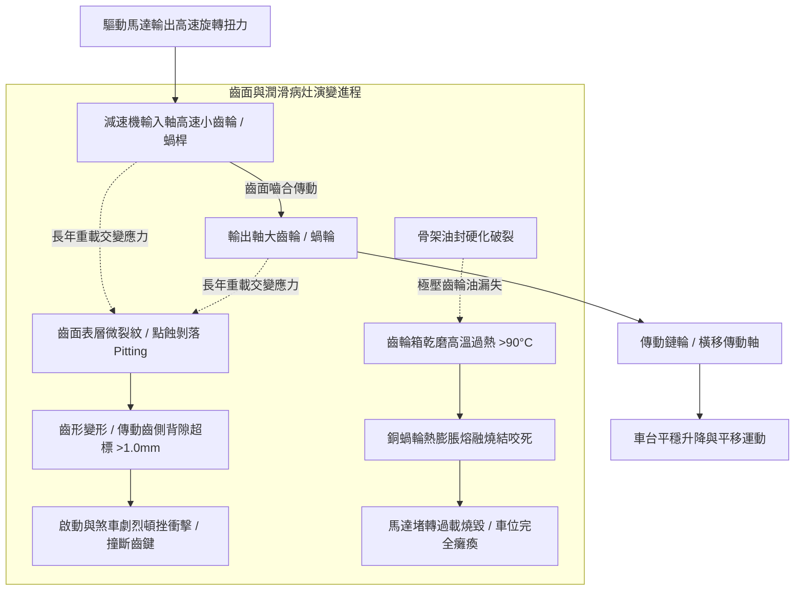

# 全案購屋實戰第五百二十一部_中古大樓社區地下室機械停車設備減速機齒輪箱齒面點蝕剝落油封滲漏背隙超標與運轉衝擊震動體檢工序全書

## 壹、核心體檢宗旨與家庭居住安全意涵

在中古集合住宅大樓的機械停車設備（包含小寶家庭考量名單中的**長億南園 8 樓**隨戶配置之升降橫移二層式車位）傳動體系中，「齒輪減速機（Gear Reducer / Gear Motor）」（常見為蝸輪蝸桿減速機 Worm Gear Reducer 或斜齒輪硬齒面減速機 Helical Gear Motor）扮演著將驅動馬達之高速低扭力轉換為帶動車台升降與橫移之低速大扭力的核心心臟角色。

對於每天需要依賴機械車位停放愛車的家庭而言，減速機的健康妥善率決定了車位運轉的平穩性、定位精準度與極端負載下的機械安全性。然而，在屋齡達 20 至 25 年的中古社區地下室中，車位每日頻繁承受車輛（特別是現代休旅車重達 1.8~2.2 噸）的啟動慣性與動態重載，且常年處於潮濕高熱環境，減速機齒輪箱極易衍生出四大極具破壞性的深層疲勞病灶：

1. **齒面接觸疲勞點蝕（Pitting）與微觀金屬剝落（Spalling）**：減速齒輪（尤其是蝸輪青銅齒面或合金鋼滲碳齒面）在數十萬次交變循環剪切應力下，表層金屬產生微觀亞表層疲勞裂紋，進而碎裂剝落形成蜂窩狀凹坑（點蝕）。點蝕一旦擴展連成大片剝落，齒輪傳動時嚙合重合度大幅衰減，引發劇烈的金屬撞擊震動與「喀啷、喀啷」尖銳異音。
2. **傳動背隙（Backlash）過大導致車台啟動剎車劇烈頓挫衝擊**：齒厚過度磨耗造成齒側間隙（Backlash）遠超原廠容許極限（超過 0.5 ~ 1.0 mm）。當馬達反轉橫移或煞車抱死瞬間，齒輪齒面發生硬碰硬的劇烈撞擊，此衝擊動能直接傳導至升降鏈條與橫移鋼構，加劇傳動軸鍵槽（Keyway）擠壓變形滾鍵，甚至引發軸斷裂車台墜落事故。
3. **輸入/輸出軸骨架油封（Oil Seal）硬化老化與潤滑油乾涸漏光**：減速箱高溫運轉（油溫常達 60°C~80°C），橡膠唇形油封歷經 20 年塑化劑揮發硬化龜裂，高黏度極壓齒輪油（如 ISO VG 220/320/460）順著軸頸持續滲漏滴落至底坑。齒輪箱在缺油「半乾摩擦」或「完全乾磨」狀態下運轉，數分鐘內即可使齒面劇烈發熱燒結咬死，導致整台驅動馬達直接堵轉燒毀。
4. **極壓添加劑熱衰竭酸化與油泥金屬磨屑研磨惡性循環**：管委會常年未曾更換減速機齒輪油（正常每 2~3 年應更換一次），油液嚴重氧化黑化酸化，沉澱底部的微細金屬鐵屑與銅粉未被濾除，隨著油液反覆泵送至齒面與軸承滾珠間，形成高硬度「研磨劑」，急速加速全套齒輪與滾動軸承的毀滅性磨耗。

本手冊針對長億南園 8 樓等具備機械車位之社區，建立標準化的減速機齒輪箱背隙量測工序、聽診棒異音判讀、油封滲漏檢視與買賣契約專屬特約防禦機制。

---

## 貳、減速機齒輪傳動結構原理與磨損劣化力學演變

### 1. 齒輪傳動背隙（Backlash）法定容許公差
- **新品標準背隙**：一般工業級圓柱齒輪或蝸輪蝸桿傳動，中心距 100~200mm 時之齒側背隙應在 **0.12 ~ 0.28 mm** 範圍內。
- **報廢與危險門檻**：
  - 手動晃動輸出軸，若旋轉自由游隙（Angular Free Play）超過 **1.0 mm** 或角度游隙超過 **3 度**。
  - 運轉啟動時車台有明顯「空轉一下再猛烈頓挫起步」現象，代表齒隙磨耗已達結構破壞臨界點。

### 2. 減速機潤滑油品質量檢測指標
- **正常齒輪油**：紅褐色、深琥珀色、清澈黏稠（VG 320/460）、無金屬閃光粉末、無刺鼻酸腐臭味。
- **嚴重劣化指標**：油色發黑如墨汁，手指搓揉有明顯砂礫感；在陽光或手電筒照射下可見大量金黃色（銅屑）或銀白色（鐵屑）金屬反光懸浮顆粒。

---

## 參、實地帶看機械車位減速機現場體檢工序（SOP）

小寶在帶看長億南園 8 樓現場檢驗隨戶配置的機械車位時，應要求現場實地通電操作車位，並會同房仲與總幹事進行以下四步專業機電體檢：

| 檢驗步驟 | 檢驗場域與操作工序 | 正常指標 | 異常警訊與深層機械病灶 |
| :--- | :--- | :--- | :--- |
| **步驟一：齒輪箱外殼油封與底坑滴油查驗** | 攜帶強光手電筒照射橫移及升降馬達減速機的輸入軸與輸出軸油封處，以及正下方地面。 | 減速機外殼鑄鐵乾爽微塵，油封接縫處無油漬，下方地坪乾淨無油污。 | 1. 軸頸周圍凝結厚重黏稠黑油泥，形成「黑油裙」。 2. 減速機正下方地坪積聚一灘發黑的齒輪廢油，油箱內部已近乾涸。 |
| **步驟二：實機運轉聽診棒異音監聽** | 在車位升降或橫移運轉時，以螺絲起子或機械聽診棒接觸減速機軸承座外殼。 | 傳出的聲音為平穩、連續且細微的齒輪滑動嗡鳴聲，無金屬撞擊聲。 | 1. 傳出規律性「喀嗒、喀嗒」金屬撞擊聲（齒面單齒剝落或斷齒）。 2. 傳出刺耳沙啞的「嘶吼磨擦聲」（軸承缺油滾珠碎裂）。 |
| **步驟三：減速機外殼表面工作溫升檢測** | 車位連續運轉 2~3 個完整循環後，以紅外線測溫槍測量減速箱體中心溫度。 | 箱體外殼溫度微溫（通常在 **35°C ~ 50°C** 之間），溫升平緩。 | 外殼溫度迅速飆升超過 **75°C ~ 90°C**，手觸有燙手感，並散發出齒輪油高溫燒焦臭味。 |
| **步驟四：手動晃動車台量測旋轉背隙衝擊** | 在車台完全停穩並切斷電源時，雙手用力左右晃動橫移車台或抬動升降軸。 | 車台傳動軸咬合緊湊，僅有微小且柔和的機械彈性游隙（游隙 < 2mm）。 | 車台可被輕易晃動推移超過 **10 ~ 20 mm**，伴隨箱體內發出清脆金屬碰撞聲（齒側間隙嚴重超標）。 |

---

## 肆、長億南園機械車位置產防衛與合約特約保障

對於鎖定**長億南園 8 樓**（主附 32 坪超大空間，但隨戶配置機械車位）的小寶家庭而言，機械車位的減速機若因老化崩齒損壞，將造成整台車位瞬間卡死，面臨高額維修費與車輛無法取出的困境：

### 1. 減速機齒輪箱維修與更新工程成本基準
- **現場拆卸減速箱、更換骨架油封與清洗換注極壓齒輪油**：連工帶料約 **\$8,000 ~ \$14,000 / 台**。
- **更換全套內部滾動軸承（4 顆高精度軸承）與重新校正背隙**：約 **\$12,000 ~ \$18,000**。
- **減速機齒面嚴重崩齒點蝕，全組更換全新同規格減速馬達（0.75kW ~ 1.5kW 附電磁煞車）**：整組換新約 **\$28,000 ~ \$42,000**。

### 2. 購屋買賣合約機械車位傳動減速機特約保障條款範本
> **機械車位減速機傳動結構正常保證特約條款**：  
> 「賣方擔保本買賣標的所隨附之機械停車位（車位編號：___），其升降及橫移驅動減速機齒輪箱運轉性能正常，齒輪無崩齒點蝕、齒隙無超標撞擊、油封無滲漏滴油，且外殼無異常高溫過熱情事。交屋點交當日，雙方應現場通電實機操作該車位升降及橫移各三次，運轉時減速機應平穩無劇烈震動與金屬敲擊異音。若交屋日前經檢查發現減速機有嚴重漏油、齒隙過大或軸承損壞需更換之情事，賣方應全額負擔維修更換合格原廠零件費用，否則買方得逕行自交屋尾款中扣留新台幣三萬元整作為修繕預留金。」
