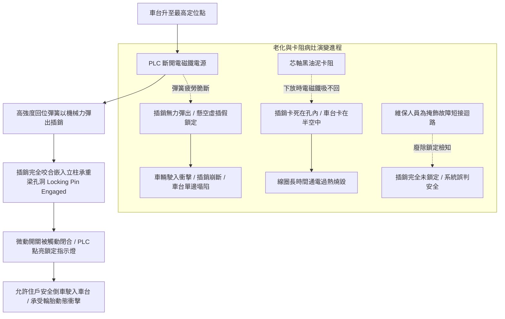

# 全案購屋實戰第五百二十三部_中古大樓社區地下室機械停車設備車台防跳動防傾斜安全插銷電磁鐵吸合卡阻回位彈簧斷裂與水平鎖定失靈體檢工序全書

## 壹、核心體檢宗旨與家庭居住安全意涵

在中古集合住宅大樓中，機械停車設備（包含小寶家庭考量名單中的**長億南園 8 樓**隨戶配置之升降橫移二層式車位）在車台升至定位後，除了依靠懸吊鏈條或油壓缸支撐外，依建築物立體停車設備安全法規標準，必須在車台兩側或四角配置「防跳動防傾斜安全插銷鎖定機構（Anti-Bounce & Anti-Tilt Safety Hook / Locking Pin Mechanism）」。

此套機構由「直流電磁鐵（DC Solenoid / Actuator）」、「機械鎖定插銷/掛鉤（Locking Pawl / Hook）」、「高強度回位彈簧（Return Spring）」與「插銷鎖定到位檢知微動開關（Locking Position Limit Switch）」所組成。當車台上行到位時，電磁鐵斷電釋放，回位彈簧以純機械力量將插銷瞬間彈出、牢牢插入鋼柱承重孔內，將車台「剛性鎖定」於水平位置，承擔車輛載重並防止車輛進出時車台彈跳傾斜。

然而，在屋齡達 20 至 25 年的中古社區地下室中，安全插銷機構常年處於潮濕高鹽霧環境中，極易衍生出四大極具威脅的機械與電氣失效病灶：

1. **電磁鐵導向芯軸（Plunger Core）油泥積碳卡阻與線圈過熱燒毀**：地下室粉塵與凝結水汽混入潤滑脂，在電磁鐵內部形成黏稠黑油泥，芯軸滑動阻力暴增。當車台需要下放時，電磁鐵通電吸合力量不足以克服油泥阻力，導致插銷「吸不回來（卡死在鎖定孔內）」，整台車位報警卡死於半空中；若線圈長時間通電過載，漆包線絕緣耐溫層燒穿，引發線圈冒煙燒毀。
2. **回位彈簧（Return Spring）長年交變疲勞斷裂與插銷「虛插假鎖定」**：插銷彈簧承受數萬次往復拉伸與扭曲應力，金屬產生疲勞脆斷。彈簧斷裂後，插銷失去回位推力，僅靠重力微幅傾斜，形成插銷前端僅伸入孔洞數公釐的「虛插假鎖定」。當 1.8~2.0 噸之車輛駛入車台瞬間，強大衝擊剪切力直接將插銷邊緣崩斷，車台單邊劇烈下陷傾斜，導致車輛翻覆或底盤重度撞擊立柱。
3. **安全插銷與立柱承重孔之嚙合深淺不均引發車台單邊懸空**：鋼構立柱在長年震動或基礎沉陷下產生垂直度偏差，導致車台左側插銷完全插入（深度達 50mm），但右側插銷卻因距離過遠僅插入 10mm 甚至完全脫靶懸空。車台在單邊無支撐狀態下長期承受偏載扭力，造成車台主梁扭曲變形與升降導輪嚴重啃軌。
4. **插銷鎖定微動開關接點氧化粘連與「短接跳線（Jumper）」惡意盲區**：為了解決插銷卡阻頻繁跳機報警，部分維保技師在控制箱內將「插銷鎖定檢知迴路」私自短接。即使插銷根本沒有彈出鎖定，控制電腦仍誤判為「已鎖定完畢」並允許住戶開車駛入，直接將脆弱的鏈條與馬達置於極度危險的無防護衝擊狀態！

本手冊針對長億南園 8 樓等具備機械車位之社區，建立標準化的安全插銷嚙合深度量測工序、電磁鐵吸合動作查驗、防短接電氣核對與買賣契約專屬特約防線。

---

## 貳、安全插銷鎖定機構運作流程與機械失效力學

### 1. 安全插銷嚙合深度（Engagement Depth）法規標準
- **CNS 14386 機械停車設備安全標準**：
  - 安全插銷之有效插入深度不得小於 **35 mm**，插入後重疊接觸面應達到插銷截面積的 **80% 以上**。
  - 插銷材料必須採用中碳鋼鍛造（如 S45C）或合金鋼調質處理，抗剪切強度必須大於全載動態負載之 **5 倍安全係數**。
- **危險指標**：實測插入深度 **< 15 mm** 即屬嚴重結構失準，車輛進出時隨時可能發生滑脫崩落。

### 2. 電磁鐵通電吸合間隙與溫升指標
- **正常工作溫升**：電磁鐵在連續通電吸合 10 分鐘內，線圈外表溫升應 **< 45°C**，動作聲音清脆響亮。
- **老化病灶**：通電時發出「嗡嗡」交流電磁噪聲（磁極未完全閉合），外殼於數分鐘內飆升超過 **70°C**，手觸燙手並散發出絕緣漆異味。

---

## 參、實地帶看機械車位安全插銷現場檢驗 SOP

小寶在帶看長億南園 8 樓現場檢驗隨戶配置的機械車位時，應要求房仲與管理員現場實機操作車位升至定位，並執行以下四步深度工序體檢：

| 檢驗步驟 | 檢驗場域與操作工序 | 正常指標 | 異常警訊與深層機械病灶 |
| :--- | :--- | :--- | :--- |
| **步驟一：車台定位後兩側插銷嚙合深度勘驗** | 攜帶強光手電筒與鋼尺，爬上檢修梯檢視車台兩側安全插銷與立柱孔洞。 | 兩側插銷均確實彈出，深入鋼柱承重孔超過 **35 ~ 50 mm**，咬合扎實緊湊。 | 1. 單側插銷僅插入不到 10mm（嚴重偏心掛載）。 2. 插銷尖端卡在承重梁孔邊緣，根本未完全穿入！ |
| **步驟二：車台下放時電磁鐵吸合動作驗證** | 按下車位下降按鈕，觀察插銷由鎖定孔縮回的機械動作。 | 按下按鈕瞬間，電磁鐵發出清脆「啪」一聲，插銷於 0.2 秒內乾淨俐落完全縮回。 | 1. 插銷卡在孔內動彈不得，伴隨電磁鐵發出劇烈「嗡嗡」掙扎噪聲。 2. 需人工拿鐵棒敲擊插銷座才能勉強縮回。 |
| **步驟三：回位彈簧外觀與彈性手動查驗** | 在車位停妥切斷電源時，戴工作手套手動向外拉動插銷並釋放。 | 釋放瞬間，插銷在彈簧強大彈力下瞬間彈回卡死位置，手感極度緊實有勁。 | 插銷回彈無力、緩慢滑動；或手感鬆垮垮，外觀可見彈簧斷成數節或鏽蝕嚴重起毛。 |
| **步驟四：控制盤安全迴路防短接開箱檢驗** | 請維保技師開啟控制箱，查驗標示「HOOK / LOCK LIMIT」插銷微動開關端子。 | 端子線路整齊進入安全模組，無額外並聯的臨時短路跨接銅線。 | 發現端子間存在短接跳線（Jumper Wire），代表插銷早有卡死故障，被廠商私自廢除安全保護！ |

---

## 肆、長億南園機械車位置產防衛與合約特約保障

對於鎖定**長億南園 8 樓**（主附 32 坪超大空間，但隨戶配置機械車位）的小寶家庭而言，機械車位的安全防跳動插銷若機能失效，將使愛車面臨駛入時單邊塌陷或翻落底坑的毀滅性風險：

### 1. 安全插銷鎖定機構維修與更換成本基準
- **更換全套重載高抗疲勞合金回位彈簧組（1 組 2 支）**：連工帶料約 **\$3,000 ~ \$5,000**。
- **拆卸清洗電磁鐵、更換耐高溫直流吸合線圈（含防塵套）**：約 **\$8,000 ~ \$14,000 / 顆**。
- **更換全新合金鋼防墜安全插銷總成（含微動開關與固定座）**：單側換新約 **\$15,000 ~ \$22,000**。
- **立柱承重孔變形校正與導向導軌垂直度重新對齊工程**：整棟校正約 **\$25,000 ~ \$38,000**。

### 2. 購屋買賣合約機械車位防傾斜安全插銷特約條款範本
> **機械車位安全插銷防傾斜鎖定保證特約條款**：  
> 「賣方擔保本買賣標的所隨附之機械停車位（車位編號：___），其車台防跳動防傾斜安全插銷機構（包括機械插銷、回位彈簧、電磁鐵驅動器及鎖定檢知微動開關）功能完整正常，嚙合深度符合立體停車設備安全法規標準，且安全迴路無任何跳線短接情事。點交當日，賣方應實地操作車位上行到位，由買方現場查驗兩側插銷深入承重孔深度均大於三十五公釐（35mm），且下放時電磁鐵縮回順暢無卡死。若交屋日前經檢查發現插銷無法咬合、彈簧斷裂或電磁閥燒損之情事，賣方應全額出資維修換新並取得設備保養合格簽證，否則買方得扣留尾款新台幣三萬元整。」
