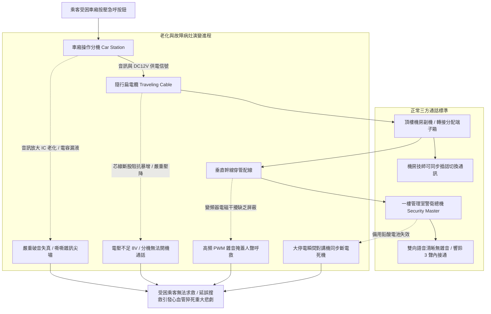

# 全案購屋實戰第五百二十九部_中古大樓社區各樓層電梯對講機室內分機音訊放大IC老化破音直流供電壓降雜訊干擾與主機面板通訊中斷體檢工序全書

## 壹、核心體檢宗旨與家庭居住安全意涵

在中古集合住宅大樓中，電梯昇降系統依建築技術規則及中華民國 CNS 10594 昇降機安全標準，必須配置一套獨立且全時在線的「電梯車廂緊急對講機通訊系統（Elevator Emergency Intercom & Intercommunication System）」。該系統包含安裝於乘廂操作面板上的「室內緊急呼叫分機（Car Intercom Station）」、連通至大樓 1 樓管理室中控台的「管理員總機（Security Master Console）」，以及設置於頂樓電梯機房的「機房副機（Machine Room Substation）」，構成關鍵的「三方（或五方）緊急通話防護網」。

當電梯因台電跳電、強烈地震、控制電腦死機或鋼索卡軌而發生突發性「關人受困（Trapped Passengers）」時，車廂內往往處於斷電昏暗且極度封閉的狀態。此時，操作面板上的緊急呼叫按鈕是對外求救的「唯一生命線」。受困乘客（特別是獨自搭乘的長輩、幼童或心血管疾病患者）在恐慌與缺氧焦慮下，必須在數秒鐘內與管理室保全或外部電梯維保中控台取得雙向清晰通話，獲得心理安撫與即時搜救派遣。

然而，在屋齡達 20 至 25 年的中古社區（如小寶家庭重點關注的**大安紫金城 13 樓**、**長億南園 8 樓**、**歌德堡 8 樓**與**靜園 A 區 11 樓**），由於通訊系統長年暴露於昇降路強電磁干擾、隨行電纜反覆折彎以及電子元件老化環境中，常衍生出四大極具威脅的「通訊盲區」與致命病灶：

1. **車廂分機音訊放大運算放大器 IC（Op-Amp IC）老化、電容漏液乾涸與聲音破裂失真**：乘廂面板分機內部的音訊放大晶片（如 LM386、TDA2822 等）歷經 20 年長年通電運轉，內部矽基半導體熱噪聲劇增；周邊電解電容電解液乾涸漏液，導致通話時發出極大刺耳的「嘶嘶」白噪聲、交流哼聲（Hum）與嚴重破音，受困者大聲呼救，管理員聽到的卻是無法辨識的模糊雜音。
2. **隨行扁電纜（Traveling Cable）信號芯線金屬疲勞阻抗暴增與直流供電壓降**：由機房懸掛垂降至車廂底部的隨行電纜，隨車廂往復彎折數百萬次，內部 0.75mm² 銅導線產生微觀斷絲（斷股），回路直流阻抗由原本數歐姆暴增至數十甚至上百歐姆。原本直流 12V/24V 的對講機供電，到達車廂面板時大幅「壓降」至僅剩 6V~8V，導致分機電路無法正常工作，呼叫鍵按下後蜂鳴器無力鳴響或主機直接斷電重啟。
3. **昇降路動力變頻器（Inverter）高頻 PWM 諧波電磁干擾（EMI）嚴重串音**：大樓早期改裝變頻電梯或電梯馬達驅動電纜未施作完善的金屬屏蔽接地，高達數千赫茲的載波高頻雜訊透過空間輻射或接地迴路耦合進入對講機音訊雙絞線，使通話線路充滿尖銳刺耳的「高頻嘯叫聲」，徹底掩蓋人聲通話。
4. **管理室總機按鍵氧化接觸不良、備用蓄電池衰竭斷電即死**：管理室總機面板長期未清污，按鈕接點氧化，警衛無法精準接聽或切換棟別分機；更致命的是，對講機系統內部之鉛酸備用蓄電池（12V 7Ah）超過 5 年未換早已乾涸失效，一旦大樓發生颱風或火災大停電（也是電梯最容易關人的時刻），對講機因失去備用電源瞬間「全面斷電罷工」，使受困住戶陷入求救無門的絕望死局。

本手冊針對高樓層標的建立標準化的電梯對講機三方通話實測 SOP、音質與壓降量測指標、修繕成本預算與買賣契約專屬特約防線。

---

## 貳、電梯緊急對講通訊系統架構與失效病灶力學演變

### 1. 電梯緊急通話法規標準規範
- **CNS 10594 昇降機安全標準 / EN 81-28 電梯遠端報警標準**：
  - 電梯乘廂內必須設置對外雙向緊急通話裝置，且通話音量在車廂內部測量應達到至少 **65 dB(A)**，確保背景噪音下人聲清晰可辨。
  - **停電備用電源要求**：對講機系統必須配備自動充電之備用蓄電池，在建築物主電源中斷時，必須能維持至少 **1 小時（現代標準要求 2~4 小時）** 的正常通話與待機運作。
  - 必須具備「三方通話」機能（車廂、機房、管理室），部分現代大樓更要求連線至電梯原廠 24 小時遠端監控中心（五方通話）。

### 2. 隨行電纜壓降檢測門檻
- **輸入電壓標準**：機房端子箱提供標準 **DC 12.0V ± 5%**。
- **車廂分機端容許壓降**：在通話啟動最大負載下，分機端實測直流電壓不得低於 **DC 10.8V**。若低於 **10.0V**，即代表隨行電纜線徑不足或芯線已發生嚴重金屬斷股，必須立即抽換備用線芯或更新電纜。

---

## 參、實地帶看電梯對講機現場動態體檢工序（SOP）

小寶在實地帶看大安紫金城 13 樓、長億南園 8 樓、歌德堡 8 樓或靜園 A 區 11 樓時，搭乘電梯應偕同房仲與總幹事實地執行以下四步緊急通訊動態檢驗：

| 檢驗步驟 | 檢驗場域與操作工序 | 正常指標 | 異常警訊與深層電氣病灶 |
| :--- | :--- | :--- | :--- |
| **步驟一：車廂操作盤緊急呼叫鈕實體按壓測試** | 進入車廂關閉車門後，長按面板上標示黃色鈴鐺或電話圖案的緊急呼叫按鈕 2~3 秒。 | 車廂內立即響起清脆響鈴聲，或語音提示「正在連線管理室請稍候」，通話燈亮起。 | 1. 按鈕卡死無彈性，按壓毫無反應。 2. 按鈕按下去後無任何鈴聲或燈號，車廂內部死寂一片。 |
| **步驟二：雙向語音清晰度與破音雜訊勘驗** | 當管理室警衛接通後，由車廂內正常說話，請警衛應答並報出其所在位置。 | 雙向聲音宏亮、清晰無破音、無刺耳金屬摩擦嘯叫聲，背景噪音安靜。 | 1. 喇叭傳出劇烈「刺啦、刺啦」白噪聲與破裂電流聲，完全聽不清警衛說話。 2. 伴隨變頻器運轉之高頻「吱吱」干擾聲，聲音極小。 |
| **步驟三：管理室總機主機板外觀與電池檢視** | 陪同總幹事至一樓警衛管理室，檢視電梯對講機總機機台與備用電池。 | 機台指示燈正常，外殼乾淨無積垢，內部 12V 鉛酸電池外觀平整無膨脹，標示更換日期在 2 年內。 | 1. 電池本體發熱、兩側外殼嚴重鼓包膨脹（隨時有漏液起火危險！）。 2. 電池電極樁頭長滿厚重白色硫酸鉛結晶，電池早已乾涸死機。 |
| **步驟四：查驗機房副機通話機能與維保紀錄** | 至頂樓機房檢視機房對講副機，並調閱每月保養單「緊急連絡裝置」項次。 | 機房副機能正常與車廂對講，保養紀錄按月打勾合格並註記通話測試良好。 | 紀錄表連續空白，或備註「對講機雜音待修」，管委會卻因更換隨行電纜費用高昂拖延不修。 |

---

## 肆、高樓層住宅置產防禦與合約特約保障

對於鎖定高樓層（大安紫金城 13 樓、靜園 A 區 11 樓、長億南園 8 樓、歌德堡 8 樓）的小寶家庭而言，電梯對講機是保障家人在突發受困時免於窒息、恐慌與失溫猝死的最重要生命防禦設施：

### 1. 電梯緊急通訊系統修繕與更新成本基準
- **更換車廂面板對講機分機主板（含高感度麥克風與音訊放大 IC 模組）**：約 **\$4,500 ~ \$8,000 / 台**。
- **更換管理室總機 12V 7Ah/12Ah 專業閥控式密封鉛酸蓄電池（湯淺 YUASA 或廣隆 LONG）**：約 **\$1,800 ~ \$3,200 / 顆**。
- **更換隨行電纜內部專用雙絞屏蔽音訊通訊線芯（重新跳接備用芯線或放線）**：約 **\$8,000 ~ \$15,000**。
- **全棟電梯緊急對講系統升級數位化總線五方通話系統（含遠端電話自動撥號警報器，斷電自動撥打原廠或消防局）**：單棟全面升級工程款約 **\$35,000 ~ \$55,000**。

### 2. 購屋買賣合約電梯緊急通訊安全專屬特約條款範本
> **電梯緊急對講機通訊系統妥善運作保證特約條款**：  
> 「賣方保證本買賣標的所在棟別之電梯昇降設備運作正常，其乘廂內部緊急通話分機、一樓管理室警衛總機及機房副機之三方通話機能完整在線，通話音質清晰宏亮無破音雜訊，且備用電源蓄電池運作正常，符合建築物昇降設備安全法規標準。交屋點交當日，買賣雙方應於現場實測：於電梯車廂內按壓求救按鈕時，管理室總機必須於十秒內響鈴並成功建立清晰雙向通話。若交屋日前經檢查發現對講機故障斷線、聲音失真嚴重或備用電源失效情事，賣方應全額出資修復完畢並取得設備保養合格簽證證明，否則買方得逕行自交屋尾款中扣留新台幣二萬元整作為修繕預留金。」
