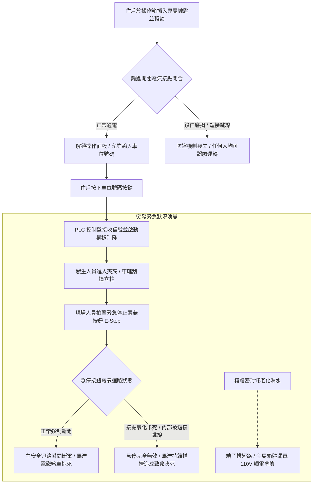

# 全案購屋實戰第五百二十二部_中古大樓社區地下室機械停車設備操作控制箱按鈕接點氧化急停蘑菇鈕開路失靈鑰匙開關防盜短接與配電保護體檢工序全書

## 壹、核心體檢宗旨與家庭居住安全意涵

在中古集合住宅大樓中，機械停車設備（包含小寶家庭考量名單中的**長億南園 8 樓**隨戶配置之升降橫移二層式車位）的日常操作，完全依賴安裝於車道立柱或地下室牆面的「現場操作控制箱（Local Operation Control Box）」。

操作箱是住戶每日以「鑰匙（Key Switch）」、「數字號碼按鍵（Numeric Keypad）」或「車位叫車按鈕（Push Buttons）」進行取車與停放的唯一人機介面，同時更是緊急狀況下唯一能由現場人員手動切斷主電源的「緊急停止蘑菇按鈕（Emergency Stop Mushroom Pushbutton）」安裝所在。然而，在屋齡達 20 至 25 年的中古地下室中，操作箱常年暴露於潮濕水氣、車輛酸性廢氣與震動環境中，極易衍生出四大極度危險但外觀不易察覺的電氣與控制病灶：

1. **緊急停止蘑菇按鈕（E-Stop Pushbutton）接點氧化、卡阻與「按不下去 / 開路失靈」**：安全法規要求急停按鈕必須採用「強制斷開（Direct Opening Action）」與「旋轉復歸（Twist-to-Release）」機制。老舊急停鈕內部微動開關彈簧生鏽斷裂、常閉接點（NC Contact）因粉塵油泥卡死，或因接點氧化被維修工私自以電線「常態短接跳線（Jumper）」，當車台發生人員捲入、車體刮撞或卡軌時，現場人員猛力拍擊急停鈕，馬達卻依然全速運轉推擠，造成人身夾死或車輛被活生生壓扁的重大悲劇。
2. **操作面板鑰匙開關（Key Switch）彈子磨損與「免鑰匙短接隨意啟動」**：原設計為防盜與防止未授權兒童誤觸，必須插入專屬車位鑰匙轉動方能啟動。老舊開關內部銅質鎖仁與彈子磨損嚴重，甚至鑰匙孔已變形鬆動，任何人拿螺絲起子或任何鐵片即可轉動；更有甚者，管委會為求方便，將鑰匙開關後方線路直接常態短接，導致社區幼童可在無大人看管下隨意按鍵玩耍，釀成恐怖公安意外。
3. **數字鍵盤與升降按鈕接點氧化跳火、指令錯亂與連續觸發**：導電橡膠（Conductive Rubber）或金屬彈片（Metal Dome）表面氧化發黑，住戶按壓時接觸電阻極高（超過數十歐姆），引發 PLC 控制信號忽斷忽續，造成馬達主接觸器頻繁吸合釋放「打嗝跳火」，引發電磁干擾使 PLC 當機指令錯亂，甚至呼叫 A 車位卻啟動 B 車位。
4. **箱體防護等級（IP Rating）失效、內部積水結露與漏電跳閘**：操作箱外殼橡膠密封條老化硬化脫落，防護等級自 IP54 衰退至無防護狀態。洗車水、地下室連續壁滲水或濕氣在箱內冷凝結露，水滴直接滴落在端子排與直流 24V 開關電源上，造成控制電路短路燒毀，甚至金屬面板帶電，住戶操作時有觸電危險。

本手冊針對長億南園 8 樓等具備機械車位之社區，建立標準化的操作控制箱急停機能響應、鑰匙防盜驗證、端子排防短接查驗工序、更新成本指標與買賣特約防護。

---

## 貳、操作控制箱安全連鎖體系與電氣失效力學

### 1. 緊急停止按鈕（E-Stop）法規標準規範
- **IEC 60947-5-5 / CNS 14386 標準**：
  - 急停按鈕必須為紅色蘑菇頭、黃色底座。
  - 必須具備「機械自鎖（Latching）」功能，拍下後必須手動旋轉或拉出方能復歸。
  - 必須採用「直接斷開常閉接點（Direct Opening NC Contact）」，嚴禁使用軟體邏輯中斷，必須硬體直接串聯切斷主接觸器線圈迴路。

### 2. 接點接觸電阻檢測門檻
- **正常健康按鈕**：按壓導通時接觸電阻應 **< 0.2 Ω**。
- **故障淘汰門檻**：實測電阻若介於 **10 ~ 100 Ω**，代表接點表面已嚴重氧化燒蝕，隨時會在微動開關受振時產生誤斷路或接觸不良。

---

## 參、實地帶看機械車位操作控制箱現場檢驗 SOP

小寶在帶看長億南園 8 樓現場檢驗隨戶配置的機械車位時，應要求房仲與管理員陪同，現場實地操作該控制箱並執行以下四步電氣安全檢驗：

| 檢驗步驟 | 檢驗場域與操作工序 | 正常指標 | 異常警訊與深層電氣病灶 |
| :--- | :--- | :--- | :--- |
| **步驟一：急停蘑菇按鈕機械手感與自鎖檢驗** | 用手掌用力拍擊紅色急停蘑菇按鈕，觀察下壓手感與自鎖狀態。 | 下壓手感清脆扎實，按鈕牢牢鎖死在凹陷位置，無法直接拔起，需旋轉箭頭方向方能彈回。 | 1. 按鈕卡死按不下去；或按下去後無阻力、鬆垮垮無法自鎖彈回。 2. 塑膠外殼受紫外線或化學品腐蝕破裂脆化。 |
| **步驟二：運轉中「實機拍擊急停」斷電測試** | 啟動車台升降或橫移動作，於運轉正中瞬間，用力拍下急停蘑菇按鈕。 | 車台於拍下瞬間（0.1 秒內）發出「喀」煞車抱死聲立即靜止，操作盤所有指示燈熄滅或閃爍報警。 | 拍下急停鈕後，車台毫無停頓繼續運轉！此為致命重大違法缺陷（迴路被惡意短接），絕對不可點交！ |
| **步驟三：鑰匙開關防盜機能與拔出實測** | 插入專屬鑰匙轉至啟動位置，嘗試在運轉中拔出鑰匙，或不插鑰匙嘗試啟動。 | 未插鑰匙時操作盤完全無電；鑰匙轉至啟動位置後無法任意拔出（防止運轉中誤拔）。 | 1. 鑰匙孔鬆動，隨便拿一把鑰匙甚至硬幣轉動即可啟動。 2. 根本不需插鑰匙，直接按按鈕就能操作（防盜機能被完全廢除）。 |
| **步驟四：開啟操作箱內部查驗結露與跳線** | 請管理員或維保技師開啟操作箱金屬門板，檢視箱內配線與箱體底層。 | 箱內乾燥清爽、配線整齊走線槽，接線端子金屬光亮無鏽，密封膠條彈性良好。 | 1. 箱體底部有一層生鏽積水或死昆蟲。 2. 在急停開關背後端子上發現額外跨接的臨時銅線（惡意跳線短接）。 |

---

## 肆、長億南園機械車位置產防衛與合約特約保障

對於鎖定**長億南園 8 樓**（主附 32 坪超大空間，但隨戶配置機械車位）的小寶家庭而言，操作控制箱若機能老化或安全迴路被短接，將直接使家人在操作車位時暴露於夾傷壓扁或觸電的巨大風險之中：

### 1. 操作控制箱更新與電氣整修成本基準
- **更換合格重載防水緊急停止蘑菇鈕（含常閉強制斷開接觸塊，日本 IDEC 或富士電機）**：約 **\$2,500 ~ \$4,500 / 顆**。
- **更換專屬防盜鑰匙開關組（含全套鎖仁與 2 把鑰匙）**：連工帶料約 **\$3,500 ~ \$6,000**。
- **更換全套戶外型防水防塵金屬操作箱體（含密封膠條、數位鍵盤與指示燈面板，IP65 等級）**：整組更換約 **\$18,000 ~ \$28,000**。

### 2. 購屋買賣合約機械車位操作安全專屬特約條款範本
> **機械車位操作控制箱機能與急停安全保證特約條款**：  
> 「賣方擔保本買賣標的所隨附之機械停車位（車位編號：___），其現場操作控制箱之電氣控制與安全機能完整正常，專屬防盜鑰匙開關、叫車按鈕及緊急停止蘑菇按鈕運作確實，安全迴路無任何跳線短接或防護失效情事，符合立體停車設備安全法規規範。交屋點交當日，買賣雙方應實地測試：於車台運轉中拍下緊急停止按鈕時，車台必須立即於零點一秒內切斷主電源煞停。若交屋日前經檢查發現急停鈕失靈、開關氧化或迴路短接等情事，賣方應全額負擔更新合格原廠零件並經專業廠商出具檢驗證明，否則買方得扣留尾款新台幣三萬元整。」
