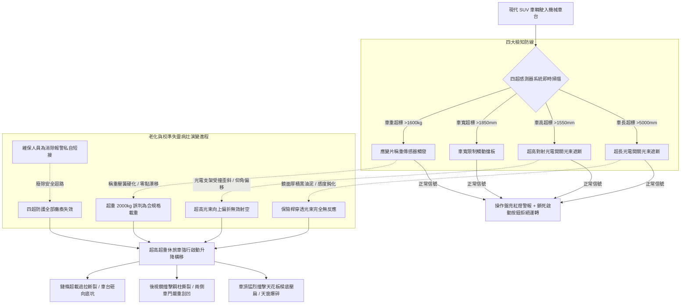

# 全案購屋實戰第五百二十八部_中古大樓社區地下室機械停車設備車位超長超高超寬超重檢知感測器校準失靈車體刮撞鋼柱盲區事故與安全防禦體檢工序全書

## 壹、核心體檢宗旨與家庭居住安全意涵

在中古集合住宅大樓中，機械停車設備（包含小寶家庭考量名單中的**長億南園 8 樓**隨戶配置之升降橫移二層式車位）的入口處與車台上方，依立體停車設備安全檢查標準，必須配置四道關鍵的「幾何外型與負載安全檢知感測器（Vehicle Dimension & Overload Detection Sensors）」：
1. **車長檢知光電開關（Length Detection Sensor）**：監測車輛前後保險桿是否超出車台前後邊界（通常車長上限為 4,700 ~ 5,000 mm）。
2. **車高檢知光電開關（Height Detection Sensor）**：監測車頂（包含休旅車行李架、車頂天線）是否超過升降淨高極限（通常限高僅 1,500 ~ 1,550 mm）。
3. **車寬檢知感應裝置（Width Detection Sensor）**：監測左右車外後視鏡或改裝加寬輪拱是否超出車台導向輪緣寬度（通常限寬 1,800 ~ 1,850 mm）。
4. **超重檢知感應機構（Overweight Load Cell / Sensor）**：監測停放車輛是否超過車台額定結構負載（通常上限僅為 1,600 kg）。

對於購置中古社區的家庭而言，現代家庭休旅車（SUV，如 Toyota RAV4、Honda CR-V、Tesla Model Y）已成為主流用車，其車高動輒 1,650~1,700 mm、車重達 1,700~2,100 kg，**幾乎全數超過 20 年前中古機械車位的原始設計規格**。

若車位的「四超（超長、超高、超寬、超重）」感測系統因老化、移位或校準失靈，一旦住戶將超規格車輛強行開入並啟動升降橫移，將引發車頂直接撞碎於上方鋼樑混凝土天花板、後視鏡被邊柱硬生生折斷，甚至車台因嚴重超重導致升降鏈條瞬間崩斷墜落的毀滅性事故。更甚者，若感測器被惡意短接跳線，社區將陷入無窮無盡的鄰損車損訴訟與修繕爭議。

本手冊針對長億南園 8 樓等具備機械車位之社區，建立標準化的四超感測器現場校準勘驗工序、感度盲區實測 SOP、修繕成本指標與買賣契約專屬特約防線。

---

## 貳、四超檢知安全防護體系與校準失靈力學演變

### 1. 四超檢知器安裝幾何位置與法定容差標準
- **車長極限裕度**：光電開關光束距離車台前後機械防撞阻擋板（Wheel Stopper）之容許緩衝長度應保留至少 **150 ~ 200 mm**。
- **車高極限光幕設定**：對射式光電開關光軸高度必須精準對齊標稱限高高度（如 1,550 mm），容許安裝高度誤差不得超過 **±10 mm**。
- **超重感測切斷門檻**：當車重達到額定載重之 **105%（約 1,680 kg）** 時，控制迴路必須強制切斷馬達供電。

### 2. 光軸偏轉與「光束射空」的致命盲區
- 安裝在入口立柱側邊的紅外線發射器，常因車主開車門撞擊或倒車微幅刮碰，使支架向外偏轉 5~10 度。紅外線光束由原本水平穿過車頂上方，變成斜向上方射入虛空，使任何超高休旅車開入時，光束完全無法被遮斷，形成形同虛設的假防護！

---

## 參、實地帶看機械車位四超檢知現場體檢工序（SOP）

小寶在帶看長億南園 8 樓現場檢驗隨戶配置的機械車位時，應要求房仲與管理員陪同，實地進行以下四步深度工序體檢：

| 檢驗步驟 | 檢驗場域與操作工序 | 正常指標 | 異常警訊與深層機械病灶 |
| :--- | :--- | :--- | :--- |
| **步驟一：入口立柱超長與超高光電外觀檢查** | 攜帶強光手電筒檢視立柱兩側距離地面 1.5 米高度處之光電發射/接收器。 | 外殼金屬支架垂直堅固，光學透鏡乾淨透亮，投光器指示燈（紅色/綠色）常亮。 | 1. 支架嚴重扭曲歪斜，鏡面覆蓋厚重黑色油泥。 2. 指示燈完全不亮（已斷電斷線或燈泡燒損）。 |
| **步驟二：車高超標「紙板遮斷」模擬警報實測** | 於車台正中央，手持一塊大於 30cm 見方的紙板或厚紙箱，高舉至限高高度（約 1.55 米）。 | 紙板遮斷光束瞬間，操作盤立即發出「嗶嗶」刺耳警報聲，並鎖死無法啟動。 | 紙板在光束路徑上來回揮動，操作盤毫無反應，車位依然可正常通電啟動（超高防護全毀！）。 |
| **步驟三：車位規格標籤與實際物理空間鋼尺量測** | 檢視控制箱旁金屬銘牌標示之「長/寬/高/重」極限數據，並以雷射測距儀實測車台淨空間。 | 標示清晰完整，實測淨高淨寬符合銘牌標稱尺寸（淨高通常留有 100mm 安全餘裕）。 | 銘牌剝落磨損無標示（黑戶車位）；實測鋼樑淨高僅 1,500mm，但銘牌卻浮誇標示 1,600mm！ |
| **步驟四：控制盤超載超限安全迴路防短接開箱** | 請管理員或維保技師開啟操作控制箱，檢視「OVERLOAD / SENSOR」端子排。 | 端子線路走專用線槽，無任何額外跳接的銅線跨接。 | 在超載或車高開關端子間發現短路跳線（Jumper），此為故意廢除感測器之高危違規！ |

---

## 肆、長億南園機械車位置產防衛與合約特約保障

對於鎖定**長億南園 8 樓**（主附 32 坪超大空間，但隨戶配置機械車位）的小寶家庭而言，若家中車輛或未來換購之休旅車尺寸逼近極限，車位感測系統失靈將直接導致數萬至數十萬元的車體損壞或公安爭議：

### 1. 四超檢知系統修繕與更新成本基準
- **清潔光電透鏡、重新校準雙側光軸與更換訊號線組**：約 **\$3,500 ~ \$6,500**。
- **更換全新工業級耐衝擊對射式超長/超高紅外線光電感應器組（1 組 2 對，含固定防撞支架）**：連工帶料約 **\$12,000 ~ \$18,000**。
- **更換車台超重檢知高精度稱重壓力傳感器（Load Cell）與校準歸零盒**：約 **\$18,000 ~ \$28,000**。

### 2. 購屋買賣合約機械車位尺寸檢知專屬特約條款範本
> **機械車位車輛規格限制與安全檢知機能特約條款**：  
> 「賣方保證本買賣標的所隨附之機械停車位（車位編號：___），其車長、車高、車寬及超重安全檢知感測裝置均運轉正常，銘牌標示規格完整清晰，安全迴路無任何跳線短接情事，且符合立體停車設備安全法規標準。交屋點交當日，買賣雙方應於現場實測：當車輛尺寸超出標稱限值或遮斷感測光幕時，控制系統必須立即發出警報並拒絕運轉。若交屋日前經檢查發現感測器損壞失效、支架變形或有短接廢除情事，賣方應全額負擔更新合格原廠零件並經專業廠商出具檢驗證明，否則買方得逕行扣留尾款新台幣三萬元整。」
