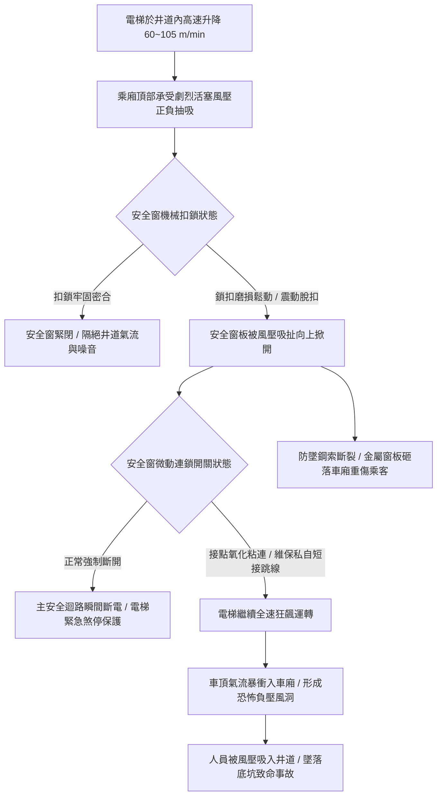

# 全案購屋實戰第五百二十六部_中古大樓社區各樓層電梯乘廂頂部緊急逃生安全窗微動連鎖開關氧化短接與井道風壓吸扯墜落體檢工序全書

## 壹、核心體檢宗旨與家庭居住安全意涵

在中古集合住宅大樓中，電梯乘廂（Car）頂部依建築物昇降設備安全檢查標準，必須配置一座「乘廂緊急逃生安全窗（Car Top Emergency Exit / Trap Door）」。該安全窗是當電梯因地震、火災、控制電腦死機或鋼索卡死等極端意外受困於兩樓層之間且無法開門時，供消防搜救人員由車廂外部開啟救出受困住戶，或供受困者在極限危機下逃生至乘廂頂部的生命通道。

依據 CNS 10594 電梯安全法規，安全窗必須具備嚴密之「電氣安全連鎖裝置（Electrical Safety Interlock Switch）」：
1. **電氣切斷強制連鎖**：安全窗一旦被推開、掀起或鎖定未到位，連鎖微動開關之常閉接點（NC Contact）必須立即機械式強制斷開，瞬間切斷電梯主安全迴路（Safety Circuit），強制電梯主機斷電並使主煞車電磁抱死，絕對禁止電梯在安全窗開啟狀態下運轉。
2. **外部手動解鎖限制**：安全窗原設計必須只能由「車廂外部（乘廂頂部）」以專用工具或手柄開啟；由車廂內部開啟時，必須具備需特殊工具或破壞鉛封之防誤開機制，防止乘客或孩童在車廂內好奇推開。

然而，在屋齡達 20 至 25 年的中古社區（如小寶家庭關注的**大安紫金城 13 樓**、**長億南園 8 樓**、**歌德堡 8 樓**與**靜園 A 區 11 樓**），昇降路在數十萬次往復升降與長年強烈活塞風（Piston Effect）衝擊下，安全窗連鎖系統常衍生出四大致命的安全盲區：

1. **連鎖微動開關金屬簧片疲勞卡死、接點氧化與「被惡意短接跳線（Jumper）」**：車廂頂部常年積聚厚重煞車碳粉、油泥與灰塵，微動開關擺臂彈簧生鏽斷裂。更可怕的是，由於安全窗長年受震動微幅跳動引發誤跳機，部分非原廠維修技師為了省事，在車頂檢修盒（Car Top Inspection Box）內私自將安全窗開關「短接跳線」，使電梯在逃生窗敞開狀態下依然能全速高速狂飆！
2. **高速活塞風壓吸扯掀起安全窗引發人體墜落井道深淵**：電梯在狹窄井道內高速升降（速度 60~105 m/min），車頂承受劇烈的正負風壓交替抽吸。若安全窗扣鎖（Latching Mechanism）磨損鬆動，在經過穿堂層時窗板被負壓瞬間掀開；若此時住戶在車內或孩童站在下方，強大吸力與視線干擾極易造成人員失足被吸入深達數十公尺的黑暗井道底坑，造成粉身碎骨的慘劇。
3. **安全窗防墜落安全拉繩斷裂脫落**：安全法規要求安全窗蓋板必須配有高強度防墜鋼索（Safety Retaining Cable）。若防墜鋼索鏽蝕斷裂，當窗板開啟時，重達十數公斤的金屬窗板受重力直接由頂部砸入車廂內，將車廂內乘客頭部當場砸成重傷。
4. **逃生梯架鏽蝕脫落阻礙搜救**：許多中古電梯安全窗下方配備折疊式或懸掛式逃生爬梯，因長年潮濕固定扣件鏽蝕穿孔，緊急逃生時無法承載成年人體重，攀爬瞬間斷裂摔落。

本手冊針對高樓層標的建立標準化的乘廂頂部安全窗現場體檢工序、電氣連鎖驗證 SOP、修繕成本指標與買賣特約防護。

---

## 貳、乘廂安全窗連鎖系統與井道風壓病灶力學演變

### 1. 安全窗尺寸與電氣連鎖法定規範
- **CNS 10594 昇降機安全標準規範**：
  - 乘廂緊急逃生窗之淨開口尺寸不得小於 **0.4 公尺 × 0.5 公尺**，且開啟方向必須朝向乘廂外部（向外翻開）。
  - 安全連鎖開關必須為「正向開離型（Direct Opening Action）」，開關防護等級需達 IP54 以上，嚴禁以磁簧開關代替機械式強制斷開微動開關。
- **風壓抗力標準**：鎖定機構必須能承受至少 **1,000 N** 的向上拉拔力而不脫扣。

### 2. 「安全迴路被短接（Jumping）」的致命危害
- 若安全窗開關被短接，當車廂發生故障卡在兩樓層之間時，搜救人員掀開安全窗進行救援的瞬間，若控制盤突然恢復供電或發生邏輯錯亂，電梯將突然起步暴衝，將正在窗孔處爬行的乘客或搜救人員當場剪切腰斬！

---

## 參、實地帶看搭乘感受與安全窗防護體檢工序（SOP）

小寶在帶看大安紫金城 13 樓、長億南園 8 樓、歌德堡 8 樓或靜園 A 區 11 樓時，搭乘電梯應進行以下四步專業安全檢驗：

| 檢驗步驟 | 檢驗場域與操作工序 | 正常指標 | 異常警訊與深層機械病灶 |
| :--- | :--- | :--- | :--- |
| **步驟一：車廂天花板安全窗外觀與縫隙勘驗** | 抬頭檢視車廂頂棚（若有壓克力裝潢飾板，透過燈光透光處檢視上方金屬窗板）。 | 窗板閉合平整密實，周邊無開裂，扣鎖手柄處鉛封或防拆扣環完好。 | 1. 窗板邊緣明顯下垂傾斜，露出超過 10mm 縫隙。 2. 窗板四周被膠帶或鐵絲胡亂綑綁固定，代表扣鎖早已損壞。 |
| **步驟二：高速運行中井道風噪與窗板震顫監聽** | 由 1 樓直達頂樓（如 13 樓），於車廂高速運轉時細聽天花板聲音。 | 運轉音低沈平穩，天花板僅有均勻風聲，無金屬拍擊與空氣呼嘯聲。 | 1. 天花板傳出劇烈「匡啷、匡啷」金屬窗板上下跳動拍打聲。 2. 經過各樓層穿堂門時傳出「呼！呼！」刺耳風哨聲，代表氣密條全毀。 |
| **步驟三：陪同管委會檢視車頂檢修盒電氣迴路** | 請總幹事或保養技師開啟頂樓機房或由車頂檢修孔檢視車頂接線盒。 | 安全窗微動開關線路完整接入控制電纜，接點乾淨無氧化。 | 接線端子排上標示「TRAP DOOR / ESCAPE」處發現額外跨接的彩色銅線（惡意短接跳線！）。 |
| **步驟四：調閱電梯每月安全維護保養單** | 查閱管理室存查之「電梯定期保養紀錄表」昇降廂項目。 | 技師按月檢驗「緊急逃生口及連鎖安全開關」並簽章打勾合格。 | 該項目長年空白、打叉，或備註欄註明「逃生窗開關接觸不良建議更換」，管委會未安排維修。 |

---

## 肆、高樓層住宅置產防衛與合約特約保障

對於鎖定高樓層（大安紫金城 13 樓、靜園 A 區 11 樓、長億南園 8 樓、歌德堡 8 樓）的小寶家庭而言，電梯是全家人每日垂直通勤的唯一途徑。乘廂逃生窗的電氣連鎖機能若遭短接或損壞，將使全家人處於嚴重的剪切與墜落生命風險中：

### 1. 安全窗連鎖系統修繕與更新成本基準
- **更換合格重載防水正向斷開微動開關（日本歐姆龍 Omron 或 Telemecanique）與調整連桿**：連工帶料約 **\$4,500 ~ \$8,000**。
- **更換全套安全窗金屬機械扣鎖機構與耐磨不銹鋼防墜鋼索組**：約 **\$6,000 ~ \$12,000**。
- **全面更換抗風壓加厚型鋁合金緊急逃生窗總成（含雙迴路安全開關與防誤開鉛封鎖）**：單台電梯更新款約 **\$25,000 ~ \$40,000**。

### 2. 購屋買賣合約電梯逃生窗安全專屬特約條款範本
> **電梯緊急逃生窗安全連鎖保證特約條款**：  
> 「賣方擔保本買賣標的所在棟別之電梯昇降設備運作正常，其乘廂頂部緊急逃生安全窗之機械鎖扣完整牢固、抗風壓密合良好，且其電氣安全連鎖開關機能完全正常，無任何線路短接、跳線或防護失效情事，符合建築物昇降設備安全法規標準。自簽約日起至交屋日止，若經電梯專業維保機構檢查發現該逃生窗連鎖開關遭短接、扣鎖損壞需更換或不符法規標準之情事，賣方應負責促請管委會或全額出資於交屋日前修復完畢並取得合格簽證證明，否則買方得逕行自交屋尾款中扣留新台幣三萬元整作為安全整修預留金。」
