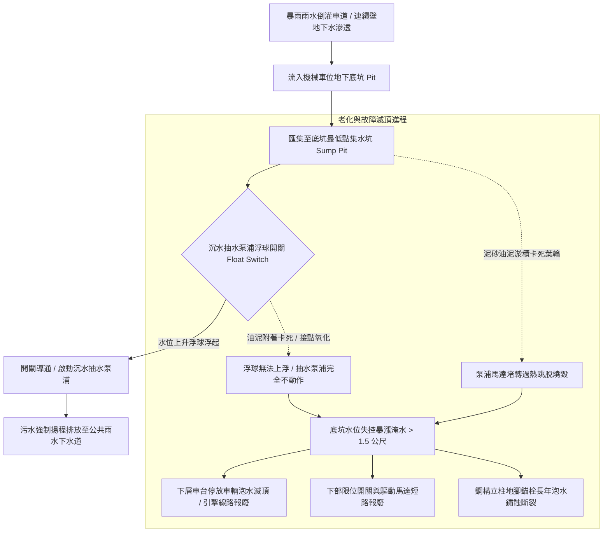

# 全案購屋實戰第五百二十四部_中古大樓社區地下室機械停車設備集水坑污水滲透底坑鏽蝕沉水抽水泵浦故障與暴雨積水車台泡水體檢工序全書

## 壹、核心體檢宗旨與家庭居住安全意涵

在中古集合住宅大樓中，機械停車設備（包含小寶家庭考量名單中的**長億南園 8 樓**隨戶配置之升降橫移二層式車位）大多設置於大樓地下室最底層（B1、B2 或 B3），且機械車位的下層車台在下降停靠時，必須深入地下地坪下方的「設備基坑/底坑（Equipment Pit）」。

基坑的深度通常達 **1.8 至 2.2 公尺**，是全棟建築物地勢最低、地下水水壓最高且水氣最容易匯集的極端環境。為了排放日常洗車水、暴雨車道倒灌雨水或連續壁微幅滲水，每個機械車位底坑均配置有「排水集水坑（Sump Pit）」與「自動沉水式抽水泵浦（Submersible Sump Pump）」。

然而，在屋齡達 20 至 25 年的中古社區地下室中，底坑防水層與排水平衡系統常因長年缺乏維護，衍生出四大毀滅性的泡水與腐蝕病灶：

1. **底坑混凝土底板與連續壁接縫防水層破裂滲水**：地下水長期處於高靜水壓狀態，若底坑之聚脲（Polyurea）、環氧樹脂（Epoxy）或結晶滲透防水層老化龜裂，地下水順著施工縫與蜂窩孔洞湧出，使底坑常年積水長青苔，變成地下「蓄水池」。
2. **沉水式排污抽水泵浦葉輪被砂石卡死、浮球開關（Float Switch）失靈**：車輛輪胎帶入的大量細沙、落葉與油污沉積於集水坑底，抽水泵浦之鑄鐵葉輪被泥沙卡死；控制泵浦啟閉的浮球開關在厚重黏稠油泥附著下失去浮力「沈底無法上浮」，或浮球內部水銀/微動開關接點氧化，即便水位已淹沒基坑，抽水泵浦完全無法自動啟動！
3. **下層車台鋼構、傳動鏈條、電氣感應器與愛車滅頂泡水**：當夏季午後強降雨或颱風暴雨來襲，若車道截水溝排水不及或逆流，雨水大量灌入底坑。在抽水泵浦故障狀態下，底坑水位在數十分鐘內即可暴漲超過 1.5 公尺，將停放在下層車位的車輛（包含底盤、引擎、變速箱與車內地毯）完全滅頂浸泡在污水中，造成數十萬至上百萬的報廢車損，引發住戶與管委會長達數年的連帶賠償訴訟。
4. **高濕鹽霧環境引發鋼柱腳座與地腳錨栓（Anchor Bolts）穿孔鏽蝕**：常年積水與高濕度（RH 經常性維持 95%~100%）形成高腐蝕性微氣候，化學油水直接浸泡立柱鋼結構根部。地腳錨栓因電化學腐蝕斷裂、槽鋼底座鏽蝕穿孔厚度衰減超過 50%，使整座機械停車鋼構失去根基，在車輛升降震動時隨時有向單側傾倒坍塌之重大公安危機。

本手冊針對長億南園 8 樓等具備機械車位之社區，建立標準化的底坑集水坑、沉水抽水泵浦手動浮球測試、鋼柱地腳鏽蝕勘驗工序、更新預算指標與買賣契約專屬特約防線。

---

## 貳、底坑排水平衡系統與積水滅頂病灶力學演變

### 1. 機械停車底坑法定排水標準規範
- **CNS 14386-1 機械停車設備安全標準**：
  - 機械停車設備基坑必須具備暢通之排水設施，且底坑地坪必須向集水坑施作 **1/50 至 1/100** 之洩水坡度。
  - 集水坑必須配置**雙抽水泵浦（Dual Submersible Pumps）**交替運轉與自動互備機能，且必須具備「高水位溢流警報浮球（High Water Alarm Float）」連線至警衛室中控台。
- **危險指標**：底坑內僅有一台小型抽水泵浦（無備份）、無高水位警報、且集水坑積滿發黑死水與沉泥。

### 2. 鋼構地腳錨栓鏽蝕安全厚度極限
- **地腳槽鋼與底板厚度**：原始設計通常為 8mm ~ 12mm 結構鋼板。
- **報廢極限**：若底板浸泡腐蝕產生「層狀剝落（Exfoliation Rust）」，實測鋼板有效厚度衰減超過 **25%**（小於 6mm），或地腳錨栓螺帽鏽死膨脹甚至脫落，必須立即停機進行基座鋼板補強加固工程。

---

## 參、實地帶看機械車位底坑排水現場體檢工序（SOP）

小寶在帶看長億南園 8 樓現場檢驗隨戶配置的機械車位時，應要求房仲與管理員陪同，走到下層基坑旁，執行以下四步深度工序體檢：

| 檢驗步驟 | 檢驗場域與操作工序 | 正常指標 | 異常警訊與深層機械病灶 |
| :--- | :--- | :--- | :--- |
| **步驟一：底坑底部乾燥度與連續壁滲水勘驗** | 攜帶強光手電筒直射機械車位底部地坪與角落邊緣。 | 底坑水泥地坪乾燥清爽，無積水、無青苔結晶，連續壁表面無水痕。 | 1. 底坑積水深達 5~15 公分，水面漂浮油污與落葉死昆蟲。 2. 混凝土壁面出現白色碳酸鈣結晶（壁癌鐘乳石）與持續滴水。 |
| **步驟二：集水坑泥沙淤積與浮球外觀檢查** | 檢視底坑角落的方型金屬格柵集水坑內部。 | 集水坑水質清澈、無厚重沉泥，沉水泵浦與浮球表面乾淨無油泥裹覆。 | 1. 集水坑被黑色黏稠沉泥填滿，泵浦進水口已完全被爛泥沒頂。 2. 浮球被電纜線或油泥纏繞卡死在坑壁底部，無法自由漂浮。 |
| **步驟三：手動抬起浮球開關「強制排水實測」** | 戴絕緣橡膠手套，以長桿或工具手動將集水坑內的浮球向上抬起。 | 浮球抬起至水平位置瞬間，泵浦立即啟動發出清脆吸水運轉聲，排水管出水強勁。 | 1. 抬起浮球後毫無動靜（電路斷路、接點氧化或馬達已燒毀）。 2. 馬達發出「嗡嗡」沉悶卡死噪聲，但葉輪完全不轉動（泥砂卡死）。 |
| **步驟四：立柱鋼構底座與地腳螺栓鏽蝕體檢** | 以刮刀或螺絲起子輕敲檢驗最底層立柱鋼材根部與地面固定錨栓。 | 鋼材表面油漆完整，無起泡生鏽，金屬敲擊聲清脆清響。 | 敲擊時大片鐵鏽呈片狀粉碎脫落（紅鏽穿孔），螺栓螺帽已鏽蝕成圓形球狀失去固定力！ |

---

## 肆、長億南園機械車位置產防衛與合約特約保障

對於鎖定**長億南園 8 樓**（主附 32 坪超大空間，但隨戶配置機械車位）的小寶家庭而言，機械車位底坑若排水不良或抽水泵浦損壞，一旦暴雨來襲愛車將直接面臨滅頂報廢的慘劇：

### 1. 底坑防水與排水設備修繕工程成本基準
- **底坑集水坑清淤、清洗葉輪與更換沉水抽水泵浦（單相 1/2HP 不銹鋼污水型）**：連工帶料約 **\$8,000 ~ \$14,000 / 台**。
- **全面升級雙泵浦自動交替控制盤（含高水位蜂鳴警報器與不銹鋼雙浮球）**：整套改裝約 **\$18,000 ~ \$28,000**。
- **底坑全面高壓灌注止漏（PU 發泡止水針）與塗布結晶抗滲防水塗料**：單一基坑工程款約 **\$25,000 ~ \$40,000**。
- **立柱底部鋼板除鏽、焊接槽鋼補強肋板與重新植入化學錨栓**：每柱加固約 **\$8,000 ~ \$15,000**。

### 2. 購屋買賣合約機械車位底坑防水防泡水特約條款範本
> **機械車位基坑排水正常與無泡水歷史保證特約條款**：  
> 「賣方保證本買賣標的所隨附之機械停車位（車位編號：___），其地下底坑結構無嚴重湧水滲漏，底坑集水坑及自動沉水式抽水泵浦功能完整正常，且該車位過去無任何因暴雨或排水故障導致之車輛淹水泡水紀錄。交屋點交當日，雙方應現場查驗底坑地坪及集水坑，由賣方現場實測抽水泵浦手動浮球運轉排水正常，底坑內無積水。若交屋日前經檢查發現底坑漏水積水、抽水泵浦損壞需換新或鋼構底座嚴重鏽蝕情事，賣方應全額負擔修繕工程費用並取得合格簽證，否則買方得扣留尾款新台幣三萬元整。」
