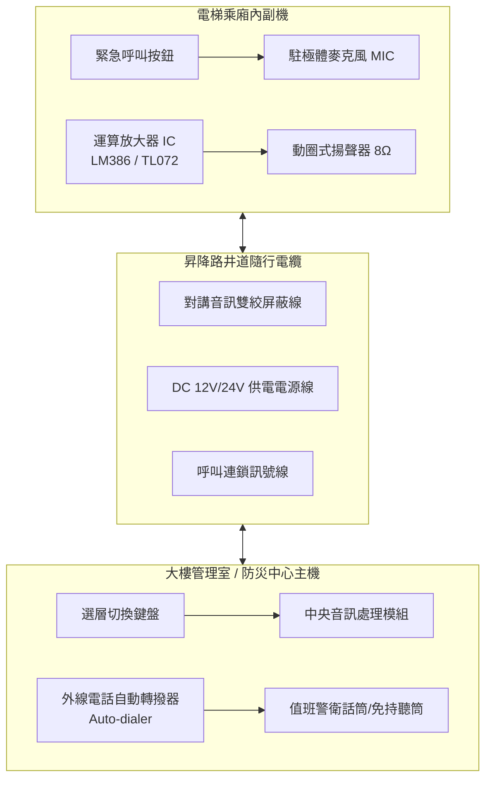

# 全案購屋實戰第五百五十一部_中古大樓社區各樓層電梯對講機室內分機音訊放大IC老化破音直流供電壓降雜訊干擾與主機面板通訊中斷體檢工序全書

---

## 序章：高樓安全通訊中樞——電梯對講機系統之生命防線

中古大樓社區電梯之緊急對講機系統（Elevator Emergency Intercom System），是乘廂內部發生停電、地震受困、突發性機械故障夾人時，乘客與管理室、防災監控中心及外部維保廠商進行雙向求救通話之唯一法定生命通訊通道。

然而，在屋齡 20 至 30 年以上之中古大樓中，電梯對講系統經常因井道隨行電纜（Traveling Cable）內銅芯導線反覆彎折疲勞產生微斷路、機房直流供電電源供應器（DC 12V/24V Power Supply Unit）電解電容爆漿乾涸導致直流壓降過大、乘廂內部副機對講話筒之音訊運算放大器 IC 老化燒蝕產生強烈交流嗡鳴聲（AC Hum）與破音，甚至管理室主機面板按鍵微動開關觸點氧化積碳，導致乘客按下警鈴呼叫時管理室「只響不通」或「通話雜訊過大無法辨識語音」，嚴重威脅乘梯者之人身安全。

本全書將深入剖析電梯對講機系統之電氣架構、信號調製、雜訊抑制原理，並建立一套標準化實戰體檢工序，協助購屋家庭於現場看屋時精準驗收。

---

## 第一章：電梯緊急對講機電氣架構與雜訊老化機理

### 第一節：音訊放大晶片（Op-Amp IC）老化與熱噪聲機制

1. **晶片熱應力與半導體摻雜漂移**：
   - 乘廂內部對講副機常年處於 24 小時不間斷通電待機狀態，運算放大晶片（如經典之 `LM386`、`TL072` 或專用音頻功放 IC）長期受高溫烘烤，內部矽基半導體之 PN 結漏電流增大，偏置電流（Input Bias Current）失衡。
   - 老化後之晶片在微弱音訊輸入時，內部熱噪聲（Thermal Noise）大幅提升，輸出端產生持續性的高頻白噪聲或嚴重的截波失真（Clipping Distortion），導致受困乘客講話聲音嘶啞、金屬破音無法辨識。

2. **退耦電解電容乾涸與交流漣波干擾（Ripple Noise）**：
   - 副機電路板上之電源濾波電容（Filter Capacitor，通常為 220μF~470μF 鋁電解電容）在運作 10~15 年後，內部電解液乾涸，等效串聯電阻（ESR）激增數十倍。
   - 電梯井道內動力電纜產生的 60Hz 交流工頻感應電壓無法被有效濾除，直接耦合至音頻放大迴路，形成強烈低頻「嗡嗡嗡」交流蜂鳴聲（60Hz Hum）。

---

### 第二節：隨行電纜線阻壓降與屏蔽層斷裂

1. **導線反覆彎折與金屬疲勞**：
   - 電梯隨行電纜隨著乘廂在井道內每日上下數千次運行，其內部負責傳輸對講訊號之多股軟銅線在懸掛點（Traveling Cable Hanger）處承受劇烈的反覆交變應力。
   - 長期運轉下，外圍銅絲逐根斷裂，導致迴路直流電阻（Loop Resistance）自正常的十數歐姆激增至數百歐姆，當主機發送呼叫信號時，末端電壓產生嚴重壓降（Voltage Drop），無法驅動放大晶片正常工作。

2. **金屬屏蔽網層氧化與共模抑制比（CMRR）衰減**：
   - 對講音訊線通常採用雙絞屏蔽線（STP），金屬屏蔽編織網負責將電梯變頻器（Inverter/VVVF）高頻 PWM 斬波脈衝屏蔽導地。
   - 若屏蔽網在井道接線箱處接地不良、虛焊或因潮濕氧化斷開，變頻器產生的數千赫茲高頻諧波雜訊將直接感應至音訊線上，導致通話時伴隨尖銳刺耳之電磁嘯叫聲（High-Frequency Whistle）。

---

## 第二章：管理室對講主機面板與通訊協定體檢

### 第一節：機械觸點氧化積碳與彈片疲勞
1. **乘廂警鈴呼叫按鈕（Call Button）**：
   - 採鍍金或鍍銀微動開關（Micro-switch），若乘廂內部長期潮濕或清潔人員噴灑消毒液滲入按鈕內部，觸點表面會生成硫化銀或氧化膜。
   - 觸點接觸電阻自正常的 <0.5Ω 激增至數百歐姆，按下呼叫鈕時無法將信號線電位有效拉低至接地電平（GND），主機無法解碼出呼叫信號。

2. **管理室矩陣式鍵盤老化**：
   - 管理室對講主機之各棟、各梯號切換按鈕頻繁按壓，導電橡膠老化脫落或彈簧疲勞，造成警衛欲接通特定乘廂時按鍵無反應，通話被迫中斷。

### 第二節：外線自動轉撥器（Auto-Dialer）斷線危機
1. **中華電信 PSTN 市話實體線路缺失**：
   - 現行消防與特種設備法規要求電梯對講機除連接警衛室外，必須具備自動撥打外部維修保養廠商 24 小時服務專線之功能。
   - 許多老舊社區為節省每月數百元之市話月租費，擅自將對講機外接市話線拆除或欠費停機，一旦夜間警衛離座或巡邏，乘客受困電梯按下對講機將面臨「求救無門」之絕境。

---

## 第三章：現場看屋電梯對講系統七大實戰體檢工序

中古大樓看屋時，小寶與家人應與房仲、陪同管理員協調，於電梯運行期間實地執行下列檢驗：

| 體檢步驟 | 檢驗標的與操作動作 | 合格標準 (Pass) | 潛在致命瑕疵 (Fail) | 修繕對策與預算評估 |
| :---: | :--- | :--- | :--- | :--- |
| **Step 1** | **乘廂呼叫鈕觸發性** 於乘廂內按壓黃色對講/警鈴鈕 3 秒 | 管理室主機於 1 秒內發出清脆鈴聲並點亮梯號燈 | 按鈕卡死無彈力、按壓多次管理室毫無反應 | 更換乘廂防破壞不鏽鋼警鈴按鈕（約 1,200~2,500 元） |
| **Step 2** | **雙向對講清晰度** 由管理員於中控室接聽對話 | 語音清晰宏亮，正常說話音量即可互相辨識 | 嚴重金屬破音、聲音微弱如蚊蠅、斷斷續續 | 更換副機放大電路板、調整麥克風增益（約 3,500~6,000 元） |
| **Step 3** | **變頻器雜訊抗擾度** 電梯在全速升降過程中持續通話 | 通話背景安靜，無變頻高頻嘯叫或交流低頻嗡鳴 | 電梯一加速啟動即出現劇烈電磁刺耳雜訊 | 檢修井道屏蔽接地、抽換隨行電纜音訊線（約 18,000~35,000 元） |
| **Step 4** | **直流供電端電壓測量** 三用電表測量副機電源接線端子 | DC 12V 系統實測電壓不得低於 11.2V | 電壓低於 10.0V，通話瞬間電壓嚴重崩塌跳脫 | 更換機房交換式電源供應器（PSU）（約 2,500~4,500 元） |
| **Step 5** | **免持受話音量** 距離副機揚聲器 1.5 公尺處聆聽 | 揚聲器音壓級（SPL）達到 65~75 dB(A) | 揚聲器紙盆破裂沙啞、低於 50 dB(A) 無法聽清 | 更換高耐候動圈式防水揚聲器（約 800~1,500 元） |
| **Step 6** | **外部自動轉撥測試** 警衛室響鈴 30 秒無人接聽模擬 | 主機自動跳撥外線至崇友/台灣三菱/永大等原廠客服 | 系統自動斷線嘟嘟聲、未連線外線電話線 | 申裝專用實體電話線路並開通自動轉撥（約 3,000 元 + 月租費） |
| **Step 7** | **不斷電系統備援測試** 切斷管理室主機 AC 110V 交流電源 | 備用鉛酸電池立即無縫供電，通話維持 2 小時以上 | 切斷市電主機立即斷電熄滅，蓄電池完全無蓄電力 | 更換 12V 7.2Ah 密閉鉛酸蓄電池（約 800~1,600 元/顆） |

---

## 第四章：斡旋談判防禦性條款與修繕責任劃分

在鎖定 **大安紫金城 13 樓** 或 **長億南園 8 樓** 進行價格談判時，公設電梯之安全通訊完整度直接反映管委會對安全法規之重視程度：

1. **公設查驗備忘錄（MOU）要求**：
   - 要求賣方與管委會出示最近一期特種設備（電梯升降設備）年度安全檢查合格證，並確認對講機自動轉撥功能列入昇降設備年度維護保養合約之責任範圍。
2. **修繕基金提撥扣抵談判**：
   - 若現場查驗發現電梯對講機長期處於壞損失修狀態、管理室通話斷絕，買方應當場以「公設安全通訊重大瑕疵，需提撥專款全面抽換隨行電纜對講訊號線與主機模組」為由，向屋主主張爭取折讓價金 **5 至 8 萬元**，作為未來社區修繕特別公費之預備基金。
