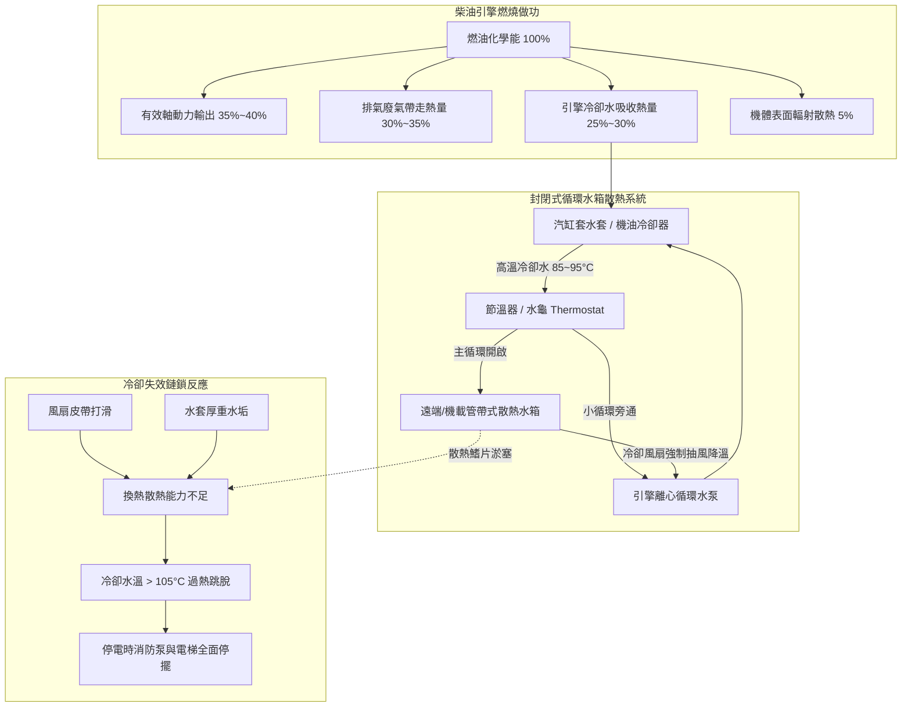
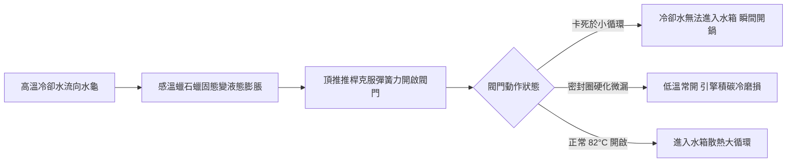
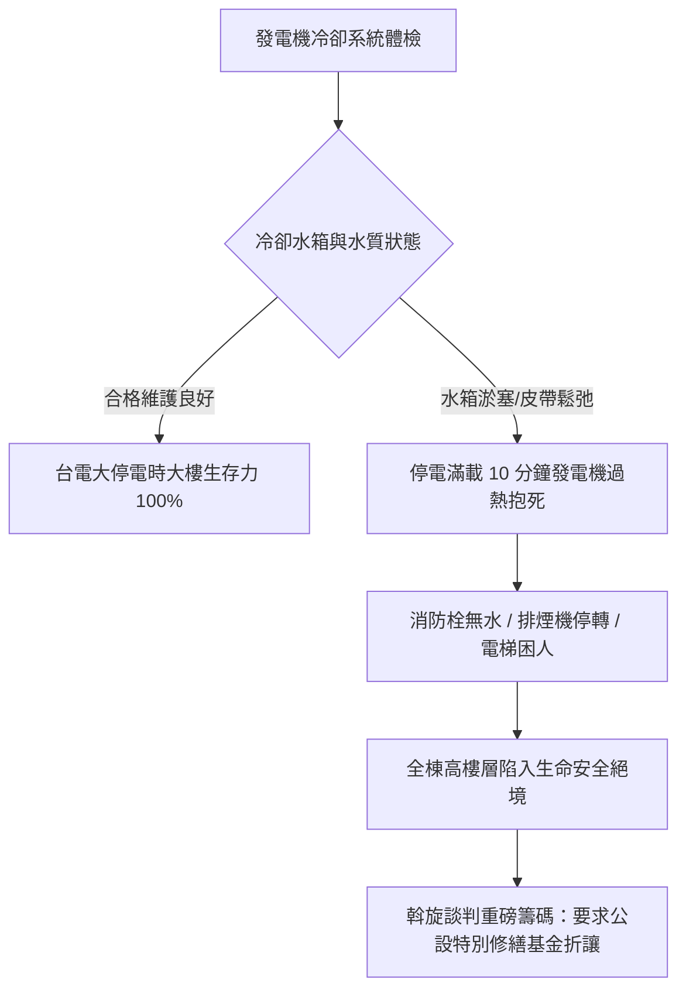

# 全案購屋實戰第五百五十七部_中古大樓社區地下室緊急柴油發電機冷卻水箱散熱鰭片鋁蝕淤塞冷卻風扇皮帶打滑水泵軸封滲漏與過熱高溫抱死體檢工序全書

---

## 序章：都會高樓停電時之救命心臟——緊急柴油發電機冷卻系統之隱患

在現代高層集合住宅大樓中，「**地下室緊急柴油發電機組（Emergency Diesel Generator Set, EDG）**」是當台電市電遭遇颱風暴雨、地震變電所跳脫、或區域性大停電時，維持全棟「**緊急排煙風機、消防栓/撒水加壓泵浦、避難引導照明、以及最關鍵之電梯緊急平層疏散**」之唯一法定應急動力來源。

緊急發電機通常採高轉速（1,800 RPM / 60 Hz）、大排氣量之重型四行程柴油引擎（如 Cummins、Caterpillar、Perkins、Deutz 或三菱重工），於停電指令下達後必須在 **10 至 15 秒內** 完成自動啟動、建壓建頻並全載供電。

然而，在屋齡 20 至 30 年以上之中古大樓社區中，發電機常年處於低使用率之靜止冷備用狀態，管委會與機電保養常僅做「每月無載試車運轉 3~5 分鐘（空轉無負載）」。這種敷衍式保養隱藏了極其致命之散熱冷卻病理：
1. **冷卻散熱水箱（Radiator）鰭片大面積腐蝕粉化與泥沙雜物淤塞**：地下室通風受潮及柴油廢氣硫化物侵蝕，散熱器銅/鋁散熱鰭片（Cooling Fins）表面產生白粉狀氧化鋁剝落，迎風面被灰塵與老鼠巢穴死角封死，全載散熱風量衰減超過 50%。
2. **冷卻冷卻水管路與引擎水套（Cylinder Liner Water Jacket）水垢淤塞**：社區未嚴格添加合格之乙二醇（Ethylene Glycol）防凍防鏽冷卻液，反而便宜行事常年補充自來水，導致水道內部生成厚達數公釐之碳酸鈣硬垢與鐵鏽泥，冷卻水循環傳熱係數（Heat Transfer Coefficient）腰斬。
3. **冷卻風扇傳動皮帶（V-Belt）老化龜裂與打滑**：橡膠皮帶長年受機房高溫烘烤，橡膠硬化龜裂、張力鬆弛，在高負載帶風運轉時產生劇烈打滑（Slip Ratio $> 15\%$），風扇轉速不足。
4. **引擎循環水泵（Engine Water Pump）機械軸封老化滲漏與空蝕**：冷卻液缺少水幫浦潤滑劑，陶瓷/石墨密封環乾磨磨損，冷卻水持續微滴滴入發電機底座底盤；加上水泵葉輪遭氣蝕鏽蝕，循環水流量不足。
5. **滿載運轉高溫抱死（Engine Seizure）**：當真實大停電發生、發電機投入滿載運轉時，引擎冷卻液溫度於 **8 至 12 分鐘內** 瞬間飆破 105°C~115°C，觸發「冷卻水過熱極限保護（High Water Temp Trip）」強制熄火；若保護開關老化失效，活塞與汽缸套在極端高溫下發生熱膨脹咬死、連桿斷裂擊穿曲軸箱，釀成全棟陷入黑暗死寂與火警無消防水可用之絕境。

本全書將深入剖析柴油發電機熱力平衡方程式、冷卻系統流體換熱機制、風扇傳動打滑力學，並建立現場實戰體檢工序，為購屋家庭鎖定社區應急公設之最高安全防線。

---

## 第一章：緊急柴油發電機熱力平衡與散熱冷卻失效機理

### 第一節：熱力平衡方程式與散熱器熱阻崩塌

1. **引擎冷卻水需散熱量計算**：
   - 一台配備於中古大樓之典型 $300\text{ kW} / 375\text{ kVA}$ 緊急柴油發電機，柴油燃燒總熱量輸入約為 $800\text{ kW}$。
   - 轉移至冷卻水系統之熱負荷 $Q_w$ 佔總熱量之 $25\%\sim 30\%$：
     $$Q_w \approx 800\text{ kW} \times 0.28 = 224\text{ kW} \approx 192,600\text{ kcal/hr}$$
   - 散熱水箱之換熱面積與總熱傳導係數必須滿足：
     $$Q_w = K \cdot A \cdot \Delta T_m$$
     其中 $K$ 為總熱傳導率，$A$ 為水箱散熱鰭片總表面積，$\Delta T_m$ 為對數平均溫差。

2. **鰭片白蝕與泥垢之熱阻激增（Fouling Resistance）**：
   - 地下室濕氣與微量酸性氣體造成散熱水箱鋁製鰭片表面產生水合氧化鋁（$\text{Al}_2\text{O}_3 \cdot n\text{H}_2\text{O}$）白霜鏽蝕，破壞原本光潔之金屬熱傳導介面。
   - 灰塵與油污沉積於狹小的散熱百葉片（Fin Pitch 僅 $1.5\sim 2.0\text{ mm}$）縫隙中，形成高熱阻污垢層，使外側空氣對流熱傳導係數衰減達 $60\%$ 以上。
   - 冷卻風扇即使全速抽風，空氣亦無法穿透淤塞之鰭片，導致冷卻水降溫幅度自正常的 $8\sim 12^\circ\text{C}$ 暴跌至不足 $2^\circ\text{C}$。

---

### 第二節：節溫器（Thermostat / 水龜）熱敏蠟封老化與卡阻

1. **石蠟感溫體（Wax Pellet）熱敏衰退**：
   - 節溫器內部充填精確配比之高膨脹係數石油石蠟與銅粉混合物，外部以橡膠膜片密封。
   - 歷經 20 年之熱脹冷縮週期，橡膠膜片龜裂導致石蠟微量外洩，感溫蠟膨脹力矩嚴重衰減。原本設計於 $82^\circ\text{C}$ 開始開啟、$95^\circ\text{C}$ 全開之主閥門，延遲至 $95^\circ\text{C}$ 才微幅開啓，甚至因閥桿水垢卡阻於「半開或全關」位置。

2. **小循環無法切換至大循環之「開鍋」悲劇**：
   - 當發電機突發全負載啟動時，冷卻水溫度以每分鐘 $5^\circ\text{C}\sim 8^\circ\text{C}$ 速率急遽飆升。
   - 節溫器若卡死在閉合位置，高達 90°C 以上之滾燙熱水完全無法進入水箱進行風冷，只能在引擎本體內部循環，冷卻水在數分鐘內汽化沸騰產生「開鍋（Boiling）」，大量蒸氣衝破水箱壓力安全蓋，氣阻現象使水泵瞬間空轉失壓，汽缸壁失去液體潤滑，發生毀滅性之活塞拉缸（Piston Scuffing）。

---

### 第三節：風扇傳動皮帶打滑與張力衰減力學

1. **歐姆皮帶摩擦傳動公式（Euler's Belt Formula）**：
   - 引擎曲軸皮帶輪驅動冷卻風扇之最大有效圓周力 $F_e$ 決定於皮帶緊邊張力 $T_1$ 與鬆邊張力 $T_2$：
     $$\frac{T_1}{T_2} = e^{\mu \cdot \theta}$$
     其中 $\mu$ 為橡膠與金屬輪槽間之摩擦係數，$\theta$ 為包角（Wrap Angle）。

2. **橡膠老化硬化與張力鬆弛**：
   - 長期受引擎機房 50°C~70°C 環境烘烤，三元乙丙橡膠（EPDM）或氯丁橡膠（Neoprene）皮帶增塑劑揮發，表面硬化拋光、摩擦係數 $\mu$ 由 $0.35$ 暴跌至 $0.15$。
   - 加上皮帶內部聚酯線繩長期受拉伸產生永久塑性變形，初張力 $T_0$ 嚴重鬆弛。當引擎轉速瞬間由 0 飆升至 1,800 RPM 時，直徑達 80~120 公分之重型金屬風扇產生巨大轉動慣量，皮帶在輪槽內發生劇烈相對滑動，發出刺耳「嘰——」尖叫聲，風扇實際轉速嚴重落後，風量銳減達 30%~50%。

---

## 第二章：現場看屋緊急柴油發電機冷卻系統七大實戰體檢工序

在評估中古大樓社區時，買方應協調管委會或機電主任陪同，至地下室緊急發電機房進行實地檢驗：

| 體檢步驟 | 檢驗標的與操作動作 | 合格標準 (Pass) | 潛在致命瑕疵 (Fail) | 修繕對策與預算評估 |
| :---: | :--- | :--- | :--- | :--- |
| **Step 1** | **散熱水箱鰭片外觀透光度** 強力手電筒自水箱後方照射鰭片 | 鰭片平直整齊無倒伏，光線穿透度 $\ge 90\%$，表面無白粉 | 鰭片大面積倒伏壓扁、佈滿油污白粉、透光率 $< 50\%$ | 使用專用翅片梳梳直鰭片，以高壓水槍中性藥劑除垢（約 6,000~15,000 元） |
| **Step 2** | **冷卻液品質與乙二醇比重** 使用光學折射計抽取副水箱水樣 | 呈現清澈螢光綠/粉紅色，防凍液濃度 $33\%\sim 50\%$，冰點 $\le -15^\circ\text{C}$ | 呈現混濁鐵鏽黃褐色、漂浮油花、使用一般自來水（冰點 $0^\circ\text{C}$） | 徹底水套酸洗除垢，重新更換原廠重負載長效冷卻液（約 8,000~18,000 元） |
| **Step 3** | **風扇傳動皮帶張力與撓度** 以拇指施加約 $10\text{ kg}$ 力量按壓皮帶中段 | 皮帶中段下沉撓度在 $10\sim 15\text{ mm}$ 以內，無龜裂剝落 | 撓度 $> 25\text{ mm}$ 鬆弛晃動、表面佈滿裂紋齒槽斷裂 | 調整張緊輪滑軌螺栓，更換耐高溫重載三角傳動皮帶（約 2,500~5,000 元/條） |
| **Step 4** | **冷卻水泵機械軸封滲漏檢查** 檢查水泵洩漏觀察孔（Weep Hole） | 洩漏孔乾燥清潔，無冷卻液滴落結晶痕跡 | 洩漏孔掛著綠色/粉色結晶鹽塊、持續有水滴下滴 | 拆卸更換原廠水泵總成或全套陶瓷碳化矽機械密封軸承（約 15,000~35,000 元） |
| **Step 5** | **夾套預熱器（Jacket Water Heater）** 觸摸引擎缸體側面水套溫度 | 發電機靜止待機時，缸體維持微溫（$40^\circ\text{C}\sim 50^\circ\text{C}$） | 缸體冰冷如鐵，預熱電熱管斷線燒毀、無熔絲開關跳脫 | 更換恆溫控制型發電機夾套電加熱水套管（約 6,000~12,000 元） |
| **Step 6** | **帶載試車冷卻水溫升曲線** 查閱最近一次發電機年度帶載試車紀錄 | 投入 $50\%\sim 80\%$ 負載連續運轉 30 分鐘，水溫穩定於 $80\sim 92^\circ\text{C}$ | 僅做無載空轉 3 分鐘應付，或帶載 10 分鐘水溫即逼近 $100^\circ\text{C}$ | 責成管委會委託發電機專業廠商實施全載假負載（Load Bank）測試 |
| **Step 7** | **過熱高溫警報與跳脫連鎖** 檢視控制盤水溫表感測器與警報燈 | 具備兩段式保護：$98^\circ\text{C}$ 發出聲光預警蜂鳴、$105^\circ\text{C}$ 強制跳脫 | 高溫感應開關線路短接作弊、感應器探頭鏽死無信號 | 更換雙接點精密冷卻水溫度感應開關並重新校線（約 3,500~7,000 元） |

---

## 第三章：發電機散熱效能與社區置產談判籌碼

當評估 **大安紫金城 13 樓**（高樓層需仰賴發電機提供消防排煙與電梯急停備援）或 **長億南園 8 樓**（機械車位與二次加壓水泵極度依賴發電機）時：

1. **高樓層住戶（大安紫金城 13 樓）之生命依靠**：
   - 若發生火災併發斷電，高樓層住戶無法使用樓梯逃生時，完全取決於緊急發電機是否能持續運轉供電驅動「**正壓排煙風機（Pressurization Fan）**」防止濃煙灌入梯間。
   - 若發電機冷卻水箱老化淤塞，運轉數分鐘即高溫熄火，整棟高樓將喪失防煙護盾。此一重大公共安全隱患，可作為要求屋主折讓價金之強力專業論述。

2. **成屋買賣緊急備用電源保證特約條款**：
   > 「賣方保證本買賣標的所屬社區之緊急柴油發電機組，其冷卻散熱系統（包含散熱水箱、冷卻風扇、水泵及節溫器）均處於合格安全可用狀態，並於交屋日前出具管委會或合格機電維護廠商一年內經實質測試運轉（含手動/自動啟動測試及水溫正常紀錄）之完整檢測合格報告。若交屋前查明發電機組冷卻系統存在水箱嚴重淤塞滲漏、無法正常降溫或已逾三年未進行實質換水保養者，賣方應負責協調管委會於交屋前完成檢修保養；否則買方得主張自買賣價金中扣留新台幣參萬元整，作為買方承擔公共安全風險之補償。」
