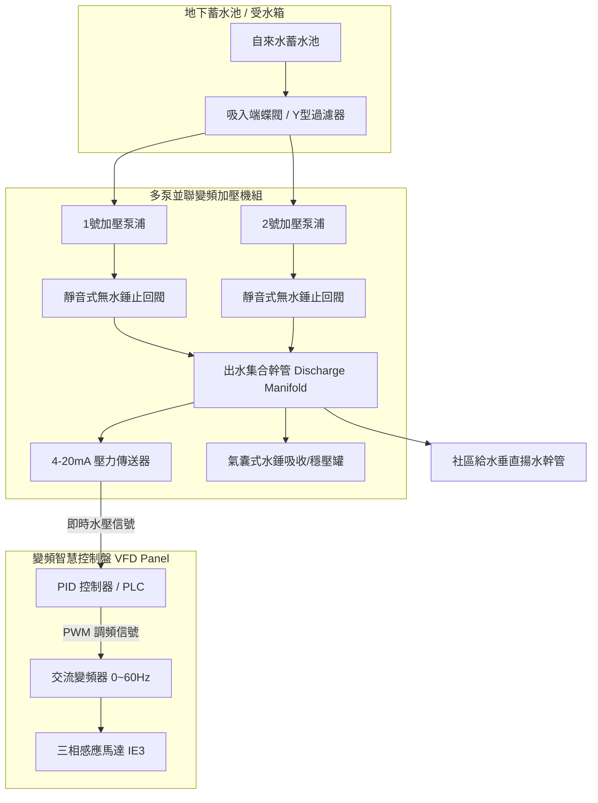
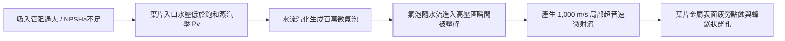
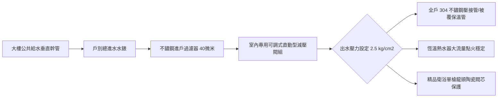

# 全案購屋實戰第五百五十三部_中古大樓社區地下室生活自來水二次加壓變頻泵浦PID控制恆壓傳送器漂移葉輪氣蝕剝落與機械軸封高溫乾磨體檢工序全書

---

## 序章：都會高樓生活命脈——二次加壓供水系統之隱形危機

在現代集合住宅與中古大樓社區中，自來水無法僅憑自來水公司之市政管網水壓直接輸送至 4 樓以上之中高樓層。社區必須於地下室設置「自來水受水箱（Suction Tank）」，並透過「**二次加壓給水泵浦機組（Secondary Booster Pump System）**」——通常採多台並聯之變頻恆壓泵浦（Variable Frequency Drive Booster Pumps）——將自來水加壓輸送至各住戶室內或頂樓中繼水箱。

二次加壓給水系統攸關全體住戶每日之飲用水、洗沐熱水器點火與衛生沖洗。然而，在屋齡 20 至 30 年之中古社區中，加壓供水機組常因長年高負荷運轉而隱藏三大致命機電病理：
1. **PID 恆壓壓力傳送器（Pressure Transmitter）零點漂移（Zero Drift）**：壓阻式感測薄膜老化或毛細引壓管積垢堵塞，導致回授給變頻器之壓力信號失真，引發全棟給水管路高頻壓力震盪、水壓驟降忽冷忽熱，甚至超壓爆裂低樓層軟管。
2. **水泵葉輪氣蝕（Cavitation）與金屬剝落**：吸入端管阻過大、淨吸入壓頭（NPSHa）不足，使水流於葉片背面汽化產生微氣泡，氣泡破滅之微射流（Micro-jet）以千度高溫與數萬大氣壓持續衝擊不鏽鋼/青銅葉輪，造成葉片呈蜂窩狀穿孔剝落、供水揚程嚴重腰斬。
3. **機械軸封（Mechanical Seal）高溫乾磨與碳化洩漏**：因缺水保護極限開關失準或排氣未淨，旋轉環（Rotary Ring）與靜止環（Stationary Ring）端面缺乏水膜潤滑產生乾摩擦，摩擦面瞬間高溫超過 200°C 導致碳化矽/碳化鎢端面爆裂、氟橡膠 O 型環碳化脆化，導致泵浦大量噴水淹沒地下泵房。

本全書將深入剖析二次加壓泵浦之流體力學、PID 控制原理與機械密封機制，並建立一套現場查驗工序，為購屋家庭徹底排除「買房後水壓不足、水管爆管淹水與高額公設維修分攤」之重大隱患。

---

## 第一章：二次加壓變頻泵浦電氣與流體力學架構

### 第一節：壓力傳送器（Pressure Transmitter）零點漂移與 PID 振盪

1. **壓阻式擴散矽薄膜老化與引壓管淤塞**：
   - 壓力傳送器通常輸出標準 $4\sim 20\text{ mA}$ 直流電流信號（對應 $0\sim 10\text{ kg/cm}^2$ 壓力）。
   - 在中古大樓中，自來水中之碳酸鈣水垢、鐵鏽與砂石微粒常沉積於壓力傳送器前端之 1/4" 引壓小管內，形成局部死水腔，造成水壓傳遞滯後。
   - 內部壓阻式矽晶圓應變薄膜因長期承受水錘衝擊與熱脹冷縮，晶格產生微觀塑性變形，產生「零點正向/負向漂移」。當實際管網水壓僅有 $2.0\text{ kg/cm}^2$ 時，感測器回授信號卻虛報為 $3.5\text{ kg/cm}^2$，變頻器誤判水壓已達標而降低運轉頻率至睡眠頻率（Sleep Frequency），造成高樓層住戶蓮蓬頭出水驟減、熱水器因水壓不足強制熄火。

2. **PID 控制迴路參數發散（Hunting Phenomenon）**：
   - 若比例增益（Proportional Gain, $K_p$）設定過高或積分時間（Integral Time, $T_i$）過短，控制系統對管網用水量變化產生過度補償。
   - 泵浦轉速在 20Hz 與 60Hz 之間激烈來回劇烈擺盪（Hunting），各戶水龍頭出水忽大忽小，管壁承受劇烈週期性交變應力，加速各樓層給水幹管之管件牙口金屬疲勞脫扣。

---

### 第二節：水泵葉輪氣蝕（Cavitation）之微觀力學破壞

1. **有效淨吸入壓頭（NPSHa）與必需淨吸入壓頭（NPSHr）失衡**：
   - 泵浦入口水壓必須滿足：
     $$\text{NPSHa} = \frac{P_a - P_v}{\rho g} + H_s - h_f > \text{NPSHr} + 0.5\text{ m}$$
   - 當地下室受水箱水位下降至最低警戒線（靜水頭 $H_s$ 減小）、或入口 Y 型過濾器（Strainer）被泥沙藻類嚴重淤塞（水頭損失 $h_f$ 激增）時，葉輪入口局部絕對壓力低於該水溫對應之飽和蒸汽壓（Saturated Vapor Pressure, $P_v$）。

2. **微射流（Micro-jet）衝擊金屬剝蝕**：
   - 液體瞬間汽化產生無數微觀空泡。當空泡被葉輪旋轉甩入高壓葉片流道時，周遭高壓水流瞬間將空泡壓潰壓碎，形成速度高達 $1,000\text{ m/s}$、衝擊微壓高達 $10^4\text{ atm}$ 之極致微射流。
   - 泵浦運轉時發出類似「內部劇烈攪動碎石沙礫」之尖銳爆裂聲，不鏽鋼（SUS304/SUS316）葉片表面迅速出現麻點，進而發展成海綿狀孔洞與葉緣斷裂，泵浦出水量與總揚程急劇崩塌衰減達 40%~70%。

---

### 第三節：機械軸封（Mechanical Seal）高溫乾磨與碳化洩漏

1. **端面摩擦副（Friction Pair）水膜潤滑失效**：
   - 機械軸封由隨泵軸旋轉之「旋轉環（動環）」與固定在泵殼上之「靜止環（靜環）」組成，依靠兩者極其平整之接觸端面（平面度 $< 0.0009\text{ mm}$）阻隔高壓水外洩。端面間必須維持一層厚度僅數微米之潤滑水膜。
   - 當社區受水箱自來水進水不及產生抽空（Air Binding），或機組更換維修後未落實頂部排氣閥手動排氣，軸封腔體內積存大量空氣。

2. **乾摩擦熱失控與熱裂紋（Thermal Cracking）**：
   - 在高達 3,000 RPM 高速旋轉下，動靜環在缺乏液體冷卻與潤滑之狀態下發生直接剛性乾磨，端面接觸區溫度可在數十秒內飆升至 250°C~350°C。
   - 碳化鎢（Tungsten Carbide）或碳化矽（Silicon Carbide）硬質密封面因極端溫度梯度產生放射狀微細熱裂紋；後方之彈簧補償機構氟橡膠（FKM）O 型密封圈瞬間過熱碳化硬化、失去彈性，泵浦軸頸處隨即由微滴演變為高壓水柱噴射噴灑，直接造成地下室電機設備浸水短路。

---

## 第二章：現場看屋自來水二次加壓機組七大實戰體檢工序

在評估中古大樓社區時，買方應於現場調閱社區設備養護日誌，並至地下室給水泵房實地落實以下七步工序：

| 體檢步驟 | 檢驗標的與操作動作 | 合格標準 (Pass) | 潛在致命瑕疵 (Fail) | 修繕對策與預算評估 |
| :---: | :--- | :--- | :--- | :--- |
| **Step 1** | **泵浦運轉聲音與氣蝕聽診** 使用聽診棒抵住泵頭葉輪渦室聽診 | 聲音平順均勻，僅有輕微純淨水流旋轉嗡鳴聲 | 發出強烈碎石撞擊爆裂聲、伴隨泵體劇烈抖動 | 清洗吸入端 Y 型過濾器、調整蓄水池最低進水液位（約 2,000~5,000 元） |
| **Step 2** | **機械軸封滲漏檢查** 手電筒照射泵軸與馬達聯軸器下方 | 軸封端面完全乾燥，滴水速率 $< 3\text{ 滴/分鐘}$ | 軸承座下方積水如泉湧、噴濺褐色鐵鏽水霧 | 更換原廠高品質碳化矽耐磨機械軸封組（約 4,500~9,000 元/台） |
| **Step 3** | **壓力傳送器讀數比對** 比對控制盤數位顯示值與機械甘油壓力錶 | 兩者壓力讀數誤差 $\le \pm 0.15\text{ kg/cm}^2$ | 數位讀數與指針錶偏差 $> 0.5\text{ kg/cm}^2$，數值劇烈跳動 | 更換高精度 4-20mA 壓力傳送器並重新校正 PID（約 3,500~6,500 元） |
| **Step 4** | **變頻器運轉頻率響應** 觀察多戶同時用水時變頻器升降頻過程 | 頻率由睡眠 20Hz 順暢線性加速至 45~55Hz，水壓穩定 | 頻率在 20Hz 與 60Hz 間劇烈振盪拉扯，管路持續水錘震動 | 重新整定 PID 參數（增大積分時間、調小比例帶）（約 3,000~6,000 元） |
| **Step 5** | **多泵自動交替與備援切換** 手動將 1 號主泵電源開關切斷模擬故障 | 2 號備用泵浦於 3 秒內自動無縫接替啟動恆壓供水 | 備用泵浦卡死不啟動、控制盤報警癱瘓全棟斷水 | 檢修 PLC 邏輯控制模組、更換故障之交流接觸器（約 6,000~15,000 元） |
| **Step 6** | **隔膜式氣囊穩壓罐預充壓力** 胎壓錶測量氣囊罐頂部美式氣嘴壓力 | 預充氮氣壓力應為系統設定恆壓值之 80%~90% | 按壓氣嘴直接噴出自來水（內部橡膠氣囊完全破裂穿孔） | 更換進口重載型 EPDM 隔膜式穩壓氣囊罐（約 12,000~28,000 元） |
| **Step 7** | **馬達軸承溫度與絕緣電阻** 紅外線測溫槍測量馬達前後軸承蓋溫度 | 運轉 30 分鐘後軸承溫度 $\le 75^\circ\text{C}$，外殼無燙手感 | 軸承溫度 $> 90^\circ\text{C}$，伴隨高頻金屬刮磨尖叫聲 | 更換 NSK/SKF 高溫高速雙封閉滾珠軸承（約 3,000~6,000 元/台） |

---

## 第三章：高低樓層水壓失衡與裝修前衛浴給水防禦規劃

當選定核心物件（如 **大安紫金城 13 樓** 高樓層景觀戶，或 **長億南園 8 樓** 中高樓層）時，室內裝修必須實施下列給水防禦規劃：

1. **高樓層水壓不足之終極解法**：
   - 若位處社區最頂樓或次頂樓（如大安紫金城 13 樓），距離頂樓水塔垂直高度過低（落差 $< 10\text{ 公尺}$，自然重力水壓 $< 1.0\text{ kg/cm}^2$）。
   - **裝修專用解法**：必須於室外管路間或熱水器進水端，加裝一台 **1/4 HP DC 直流變頻靜音加壓泵（如葛蘭富 SCALA2 或木川變頻機型）**，將室內恆壓穩定提升至 $2.5\text{ kg/cm}^2$，確保雙衛浴花灑同時沖淋不降壓。

2. **中低樓層超壓爆管防禦**：
   - 若位處 8 樓以下之受壓區，幹管水壓常高達 $4.5\sim 6.0\text{ kg/cm}^2$。
   - **裝修防禦措施**：於戶外水錶箱出水端裝設「**黃銅鍛造直動式減壓閥（Direct-acting PRV）**」，出水端並聯一只機械壓力錶，強制調降至 $2.2\sim 2.5\text{ kg/cm}^2$ 安全區間，嚴防廚房與衛浴軟管因夜間市政水壓回升產生爆管慘劇。
