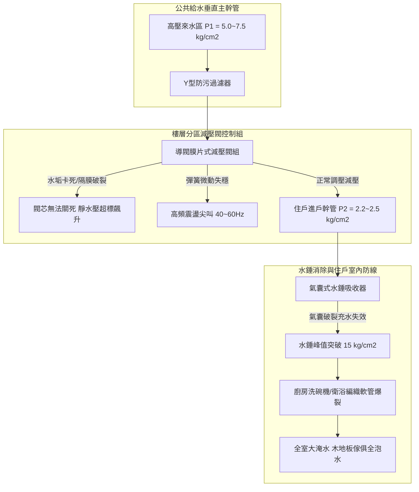
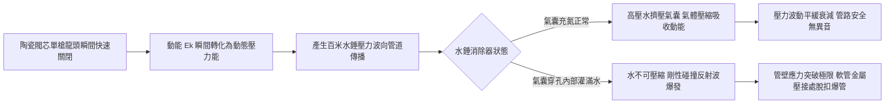
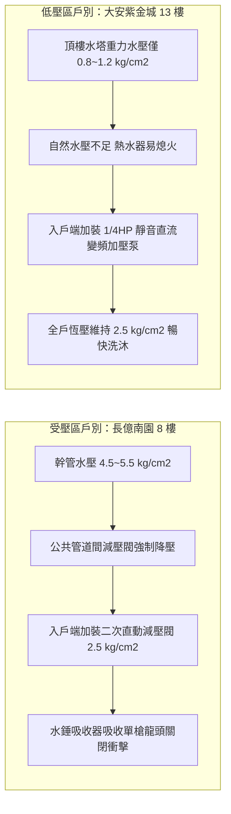

# 全案購屋實戰第五百五十九部_中古大樓社區各樓層生活給水垂直幹管減壓閥組閥芯水垢卡死超壓震盪水錘消除器氣囊破裂與低樓層水管爆裂體檢工序全書

---

## 序章：高層建築水壓之定海神針——樓層減壓閥組與水錘消除器

在現代高層集合住宅大樓中，自來水給水垂直幹管（Domestic Water Supply Vertical Riser）承受著極其巨大的靜水頭壓力（每向下 10 公尺垂直高度即增加 $1.0\text{ kg/cm}^2$ 之靜水壓力）。以一棟 15 層樓至 25 層樓之住宅大樓為例，地下室二次加壓泵浦輸送至頂樓水塔或由頂樓自然重力向下供水至低樓層時，1 樓至 6 樓管道間之靜水壓常高達 **$4.5\sim 7.5\text{ kg/cm}^2$**。

為防止過高水壓破壞各住戶室內水龍頭、熱水器水箱、洗碗機與馬桶進水軟管，建築水電工程法規強制要求在各分區樓層（通常為 1~6 樓或每隔 3~5 層）之給水垂直管道間內，安裝「**直接作用式/導閥膜片式生活給水減壓閥組（Pressure Reducing Valve Station, PRV Station）**」以及並聯之「**氣囊式水錘消除器（Water Hammer Arrester）**」。

然而，在屋齡 20 至 30 年之中古大樓社區中，給水減壓閥組長年隱藏三大致命水動力病理：
1. **減壓閥閥芯水垢（Scale）與結晶沉積卡死失靈**：自來水中之碳酸鈣、鐵鏽與砂石微粒沉積於減壓閥節流口（Orifice）與滑動閥芯導向桿周遭，導致閥芯卡死在「微開或全開」位置。夜間住戶用水停滯時，高壓水流持續滲透，使低樓層住戶室內靜水壓悄然飆升至 $5.5\sim 7.0\text{ kg/cm}^2$ 之危險極限。
2. **減壓閥隔膜（Diaphragm）高頻震盪與喘振（Hunting & Chatter）**：調壓彈簧疲勞或下游管網容積過小，減壓閥在小流量時無法穩定節流，閥瓣在閥座上以數十赫茲之頻率劇烈拍擊震盪，引發全棟給水管路低頻共振與強烈尖叫嘯叫聲，加速管牙鬆動。
3. **水錘消除器內部丁基橡膠氣囊（Butyl Bladder）老化破裂穿孔**：長期承受住戶陶瓷閥芯單槍龍頭瞬間關閉（關閥時間 $< 0.1\text{ 秒}$）產生之高達數十個大氣壓水錘衝擊，橡膠氣囊破裂、預充氮氣洩漏殆盡，水錘吸收器內部灌滿自來水而完全喪失彈性緩衝吸能能力。當深夜高壓水錘再度爆發時，低樓層住戶室內編織軟管瞬間爆裂穿孔，釀成全戶淹水、木地板全毀且大水向下滲漏數個樓層之災難性損失。

本全書將深入剖析減壓閥節流流體力學、水錘壓力波彈性碰撞方程、減壓閥組雙並聯備援架構，並建立現場實戰體檢工序，為購屋家庭徹底排除低樓層超壓爆管之致命隱患。

---

## 第一章：生活給水垂直減壓閥組與水錘消除器力學機制

### 第一節：減壓閥閥芯水力平衡與水垢卡阻超壓機制

1. **直接作用式減壓閥之力平衡方程式**：
   - 閥芯受力平衡決定出水壓力 $P_2$：
     $$F_{\text{spring}} = P_2 \cdot A_{\text{diaphragm}} + F_{\text{friction}}$$
     其中 $F_{\text{spring}}$ 為調節彈簧向下推力，$A_{\text{diaphragm}}$ 為橡膠感應隔膜面積，$P_2$ 為下游出口水壓。
   - 當住戶打開水龍頭用水時，$P_2$ 瞬間下降，彈簧推動閥芯向下開啟增大節流口；用水停止時，$P_2$ 上升頂推隔膜向上壓縮彈簧，帶動閥芯關閉截斷水流。

2. **閥芯結垢引發之靜態超壓滲漏（Static Pressure Creep）**：
   - 閥芯密封面（Disc Seal）通常為丁腈橡膠（NBR）或聚四氟乙烯（PTFE），對應黃銅/不鏽鋼閥座。
   - 自來水中之鈣鎂離子硬垢與管壁剝落之氧化鐵砂粒，極易嵌入閥口密封面或附著於不鏽鋼閥軸導向滑套表面。
   - 當住戶半夜全數停止用水時，由於水垢阻擋，閥芯無法 $100\%$ 完全閉合，殘留僅 $0.1\text{ mm}$ 之微小隙縫。歷經深夜 4~6 小時之靜態滲漏，下游管道水壓逐漸上升直至與上游高壓幹管完全同壓（$P_2 \rightarrow P_1 \approx 6.5\text{ kg/cm}^2$）。
   - 晨間住戶第一次開啟水龍頭時，強大水壓如爆破般噴出，伴隨劇烈水管彈跳與軟管膨脹。

---

### 第二節：水錘消除器（Water Hammer Arrester）氣囊吸能物理學

1. **瞬態水錘壓力峰值計算（Joukowsky 公式）**：
   - 當住戶快速切換淋浴單槍龍頭或滾筒洗衣機電磁閥（Solenoid Valve）瞬間斷水時，水流速度在 $\Delta t < 0.05\text{ 秒}$ 內由 $v = 2.5\text{ m/s}$ 驟降至 0。
   - 其瞬時水錘增壓峰值為：
     $$\Delta P = \rho \cdot a \cdot \Delta v = 1000 \cdot 1200 \cdot 2.5 = 3 \times 10^6\text{ Pa} \approx 30.6\text{ kg/cm}^2$$
   - 此一劇烈衝擊波以每秒上千公尺之速度在室內配管內來回反射衝擊。

2. **氣囊破裂與水錘吸收能力完全喪失**：
   - 水錘消除器內部以可形變之丁基橡膠（Butyl Rubber）氣囊將腔體分隔為「預充高壓氮氣室」與「自來水接水室」。
   - 當氣囊經歷數十萬次劇烈收縮膨脹後，橡膠分子產生疲勞撕裂，氣囊穿孔破裂。原本預充之 $2.5\sim 3.0\text{ kg/cm}^2$ 氮氣由管路排氣閥逸散，水錘消除器內部完全被自來水填滿。
   - 因水屬於不可壓縮流體（Bulk Modulus 極高），破裂後之水錘消除器形同虛設，水錘動能無法被氣體吸收，直接傳遞至最脆弱之熱水器防爆軟管與馬桶三角凡爾進水編織管。

---

## 第二章：現場看屋公共管道間減壓閥組七大實戰體檢工序

在評估中古大樓社區時，買方應協調管委會或水電師傅，開啟目標物件該樓層之公共管道間（Shaft / Chase）實地落實以下七步工序：

| 體檢步驟 | 檢驗標的與操作動作 | 合格標準 (Pass) | 潛在致命瑕疵 (Fail) | 修繕對策與預算評估 |
| :---: | :--- | :--- | :--- | :--- |
| **Step 1** | **減壓閥前後雙壓力錶配置** 檢視減壓閥組是否配備一次側與二次側壓力錶 | 具備進水與出水雙壓力錶，一次側高壓、二次側維持低壓 | 無壓力錶（盲調）、或壓力錶指針漏油卡死在 0 位置 | 增設不鏽鋼甘油防震精密壓力錶（約 1,200~2,500 元/只） |
| **Step 2** | **靜態壓力滲漏（Pressure Creep）** 關閉室內所有水龍頭 15 分鐘後觀察出水錶 | 出水靜水壓穩定鎖定在 $2.2\sim 2.5\text{ kg/cm}^2$，無爬升跡象 | 出水壓力指針緩慢持續爬升至 $4.5\sim 6.0\text{ kg/cm}^2$（閥芯漏水） | 拆解更換減壓閥全套閥芯、閥座密封橡膠與不鏽鋼濾網（約 6,500~15,000 元） |
| **Step 3** | **動態流動水壓降與流量響應** 全開室內雙衛浴浴缸與廚房水龍頭 | 出水壓力微降至 $1.8\sim 2.1\text{ kg/cm}^2$，流量充沛穩定 | 動態水壓崩跌至 $< 1.0\text{ kg/cm}^2$，出水變為涓涓細流（過濾網堵塞） | 清洗前置 Y 型過濾器濾網，重新調整彈簧壓力螺桿（約 2,000~4,500 元） |
| **Step 4** | **減壓閥高頻共振與嘯叫聽診** 在微小開度用水時聆聽管道間聲音 | 減壓閥僅有輕微水流聲，無任何高頻金屬震盪尖叫 | 管道間爆發高分貝刺耳嘯叫聲（Chatter），伴隨立管手感麻手震動 | 更換耐震抗喘振型導閥膜片式減壓閥組（約 18,000~38,000 元） |
| **Step 5** | **水錘消除器氣囊彈性與頂部氣嘴** 拿胎壓計測量水錘消除器頂部美式氣嘴 | 預充氮氣壓力約 $2.5\sim 3.0\text{ kg/cm}^2$，按壓氣嘴只出氣 | 按壓氣嘴直接噴出自來水、或胎壓為 0（氣囊完全穿孔破裂） | 全面更換全不鏽鋼活塞式/重載氣囊式水錘消除器（約 3,500~7,500 元/支） |
| **Step 6** | **旁通管（Bypass Line）與隔離閥組** 檢查減壓閥旁是否有旁通管與三個球閥 | 具備「前隔離閥、後隔離閥、中間旁通閥」，以便在線維修 | 無旁通管路，一旦減壓閥故障維修必須全棟停水數小時 | 重新配置標準三閥式減壓閥組旁通配管（約 12,000~25,000 元） |
| **Step 7** | **室內衛浴軟管耐壓與漏水檢視** 檢查洗臉盆、馬桶與熱水器底部軟管 | 採用高品質不鏽鋼絲加厚編織管或波紋管，無膨脹包起 | 軟管金屬編織網鏽斷、管壁局部鼓包如腫瘤、接頭處滲水 | 全面強制更換 304 不鏽鋼加厚波紋硬管（約 300~600 元/條） |

---

## 第三章：四大核心考慮物件之水壓防禦與裝修施工指引

### 第一節：大安紫金城 13 樓（高樓層頂樓戶）之低水壓對策
- **現況特徵**：位處頂樓 13 樓，距離頂樓水塔垂直高度僅約 3~5 公尺，自然重力水壓僅 **$0.3\sim 0.5\text{ kg/cm}^2$**，完全不存在超壓爆管風險，但存在「**水壓太小導致強排熱水器點火失敗、雙衛浴無法同時淋浴**」之困境。
- **裝修專用解法**：在室內管路重新配置時，於後陽台冷水進戶總管處加裝一台「**葛蘭富 SCALA2 或木川電子穩壓直流變頻加壓機（1/4 HP）**」，將全戶恆壓鎖定在 $2.2\sim 2.5\text{ kg/cm}^2$。

### 第二節：長億南園 8 樓（中低受壓樓層）之超壓爆管防禦
- **現況特徵**：位處 8 樓，上方承接數十公尺垂直落差高壓水柱，幹管靜水壓常高達 **$4.0\sim 5.0\text{ kg/cm}^2$**。
- **實地必查要點**：
  1. 勘查 8 樓公共管道間內之減壓閥組，確認二次側壓力指針是否平穩鎖定在 $2.5\text{ kg/cm}^2$。
  2. 若發現減壓閥閥體外殼泛生綠色銅鏽、出水壓力錶在夜間爬升至 $4.5\text{ kg/cm}^2$ 以上，代表減壓閥芯已卡死漏水。
- **合約防禦特約條款**：
  > 「賣方保證本買賣標的所屬樓層之公共自來水給水減壓閥組與水錘消除器運作正常，標的物室內靜態給水壓力維持在安全標準（不超過 $2.8\text{ kg/cm}^2$）。交屋日前買方有權委託專業水電技師進行室內水壓檢測，若發現減壓閥組失靈致使室內靜水壓超標滲漏者，賣方應負責協調管委會於交屋前完成減壓閥組之整修更換；否則賣方應折讓價金新台幣貳萬元整，作為買方於室內進戶端自行增設不鏽鋼減壓防禦閥組之費用。」
