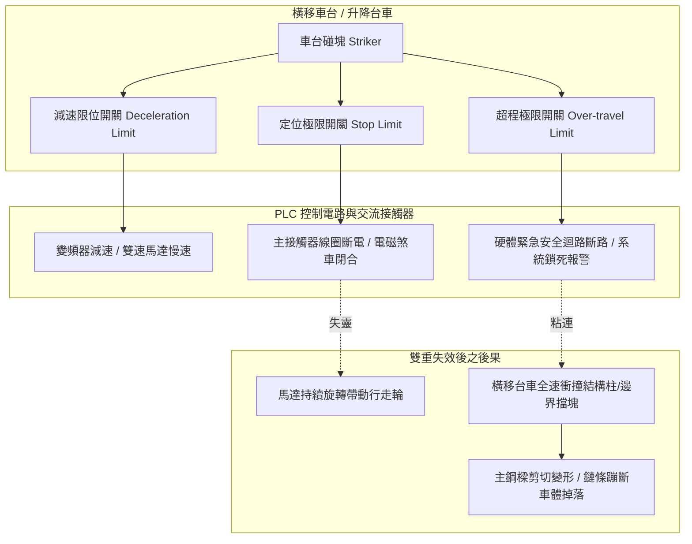
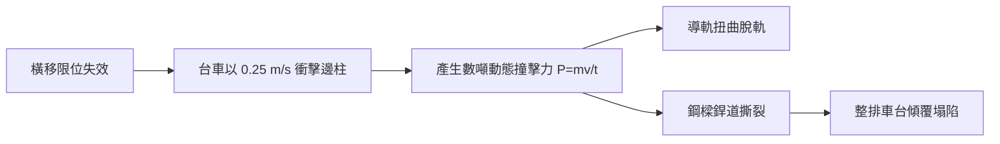

# 全案購屋實戰第五百五十二部_中古大樓社區地下室機械停車設備車位限位極限開關碰桿變形接點氧化短路與橫移車台衝撞邊柱體檢工序全書

---

## 序章：地下立體車庫之鋼鐵碰撞危機——限位開關之防線定位

中古大樓社區之地下機械停車設備（Mechanical Parking Systems，常見為二層或三層升降橫移式），為現代都會住宅解決法定停車位不足之關鍵公設。機械車位之安全運行，極度依賴遍布於鋼構骨架與車台邊緣之「**位置極限開關（Limit Switch）**」與「**過行程極限防護開關（Over-travel Limit Switch）**」。

然而，在屋齡 20 至 30 年之老舊社區中，機械車位長期承受車輛進出之衝擊震動、地下室潮濕水氣、車輛滴落之廢機油與雨水酸霧侵蝕，導致：
1. **限位碰桿（Actuator Arm / Lever Roller）** 因長期疲勞金屬變形、滾輪卡死磨損，導致動作行程延遲。
2. **微動電氣觸點（Micro-switch Contacts）** 氧化積碳、受潮短路或粘連失效，無法在車台抵達定位時及時切斷驅動馬達電源。
3. **橫移台車（Traverse Platform）衝撞邊柱**：由於橫移減速與終端極限雙重失效，重達數噸之鋼構台車以全速直接撞擊結構鋼柱或鄰近車位，造成鋼構主樑扭曲變形、導軌撕裂、鏈條跳齒崩斷，甚至引發整排車位連鎖坍塌之毀滅性事故。

本全書將深入剖析機械停車設備限位控制之電氣與機械聯鎖機制，並建立現場實戰體檢工序，為購屋家庭鎖定社區公設與專有車位之結構安全。

---

## 第一章：升降橫移式機械車位限位控制電氣架構與失效機理

### 第一節：限位碰桿變形與滾輪軸承卡死之機械病理

1. **滾輪與碰塊之交變衝擊磨損**：
   - 橫移車台每次進出定位時，車台側邊之凸輪碰塊（Cam Dog / Striker）以水平速度撞擊限位開關之滾輪碰桿（Roller Lever）。
   - 在缺乏潤滑油之惡劣環境下，滾輪內部之微型軸承因粉塵與鐵屑咬死，滾輪不再旋轉，變成與碰塊產生剛性乾摩擦。長期滑動磨損造成碰桿彎曲變形（行程角度漂移 5°~15°），導致碰塊滑過時無法達到微動開關之觸發動作角度（Operating Angle）。

2. **碰桿復位扭簧疲勞與斷裂**：
   - 限位開關內部之不鏽鋼扭轉彈簧（Return Torsion Spring）在經歷數萬次擺動後產生金屬疲勞，彈力係數（Spring Constant）衰減。
   - 當車台反向移開後，碰桿無法依賴彈簧迅速彈回原始常閉（NC）或常開（NO）初始狀態，維持在「半微動」懸空卡滯位置，造成控制系統誤判車台仍處於定位狀態，引發邏輯閉鎖或動作混亂。

---

### 第二節：電氣微動觸點氧化積碳與密封防護劣化（IP 等級失效）

1. **開關外殼防護等級（IP65/IP67）破壞**：
   - 地下室濕度長期高達 80%~95% RH，加上底坑通風不良，廉價或老化之鑄鋁/塑膠限位開關外殼密封橡膠墊圈（Nitrile Gasket）硬化龜裂。
   - 水氣與硫化氫氣體（來自化糞池與污水溝）滲透至開關內部腔體，導致內部銀合金觸點表面迅速生成高阻抗之硫化銀（$\text{Ag}_2\text{S}$）絕緣薄膜，接觸電阻自正常的 $<50\text{ m}\Omega$ 暴增至數千歐姆，信號無法送達 PLC 輸入端模組（Digital Input Module）。

2. **接觸器反向感應電動勢（Back EMF）電弧燒蝕**：
   - 部分傳統老舊機械車位控制盤未使用 PLC 或固態繼電器，而是由限位開關觸點直接切斷 AC 220V/380V 馬達交流接觸器（Magnetic Contactor）之線圈迴路。
   - 接觸器線圈為大電感元件，在斷開瞬間產生高達上千伏特之反向感應電弧，導致限位開關內部微動觸點發生金屬轉移、熔焊（Contact Welding）粘連。一旦觸點熔焊粘死，即使碰桿被碰塊頂起，電路依然處於常通狀態，馬達電磁煞車無法釋放抱閘，引發持續拖曳衝撞。

---

## 第二章：車台橫移衝撞邊柱之結構力學破壞與安全防禦

### 第一節：動力學衝擊力計算與結構剪切毀損
1. **動量衝擊公式與破壞力**：
   - 設橫移台車載有一輛中型休旅車，總質量 $M = 2,500\text{ kg}$，橫移速度 $V = 0.25\text{ m/s}$。若終端緩衝橡膠完全老化硬化，碰撞減速時間 $t$ 僅為 $0.05\text{ 秒}$。
   - 其瞬時碰撞衝擊力可達：
     $$F = \frac{M \cdot V}{t} = \frac{2500 \cdot 0.25}{0.05} = 12,500\text{ N} \approx 1.28\text{ 噸力}$$
   - 此一強大側向集中載重直接撞擊外圍之輕型槽鋼邊柱，超過鋼材之降伏強度（Yield Strength），造成導向輪輪緣崩裂、固定地腳螺栓（Anchor Bolt）被向上連根拔起。

2. **脫軌與鏈條撕裂鏈鎖效應**：
   - 橫移衝撞導致行走輪跳出水平導軌（Derailment），台車傾斜卡死。若驅動馬達之熱過載繼電器（Thermal Overload Relay）未及時跳脫，高扭力減速機將持續拉扯驅動滾子鏈條，直至鏈條鏈片拉伸撕裂、銷軸斷裂，使車台瞬間失去水平平衡，引發相鄰車位連鎖被牽扯變形。

---

## 第三章：現場看屋機械停車位限位系統七大實戰體檢工序

在評估如 **長億南園 8 樓**（配有機械車位）或任何具備機械車位之社區時，買方應偕同仲介或社區機電人員進行下列查驗：

| 體檢步驟 | 檢驗標的與操作動作 | 合格標準 (Pass) | 潛在致命瑕疵 (Fail) | 修繕對策與預算評估 |
| :---: | :--- | :--- | :--- | :--- |
| **Step 1** | **碰桿外觀與滾輪轉動度** 目視並手動撥動各定位開關滾輪 | 碰桿平直無彎曲，滾輪轉動滑順無阻滯，撥動後能瞬間彈回原位 | 碰桿歪斜彎曲、滾輪鏽死磨出扁平磨耗面、彈簧斷裂不復位 | 更換重載型金屬滾輪限位開關（約 1,500~2,800 元/只） |
| **Step 2** | **雙重極限開關配置檢查** 檢視導軌端點是否有二道開關 | 必須具備第一道「運轉減速/停止開關」與第二道「獨立超程極限保護開關」 | 僅有一道開關，無後備超程斷電防線（嚴重違規偷工） | 增設超程安全極限開關與獨立斷電硬體迴路（約 6,000~12,000 元/組） |
| **Step 3** | **端點緩衝橡膠塊厚度** 測量邊柱末端防撞橡膠厚度與彈性 | 橡膠塊厚度 $\ge 50\text{ mm}$，表面有彈性無深度龜裂硬化 | 橡膠塊碎裂脫落、或已直接露出鋼性金屬底板 | 更換重型聚氨酯（PU）防撞緩衝阻尼塊（約 800~1,500 元/個） |
| **Step 4** | **橫移停層平整度與間隙** 操作車台橫移到位後測量停靠間隙 | 車台與固定引道邊界縫隙在 $20\text{ mm} \pm 5\text{ mm}$ 以內，無偏移擦碰 | 停車台撞擊邊界發出巨響、左右縫隙嚴重歪斜超標 | 重新調整碰塊位置並鎖固限位開關支架（約 2,000~3,500 元） |
| **Step 5** | **開關內部接線防潮密封** 檢視開關進線口葛蘭頭（Cable Gland） | 橡膠密封圈迫緊良好，金屬外殼防護等級達到 IP67，內部無水滴 | 葛蘭頭鬆脫、內部充滿褐色鐵鏽水、觸點嚴重積碳 | 重新封堵防水密封膠，更換耐候型電纜接頭（約 800~1,200 元） |
| **Step 6** | **馬達過載跳脫電氣保護** 檢視控制盤內熱過載繼電器設定值 | 設定值符合馬達銘板額定電流（Full Load Amps $\times 1.15$） | 設定值被蓄意調至最大（防跳機），失去保護馬達功能 | 重新校準熱過載繼電器或更換電子式馬達保護器（約 1,800~3,500 元） |
| **Step 7** | **手動觸發超程斷電測試** 在機電人員陪同下手動壓下超程開關 | 系統發出高分貝警報蜂鳴，總主電源接觸器瞬間釋放斷電 | 壓下開關系統毫無反應、馬達依然可被手動啟動 | 查修控制迴路斷線或更換損壞之安全繼電器（約 4,500~8,000 元） |

---

## 第四章：購屋斡旋談判車位抗性壓價與特約保障條款

若目標物件附帶機械車位（如長億南園 8 樓）：

1. **車位載重與尺寸抗性**：
   - 必須現場核對機械車位鋼印銘板之「**車長、車寬、車高、車重限制**」。中古社區機械車位常見限重僅 1,500~1,600 kg（現代中大型休旅車如 RAV4、CR-V、Model Y 常重達 1.7~2.1 噸，停入極易壓斷鏈條或壓彎鋼樑）。
   - **談判籌碼**：以此規格嚴重脫節現代家庭用車需求為由，向賣方大砍價格 **30 至 50 萬元**。

2. **成屋契約特別保障條款**：
   > 「賣方保證本買賣標的所附屬之機械停車位（車位編號：＿＿號），其升降、橫移、電氣控制開關、鏈條鋼索及防墜安全機構均處於正常安全運作狀態，並附有合格維護保養廠商之最近一期保養合格紀錄表。交屋點交時買方有權要求現場實際空車及滿載試車升降橫移運轉各三次，若發現限位開關失靈、結構變形異音或卡滯情事，賣方應於交屋日前負責修繕至完全合格；否則買方得主張扣留車位等值價金（新台幣伍拾萬元整）於履約保證專戶，待修繕驗收完成後始得撥付。」
