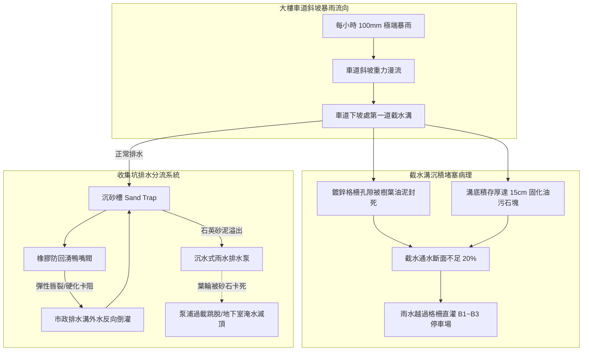
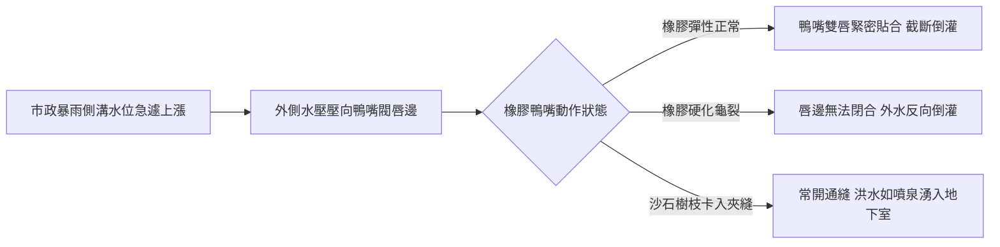
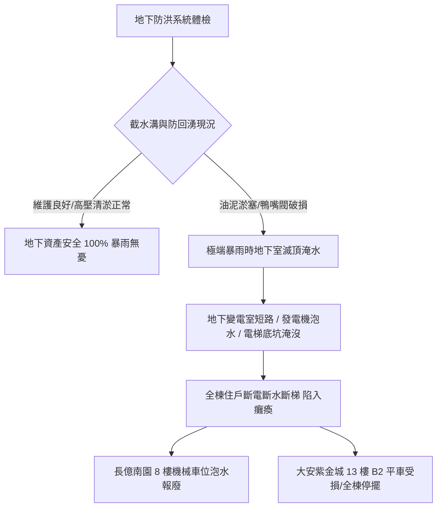

# 全案購屋實戰第五百五十八部_中古大樓社區地下室截水溝重油污泥沉積堵塞防回湧鴨嘴閥橡膠硬化與高壓水刀清淤體檢工序全書

---

## 序章：地下防洪防淹之第一道壕溝——截水溝與防回湧閥之防線

在都會集合住宅與中古大樓社區中，地下停車場（通常規劃為地下 1 層至地下 3~5 層）是全社區機電設備、配電變電室、發電機房、自來水受水箱、昇降設備底坑以及全體住戶愛車之樞紐所在。而在面對極端氣候強降雨、颱風暴雨或道路側溝排水不及之洪峰衝擊時，位於大樓車道出入口迎風面坡道下端、車道交會處與地下各層周邊之「**地下室截水溝（Trench Drain / Interceptor Ditch）**」與排水分流管道，即為全棟建築抵禦洪水滅頂之第一道生死防線。

然而，在屋齡 20 至 30 年以上之中古大樓社區中，地下截水溝系統常年處於維護死角，隱藏三大致命機電與流體力學病理：
1. **重油污泥與車輛胎屑泥沙硬化結塊堵塞**：車輛進出常年滴落之廢機油、底盤泥沙、輪胎橡膠磨屑與洗車油污排入截水溝內，歷經數十年厭氧反應，油泥硬化膠結如混凝土，截水溝有效通水斷面積自設計之 $100\%$ 暴跌至不足 $20\%$，一旦暴雨來襲，雨水根本無法落入溝內，直接漫過格柵化為滾滾洪流灌入地下底層。
2. **防回湧橡膠鴨嘴閥（Duckbill Check Valve）老化硬化失靈**：截水溝末端連接雨水收集池或市政側溝之出口處，通常安裝橡膠彈性鴨嘴止回閥以防止外部洪水倒灌。但長期浸泡於油污廢水中，三元乙丙橡膠（EPDM）或氯丁橡膠閥體嚴重塑化、硬化龜裂或卡入砂石樹枝，唇邊失去彈性閉合力，當市政排水溝水位暴漲時，外水直接沿著管道反向灌入地下停車場，造成「雨水倒灌水庫」慘劇。
3. **沉澱砂槽（Sand Trap）長年未清淤引發排水泵浦磨損卡死**：截水溝末端之沉砂坑因管委會省錢忽視清淤，砂石直接隨水流進入雨水收集坑，被沉水泵浦吸入，高速旋轉之石英砂粒如同砂輪機般研磨泵浦葉輪與機械軸封，導致防洪泵浦在暴雨關鍵時刻跳脫燒毀。

本全書將深入剖析地下截水溝之水力漫流力學、鴨嘴閥非線性彈性力學、高壓水刀清淤工程規範，並建立一套現場實戰體檢工序，為購屋家庭鎖定社區地下防洪之最高安全防線。

---

## 第一章：地下室截水溝水力溢流與防回湧閥失效機理

### 第一節：曼寧公式水力流速與截水溝漫流極限（Manning's Equation）

1. **截水溝流水斷面與坡度水力計算**：
   - 地下室截水溝通常為寬度 $B = 30\text{ cm}$、深度 $H = 30\sim 40\text{ cm}$ 之矩形混凝土明溝，溝底具備 $S = 1/100\sim 1/50$ 之洩水坡度。
   - 其過水斷面積 $A$ 與潤周 $P$ 決定水力半徑 $R = A / P$。依據曼寧公式（Manning's Formula）：
     $$V = \frac{1}{n} \cdot R^{2/3} \cdot S^{1/2}$$
     $$Q = A \cdot V$$
     其中混凝土明溝粗糙係數 $n$ 正常約為 $0.013\sim 0.015$。

2. **油泥硬化引發之水力斷面暴跌與阻力激增**：
   - 當溝底沉積厚達 $15\sim 20\text{ cm}$ 之硬化油泥砂石時，有效流水深度 $H_{\text{eff}}$ 僅剩不足 $10\text{ cm}$，過水斷面積 $A$ 衰減超過 $70\%$。
   - 固化油泥表面粗糙不平，粗糙係數 $n$ 飆升至 $0.030\sim 0.040$。水流流速 $V$ 大幅下降，水流阻力激增數倍。
   - 當極端暴雨降雨強度達到 $100\text{ mm/hr}$ 時，自車道斜坡急速衝下之暴雨水量遠大於截水溝能吞吐之極限排量 $Q$，水流直接形成跨溝射流（Over-trench Jetting），跳過截水溝格柵，順著車道一路傾瀉淹沒地下地下室各層。

---

### 第二節：防回湧橡膠鴨嘴閥（Duckbill Valve）材料老化與卡阻

1. **非線性高彈性橡膠之應力鬆弛與脆化**：
   - 鴨嘴閥依靠全橡膠結構（外層氯丁橡膠耐磨、內襯聚酯簾布增強層、內壁三元乙丙橡膠耐候）之「自我張力閉合」特性，順向水流頂開雙唇排水，逆向水壓壓緊雙唇防倒灌。
   - 長期浸泡在地下室含有汽柴油殘渣、重金屬與洗劑之弱酸性環境中，橡膠分子鏈發生交聯與降解反應（Degradation），硬度由肖氏硬度 Shore A 55° 飆升至 80° 以上，橡膠完全喪失柔韌性與彈力回復率。

2. **異物卡阻引發「開口笑」常通倒灌**：
   - 車道沖刷下之落葉、碎塑膠袋、甚至小石子在流經鴨嘴閥時，若卡在雙唇密封面之間，橡膠雙唇便無法完全密閉。
   - 當外部市政箱涵水位因颱風暴雨高於地下室管口時，外水藉由數公尺之高壓水頭差（Hydraulic Head），自卡阻縫隙處如噴泉般反向噴湧灌入地下室沉砂坑，迅速淹沒整座泵房。

---

### 第三節：高壓水刀清淤（High-Pressure Hydro-Jetting）工法規範

1. **傳統人工鏟挖之局限與死角**：
   - 地下室截水溝長度常達數十至百公尺，許多穿牆暗管與轉彎彎頭（Elbows）埋設於地坪混凝土結構內部，傳統人工長柄鐵鏟只能清理表面明溝，暗管內部之鈣化油泥完全無法觸及。

2. **超高壓水刀旋轉噴頭（Rotating Jet Nozzle）之破壞力學**：
   - 專業清淤必須採用 **$150\sim 250\text{ bar}（約 2,100\sim 3,600\text{ PSI}）$** 之高壓水刀清洗車。
   - 利用前端 1 個穿透性前噴射孔擊碎前方固化油泥，後方 3~6 個反向傾斜 30°~45° 之高壓噴嘴產生強大自推進推力（Self-propulsion），將管壁上硬化如岩石之鈣化皂化油脂徹底切削剝落，並將碎屑反向沖出溝外徹底抽吸清除。

---

## 第二章：現場看屋地下室截水溝七大實戰體檢工序

在評估中古大樓社區時，買方應特別注意地下室空氣氣味，並偕同仲介或管理員至車道坡道下端實地落實以下七步工序：

| 體檢步驟 | 檢驗標的與操作動作 | 合格標準 (Pass) | 潛在致命瑕疵 (Fail) | 修繕對策與預算評估 |
| :---: | :--- | :--- | :--- | :--- |
| **Step 1** | **截水溝格柵開孔率與鏽蝕** 檢視車道入口鍍鋅格柵板外觀 | 採用重載型熱浸鍍鋅格柵，開孔率 $\ge 60\%$，固定牢固無跳動 | 格柵板嚴重鏽穿凹陷、縫隙被黑黃油泥封死、車輛碾過發出金屬巨響 | 更換重載型球墨鑄鐵/熱浸鍍鋅防跳動格柵（約 1,800~3,500 元/米） |
| **Step 2** | **溝底油泥厚度與通水斷面** 拿螺絲起子或木棍插入溝底探測 | 溝底無淤積，有效過水深度保持在原設計 $85\%$ 以上 | 淤泥厚度超過溝深一半（$> 10\text{ cm}$），散發刺鼻酸臭油味 | 委託環保工程行進行全面高壓水刀清淤沖洗（約 15,000~35,000 元/次） |
| **Step 3** | **沉砂槽（Sand Trap）防護攔污網** 打開截水溝轉角處沉砂檢查井 | 配備 SUS304 不鏽鋼可抽取式攔污籃，定期清理無滿溢 | 無攔污籃、沙石直衝下游管道、井底沙土沉積滿溢 | 增設不鏽鋼活動式提籃沉砂過濾隔板（約 4,500~8,500 元/座） |
| **Step 4** | **防回湧鴨嘴閥外觀與柔韌度** 檢視排入雨水坑或外管之鴨嘴閥 | 橡膠唇邊閉合緊密無縫隙，按壓質地柔軟有彈性 | 鴨嘴雙唇開裂、硬化變形呈橢圓敞開狀、卡有石塊樹枝 | 更換高品質氯丁橡膠耐油防回湧鴨嘴閥（約 12,000~25,000 元/組） |
| **Step 5** | **車道入口防洪擋水板卡槽** 檢查車道口兩側柱子之防水閘門槽 | 鋁合金防洪閘門卡槽平整垂直，止水膠條完好，擋板配件齊全存放於旁 | 無卡槽、卡槽變形積垢無法插入擋水板、找不到防水擋板 | 重新校正安裝雙側不鏽鋼防水閘門滑軌與擋水板（約 35,000~80,000 元） |
| **Step 6** | **雨水收集坑浮球與排污泵** 打開雨水坑蓋手動拉起高水位浮球 | 沉水泵立即啟動，出水管排水強勁，控制盤蜂鳴警報響起 | 泵浦嗡嗡作響卡死不轉、浮球開關電線斷裂失靈 | 吊起泵浦清理葉輪雜物、更換不鏽鋼防卡排污泵（約 18,000~38,000 元） |
| **Step 7** | **地下室淹水歷史痕跡掃描** 手電筒照射地下室樑柱底層牆角 | 牆角油漆平整無離層，無水平褐色浸水水線跡痕 | 離地 30~50cm 處有一圈清晰水平水漬痕，配電箱下緣鏽蝕 | 徹底追查大樓歷史淹水記錄與管委會改善方案（列入談判重大殺價藉口） |

---

## 第三章：地下防洪風險對四大核心物件之戰略評估

### 第一節：四大核心考慮物件之防洪影響分析
1. **大安紫金城 13 樓（PROP_10，第一首選）**：
   - 本物件最大核心資產為「**獨立 B2 大平面車位**」。
   - 若大樓車道入口第一道截水溝長年被油泥堵塞、或防回湧閥失效，暴雨雨水將順著車道一路灌入地下 B2 層，首當其衝即為地下平面車位之愛車受損，且 B2 之公共機電設施亦將泡水。
   - **實地必查**：務必親自走訪車道斜坡底端，用腳踩踏並檢視截水溝是否有硬化黑油泥，並調閱大樓管委會「歷年防颱高壓水刀清淤廠商單據」。

2. **長億南園 8 樓（PROP_106，空間之王）**：
   - 本物件所附為「**機械停車位**」。
   - 機械車位之底坑（Pit）地勢最低，一旦截水溝漫流或沉砂坑泵浦卡死，積水將第一時間灌入機械車位底坑，淹沒下層升降台車、油壓缸與電氣限位開關，導致機械車位全面鏽蝕報廢。
   - **談判籌碼**：若現場發現截水溝泥沙積存嚴重，以此潛在巨額泡水維修風險為由，強勢向屋主砍價 **20 至 30 萬元**。

### 第二節：成屋買賣合約地下防洪瑕疵擔保特約條款範本
> 「賣方保證本買賣標的所屬大樓地下室之車道截水溝、雨水收集坑、防回湧止回閥及防洪抽水泵浦機組，均處於排水暢通與功能正常狀態，且本社區在賣方持有期間及現況點交前，無任何因截水溝堵塞或外水倒灌所致之地下室淹水歷史。若交屋前查明社區截水溝存在嚴重油泥固化堵塞、防回湧閥毀損或雨水泵浦故障未修復情事，賣方應負責協調管委會於交屋日前完成全溝段高壓水刀清淤及設備修繕；否則買方得扣留價金新台幣貳萬元整於履約保證專戶，作為買方自行委託工程廠商清淤之補償款。」
