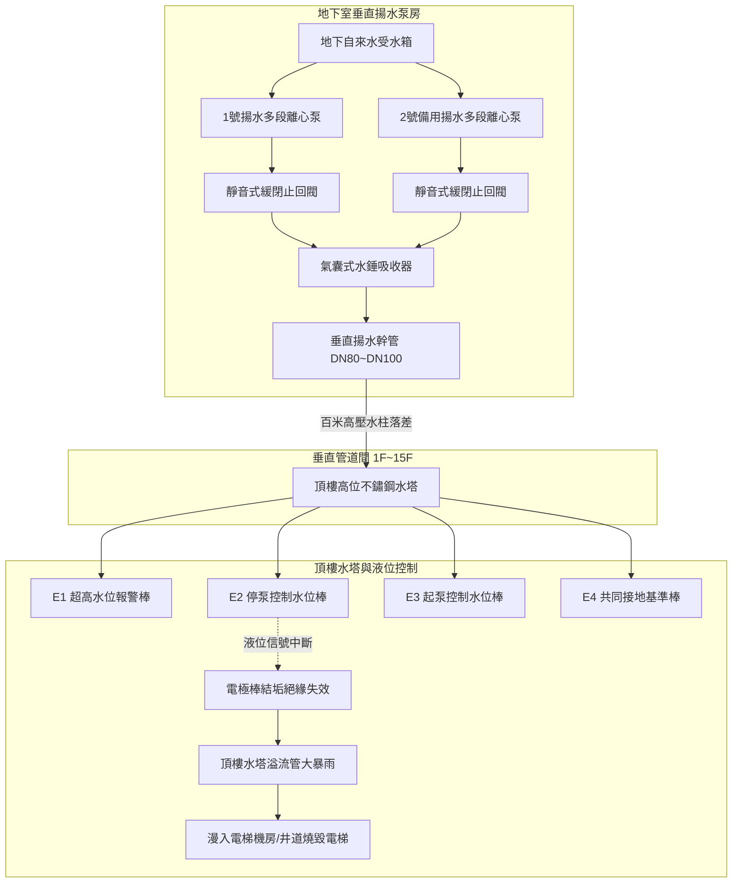
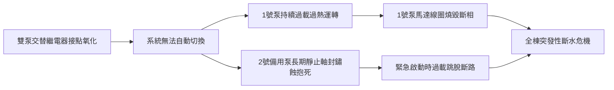
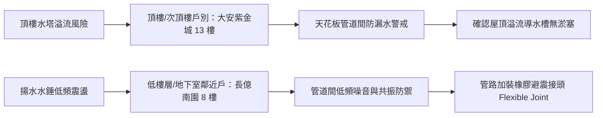

# 全案購屋實戰第五百五十六部_中古大樓社區地下室生活自來水雙泵揚水系統止回閥逆向洩漏低頻水錘震盪雙泵自動交替控制器故障與高樓層水塔溢流體檢工序全書

---

## 序章：高層建築水動力脈動——垂直雙泵揚水系統之隱患

在集合住宅與中古大樓社區之給水工程架構中，「**地下室垂直揚水系統（Vertical Water Lifting System / Transfer Pumping System）**」扮演著將地下受水箱之自來水高壓輸送至頂樓水塔或高位蓄水池（Elevated Roof Water Tank）之動脈角色。為確保供水不中斷，法規與工程實務皆強制要求配置「**一用一備（1 Duty 1 Standby）**」之雙泵並聯加壓機組，並搭配「自動交替運轉控制器（Alternating Duplex Pump Controller）」與「頂樓電極棒液位傳送系統」。

然而，在屋齡 20 至 30 年以上之中古大樓社區中，垂直揚水系統長年承受數十公尺至百公尺以上之巨大靜水頭壓力（Static Head Pressure，每 10 公尺垂直落差即承受 $1.0\text{ kg/cm}^2$ 靜水壓）。長期運作下，常誘發三大致命機電與水動力病理：
1. **水泵出口靜音止回閥（Silent Check Valve）逆向微漏與高壓倒灌**：逆止閥彈簧疲勞斷裂或閥瓣橡膠密封圈遭砂石鐵屑磨損，當揚水泵停機瞬間，垂直揚水幹管內重達數噸之高壓水柱高速逆流倒灌，帶動停機之泵浦葉輪以數倍轉速反向瘋狂飛車（Reverse Runaway），引發劇烈之低頻水錘震盪（Low-Frequency Water Hammer），重創地下室管路吊架與混凝土結構柱。
2. **微電腦雙泵自動交替控制器（Alternator Controller）繼電器接點氧化粘連**：長年處於高溫高濕之泵房環境，交替控制器之機械微動開關或雙穩態繼電器（Latching Relay）老化失效，導致「單泵過勞死、備用泵生鏽卡死」；甚至因接點粘死造成雙泵同時啟動，瞬間湧浪電流（Inrush Current）導致總配電箱無熔絲開關（NFB）跳脫。
3. **頂樓電極式液位控制器（Floatless Level Relay, 61F-G）感應失效導致頂樓水塔溢流暴雨**：頂樓水塔之不鏽鋼電極棒長年受自來水水垢沉積與空氣中二氧化硫酸蝕鈍化，形成高阻抗絕緣層，停水信號無法送回地下室控制盤，地下揚水泵持續通電瘋狂運轉，造成頂樓水塔發生「大瀑布式巨量溢流」，滾滾大水漫入電梯昇降路井道，燒毀電梯乘廂控制電腦與變頻器。

本全書將深入剖析垂直雙泵揚水系統之流體水錘力學、雙泵交替電氣邏輯、電極液位傳感機制，並制定現場實戰體檢工序，為購屋家庭鎖定社區公設與居住安全。

---

## 第一章：垂直雙泵揚水系統流體力學與水錘衝擊破壞機理

### 第一節：止回閥逆向洩漏與低頻水錘震盪（Water Hammer）

1. **重力水柱回擊與壓力波傳播（Joukowsky Equation）**：
   - 設一棟 15 層樓大樓，地下室至頂樓水塔垂直高度 $H = 50\text{ 公尺}$，幹管內水流速度 $v = 2.0\text{ m/s}$。水在鋼管內之壓力波傳播速度 $a \approx 1,000\text{ m/s}$。
   - 當揚水泵突然停機時，若止回閥閥瓣因彈簧斷裂未能於 $0.05\text{ 秒}$ 內完全關閉，管道內水流停止並瞬間反向倒灌。當水流最終撞擊關閉之止回閥時，產生的瞬態水錘壓力增量（Pressure Surge）為：
     $$\Delta P = \rho \cdot a \cdot \Delta v = 1000 \cdot 1000 \cdot 2.0 = 2 \times 10^6\text{ Pa} \approx 20\text{ kg/cm}^2$$
   - 疊加原有的 $5.0\text{ kg/cm}^2$ 靜水壓，管底瞬間承受高達 **$25.0\text{ kg/cm}^2$** 之極端破壞壓力！

2. **低頻共振與管路支架撕裂**：
   - 巨大的水錘壓力波在地下室泵房與頂樓水塔之間以每秒上千公尺之速度來回反射，管路產生頻率為 $1\sim 5\text{ Hz}$ 之強烈低頻機械抖動與金屬敲擊聲（類似巨鎚重擊鋼管之「砰！砰！砰！」巨響）。
   - 長期反覆震盪導致混凝土膨脹螺栓鬆脫、管道間防震彈簧吊架（Spring Hanger）斷裂，甚至將閥體法蘭（Flange）石綿墊片沖毀撕裂，造成數百噸自來水自斷口噴射而出。

---

### 第二節：雙泵自動交替控制器（Alternator Controller）故障病理

1. **雙穩態步進繼電器（Impulse/Ratchet Relay）機械疲勞**：
   - 控制盤內負責交替 1 號泵與 2 號泵之步進棘輪機構（Ratchet Mechanism）在歷經數萬次跳轉後，塑料棘爪磨損滑齒，停留在單一迴路無法翻轉。
   - 結果造成 **1 號主泵單獨承擔 100% 揚水負荷**，軸承高溫磨損、馬達絕緣老化；而 **2 號備用泵長年閒置靜止**，自來水中的鐵離子與水垢於葉輪密封環（Casing Wear Ring）與機械軸封處沉澱結晶，將泵軸牢牢「鏽死抱死」。當 1 號泵燒毀、控制系統強制切換至 2 號泵時，2 號泵馬達因堵轉（Locked Rotor）電流激增 6~8 倍，直接燒毀控制盤接觸器。

---

### 第三節：頂樓電極式液位控制器（61F-G）感應失效與水塔暴雨溢流

1. **電極棒鈍化與高阻抗結垢薄膜**：
   - 頂樓水塔通常採用三根或四根 SUS304 不鏽鋼電極棒（$E_1$ 溢流水位、$E_2$ 停泵水位、$E_3$ 起泵水位、$E_4$ 共同接地端），利用水之弱導電性傳遞 AC 8V 低壓交流信號至地下室液位繼電器（如 Omron 61F-G）。
   - 在水質硬度偏高之台中地區，電極棒浸泡於自來水中數年後，金屬表面析出緻密厚實之碳酸鈣（$\text{CaCO}_3$）與碳酸鎂白色水垢絕緣層。
   - 接觸電阻自正常的幾百歐姆激增至數十萬歐姆，當水面上升淹沒 $E_2$（停泵位）甚至 $E_1$（超高報警位）時，微弱交流電流無法導通，地下室控制器誤判水塔「仍處於枯水缺水狀態」，揚水泵持續全速加壓注水。

2. **電梯昇降路井道浸水燒毀鏈鎖災難**：
   - 頂樓水塔水滿後，大水由溢流管瘋狂排出。若頂樓屋頂洩水孔被落葉雜物堵塞、或溢流管口未妥善引導至排水溝，積水迅速由頂樓屋突門檻漫延至「電梯機房（Elevator Traction Machine Room）」。
   - 高壓自來水沿著電梯纜繩孔（Rope Holes）直瀉而下，如同室內瀑布般澆灌乘廂頂部控制箱、光幕感應器與變頻控制盤，瞬間造成主機板短路燒蝕，維修費用動輒數十萬至上百萬元。

---

## 第二章：現場看屋垂直揚水系統七大實戰體檢工序

在評估中古大樓社區時，小寶與家人應要求檢視地下室揚水泵房與頂樓水塔，逐一落實下列工序：

| 體檢步驟 | 檢驗標的與操作動作 | 合格標準 (Pass) | 潛在致命瑕疵 (Fail) | 修繕對策與預算評估 |
| :---: | :--- | :--- | :--- | :--- |
| **Step 1** | **停泵水錘震盪與管路抖動** 手動停機瞬間觀察壓力錶與管架 | 停機時止回閥迅速閉合，僅發出輕微「搭」聲，指針平穩回落 | 爆發「砰！」金屬撞擊巨響，垂直立管劇烈抖動跳躍 | 更換不鏽鋼靜音式緩衝止回閥、加裝氣囊水錘吸收器（約 18,000~35,000 元） |
| **Step 2** | **止回閥逆向密封性檢查** 當 1 號泵運轉時，觸摸 2 號泵出口管 | 2 號泵止回閥後端管路冰涼，2 號泵軸完全靜止不轉動 | 2 號泵軸高速反轉飛車、閥體發出高壓水流逆流嘶嘶聲 | 拆檢更換 2 號泵止回閥閥座密封圈與復位彈簧（約 6,000~12,000 元） |
| **Step 3** | **雙泵自動交替切換功能** 連續觸發兩次手動起停運轉程序 | 第一次運轉 1 號泵，第二次啟動自動精準切換至 2 號泵 | 連續啟動永遠只有同一台泵運轉、備用泵卡死無動靜 | 更換微電腦雙泵自動交替控制器與雙穩態繼電器（約 4,500~8,500 元） |
| **Step 4** | **備用泵手動盤車與靈活度** 切斷電源後，手動旋轉備用泵風扇葉片 | 泵軸用手即可輕鬆旋轉 360 度，無任何卡滯刮磨感 | 泵軸完全卡死紋絲不動（軸承鏽死或葉輪水垢咬死） | 拆解泵頭酸洗除垢、更換全套耐磨軸承與機械軸封（約 8,000~16,000 元） |
| **Step 5** | **頂樓水塔電極棒結垢度** 爬上頂樓水塔檢視電極棒保持架 | 電極棒金屬光亮無厚重白垢，固定架陶瓷絕緣子乾燥乾淨 | 電極棒被厚厚白色石灰質水垢包覆、棒身彎曲互相碰觸短路 | 刮除水垢或全面更換 SUS316 食品級長效型電極棒（約 2,500~5,000 元） |
| **Step 6** | **水塔溢流管防蟲網與空氣間隙** 檢視頂樓水塔溢流管出口配置 | 溢流口具備細目不鏽鋼防蟲網，距屋頂地面落差 $\ge 15\text{ cm}$ | 溢流管直插落水孔無空氣間隙、網罩破損蟑螂蚊蟲直入 | 修改溢流管路維持間接排水、加裝防蟲透氣帽（約 2,000~4,000 元） |
| **Step 7** | **控制盤超高水位溢流警報連鎖** 短接 $E_1$ 與 $E_4$ 模擬頂樓高水位報警 | 地下室控制盤立即發出高分貝蜂鳴警報，並強制中斷泵浦 | 控制盤無警報響應、揚水泵依然持續受電旋轉 | 重新檢修 61F-G 液位繼電器與警報迴路接線（約 3,500~6,000 元） |

---

## 第三章：高樓層與低樓層住戶之抗震防洪戰略防線

1. **大安紫金城 13 樓（頂樓高位受水防禦）**：
   - 位處頂樓 13 樓，天花板上方即為屋頂露台與自來水塔。
   - **實地查驗重點**：至屋頂水塔下方檢視是否有長年溢流水漬痕跡，確認屋頂雨水落水頭暢通無阻。若水塔溢流管曾發生漫水，13 樓管道間與天花板角隅即為首當其衝之受災區，看屋時需使用紅外線熱像儀掃描天花板混凝土含水率。

2. **長億南園 8 樓（管道間低頻震動防禦）**：
   - 8 樓緊鄰公共設備管道間，若地下室揚水泵停機水錘未消除，巨大水錘衝擊波將沿著 8 樓立管產生強烈共振「框啷」異音，嚴重干擾夜間睡眠。
   - **解決方案**：於斡旋談判時，要求管委會於地下室揚水泵出口加裝「**氣囊式水錘吸收器（Water Hammer Arrester）**」及「**雙球型高彈性橡膠防震接頭（Rubber Expansion Joint）**」，將管道間機械噪音徹底隔離。
