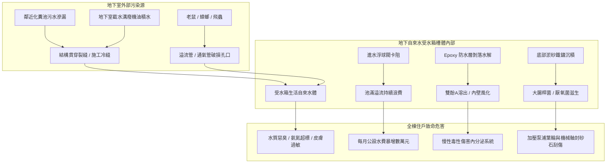
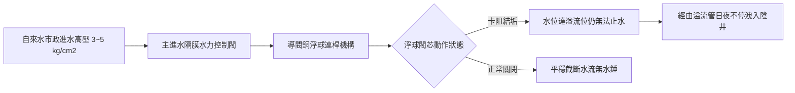
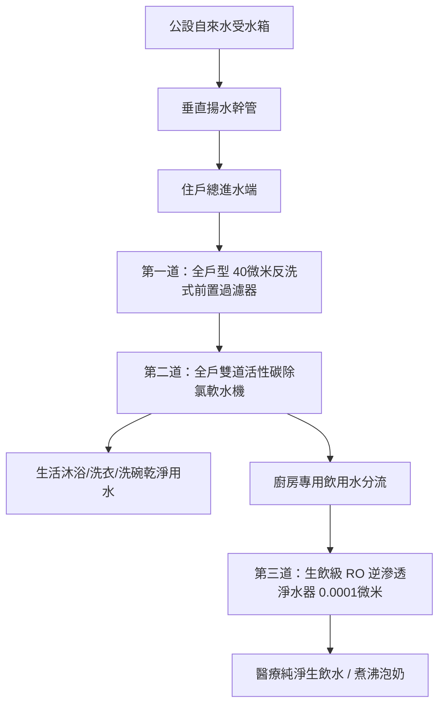

# 全案購屋實戰第五百五十四部_中古大樓社區地下室生活自來水受水箱蓄水池池體裂縫滲水進水浮球閥卡阻無效溢流管防蟲網破裂與水質二次污染體檢工序全書

---

## 序章：都會高樓自來水之起點——地下受水箱之隱密危機

在台灣集合住宅大樓之給水工程設計中，自來水公司之市政自來水幹管通常先引入建築物地下室最底層之「**地下自來水受水箱（Suction Tank / Cistern）**」，再藉由二次加壓揚水泵浦將水源輸送至各樓層住戶或頂樓蓄水池。

地下受水箱深埋於大樓地下室地底或基礎結構底板（Raft Foundation）之深處，屬於最容易被住戶忽視、卻也是整棟建築衛生安全與水質安全最脆弱之致命環節。在屋齡 20 至 30 年以上之中古大樓社區中，受水箱常見以下四大致命隱患：
1. **箱體混凝土裂縫與外部地下水/污水反滲**：受震災（如 921 地震）微裂縫及混凝土碳化中性化影響，池壁防水層完全失效，鄰近地下化糞池或雨水排溝之高污染廢水透過毛細孔與貫穿裂縫滲入自來水箱，導致大腸桿菌群與氨氮嚴重超標。
2. **機械式進水浮球閥（Float Control Valve）連桿變形卡阻失靈**：水壓推力、水垢沉積與銅連桿鏽蝕疲勞，導致浮球浮起時活塞閥芯無法閉合，大量自來水持續外溢狂流，每月白白浪費數萬元水費公攤。
3. **溢流管（Overflow Pipe）與通氣管（Vent Pipe）防蟲金屬網罩鏽蝕破裂**：地下室蚊蠅、蜚蠊（蟑螂）、鼠類經由破裂孔隙爬入水箱內溺斃腐爛，滋生致病菌與屍毒。
4. **水箱底板沉砂積垢與內襯環氧樹脂（Epoxy）剝落**：原塗布之環氧樹脂防水層長年水解起泡剝落，雙酚 A（Bisphenol A）化學物質溶出，底板沉積厚達數公分之重金屬鐵鏽與黃泥淤沙，成為病菌大量繁殖之溫床。

本全書將深入剖析地下受水箱之結構防水工法、浮球閥流力力學、水質二次污染機制，並建立一套現場實戰體檢工序，為購屋家庭徹底把關「全家人喝入口、洗在肌膚上」之用水品質與資產安全。

---

## 第一章：地下自來水受水箱結構與水質二次污染病理機制

### 第一節：混凝土池體結構裂縫與外水滲漏病理

1. **施工冷縫（Cold Joint）與穿牆套管微裂隙**：
   - 地下受水箱壁體與底板澆置混凝土時，若施工縫未設置鋼板止水帶（Steel Waterstop）或遇水膨脹止水條（Hydrophilic Waterstop），震動硬化後之交界面即為結構最薄弱之透水通道。
   - 自來水管、揚水管穿越池壁之穿牆套管（Wall-penetrating Sleeve）周遭，若無滿銲止水環（Seepage Ring）或無收縮水泥填塞密實，長年受溫差脹縮拉扯，套管邊緣即形成環狀滲漏縫隙。

2. **化糞池污水反向滲透之壓差危機**：
   - 老舊大樓地下室常將「自來水受水箱」與「化糞池/污水收集坑」相鄰配置，甚至僅隔一道單層混凝土隔牆（違反現行建築技術規則之「雙層壁隔開」防護法規）。
   - 當社區自來水受水箱抽水至低水位、而鄰近污水池處於高水位時，兩者形成可觀之水頭壓差（Hydraulic Head Gradient）。外部高污染污水透過混凝土微裂縫被強行吸入自來水箱中，造成極其嚴重之糞便源水質污染。

---

### 第二節：進水浮球閥機械疲勞卡阻與消能防震破壞

1. **水力導閥式浮球控制閥（Diaphragm Float Valve）之死穴**：
   - 大樓進水管徑通常為 3"~6"（DN80~DN150），無法單純依靠小型機械浮球力矩直接關閉大口徑高壓水流，必須採用「**隔膜式水力控制主閥（Hydraulic Diaphragm Valve）**」搭配小型銅導閥浮球。
   - **導閥針閥孔淤塞**：自來水中微小砂石、鐵鏽或水垢碎片卡入直徑僅 1~2mm 之導閥濾網與針閥（Needle Valve）節流孔，導致控制室壓力無法建立，主閥隔膜無法被水壓壓下閉合，進水口形成 24 小時無休止的大流量噴流。

2. **浮球銅球破裂進水下沉**：
   - 傳統黃銅或薄壁不鏽鋼浮球（Float Ball），因水面長期受進水湧浪之上下劇烈拍擊震盪，球體與連桿銲接頸部產生金屬疲勞裂痕。
   - 自來水逐漸滲入浮球內部，浮球因自重增加失去浮力而沉入水中，導閥永遠處於全開狀態，造成溢流槽持續排水。

---

### 第三節：溢流管防蟲網破裂與通氣孔生物污染

1. **通氣管（Air Vent Pipe）之呼吸效應**：
   - 當二次加壓揚水泵浦高速抽水時，水箱內部液位驟降，水箱必須透過頂部鵝頸彎管（Gooseneck Vent）迅速吸入大量外部空氣以維持大氣平衡；反之進水時則排出空氣。
   - 若通氣管頂部之 **SUS304 不鏽鋼防蟲網罩（Mesh Size $\ge 16\text{ 網目}$）** 因潮濕酸霧鏽蝕破裂或遭人為拆除，地下室飛行的蚊蚋、蛾蚋、甚至老鼠與蟑螂會在吸氣負壓下被直接吸入水箱內，於水面產卵孵化，造成全棟水質致命污染。

2. **溢流管（Overflow Drain）間接排水破口**：
   - 法規嚴格規定受水箱溢流管必須採「**間接排水（Indirect Waste Drainage）**」，管口必須高出地下室集水坑或排水溝格柵至少 15 公分以上之空氣間隙（Air Gap），嚴禁直接插入排水溝內。
   - 若施工單位便宜行事將溢流管直插污水溝，當地下室暴雨積水倒灌時，污水溝內之污泥、蟑螂與污水將沿著溢流管直接回吸倒灌入乾淨之自來水受水箱中。

---

## 第二章：現場看屋自來水受水箱七大實戰體檢工序

中古大樓看屋時，買方應強烈要求房仲協調管委會總幹事或機電廠商，開啟地下室自來水受水箱人孔蓋（Manhole）進行實地檢驗：

| 體檢步驟 | 檢驗標的與操作動作 | 合格標準 (Pass) | 潛在致命瑕疵 (Fail) | 修繕對策與預算評估 |
| :---: | :--- | :--- | :--- | :--- |
| **Step 1** | **人孔蓋密封與凸緣防護** 檢視水箱頂部人孔蓋構造與邊緣 | 人孔基座高出地坪 $\ge 15\text{ cm}$，附氣密橡膠墊圈與鎖定扣件 | 人孔蓋與地坪齊平（雨水廢水可直接漫入）、蓋板鏽穿無密封墊 | 重新施作加高鋼筋混凝土人孔基座與氣密蓋（約 15,000~28,000 元） |
| **Step 2** | **溢流管與通氣管防蟲網** 檢查鵝頸通氣管與溢流管出口網罩 | 採用細目 SUS304/316 防蟲網，網孔 $< 1.2\text{ mm}$，固定牢固 | 網罩破損失蹤、管口敞開、網面被蛛網油污堵塞 | 更換全不鏽鋼可拆洗式鵝頸防蟲通氣罩（約 2,500~5,000 元/座） |
| **Step 3** | **進水浮球主閥動作測試** 手動將浮球向上托起至水平位置 | 水力控制主閥於 3~5 秒內平穩完全閉合，出水口無殘流 | 浮球頂起後進水閥依然大量噴水、閥體漏水嘶嘶作響 | 拆解更換主閥隔膜片、疏通針閥導管或換整組浮球閥（約 8,000~18,000 元） |
| **Step 4** | **溢流口無外洩流水監控** 在未進水或進水停止時觀察溢流管口 | 溢流管口完全乾燥，無任何涓涓細流外洩痕跡 | 溢流管日夜不停排水、排水溝內長滿青苔水垢 | 徹底調校浮球關閉液位、更換閥座密封膠圈（約 3,000~6,000 元） |
| **Step 5** | **池壁防水層與裂縫檢視** 強力防爆手電筒照射池壁與天花板 | 內壁磁磚或食品級無溶劑 Epoxy 塗層平整無龜裂剝落 | 塗層大面積起泡脫落、混凝土粉化露筋、裂縫滲水 | 刮除舊塗層，全池施作食品級無毒聚脲/環氧樹脂防水（約 60,000~150,000 元） |
| **Step 6** | **底部沉積物與池底斜度** 觀察水箱底板是否有排泥洩水坑 | 池底平整或具備 1/50 洩水坡度，底部無泥沙、鐵屑泥 | 底板積聚數公分厚爛泥污垢、沉澱物泛黑發臭 | 委託專業領有執照廠商進行全池清洗消毒（約 8,000~15,000 元/次） |
| **Step 7** | **管委會法定水質檢驗報告** 查閱管理室近 1 年半年度自來水水質報告 | 大腸桿菌群、濁度、總菌落數、餘氯符合國家飲用水水質標準 | 無法提供報告、報告超標未複驗、蓄水池已逾 1 年未洗 | 責成管委會限期完成水箱清洗與合格檢測（列入契約點交前提） |

---

## 第三章：購屋決策與裝修前飲用水安全防禦矩陣

### 第一節：四大核心考慮物件之水質風險評估
1. **大安紫金城 13 樓（高樓層景觀戶）**：
   - 屋齡約 28 年，地下室受水箱結構與防水層多已進入老化疲勞期。
   - **防禦手段**：必須向管委會調閱「一年兩次清洗蓄水池水塔之施工照片與水質檢驗報告」。裝修時於室內冷熱水幹管全面配置全戶濾淨系統。
2. **長億南園 8 樓（超大空間戶）**：
   - 社區量體較大，水箱儲水量大，若進水浮球閥卡阻洩漏，水費分攤金額將極為驚人。
   - **查核要點**：查核管理費財務收支明細表中「公設水費」項目是否有異常激增（正常中古社區單月公用水費應在 5,000~15,000 元以內，若單月突破 3~5 萬元即為水箱或地下管線嚴重漏水鐵證）。

### 第二節：成屋買賣水質與給水設備特約條款範本
> 「賣方保證本買賣標的物所屬社區之地下自來水受水箱、蓄水池及頂樓水塔，均符合建築技術規則與自來水法規之衛生安全標準，且管委會依規定每半年定期委託合格廠商完成清洗與水質檢驗（檢驗報告各項指標均應符合國家飲用水水質標準）。若交屋前查明社區自來水箱體存在結構滲漏、嚴重污染或已逾一年未實施清洗檢驗者，賣方應負責促成管委會於交屋日前完成清洗與合格檢測；否則買方得要求折讓價金新台幣貳萬元整，作為買方自行加裝全戶生飲級淨水防禦設備之補償。」
